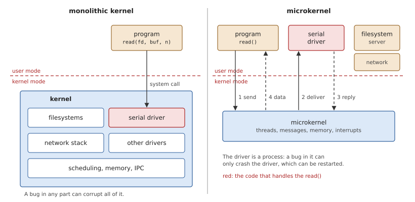

# Introduction

OsCraft is a real-time operating system built around a microkernel,
written in Rust, for 64-bit Arm (AArch64). It runs on QEMU's `virt`
machine.

Two older systems meet in it. Its kernel is a microkernel of the kind
QNX made well known: a small core that schedules threads by priority and
carries synchronous messages between processes, with everything else,
from file systems to the network stack, running as ordinary programs.
Its programs are FreeBSD's: OsCraft adopts FreeBSD's binary interface as
its own, so a program compiled for FreeBSD on AArch64 is a program for
OsCraft, and the C library, the shell, the utilities and even the
network stack are FreeBSD's code, built from FreeBSD's source.

The kernel's interface is also compatible with QNX OS 8.0, so OsCraft
can run QNX programs as well. That is an option, added on top by a
translation service. Nothing in the system depends on it: without it,
OsCraft contains no QNX code and needs none to build, boot or run.

This book explains how OsCraft works. Each chapter takes one part of the
system, first explains the problem that part solves and the ideas behind
its solution, and then shows how OsCraft implements it.

## Who this book is for

The book is for people who want to understand OsCraft well enough to
change it: contributors, students of operating systems who want to read
a complete microkernel system, and developers who know the programming
interface and want to know what happens below it. It assumes you can
read Rust and C, and know roughly what processes, threads, system calls
and page tables are. It explains the AArch64 features it uses where they
first matter.

## A microkernel

A kernel is the part of an operating system that runs with the
processor's full privilege: it can touch any memory and any device. What
belongs in it is the central design choice of an operating system.

In a *monolithic* kernel, as most desktop and server systems have, the
kernel contains nearly everything: process and memory management, but
also the file systems, the device drivers and the network stack. A
program asks for a service with a system call, and the kernel does the
work itself. That is fast, since a request costs one entry into the
kernel. But all of that code runs with full privilege, in one address
space. A bug in any driver can overwrite any kernel data and bring the
whole system down, and a driver cannot be restarted without restarting
the system.

A *microkernel* keeps in the kernel only what needs the privilege, and
moves everything else out, into ordinary processes. OsCraft's kernel
provides a small set of services: threads and scheduling, message
passing, synchronization, signals, clocks and timers, interrupts and
address spaces. Everything else is a *server*: an ordinary process in
user mode, protected from the others by its own address space. Programs
reach servers, and servers reach each other, by sending messages through
the kernel.

*Figure 1.1: The same `read()` in a monolithic kernel and in a
microkernel. In the microkernel the driver is a process, and the kernel
only carries the messages.*

A `read()` from a serial port, for example, is a message from the
program to the serial driver. The kernel copies the request to the
driver, the driver replies with the data, and the kernel copies the data
back. The kernel never knows it was a read, or that there is a serial
port. A driver that crashes takes only itself down. It can be started,
stopped, replaced and debugged like any program.

The price is speed: a request now takes two trips through the kernel, a
message and its reply, and a switch to another process and back. A
microkernel lives or dies by how cheap it makes those, which is why
OsCraft's message passing copies data once, directly from one address
space to the other, with no buffer in the kernel (Chapter 10).

## Real time

A *real-time* system is one whose correctness depends on *when* it
answers, not only on what it answers. A motor controller that computes
the right correction 50 ms too late has failed. Real time is not about
being fast on average. It is about being predictable: the time from an
event to the reaction must have a known upper bound, whatever else the
system is doing.

The main tool is *priority*. Each thread has a priority, and the
scheduler always runs the highest-priority thread that is ready, taking
the CPU away from a lower-priority one at once if it must
(*preemption*). The time a high-priority thread waits then depends only
on the work of higher priority, not on how busy the rest of the system
is.

The classic danger is *priority inversion*: a high-priority thread waits
for something a low-priority thread holds (a lock, or the attention of a
server), and a medium-priority thread, which needs neither, keeps the
low-priority one from running. The cure is *priority inheritance*: while
a thread holds something a higher-priority thread waits for, it runs at
the waiter's priority. OsCraft applies it to mutexes (Chapter 9) and to
messages, where a server runs at its client's priority (Chapter 10).

Other sources of unpredictability are subtler: a page fault that has to
find memory in the middle of a time-critical loop, a timer that fires
"soon after" its deadline by a variable amount, a lock that a CPU can be
starved of. The design principles below say how OsCraft avoids them.

## Two systems in one

An operating system has two faces. To a program, it is an *interface*:
the functions it can call, the structures it passes, the numbers that
mean "no such file". Inside, it is an *architecture*: how the work is
divided and scheduled. OsCraft takes each from a different tradition.

**The interface is FreeBSD's.** A compiled program depends on its
system's *application binary interface*, the ABI, down to the bit: the
layout of `struct stat`, the value of `ENOENT`, the numbering of
signals. OsCraft uses FreeBSD's throughout, in the kernel, in its
servers and in the messages between them. FreeBSD's C library is built
from its own source for the unchanged target `aarch64-unknown-freebsd`,
and so are its shell and utilities; a compiler that can target FreeBSD
on AArch64 can target OsCraft. Adopting a mature interface means that
decades of software, and of careful decisions about what a system call
should do in its corner cases, come with it.

**The architecture is a real-time microkernel's.** FreeBSD's own kernel
is monolithic. In OsCraft, the layer directly under FreeBSD's C library,
*libsys*, is new: where FreeBSD traps into its kernel, libsys makes
OsCraft kernel calls and sends messages to servers. Above that line the
code is FreeBSD's and does not know the difference. Below it, the system
is scheduled by fixed priorities, memory is never faulted in behind a
program's back, and a driver is a process.

Where FreeBSD's kernel has a large, well-tested subsystem that OsCraft
needs, OsCraft runs that code rather than rewriting it, inside a server:
FreeBSD's network stack, its PCI bus code and its USB stack are compiled
unchanged and run in user processes, on a thin layer that gives them the
kernel environment they expect (Part V).

**QNX compatibility is an option.** The kernel's calls and its message
passing follow the model of QNX's microkernel, closely enough that the
kernel can also serve programs built for QNX OS 8.0: their kernel calls
are answered with QNX's own numbers and structures, and a translation
service converts their messages for the native servers. QNX's programs
and libraries are not part of OsCraft. A user who has licensed them can
add them to an image, where they live in their own directory, and Part
VI explains how that works. Everywhere else, this book describes the
native system.

## Design principles

A few principles run through the whole code base, and explain many of
its details.

- **The system speaks FreeBSD.** Everything native uses FreeBSD's
  numbers and structures, with no translation. A plain name in the code
  is the native thing (`Stat`, `Termios`, `errno`); QNX's variant, where
  one exists, carries a prefix (`QnxStat`).
- **Determinism before speed.** Memory is backed when it is mapped,
  never faulted in later, so no page fault can steal time from a
  real-time thread (Chapter 16). Scheduling is strict priority with
  priority inheritance through messages and mutexes (Chapters 8 to 10).
  Timers fire on a tick grid that all CPUs share (Chapter 13). A faster
  but less predictable behaviour may exist only as an explicit option.
- **A board-independent kernel.** The kernel knows the AArch64
  architecture, not the machine it runs on. A separate program, the
  *startup*, runs first, finds the memory, the CPUs and the devices, and
  describes them to the kernel (Chapter 5).
- **Reuse what is proven.** FreeBSD's code is used as it is, from its
  own source tree, wherever it fits; what OsCraft adds is written in
  Rust.
- **Small, explained unsafety.** The kernel is Rust with `unsafe`
  limited to small blocks, each with a comment saying why it is sound
  (Chapter 4).

## How to read this book

*Table 1.1: The parts of the book.*

| Part | Covers |
|---|---|
| I. Overview | This introduction; the architecture at a glance; building, running and testing |
| II. The microkernel | The kernel's structure, boot, the AArch64 layer, kernel calls, threads and scheduling, synchronization, message passing, events, clocks and timers, signals, interrupts, memory, processes |
| III. Process 1 | The process manager, spawning and loading, the memory manager, the pathname manager, the built-in resource managers |
| IV. The native system | FreeBSD's ABI in the kernel, libsys, the native servers, the userland and the SDK |
| V. FreeBSD's kernel code in servers | bsdkern, the network stack, PCI, USB, disks and file systems |
| VI. QNX compatibility | The optional QNX personality, its translation service, and how it is measured |
| VII. Observing the system | Tracing, debugging and crash dumps |
| Appendices | Kernel-call numbers, error numbers, a source map, a glossary |

Read Part I first, in order. Chapter 2 is the map for everything after
it. Part II builds up from the hardware: each chapter uses the ones
before it, but starts by saying what it needs. The later parts assume
Part II. Appendix C maps every source file to the chapter that explains
it, so you can also start from a file.

### Conventions

- Each chapter starts with the ideas, independent of OsCraft, and then
  turns to the implementation. A reader who knows the theory can skip to
  the section named after OsCraft.
- `monospace` marks code, files, commands and identifiers. Source files
  are named by path from the repository root: `kernel/src/ker/msg.rs`.
- **Figures** carry much of the explanation; the text around a figure
  says what to look for in it.
- **Listings** are few, and are shown where the code itself is the
  clearest statement of a rule. They are included from the source files
  when the book is built, between named markers in the code
  (`// ANCHOR: name`), so a listing is always the code as it is.

> [!WARNING]
> A listing reflects the code as of the book's last build. If you change
> code between `ANCHOR` markers, re-read the text that explains it: the
> listing will follow automatically, the prose will not.
