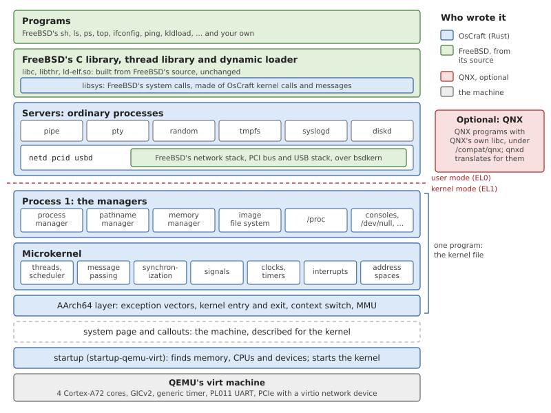
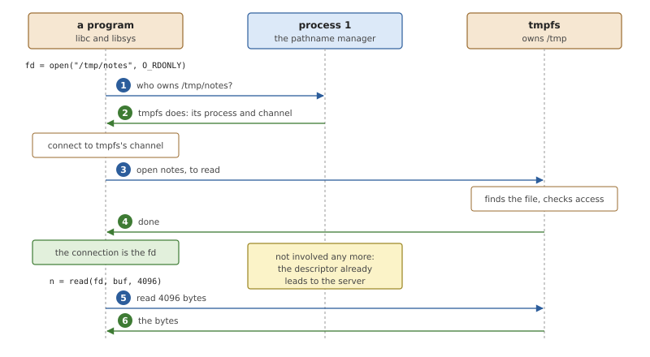
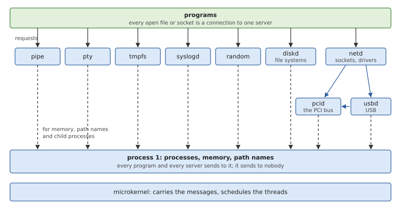

# The Architecture at a Glance

This chapter is the map of the system. It names every major part of
OsCraft, says what each is for, and follows one ordinary request, a
program opening a file and reading it, across all of them. The rest of
the book takes the parts one at a time; this chapter is where they fit
together.

## What a microkernel system needs

Moving the file systems, the drivers and the network stack out of the
kernel leaves a kernel that is easy to describe. It also raises
questions a monolithic kernel never has to answer, and the answers shape
every microkernel system in much the same way.

**Who manages processes and memory?** Creating a process, loading a
program into it and giving it memory are too involved to be single
kernel operations, and too privileged to leave to any server. They are
the job of one special process, the first in the system, which every
other process can always reach.

**How does a program find the server it needs?** In a monolithic kernel,
`open("/tmp/notes")` is a function call into the code that knows about
`/tmp`. In a microkernel the program must first learn which process that
is. The usual answer is a single tree of *path names* shared by the
whole system, in which each server claims the part it serves, and a
manager that can say who owns a given path.

**How do existing programs keep working?** Programs call `open()` and
`read()`; they do not send messages. A library underneath the standard
C functions has to turn each call into the right messages, so that
programs can be compiled unchanged.

**What decides the order of work?** With the system's code spread over
many processes, a single request passes through several of them. The
priority of the program that asked must travel with the request, or
real time is lost on the way.

OsCraft's answers are a first process with three managers, a path name
space, a system-call library under FreeBSD's C library, and message
passing that carries priorities. The next section shows where each one
sits.

## The layers of OsCraft



*Figure 2.1: A running OsCraft system, and who wrote each part. Only the
kernel file runs in the processor's kernel mode.*

Reading Figure 2.1 from the bottom:

**The machine** is QEMU's `virt`: four Cortex-A72 cores, 2 GB of memory,
an interrupt controller, a timer, a serial port, and a PCI Express bus
with a virtio network device on it.

**The startup** is the first program to run. It reads the machine's
description, sets up the memory and the other processors, and writes
down what it found in a structure called the *system page*, together
with a few small routines for this machine, the *callouts* (how to print
a character, how to acknowledge an interrupt). Then it starts the kernel
and is never run again. This split is what keeps the kernel free of any
knowledge of the machine: supporting another board means another
startup, not another kernel (Chapter 5).

**The kernel file** holds two things that are built and loaded as one
program. The *microkernel* is the small core: threads and their
scheduling, message passing, synchronization, signals, clocks,
interrupts and address spaces, on top of a layer of AArch64-specific
code. *Process 1* is the first process, whose threads run in kernel mode
too. It contains the three managers every other process depends on, for
processes, memory and path names, and a few simple servers that must
exist before any program can be loaded from a file, such as the one that
serves the files of the boot image (Part III).

**The servers** are ordinary processes. Some are small and written for
OsCraft in Rust: pipes, pseudo-terminals, the random device, a file
system in memory, the system logger. Three are larger and special in how
they are made: `netd`, `pcid` and `usbd` each hold a subsystem of
FreeBSD's kernel (the network stack, the PCI bus, the USB stack),
compiled from FreeBSD's source and running inside a process, on a layer
called *bsdkern* that supplies what that code expects of its kernel
(Part V).

**The C library** is FreeBSD's, with its thread library and dynamic
loader. The only part of it that is OsCraft's is the bottom layer,
*libsys*, where each FreeBSD system call is implemented with OsCraft
kernel calls and messages (Chapter 24).

**The programs** are FreeBSD's shell and utilities, built from their
source, and whatever else is compiled for FreeBSD on AArch64.

The optional QNX side of Figure 2.1 stands apart: QNX's programs, with
QNX's own C library, in a directory of their own. Part VI covers it.

## Opening a file

The best way to see the parts work together is to follow a request
through them. Take a program that opens a file in `/tmp` and reads it.
`/tmp` is served by `tmpfs`, the in-memory file system.



*Figure 2.2: `open()` asks the pathname manager which server owns the
path, then talks to that server. `read()` goes to the server directly.*

**Finding the server.** libsys does not know who serves `/tmp/notes`.
It asks the pathname manager in process 1, which every process has a
connection to from birth. Servers register the parts of the path name
space they serve when they start (`tmpfs` registered `/tmp`), so the
manager can answer with the server that owns the longest matching
prefix: its process and its channel. The manager opens nothing itself;
it only says where to go.

**Opening.** libsys connects to that channel and sends the server an
open request, with the rest of the path. The server finds the file and
checks that this user may read it. If it agrees, the connection stays,
and its number is what `open()` returns: the file descriptor *is* the
connection to the server.

**Reading.** `read()` is then a single message on that connection. The
server replies with the bytes, which the kernel copies straight into the
program's buffer. Process 1 takes no part, and neither does any table of
open files in the kernel, because there is none. What the kernel knows
about the open file is one connection; everything else about it, down to
the current position, is state inside the server.

The same three steps serve everything that has a name: a device in
`/dev`, a socket, a pipe. Chapter 10 explains the messages, Chapter 21
the name space, and Chapter 24 what libsys does for each system call.

## Who talks to whom

Synchronous messages impose an order on a system: if two servers could
each wait for the other, they could wait for ever. So requests only flow
one way, from programs down towards the servers closest to the kernel.



*Figure 2.3: Requests flow downwards. Solid arrows are the messages of a
server's clients; dashed arrows are what every process asks of
process 1.*

- **Programs** send to whichever server owns the file, socket or device
  they have open.
- **Servers** mostly stand alone. The exceptions are the drivers:
  `netd`, which holds network drivers, asks `pcid` where a PCI device's
  registers and interrupt are, and asks `usbd` to run transfers for a
  USB network adapter; `usbd` in turn asks `pcid` about its controller.
  A driver maps its device's registers and receives its interrupts
  itself; no data passes through `pcid`.
- **Process 1** is at the bottom. Every process sends to it, for memory,
  for path names and to create other processes, and it never sends a
  request to anyone, so it can never be caught waiting.

When something must travel upwards, for instance a server telling a
program that data has arrived, it goes as a small message that does not
block the sender, a *pulse* (Chapter 11).

## From power-on to a prompt

A boot shows the parts appearing in the order of Figure 2.1.

*Listing 2.1: A boot in QEMU, abridged. The first lines are the
startup's, the next the kernel's, and the last the boot script's.*

```text
QEMU virt: 4 CPUs, 2048 MB of RAM
GICv2: 288 interrupts, SPIs to CPU interface 0
Loaded /proc/boot/kernel, entry 0xffffff8060100010
OsCraft kernel 0.1.0 on CPU 0
system page at 0xffffff8040205000: type 0x1101, version 2.0, 3224 bytes, 4 CPUs
exceptions: vectors at 0xffffff80601a9800, self-test ok
pmem: 1844 MiB free in 3 ranges
clock: 1000 Hz tick on vector 27 (62500000 Hz counter), clock priority 254
smp: 4 of 4 CPUs online
kernel: running the boot script
bootscript: started pipe as process 2
bootscript: started random as process 3
bootscript: started pty as process 4
bootscript: started tmpfs as process 5
bootscript: started syslogd as process 4102
bootscript: started netd as process 8199
bootscript: started pcid as process 8200
pcid: FreeBSD's PCI bus is up on 4 CPUs
bootscript: started /sbin/ifconfig as process 20489
bootscript: started /bin/sh as process 28681
bootscript: done
#
```

1. **The startup** describes the machine and loads the kernel.
2. **The kernel** reads the system page, takes over memory, starts the
   clock and the other processors, and brings up process 1.
3. **The boot script**, a short list of commands stored in the boot
   image, is run by process 1. It starts the servers in order, each one
   once the names of those before it exist. It then loads the network
   driver into `netd` as four modules, with FreeBSD's `kldload`, and
   configures the interface with FreeBSD's `ifconfig`.
4. **The shell**, FreeBSD's `sh`, gets the console.

Everything in the system at that point came from one file, the boot
image, which holds the startup, the kernel, the script and a small
read-only file system. Chapter 3 shows how it is built.

## Personalities

The kernel serves two kinds of program, and calls the difference a
*personality*. A process's personality is decided when its program is
loaded, from a field in the program file that names the operating system
it was built for.

A **native** process is a FreeBSD program. The kernel's results come to
it in FreeBSD's structures and numbers, with no conversion anywhere.

A **QNX** process is the optional case. The kernel answers its calls in
QNX's structures and numbers, converting at the boundary; path names it
opens are looked up first under `/compat/qnx`, where QNX's own libraries
and tools are installed if the image has them; and its messages to the
native servers pass through a translation service, `qnxd`.

Both kinds run on the same kernel objects: the same threads, channels,
timers and address spaces. What differs is confined to one directory of
the kernel's source (`kernel/src/personality/`) and to the translation
service. Chapter 23 describes the native personality, Part VI the QNX
one.

## Where things are

*Table 2.1: The source tree.*

| Path | Contents |
|---|---|
| `kernel/src/` | the kernel: scheduler, clock, SMP, the system page |
| `kernel/src/arch/aarch64/` | everything specific to the processor architecture |
| `kernel/src/ker/` | the kernel calls: channels, messages, synchronization, signals, timers, threads, interrupts |
| `kernel/src/proc/` | process 1's managers and built-in servers |
| `kernel/src/vm/` | physical memory, address spaces, mappings |
| `kernel/src/personality/` | what differs between native and QNX processes |
| `startup/` | the startup library and its board for QEMU's virt |
| `user/libsys/` | FreeBSD's system calls as kernel calls and messages |
| `user/proto/` | the layouts of kernel-call arguments and messages |
| `user/kercall/`, `user/resmgr/` | what a native server is written with: the kernel calls and the server framework |
| `user/pipe/`, `user/pty/`, `user/random/`, `user/tmpfs/`, `user/syslogd/` | the small native servers |
| `user/bsdkern/` | the kernel environment for FreeBSD's kernel code in a process |
| `user/netd/`, `user/pcid/`, `user/usbd/` | the servers built on it |
| `user/diskd/` and its libraries | block devices and file systems |
| `user/qnxd/`, `user/qnxabi/` | the QNX translation service and its conversions |
| `images/` | what goes into the boot image |
| `tests/` | the test suite and its programs |
| `tools/` | the image builder, the QEMU launcher, the test runner, FreeBSD's build scripts |

FreeBSD's own source is not in the repository. It is a separate
checkout, a fork of FreeBSD's stable branch with a handful of patches,
from which the C library, the programs and the kernel subsystems are
built (Chapter 26).

## Summary

- Only the kernel file runs in kernel mode: the microkernel and process
  1, whose managers handle processes, memory and path names.
- Every other service is a server, an ordinary process. Some are written
  for OsCraft; the largest run FreeBSD's kernel code unchanged.
- Programs are FreeBSD programs. Under FreeBSD's C library, libsys turns
  system calls into kernel calls and messages.
- A program finds a server by path name, through the pathname manager,
  once per `open()`. After that the file descriptor is a connection to
  the server, and the kernel only carries messages.
- Requests flow one way, down towards process 1, which waits for nobody.
- The kernel can also serve QNX programs, as a separate personality with
  its own translation service. The native system does not depend on it.
