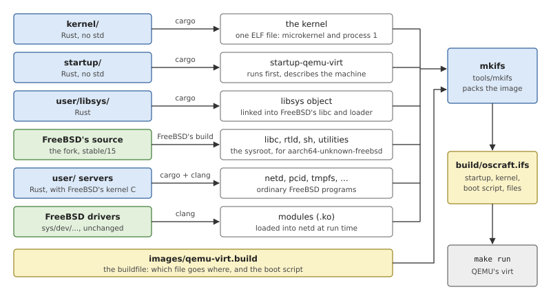
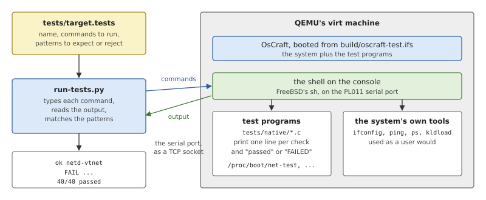

# Building, Running and Testing

This chapter is the practical one of Part I: what a bootable OsCraft
system consists of, how it is built from source, how to run it in QEMU,
and how the test suite checks it. The commands are run from the root of
the repository.

## From source to a running system

An operating system cannot be started the way a program is: nothing is
running yet that could load it. What the machine starts with is one
file, the *boot image*, placed in memory by whatever comes before
(firmware, a boot loader, or here the emulator). Everything needed until
the system can read files by itself has to be inside that image.

A boot image for a microkernel system therefore holds more than a
kernel:

- the **startup** program, which runs first and prepares the machine;
- the **kernel**;
- a **boot script**: the commands that start the first servers, since
  there is no shell yet to read a configuration from, and no file system
  to read it with;
- a small read-only **file system** with the programs and libraries the
  script needs, and whatever else the system should have from the start.

On a board with a disk the image would hold just enough to reach the
disk. OsCraft on QEMU has no disk yet, so its image holds the whole
system, and the process manager serves the image's files read-only once
the system runs.

Building OsCraft means building each of those pieces, each with the tool
that suits it, and packing them into the image.



*Figure 3.1: What is built from what. Blue boxes are OsCraft's own
source, green ones FreeBSD's.*

The pieces differ in what they are compiled *for*, which is why there
are several toolchains:

- **The kernel and the startup** run on the bare machine. They are Rust
  without the standard library, compiled for a target with no operating
  system and no floating point (`aarch64-unknown-none-softfloat`): the
  kernel does not use the floating-point registers, so it never has to
  save them on its own behalf.
- **FreeBSD's userland**, the C library, the dynamic loader, the shell
  and the utilities, is built by FreeBSD's own build system from a
  checkout of FreeBSD's source, for FreeBSD's usual target,
  `aarch64-unknown-freebsd`. The result is a *sysroot*: the headers and
  libraries a compiler needs to build programs for the system.
- **libsys** is compiled first, as one object file, because FreeBSD's
  build links it into the C library and the loader in place of FreeBSD's
  own system-call stubs.
- **The servers** are ordinary programs for the system: Rust with the
  standard library, linked against that sysroot. Those that carry
  FreeBSD kernel code (`netd`, `pcid`, `usbd`) also link a library of
  that code, compiled with FreeBSD's kernel build machinery.
- **Driver modules** are FreeBSD kernel source compiled as shared
  objects, loaded into a server at run time (Chapter 28).

The image builder, `mkifs`, is OsCraft's own tool (`tools/mkifs`). It
reads a text file, the *buildfile*, that lists the startup and the
kernel with their options, the boot script, and every file of the
image's file system with the path it should have.

## Building OsCraft

### What the host needs

OsCraft is built on Linux. The host needs Rust (the toolchain is pinned
by `rust-toolchain.toml`, plus a nightly for libsys and the servers),
`clang` and `ld.lld`, `qemu-system-aarch64`, Python 3, and a checkout of
FreeBSD's source beside the repository. `docs/setup.md` has the full
recipe, and one command checks the host and says what is missing:

```sh
make doctor
```

FreeBSD's source and build tools are set up once:

```sh
make freebsd-bootstrap
```

### The build

After that, `make` does everything, and `make run` also boots the
result:

```sh
make run          # build the image and boot it in QEMU (Ctrl-A X quits)
```

The first build takes a while, because it builds FreeBSD's C library and
utilities; later builds only redo what changed. The main targets are:

*Table 3.1: The Makefile's main targets.*

| Target | Builds |
|---|---|
| `kernel` | the kernel (`PROFILE=release` for the optimized one) |
| `startup` | the startup for QEMU's virt |
| `libsys`, `freebsd-libs`, `freebsd-progs` | libsys, then FreeBSD's libraries and programs, in that order |
| `native` | the servers |
| `netd-mods` | the modules of `netd`: the network driver, the firewall |
| `image` | all of the above and the boot image, `build/oscraft.ifs` |
| `sdk` | a toolchain package for building programs out of tree (Chapter 26) |
| `clippy` | the kernel's lints |

### The buildfile

The image is described by `images/qemu-virt.build`. It has three kinds
of entry. The first names the programs the machine boots with, and their
options:

*Listing 3.1: The programs the machine boots with (`images/qemu-virt.build`).*

```text
{{#include ../../../images/qemu-virt.build:boot}}
```

The second is the boot script, the commands process 1 runs once the
kernel is up. Each line starts a program; `&` leaves it running in the
background, and `waitfor` holds the script until a path name exists (for
at most the given number of seconds), which is how the script knows a
server is ready. This is the part that starts the network:

*Listing 3.2: The part of the boot script that brings up the network (`images/qemu-virt.build`).*

```text
{{#include ../../../images/qemu-virt.build:script_network}}
```

The rest of the file is the file system, one line per file: the path in
the image, and where the file comes from on the host.

```text
/bin/sh=${OSCRAFT_FREEBSD_BIN}/sh
/proc/boot/netd=${OSCRAFT_NATIVE}/netd
/boot/modules/if_vtnet.ko=${OSCRAFT_FREEBSD_DIR}/mods/if_vtnet.ko
```

The Makefile sets the `${...}` variables to its build directories. The
optional QNX personality is a second buildfile, `images/qnx.build`,
appended to the first when the build is run with `QNX=1` (Part VI).

## Running in QEMU

QEMU is an *emulator*: a program that imitates a complete computer, its
processors, memory and devices, in software. Its `virt` machine is not a
model of any real board. It is a simple, well-documented machine made
for running operating systems in emulation, which makes it a good first
target: a kernel bug can be caught with a debugger attached to the
emulator, and every developer has the same hardware.

`make run` starts it through a small script:

*Listing 3.3: Booting the image in QEMU (`tools/qemu/run.sh`).*

```bash
{{#include ../../../tools/qemu/run.sh:qemu_exec}}
```

QEMU loads the image into the machine's memory and jumps to it, with
the address of a description of the machine, a *device tree*, in a
register. That description is what OsCraft's startup reads (Chapter 5).
The script also adds a virtio network device on QEMU's built-in
user-mode network, which gives the guest a private network with a
gateway to the host's.

After the boot messages of Listing 2.1, the console has a shell:

```text
# uname -a
OsCraft oscraft 0.1-FREEBSD15 OsCraft kernel, FreeBSD 15 userland arm64
# ps ax
  PID   TT  STAT    TIME COMMAND
    1    -  RLs  0:39.12 kernel -v
    2    -  Ss   0:00.11 pipe
    3    -  Ss   0:00.09 random
    4    -  Ss   0:00.06 pty
    5    -  Ss   0:00.19 tmpfs -m 1777 /tmp -m 755 /var
 4102    -  Ss   0:00.14 syslogd
 8199    -  Ss   0:01.34 netd
 8200    -  Ss   0:00.79 pcid
28681 text  Ss+  0:00.19 /bin/sh
# ping -c 1 10.0.2.2
...
1 packets transmitted, 1 packets received, 0.0% packet loss
```

These are FreeBSD's `uname`, `ps` and `ping`. `ps` shows the whole
system of Chapter 2 as processes: process 1, named `kernel` after its
file, and the servers the boot script started. `10.0.2.2` is QEMU's
gateway, reached through the virtio network driver in `netd`.

`make debug` boots the same image but has QEMU wait for a debugger on
port 1234, to debug the kernel itself (Chapter 36).

## Testing

### Testing a whole system

Most of what an operating system does can only be observed from inside
it: whether `fork()` returns twice, whether a timer fires on time,
whether a socket delivers its bytes. Unit tests on the build host reach
little of that. So OsCraft is tested mainly as a whole: the image is
booted in the emulator, and a program on the host plays the user,
typing commands on the console and checking what comes back.

Two kinds of command are typed. *Test programs* are small C programs
written for the purpose, each exercising one area through the ordinary
programming interface and printing a line per check. And the *system's
own tools* are used as a user would use them, which tests the tools, the
libraries and the servers together.



*Figure 3.2: The test runner drives the booted system through its
serial console.*

### The suite

`make test` builds a second image, `build/oscraft-test.ifs`, which is
the system plus the test programs (`tests/native/image.build` is
appended to the buildfile), boots it, and runs the tests listed in
`tests/target.tests`:

```sh
make test                     # the whole suite, on the debug kernel
make test PROFILE=release     # the same on the optimized kernel
make test TESTS="netd-vtnet"  # only the named tests
make test STOP=1              # stop at the first failure
```

A test is a few lines: the commands to type, patterns its output must
match, and patterns it must not.

```text
name: netd-vtnet
timeout: 40
run: /sbin/ifconfig vtnet0 | /usr/bin/grep -E "flags=|ether|inet "
run: /sbin/ping -c 3 -t 10 10.0.2.2 > /dev/null; echo ping=$?
run: /proc/boot/vtnet-test; echo rc=$?
expect: ^vtnet0: flags=.*<UP,BROADCAST,RUNNING,
expect: ^ping=0$
expect: ^vtnet: passed$
reject: panic|not implemented|FAILED
```

The runner prints one line per test and a count at the end. A change is
not finished until the suite passes on both the debug and the release
kernel: the two differ a great deal in timing, and races show up in one
that hide in the other.

*Table 3.2: What tests what.*

| Command | Boots | Runs |
|---|---|---|
| `make test` | OsCraft, with the native test programs | the native tests |
| `make test QNX=1` | the same, plus the QNX personality and QNX's test programs | the native tests and the QNX tests |
| `make qnx-test` | QNX's own kernel, on the same machine | the QNX tests, as the reference |

The last two need the QNX development kit and are only relevant to the
QNX personality: its tests are run on QNX's own kernel as well, and
their expected results are what that kernel does (Chapter 34).

Parts of the tree that can be tested on the host have ordinary unit
tests as well: the image builder (`cargo test -p mkifs`) and the startup
library (`make -C startup test`).

## Summary

- A boot image holds the startup, the kernel, a boot script and a small
  file system; on QEMU it holds the whole system.
- The kernel and the startup are bare-metal Rust. The userland is
  FreeBSD's, built by FreeBSD's build system from its source, with
  libsys linked into the C library. The servers are programs for that
  userland.
- `images/qemu-virt.build` says what goes into the image and what the
  boot script runs; `mkifs` packs it.
- `make run` boots the image in QEMU's `virt` machine, with a virtio
  network device.
- `make test` boots the system with the test programs added and drives
  it through its console; a change must pass on the debug and the
  release kernel.
