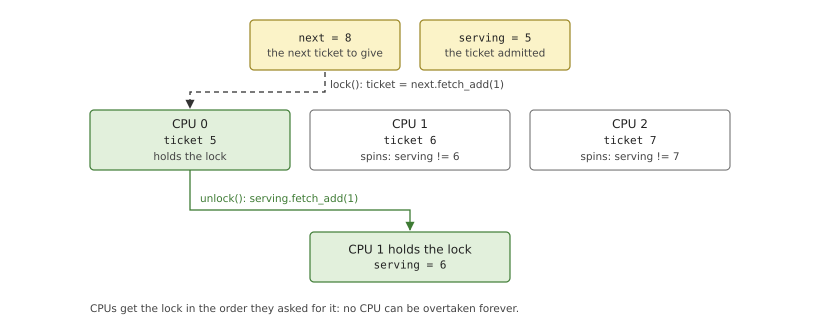
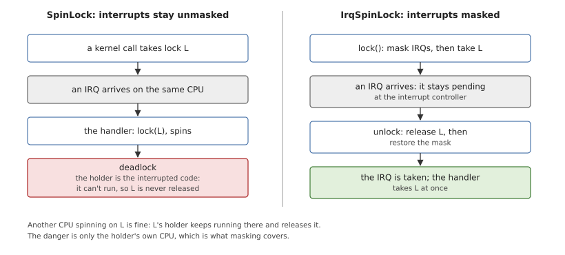
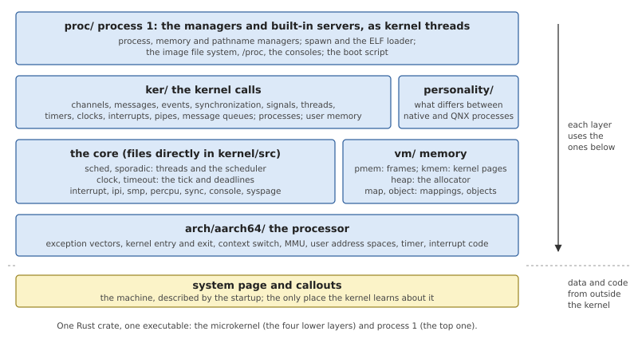
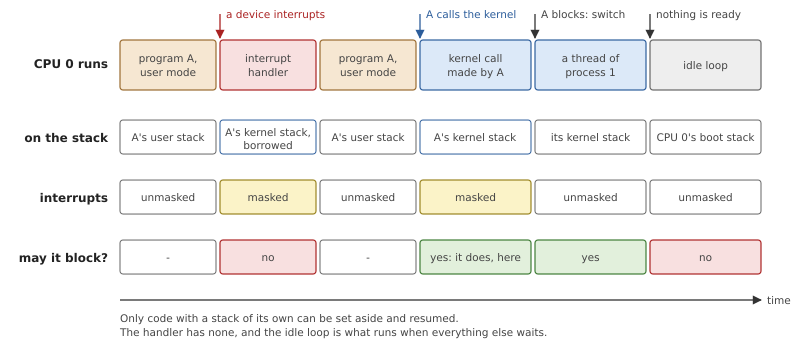
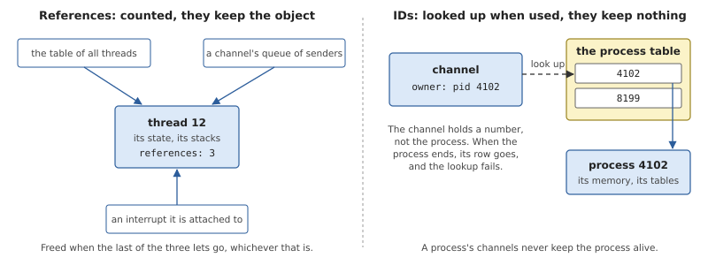
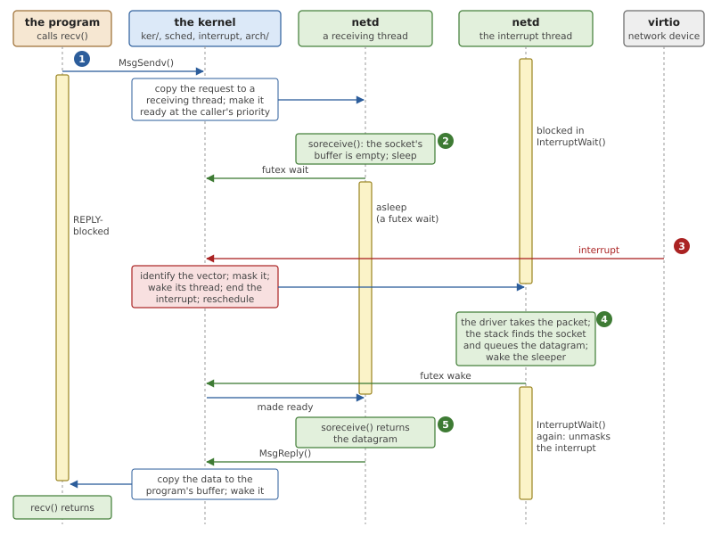

# The Shape of the Kernel

The chapters after this one take the kernel apart, one mechanism at a
time. This one comes first because a few questions apply to all of them:
how the code is layered, which code is allowed to wait, how data shared
between processors is protected, and who decides when an object may be
freed. The chapter ends by following one blocked `recv()` on a network
socket through the layers, to show what each of them contributes.

## What every kernel has to settle

### Who may wait

The most useful question to ask about a piece of kernel code is: *may it
block?* To block is to stop here, let the processor run something else,
and continue later from the same point. That takes a place to keep what
was being done: a stack with the calls in progress, and a copy of the
registers. A *thread* has both, so the scheduler can set it aside and
resume it.

An *interrupt handler* has neither. It runs when a device asks for
attention, on top of whatever the processor was doing, using the stack
of the thread it happened to interrupt. If the handler waited, there
would be nothing to resume it by, and the interrupted thread could not
continue until the handler had finished. So a handler never blocks. It
does the least it can, usually making a thread ready that will do the
real work, and returns.

Kernel code therefore runs in a small number of *execution contexts*,
and what a function may do depends on the context it is called in. Code
that can be reached from an interrupt handler must not wait for
anything, and that includes waiting for a lock in the ordinary sense.

### Sharing data between processors

On a multiprocessor, several processors run kernel code at the same
time, often on the same data. Adding a thread to a queue is several
steps: read the head, link the new element to it, write the new head. If
two processors interleave those steps, one update overwrites the other
and the queue is corrupt. A stretch of code that must not interleave
with itself is a *critical section*, and a *lock* admits one processor
at a time to it.

There are two ways to wait for a lock that is taken. A *sleeping lock*
blocks the waiting thread, which is worth the cost of two thread
switches when the lock may be held for long. A *spinlock* simply tries
again in a loop until the lock is free. Spinning wastes the processor
while it lasts, but it costs nothing to start, and it works where
blocking is impossible. A kernel whose critical sections are a few dozen
instructions long spins.

The simplest spinlock is a flag that a processor sets, atomically, if it
finds it clear. It is unfair: when the lock is released, whichever
processor tries first gets it, and an unlucky one can lose every race
and wait without limit. A real-time system cannot accept a wait with no
bound. A *ticket lock* gives one, in the way a shop counter does: each
arriving processor takes the next number, and numbers are served in
order.



*Figure 4.1: A ticket lock with three processors. Each takes a ticket;
the one whose ticket equals `serving` holds the lock, and releasing it
admits the next number. The longest wait is one critical section for
each processor ahead.*

Interrupts add a danger that has nothing to do with other processors.
Suppose a kernel call takes a spinlock, and an interrupt arrives on the
same processor before the lock is released. If the handler needs the
same lock, it spins. But the holder of the lock is the very code the
handler interrupted, which cannot run again until the handler returns.
The processor has deadlocked with itself.



*Figure 4.2: A handler that needs a lock held by the code it interrupted
waits for ever. If interrupts are masked while the lock is held, the
interrupt waits instead, and is taken when the lock is free.*

The cure is to *mask* interrupts, that is, to tell the processor to hold
them back, for as long as such a lock is held. This is one more reason
for critical sections to be short: while one runs, the processor does
not answer interrupts.

When code needs two locks, order matters as well. If one processor holds
A and waits for B while another holds B and waits for A, both wait for
ever. The usual discipline is to fix an order in which any two locks are
taken, or to avoid holding two at once.

### Who frees an object

A kernel object such as a thread is in use in several places at once: in
a table of all threads, in the queue of a channel it is waiting on, in
the record of an interrupt it has attached to. It may be freed only when
none of them needs it any longer, and none of them knows when that is.

*Reference counting* settles it without anyone having to know. The
object carries a count of the references to it; taking a reference adds
one, dropping one subtracts one, and the object is freed when the count
reaches zero. The count must be updated atomically, since references are
taken and dropped on several processors at once.

A reference keeps its object alive, which is sometimes exactly what must
not happen. If a client's connection held a reference to a server
process, the server's memory could not be released while any client
remained. The alternative is to hold the object's *identifier*, a
number, and look it up each time it is used. The lookup fails cleanly
once the object is gone.

## The shape of OsCraft's kernel

### Layers

The kernel is one Rust crate, `kernel/`, built into one executable. It
contains both the microkernel and process 1, and its modules form
layers.



*Figure 4.3: The kernel's source, by layer. A layer calls the ones below
it. The machine appears only at the bottom, as data and code that the
startup supplied.*

- **`kernel/src/arch/aarch64/`** holds everything that depends on the
  processor: the exception vectors, the way into and out of the kernel,
  the context switch, the MMU and user address spaces, the timer, and
  the code that asks the interrupt controller which interrupt fired
  (Chapters 6, 15 and 16). Nothing above this layer contains assembly or
  touches a system register.
- **The core** is the set of files directly in `kernel/src/`: per-CPU
  data, locks, the system page, the console, interrupt dispatch, starting
  and signalling the other processors, the scheduler and the clock
  (Chapters 5, 8 and 13).
- **`kernel/src/vm/`** manages memory: page frames, the kernel's own
  pages and heap, mappings and the memory objects behind them
  (Chapter 16).
- **`kernel/src/ker/`** holds the kernel calls, one module for each
  group (Chapter 7), together with the process structure and the access
  to user memory. **`kernel/src/personality/`** sits beside it with the
  few things that differ between a native process and a QNX one
  (Chapter 23 and Part VI).
- **`kernel/src/proc/`** is process 1: a set of threads that receive
  messages and answer them, like any server, but inside the kernel
  (Part III). They reach message passing through the same kernel calls
  as a user process, and the rest of the kernel through ordinary
  function calls.

No layer knows the machine. What the startup found is in the system
page, and code written for the machine runs only as callouts that the
startup provided (Chapter 5).

### Execution contexts

Kernel code runs in five contexts, and Figure 4.4 shows four of them
passing over one processor.



*Figure 4.4: What one CPU runs over time, on which stack, and whether
that code may block. The interrupt handler borrows the kernel stack of
the thread it interrupted.*

*Table 4.1: The contexts kernel code runs in.*

| Context | Stack | Interrupts | May block? | Examples |
|---|---|---|---|---|
| boot, until the CPU becomes idle | the boot stack | masked until the last steps | no | `kmain()`, `kmain_ap()` |
| a kernel call | the calling thread's kernel stack | masked, except at preemption points | yes | every handler in `kernel/src/ker/` |
| an interrupt handler | the interrupted thread's kernel stack | masked | no | the clock tick, interrupt delivery |
| a kernel thread | its own kernel stack | unmasked | yes | process 1's servers, the boot script |
| the idle loop | the CPU's boot stack | unmasked | no | `sched::idle()` |

Three things follow from the table.

**A kernel call runs with interrupts masked.** The processor masks them
when it takes the exception that enters the kernel, and the kernel
leaves them so. A kernel call is therefore not interrupted half-way
through, and most of them are short enough for that not to matter. The
exception is a long copy of a message. Between pieces of such a copy,
where it holds no lock, the kernel passes a *preemption point*: it
unmasks interrupts for an instant, and switches threads if one of higher
priority has become ready. So the time for which a kernel call can delay
an interrupt is bounded by the longest stretch between two such points,
not by the size of a message.

**Process 1's threads can be preempted like user threads.** A kernel
thread starts with interrupts unmasked. A long request to process 1,
such as creating a process and loading a large program into it, delays
neither interrupts nor threads of higher priority. When such a thread
needs message passing it makes a kernel call, with the same instruction
a user thread uses, and is then in the second row of the table.

**An interrupt handler may not do everything.** It may take locks,
because every lock it could meet masks interrupts, and it may wake
threads. Work that could wait or take long, such as creating a thread on
a program's request, is handed to a kernel thread. The handler's CPU
records that it is in a handler, so that shared code can tell.

### Locks

All of the kernel's locks spin, and they are defined in
`kernel/src/sync.rs`. The basic one is the ticket lock of Figure 4.1.

*Listing 4.1: The ticket spinlock (`kernel/src/sync.rs`).*

```rust
{{#include ../../../kernel/src/sync.rs:spin_lock}}
```

- `next.fetch_add(1)` takes a ticket: it returns the old value and adds
  one, atomically, so no two CPUs get the same number. The CPU then
  spins until `serving` reaches its ticket.
- Releasing the lock is `serving.fetch_add(1)`, done when the guard that
  `lock()` returned goes out of scope. The protected value can be
  reached only through that guard, so a lock cannot be left held on an
  early return, and the value cannot be touched without the lock.
- The value sits in an `UnsafeCell`, Rust's marker for data changed
  through a shared reference, and the `unsafe impl Sync` states the
  claim that the lock, not the type system, makes this sound.

`SpinLock` does nothing about interrupts, and the kernel never uses it
by itself. The lock used everywhere is `IrqSpinLock`, which wraps it:
`lock()` first masks interrupts on this CPU, remembering whether they
were masked before, and then takes the ticket lock. Its release is the
one place where the order of two lines carries the whole argument of
Figure 4.2.

*Listing 4.2: Releasing an `IrqSpinLock`: the lock first, then the
interrupt mask (`kernel/src/sync.rs`).*

```rust
{{#include ../../../kernel/src/sync.rs:irq_guard_drop}}
```

In the other order an interrupt could arrive between the two steps, with
the lock still held, and its handler could spin on it. Because the
earlier state of the mask is restored, not simply cleared, these locks
nest: releasing an inner one leaves interrupts masked for the outer one.

The third primitive, `InitOnce`, is for values written once during boot
and only read afterwards, such as the system page and the table of
interrupt controllers. Its state goes from empty to being written to
ready; a reader checks for ready with one atomic load and takes no lock,
which is what lets interrupt handlers read such values freely.

The code built on these locks keeps a few rules.

- **A lock is held briefly, and never across a wait.** A thread that is
  about to block releases the lock of the thing it waits on first. The
  queue of waiters lives inside that thing, under the same lock, so the
  thread that will wake it finds it there.
- **Locks are small.** There is no lock for a whole process or a whole
  thread. Each table has its own lock (the ready queue, the table of
  threads, the table of processes), each channel has one for its queues
  (Chapter 10), and a field that changes by itself is an atomic value
  with no lock at all.
- **Order is decided locally.** Where code needs two locks, a comment
  beside it gives the order; where two paths would want opposite
  orders, the code takes the locks one after the other instead of
  together.
- **Per-CPU data needs no lock.** Each CPU has a structure of its own,
  found through a register reserved for it. A kernel call stays on its
  CPU until it blocks or passes a preemption point, so what it reads
  there stays true in between.

### Objects and references

Long-lived kernel objects are reference-counted with Rust's `Arc`, an
atomically counted pointer: threads, processes, channels, connections
and memory objects. A table of all threads and a table of all processes
each hold one reference for as long as the object exists; queues and
other objects hold more while they need it.



*Figure 4.5: A thread stays allocated while anything holds a reference
to it. A channel names its owner by process ID, so it keeps nothing
alive.*

Code that runs *as* a thread needs no counting to reach itself.
`sched::current()` returns a plain reference to the running thread, and
through it to its process: neither can go away while the thread is
running in it.

Where keeping an object alive would be wrong, the kernel holds an ID. A
channel records the process that owns it as a process ID. If it held a
reference, every client connected to a server would keep the server's
process structure allocated after the server had ended. With an ID, the
kernel looks the process up when it needs it, and the lookup fails once
the process is gone.

### Conventions

A few habits recur in every module, and knowing them makes the listings
in later chapters easier to read.

- **Results.** A kernel-call handler returns `Result<u64, u32>`: a value
  for the caller, or an error number. The numbers are FreeBSD's
  (`kernel/src/ker/errno.rs`, Appendix B); a QNX process has them
  converted on the way out.
- **Layouts shared with other programs** are written out in full. A
  structure the startup or the assembly code also uses is a `#[repr(C)]`
  type whose size and offsets are checked when the kernel is compiled.
  Most kernel-call arguments are read and written as bytes at explicit
  offsets, next to a comment that names the C structure.
- **`unsafe` is kept small.** Each `unsafe` block holds one operation
  and has a `SAFETY` comment that justifies it, and an `unsafe` function
  lists what its caller must guarantee. The workspace's lints in
  `Cargo.toml` check this.
- **Output** goes through `kprintln!`, which prints with the console
  callout of the system page, one whole message at a time under a lock,
  so lines from different CPUs do not mix.

## A blocked `recv()`, layer by layer

Chapter 2 followed an `open()` and a `read()` across the system's
processes. This section looks at one call from the kernel's side, to see
which layer does what. A program has a UDP socket and calls `recv()` on
it before any packet has arrived. Sockets are served by `netd`, the
server that runs FreeBSD's network stack and, in this machine, FreeBSD's
driver for the virtio network device.



*Figure 4.6: One `recv()`. Three threads block in the kernel, each in a
different call, and the kernel's part is to move a message, wake
threads and pass on an interrupt.*

**1. The call becomes a message.** The socket is a file descriptor, so
it is a connection to `netd`. libsys builds a read request marked as a
socket receive and calls `MsgSendv()` with the program's buffer as the
place for the reply (Chapter 24). The *architecture layer* takes the
exception, saves the program's registers on its kernel stack and calls
the dispatcher in `kernel/src/ker/`, which calls the message code
(Chapters 6 and 7). `netd` keeps a thread waiting to receive, so the
*kernel-call layer* copies the request straight into that thread's
buffer, reaching both address spaces through the *memory layer*, and
marks the program REPLY-blocked. The *core*'s scheduler makes `netd`'s
thread ready, at the program's priority, and picks what this CPU runs
next (Chapters 8 and 10).

**2. The server waits, in its own way.** `netd`'s thread calls FreeBSD's
socket code, which finds the socket's receive buffer empty and sleeps,
as it would in FreeBSD's kernel. Inside `netd` a sleep is a wait on a
condition variable, and under FreeBSD's thread library that ends in a
kernel call that blocks the thread until another thread wakes it
(Chapter 9). The thread stays with this request until it is done. So
that other clients are not kept waiting, `netd` makes sure another
thread is receiving before it starts on a request, creating one if this
was the last. The program is still REPLY-blocked: for the kernel,
nothing distinguishes a server that is computing from one that is
waiting for a packet.

Two threads are now blocked, and no kernel code is running for either.
Each took the lock of the thing it waits on, put itself on that thing's
queue, released the lock and gave up the CPU.

**3. A packet arrives.** The device raises its interrupt. On the CPU
that takes it, the architecture layer enters the kernel again, this
time on the stack of whatever thread was running. The core asks the
interrupt controller which interrupt it is, with code that came from the
system page, and calls the handler for that vector (Chapter 15). For a
vector that a process has attached to, the handler masks the vector and
wakes the attached thread; then the core tells the controller that the
interrupt has been handled, and the scheduler is run. That is all the
kernel does in the interrupt handler. It has not touched the device,
and it does not know what kind of device it is.

**4. The driver runs, as a thread.** When `netd` loaded the driver, the
driver asked for its interrupt in FreeBSD's way, and the layer
underneath it created a thread for the purpose. That thread attached
itself to the vector with `InterruptAttachThread()` and has been blocked
in `InterruptWait()` since.

*Listing 4.3: A driver's interrupt thread in a FreeBSD server,
`nexus_ithread()` (`user/bsdkern/kern/nexus.c`).*

```c
{{#include ../../../user/bsdkern/kern/nexus.c:interrupt_thread}}
```

`InterruptWait()` returns, and the loop calls the driver's handler. This
is FreeBSD's code doing what it does in FreeBSD's kernel: the driver
takes the packet from the device's queue and hands it to the stack,
which finds the socket, appends the datagram to its receive buffer and
wakes whoever sleeps on it. That wake-up is a kernel call again, which
makes the thread of step 2 ready. The interrupt thread then goes back to
`InterruptWait()`, with the flag that unmasks the vector: the device can
interrupt again only now that its driver has dealt with the last one.

**5. The reply.** The receiving thread finds the datagram and calls
`MsgReply()` with it. The kernel-call layer copies the bytes from
`netd`'s memory into the program's buffer and makes the program ready;
the architecture layer restores its registers, and `recv()` returns the
number of bytes.

The packet's data was copied once by the kernel, from server to client.
The kernel ran only briefly each time: three kernel calls that blocked
their callers, one interrupt, and the calls that woke the sleepers. Everything that knows about UDP, about virtio or about this
device ran in a process, in threads that the kernel scheduled by
priority like any others.

## Summary

- The kernel is layered: the processor's code at the bottom, then the
  core and memory, the kernel calls, and process 1 on top. The machine
  is known only through the system page and its callouts.
- Only a thread can block, because only a thread has a stack and saved
  registers to resume from. An interrupt handler borrows a stack, wakes
  threads and returns.
- Kernel calls and interrupt handlers run with interrupts masked; long
  message copies pass preemption points. Process 1's threads are
  ordinary preemptible threads that happen to run in kernel mode.
- Every lock is a ticket spinlock, which serves CPUs in the order they
  asked, and masks interrupts while it is held, so that a handler never
  spins on a lock its own CPU holds.
- Locks are small, held briefly and released before blocking. Values
  set once at boot are read without any lock.
- Objects are reference-counted and freed when the last reference goes.
  Where a reference would keep something alive wrongly, the kernel holds
  an ID and looks it up.
- In a blocked `recv()` the kernel carries a message, blocks and wakes
  three threads and passes on one interrupt. The driver and the network
  stack run in `netd`.
