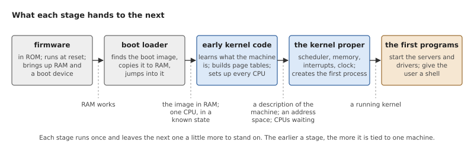
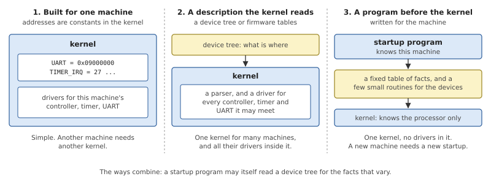
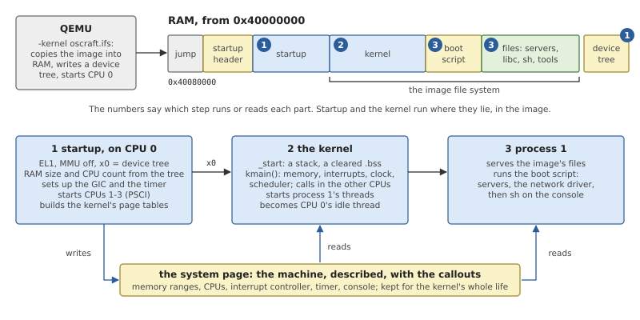
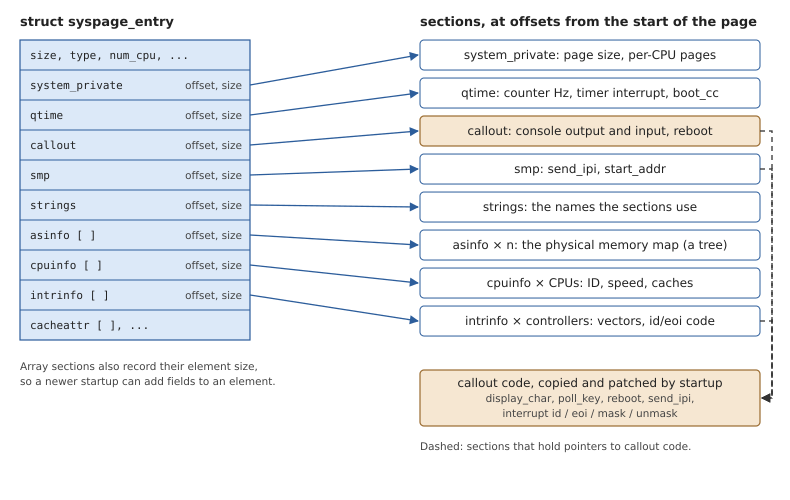
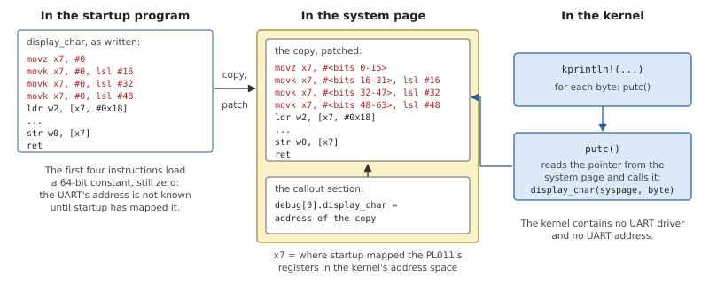
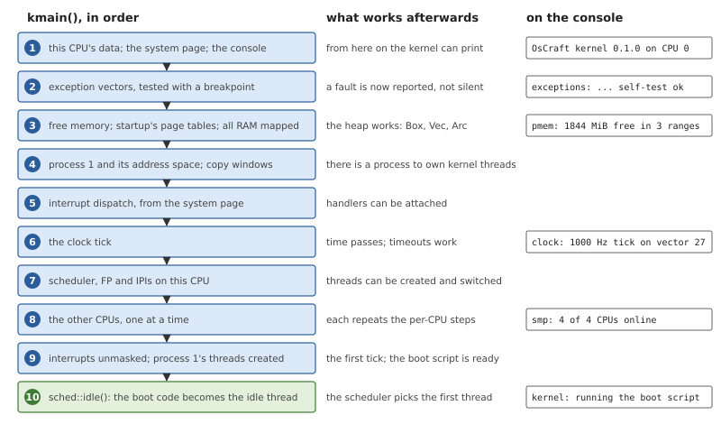
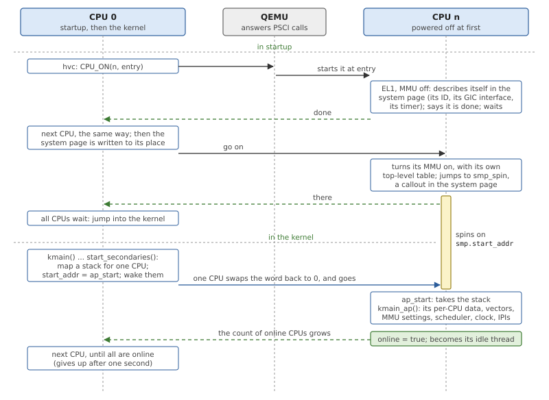

# Boot and the System Page

When a machine is switched on, nothing an operating system relies on
exists yet: no memory map, no stack, no running scheduler, one processor
executing whatever lies at a fixed address. This chapter explains how a
system gets from there to a kernel that schedules threads, and follows
OsCraft through it on QEMU's `virt` machine. On the way it introduces
two things every later chapter relies on: the *boot image*, the one file
that holds the whole system, and the *system page*, in which the kernel
finds the description of its machine.

## How a machine starts an operating system

### A chain of stages

A kernel cannot start itself. It is a file, and reading a file needs a
driver, memory to load it into and a processor set up to run it. So a
boot is a chain of programs, each of which does just enough for the next
one to run.



*Figure 5.1: The stages of a boot, and what each has prepared when it
hands over.*

**Firmware** is the code the processor finds at its reset address. It is
stored in the machine and written for it. It makes RAM usable and can
read at least one device to boot from.

A **boot loader** finds the operating system, copies it into RAM and
jumps into it. What it loads is usually a single file, a *boot image*,
which holds the kernel and whatever the kernel needs before it can read
files by itself: at least the first programs it will run. The loader
leaves the processor in a state agreed with the image, typically one
processor running, with interrupts masked and the MMU off, and a pointer
to some information in a register.

The **kernel's early code** turns that bare state into the environment
the kernel proper is written for: a stack, cleared memory for its
variables, page tables and the MMU on, the other processors found and
parked. Only then can the kernel initialize its own subsystems and
create the first process.

On a multiprocessor, one processor does all of this. The *boot
processor* runs the chain; the others are held back, powered off or
waiting in a loop, because several processors cannot safely initialize
the same data at once. The kernel calls them in later, one at a time,
when it has a place for each.

### Describing the machine

A kernel must know a good deal about its machine before it can do
anything: where RAM is and how much, how many processors there are,
where the interrupt controller's registers are, which interrupt the
timer raises, how to print a character. On a PC most of this can be
asked of the firmware at run time. On an embedded machine it is fixed by
the board's design, and two boards with the same processor can differ in
all of it. There are three ways to deal with that.



*Figure 5.2: Where the knowledge of the machine can live: in the kernel
as constants, in the kernel as drivers that read a description, or in a
separate program that runs first.*

The kernel can be **built for one machine**, with its addresses as
constants. This is the simplest, and it means a different kernel for
every board.

The kernel can **read a description** that the boot loader passes. The
common form on Arm machines is a *device tree*: a tree of nodes, one for
each device, with properties that give its type, the addresses of its
registers and its interrupts. One kernel then runs on many machines, but
it must contain a driver for every interrupt controller, timer and
serial port it may find described.

Or a **separate program**, written for the machine, can run before the
kernel, collect the facts and hand them over in a simple, fixed format.
Facts are not always enough: to acknowledge an interrupt the kernel has
to write a register of this machine's controller, in this controller's
way. So such a program also hands over a few small routines for the
devices the kernel cannot do without. The kernel calls them through
pointers and never learns what device is behind them. These routines
are called *callouts*.

The third way keeps the kernel free of drivers and of any knowledge of a
board, at the price of a second program to write for each machine. It
suits a microkernel, whose drivers are meant to be processes.

## Booting OsCraft

OsCraft takes the third way. Its kernel knows the AArch64 architecture
and no machine. A *startup program* runs before it, describes the
machine in the system page, supplies the callouts, and is never run
again. The startup is a Rust library (`startup/`) with a small crate for
each machine; the one in this tree is for QEMU's `virt`
(`startup/boards/qemu-virt`).



*Figure 5.3: A boot on `virt`. QEMU plays firmware and boot loader; the
startup describes the machine; the kernel and process 1 read the
description from the system page.*

### The boot image

Everything the system starts with is in one file, the boot image, built
by the tool `mkifs` (`tools/mkifs/`) from a *build file*,
`images/qemu-virt.build` (Chapter 3). The build file has three kinds of
content, and the image has a part for each:

- the **bootstrap programs**: the startup, then the kernel, each with a
  command line. Both are placed so that they run where they lie in the
  image, without being copied again;
- the **boot script**: the commands process 1 runs once the kernel is
  up, compiled by mkifs into a compact form;
- the **files**: the servers, FreeBSD's C library and loader, the shell
  and the utilities. Together with the kernel and the script they form
  the *image file system*, which process 1 serves read-only from where
  it lies in memory (Chapter 22).

*Listing 5.1: The bootstrap section of the build file
(`images/qemu-virt.build`).*

```text
{{#include ../../../images/qemu-virt.build:boot}}
```

The line above this section in the file, `[image=0x40080000]`, gives the
physical address the image is built for. `virtual` says the system runs
with the MMU on, and `raw` that the image is a plain block of bytes
which begins with a jump to the startup. The words after each program's
name are its command line, and the assignments are the kernel's
environment; mkifs writes both into a buffer inside each program, since
there is nobody to pass them at run time.

### QEMU as firmware and loader

On `virt` there is no firmware to speak of. QEMU is started with the
image as its `-kernel` (`tools/qemu/run.sh`) and does the first two
stages of Figure 5.1 itself: it copies the image into RAM at
`0x40080000`, 512 KB above the start of RAM, writes a device tree that
describes exactly the machine its command line asked for, and starts
CPU 0 at the image's first byte, at the kernel's privilege level (EL1),
with the MMU off and the device tree's address in register `x0`. CPUs 1
to 3 stay powered off.

### The startup

The startup's work for `virt` is short enough to read in full, because
the library does everything that is the same on every AArch64 machine.
The board's crate says where this machine's parts are.

*Listing 5.2: The startup's `main()` for QEMU's `virt`
(`startup/boards/qemu-virt/src/board.rs`).*

```rust
{{#include ../../../startup/boards/qemu-virt/src/board.rs:board_main}}
```

Reading it from the top:

- **The console first.** `init_debug()` sets up the PL011 serial port so
  that the startup itself can print, and remembers it as the kernel's
  console.
- **Two facts from the device tree.** QEMU's command line can change the
  amount of RAM and the number of CPUs, so `from_fdt()` reads those from
  the tree. The rest of `virt` is fixed, and the crate states it as
  constants: RAM starts at `0x40000000`, the interrupt controller's two
  register blocks are at `0x08000000` and `0x08010000`, the timer raises
  interrupt 27. The first line of a boot log, `QEMU virt: 4 CPUs,
  2048 MB of RAM`, is printed here.
- **CPUs, RAM, page tables.** `init_smp()` records how to start a CPU on
  this machine, `add_ram()` records the memory, and `init_mmu()` begins
  the page tables the kernel will run on.
- **The interrupt controller and the timer.** `gic_v2::init()` sets up
  the controller and installs the callouts with which the kernel will
  identify, acknowledge and mask interrupts (Chapter 15).
  `init_qtime()` describes the timer whose interrupt becomes the
  kernel's tick (Chapter 13).
- **A callout of the board's own.** Resetting `virt` is a call to QEMU,
  so the reboot callout is the board's.
- **`boot()`** finishes: it maps the kernel's segments at the addresses
  the kernel was linked for, starts the other CPUs and lets each
  describe itself, writes the system page into its final memory, turns
  the MMU on, and jumps to the kernel's entry point with the system
  page's address in `x0`.

The startup leaves the device tree where QEMU put it and records its
place in the system page. The kernel never reads it, but the servers
that run FreeBSD's bus code do: `pcid` finds the PCI host bridge in it
(Chapter 29).

### The system page

The system page is a block of memory of a few kilobytes that the startup
builds and the kernel reads. It begins with a header that says, for each
*section*, where it is and how long: an offset from the start of the
page and a size.



*Figure 5.4: The system page. The header locates each section by offset
and size; some sections hold pointers to callout code, which the startup
copied into memory next to the page.*

Offsets, not pointers, because the page is mapped more than once: for
the kernel, and read-only for user programs, which read a few things
from it directly. An offset means the same at either address. Sections
that are arrays also record the size of one element, and the kernel
steps through them by that size, so a startup can add fields to the end
of an element without breaking an older kernel.

*Table 5.1: The sections the kernel uses.*

| Section | Contents | Used for |
|---|---|---|
| `system_private` | the page size; where the system page and the per-CPU pages are mapped | telling user programs where the page is |
| `cpuinfo` | one entry for each CPU: its ID, its features, its caches | the boot report |
| `asinfo` | the physical address space as a tree of named ranges: RAM, free RAM, the image file system, the device tree | the free memory, the map of all RAM, finding the image (Chapters 16 and 22) |
| `qtime` | the timer: the counter's frequency, its interrupt, the time at boot | the clock (Chapter 13) |
| `intrinfo` | one entry for each interrupt controller: its range of vectors and its callouts | interrupt dispatch (Chapter 15) |
| `smp` | how to interrupt another CPU, and the word that releases a waiting CPU | starting CPUs, IPIs |
| `callout` | console output and input; reboot | the console, rebooting |
| `strings` | the names the other sections refer to; the machine's name | the boot report, `uname` |

The layout is a binary interface between two programs, so
`kernel/src/syspage.rs` declares every section as a structure with a
fixed layout and checks sizes and offsets when the kernel is compiled.
The kernel also checks the page it is given, its type, its version and
that every section lies inside it, before it believes any of it. It then
keeps the page for its whole life, as a value set once and read without
a lock, interrupt handlers included (Chapter 4).

### Callouts

A callout is a short routine in AArch64 assembly that follows the C
calling convention and gets the system page's address as its first
argument. The startup cannot simply point the kernel at such a routine
inside itself, for two reasons: the startup's memory is not mapped once
the kernel runs, and the routine needs the address of its device, which
is known only when the startup has mapped the device's registers into
the kernel's address space.



*Figure 5.5: The console's output callout. The startup copies it next to
the system page and writes the serial port's mapped address into the
copy's first four instructions; the kernel calls the copy through a
pointer.*

So each callout begins with instructions that load a constant, written
as zero, and the startup *patches* the copy: it writes the device's
virtual address into those instructions, sixteen bits in each. A callout
may use only its arguments, the system page and what was patched into
it, and it must work wherever it is copied to.

The kernel's side is as small as it could be. This is the whole of the
kernel's console output:

*Listing 5.3: Printing a byte through a callout, `putc()`
(`kernel/src/console.rs`).*

```rust
{{#include ../../../kernel/src/console.rs:putc}}
```

Three groups of callouts exist. The `callout` section holds the general
ones: console output and input, and reboot. Each `intrinfo` entry holds
those of an interrupt controller; two of them, the ones that identify an
interrupt and end it, are not called but copied by the kernel into its
own interrupt path (Chapter 15). The `smp` section holds the one that
sends an interrupt to another CPU (Chapter 8).

### The kernel's first instructions

The kernel is an ELF program linked to run at a fixed address high in
the address space (`kernel/kernel.ld`). It has two segments: code with
read-only data, and writable data. The startup has mapped both in place
in the image, each with its own permissions, and has allocated memory
only for the part of the data segment the file does not store, the
zero-initialized variables and the boot stack.

A 16-byte header sits just before the entry point, by which the startup
recognises a bootstrap program and finds the buffer that holds its
command line. That is why the startup reports the entry at an address
ending in `0x10`.

Before any Rust code can run, there must be a stack, and the
zero-initialized variables must really be zero. The entry code in
`kernel/src/arch/aarch64/boot.s` does that and as little else as it can:
it checks that it runs at EL1, loads the boot stack, clears those
variables, and calls `kmain()` with the system page and the CPU
number 0.

### `kmain()`: bringing the kernel up

`kmain()` in `kernel/src/main.rs` initializes the kernel in one straight
sequence. Each step needs only the ones before it, and most print a
line, so a boot log is a trace of this function.



*Figure 5.6: The steps of `kmain()`, what each makes possible, and the
lines of a boot log that mark them.*

The order is forced almost everywhere. Nothing can be reported before
the console works, and the console needs the system page. Exceptions are
set up next, so that a mistake in anything later is reported as a fault
instead of hanging the machine. Memory comes before everything that
allocates. The kernel takes over the page tables the startup built
rather than building new ones, and maps all of RAM at a fixed offset so
that it can reach any page frame. Process 1 must exist before any thread
does, because every thread belongs to a process. Interrupt dispatch
comes before the clock, whose tick is an interrupt, and the scheduler
before the other CPUs, which enter it as soon as they are up.

Interrupts stay masked on CPU 0 through all of it. They are unmasked
near the end, just before `kmain()` creates process 1's threads:
the servers for its managers, a worker, and the thread that will run the
boot script (Part III). Creating a thread only makes it ready. Nothing
has run yet when `kmain()` makes its last call, to `sched::idle()`,
which never returns. That call turns the boot code into CPU 0's *idle
thread*, the loop that runs the scheduler and waits for an interrupt
when nothing is ready (Chapter 8), and the scheduler's first choice is
one of the threads just created.

The kernel's command line and environment adjust a few of these steps.
Each is read where it is used: the tick's frequency just before the
clock starts (`-C`, 1000 Hz otherwise), and whether `fork()` shares
pages copy-on-write instead of copying them (`-mc`) when memory is set
up. With `OSCRAFT_SELFTEST=1` in the environment the kernel runs its own
tests of the scheduler and of sleeping before the boot script starts.

### The other CPUs

Starting a processor is a matter for the machine, and on `virt` it is a
call to firmware. Arm's *Power State Coordination Interface*, PSCI,
defines such calls: `CPU_ON` takes a CPU's number and an address, and
that CPU begins to run there. On `virt` QEMU itself answers PSCI, as a
hypervisor would. That knowledge belongs in the startup, so it is the
startup that powers the CPUs on. The kernel only has to call them in.



*Figure 5.7: The life of a secondary CPU. The startup powers it on and
parks it in a callout; the kernel releases it by writing one word.*

**In the startup**, the boot CPU starts the others one at a time. Each
describes itself in the system page, since only a CPU can read its own
identification registers and set up its own side of the interrupt
controller. When the system page is complete, each CPU turns on its MMU
and jumps to a callout named `smp_spin`, where it waits, watching one
word of the `smp` section. Only when all of them are there does the
boot CPU enter the kernel.

**In the kernel**, `start_secondaries()` in `kernel/src/smp.rs` releases
them, again one at a time. For each, it maps a fresh kernel stack with
an unmapped guard page below it, publishes the stack's top, writes the
address of the kernel's secondary entry into the word, and wakes the
waiting CPUs. Every waiting CPU sees the address, but each tries to swap
it back to zero with an atomic exchange, and only the one that succeeds
goes. So one store releases exactly one CPU, though not a chosen one,
which is why the kernel then waits for the *number* of online CPUs to
grow, not for a particular CPU. One published stack is enough, because
the next is published only after the last CPU has taken its own. A CPU
that does not arrive within a second is given up.

The released CPU runs `kmain_ap()`, which repeats the per-CPU steps of
`kmain()`: its own data, the exception vectors, the MMU settings, the
scheduler, the clock, the interprocessor interrupts. Everything shared
already exists. It then marks itself online and becomes its own idle
thread. The online flag is what the rest of the kernel goes by: the
scheduler sends work only to CPUs that are online.

The kernel has per-CPU data for at most eight CPUs. A CPU numbered
beyond that is refused the moment it arrives: it records itself and
waits for ever with interrupts masked, and CPU 0 reports it.

### The boot script

With the scheduler running, the rest of the boot is ordinary threads at
work. One of process 1's threads, at priority 10, runs the boot script
(`kernel/src/proc/bootscript.rs`). The script is a list of records that
mkifs compiled from the build file, and it has four kinds of command.

*Table 5.2: The commands of a boot script.*

| Command | What process 1 does |
|---|---|
| a program with arguments | finds it in the image file system, by its path or along `PATH`; creates a process, loads the program and starts it; waits for it to end unless the line ends in `&` |
| `waitfor name seconds` | checks ten times a second whether `name` exists in the path name space, for at most that long |
| `reopen name` | waits for `name` likewise, then opens it; programs started afterwards get it as standard input, output and error |
| `display_msg text` | prints the text on the kernel's console |

`waitfor` is what orders the boot. A server takes a moment to start, and
the sign that it is ready is that the path it serves exists. So the
script starts a server in the background and waits for its name before
starting anything that needs it.

The network shows the pattern. The script starts `netd` in the
background and waits for `/dev/netd`, then does the same for `pcid`, the
PCI bus server, and `/dev/pci`. Four `kldload` commands follow, each run
to completion before the next, each loading one module of FreeBSD's
virtio network driver into `netd`; then `ifconfig` and `route` configure
the interface as they would on FreeBSD. The last lines of the script reopen the console device and
start FreeBSD's `sh` on it as the leader of a new session, with the
console as its terminal. That is the prompt at the end of Listing 2.1.

## Summary

- A boot is a chain of stages, each preparing the ground for the next:
  firmware, a loader, the kernel's early code, the kernel, the first
  programs. On `virt`, QEMU is the first two.
- OsCraft's kernel knows the processor architecture and no machine. A
  startup program written for the machine runs first and leaves the
  system page: a table of facts in sections found by offset, with
  callouts for the few devices the kernel must drive.
- A callout is copied next to the system page and patched with its
  device's mapped address. The kernel's console, its interrupt
  controller code and its reboot are all callouts.
- The boot image holds the startup, the kernel, the boot script and the
  files. The startup and the kernel run in place; process 1 serves the
  rest as the image file system.
- `kmain()` brings the kernel up in a fixed order, each step standing on
  the ones before, and ends by turning into CPU 0's idle thread.
- The startup powers the other CPUs on with PSCI and parks them; the
  kernel releases them one at a time by writing one word, and each
  brings up its own per-CPU state.
- Process 1 runs the boot script, which starts each server and waits
  for the path it serves before going on.
