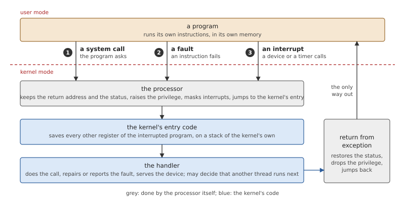
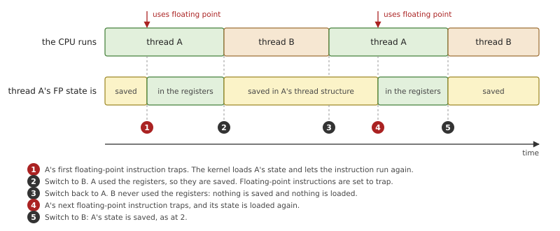
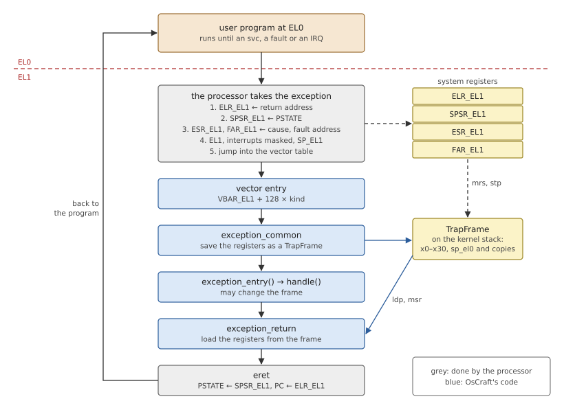
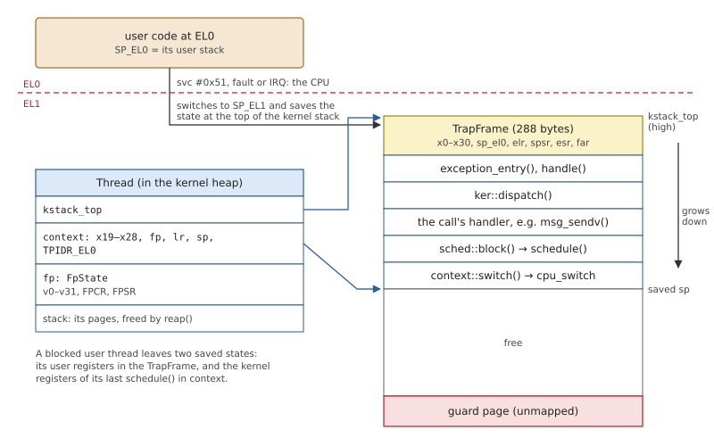
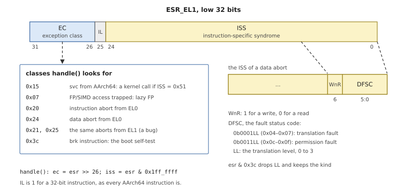
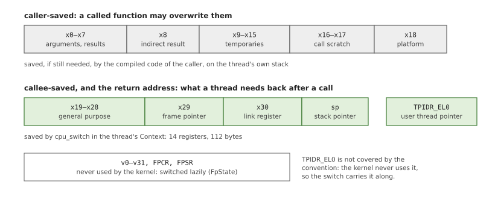
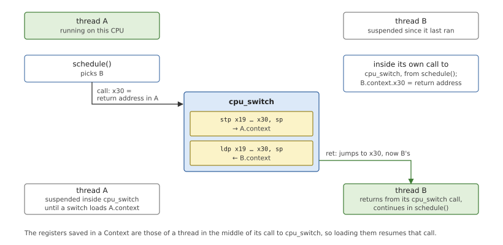
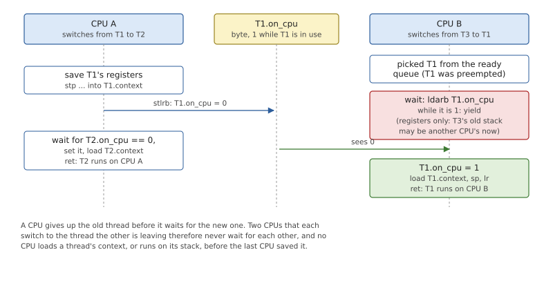

# The AArch64 Layer

Most of a kernel is ordinary code: queues, tables, state machines. A
small part is not, because it deals with the processor itself: the
instant a program stops and the kernel starts, the registers that must
be put aside and brought back, the switch from one thread to another.
In OsCraft that part is `kernel/src/arch/aarch64/`, written for 64-bit
Arm (AArch64). This chapter explains what any kernel needs from its
processor, and then how OsCraft gets it from this one. Two pieces of
the directory are left to later chapters: the translation tables and
address spaces (Chapter 16) and the interrupt entry code (Chapter 15).

You do not need to know Arm to read on. Each term is explained when it
first appears.

## What a kernel needs from the processor

### Two modes and a controlled way between them

An operating system can only keep programs apart if the processor
helps. A program that could change the memory mapping, switch off
interrupts or write to a device's registers could read any other
program's data or stop the machine. So every processor that runs a
protected system has at least two *privilege levels*: a *user mode* in
which those operations are refused, and a *kernel mode* in which they
are allowed.

A program cannot raise its own privilege. The only way into kernel mode
is an *exception*: an event that makes the processor stop what it is
doing and continue at an address the kernel chose in advance. There are
three kinds, and they differ in who causes them.



*Figure 6.1: The three ways into a kernel and the one way out. The
processor does the minimum; the kernel's entry code saves the rest.*

- A **system call** is asked for: the program executes an instruction
  whose only purpose is to enter the kernel.
- A **fault** is an instruction that cannot complete: it touches memory
  that is not mapped, or is not a valid instruction at all.
- An **interrupt** comes from outside the program: a device, a timer or
  another processor wants attention, between any two instructions.

The first two are *synchronous*: they happen at a precise instruction,
and would happen again if it were run again. An interrupt is
*asynchronous*: the interrupted program did nothing to cause it and
must not notice it.

In all three cases the processor itself does very little. It keeps the
address to return to and its own status in a safe place, raises the
privilege, switches off interrupts and jumps. It does not save the
program's working registers: the kernel's first instructions find them
exactly as the program left them, and must store every one of them
before using any. That stored copy has a name, the *trap frame*. The
way back is a single instruction that restores the status and the
return address together, so the drop in privilege and the jump are one
step.

Because the kernel returns by loading the trap frame, it can change
what the program sees by changing the frame first. A system call's
result is written into the frame; a signal handler is started by
rewriting the frame's return address. The frame is the program, as far
as the kernel is concerned.

### Where the kernel keeps its own stack

The entry code needs a stack to save the frame on, and it cannot use
the program's: that stack pointer may be wrong, unmapped, or set up on
purpose to make the kernel write somewhere. So the processor switches
to a stack pointer of the kernel's own on the way in.

Kernels differ in how many kernel stacks they have. With *one per
processor*, a system call that has to wait must record where it was in
some data structure, give the stack up, and be continued from that
record later. With *one per thread*, a call that has to wait simply
stops where it is: its local variables and its chain of function calls
stay on the thread's kernel stack, which nobody else uses, and the call
goes on from there when the thread runs again. The second design costs
a few pages of memory per thread and makes blocking calls easy to
write.

### Switching threads

A thread, at any moment, is its registers and its memory. To run
another thread on the same processor, the kernel saves the first
thread's registers and loads the second's: a *context switch*. In a
microkernel this happens on nearly every message, so its cost matters.

The frame saved on entry already holds the user-mode registers. What
remains is the kernel-mode side: the thread is somewhere inside the
kernel, in a function that decided to switch. Here a rule that
compilers follow anyway does most of the work. Every *calling
convention* divides the registers in two groups: those a called
function may overwrite freely (*caller-saved*: a caller that still
needs one saves it on its own stack first) and those a function must
hand back unchanged (*callee-saved*). If the switch is made to look
like an ordinary function call, the compiler has already put aside the
first group. The switch only has to save the second group, the stack
pointer and the address to return to, a fraction of the registers.

### Registers that are rarely used

Processors also have large registers for floating-point and vector
arithmetic. They are several times the size of the general registers,
and many threads never touch them. Saving and loading them on every
switch would be mostly wasted work, so kernels do it *lazily*: the
kernel tells the processor to raise an exception at the first
floating-point instruction, and moves the registers only for threads
that actually use them.



*Figure 6.2: Lazy handling of floating-point state. Thread B never uses
the registers, so switching to it and back costs one save, and no load
until thread A needs them again.*

The scheme rests on one promise: the kernel itself never uses those
registers. If it did, it would destroy a program's values without
knowing.

### System registers

Everything described so far is controlled through *system registers*:
registers that are not part of any computation but configure the
processor. Where exceptions jump to, which translation tables are in
use, whether floating-point instructions trap, when the timer fires:
each is a system register that only kernel mode may write. An
architecture layer is, for the most part, the code that reads and
writes them at the right moments.

## The AArch64 layer in OsCraft

AArch64 calls its privilege levels *exception levels*, numbered EL0 to
EL3, higher meaning more privileged. OsCraft uses two. Programs and
servers run at **EL0**. The kernel runs at **EL1**, and so do the
threads of process 1, the managers that are built into the kernel file
(Part III). EL2 and EL3 are for hypervisors and firmware; the startup
enters the kernel at EL1 (Chapter 5), and the kernel never deals with
the levels above.

The layer is small. Assembly is used only where Rust cannot say what is
needed: the boot entry, the exception vectors, the context switch, and
saving and loading the floating-point registers. Each `.s` file is
pulled into the Rust crate, so there is no separate assembler step. The
rest is Rust with single instructions inline, each in a small function
of its own.

*Table 6.1: The system registers the layer uses.*

| Register | What OsCraft uses it for |
|---|---|
| `VBAR_EL1` | the address of the exception vectors |
| `ELR_EL1`, `SPSR_EL1` | the return address and the saved status of the last exception |
| `ESR_EL1`, `FAR_EL1` | what a synchronous exception was, and the address of a memory fault |
| `SP_EL0` | the user stack pointer, saved and restored for the program |
| `TPIDR_EL1` | a pointer to this processor's own kernel data |
| `TPIDR_EL0` | the program's thread pointer, switched with the thread |
| `CPACR_EL1` | whether floating-point instructions at EL0 trap |
| `SCTLR_EL1` | alignment checking, for a thread that asks for it |
| `CNTFRQ_EL0`, `CNTVCT_EL0`, `CNTV_CVAL_EL0`, `CNTV_CTL_EL0` | the generic timer |
| `TTBR0_EL1`, `PAR_EL1` | the user translation tables, and asking the processor to translate an address (Chapter 16) |

### Entering and leaving the kernel

When an exception is taken to EL1, the processor stores the return
address in `ELR_EL1` and its status (the level it came from, the
condition flags, the interrupt masks) in `SPSR_EL1`. For a synchronous
exception it writes the cause in `ESR_EL1`, and for a memory fault the
address in `FAR_EL1`. It masks interrupts, selects EL1's stack pointer
and jumps into the *vector table*, a block of code whose address the
kernel put in `VBAR_EL1`. The `eret` instruction undoes it: status from
`SPSR_EL1`, program counter from `ELR_EL1`.



*Figure 6.3: An exception to EL1 and the return, in OsCraft. The
processor saves only the return address and its status; the vector code
saves everything else as a `TrapFrame`.*

The vector table has sixteen entries of 128 bytes each. The processor
picks one by where the exception came from and what kind it is, and
OsCraft numbers them the same way: the *kind* is four times the source
plus the type.

*Table 6.2: The sixteen vectors and their kind numbers.*

| Came from | Synchronous | IRQ | FIQ | SError |
|---|---|---|---|---|
| EL1, on EL0's stack pointer (never used) | 0 | 1 | 2 | 3 |
| EL1 | 4 | 5 | 6 | 7 |
| EL0, 64-bit code | 8 | 9 | 10 | 11 |
| EL0, 32-bit code (not supported) | 12 | 13 | 14 | 15 |

An IRQ is an ordinary interrupt request; FIQ and SError are a second
interrupt class and a late-reported hardware error, neither of which
OsCraft expects. Every entry does the same four things
(`kernel/src/arch/aarch64/vectors.s`): it makes room for a frame on the
kernel stack, stores the first two registers there to have something to
work with, loads its kind number, and branches to common code. That
code stores the remaining registers and copies of the four exception
registers into the frame, and calls the Rust function
`exception_entry()` with the frame and the kind. When the function
returns, `exception_return` loads the frame back, whatever it now
holds, and executes `eret`.

The frame has to be laid out identically in assembly and in Rust, and
this is its definition.

*Listing 6.1: The registers saved on every exception, `TrapFrame`
(`kernel/src/arch/aarch64/exception.rs`).*

```rust
{{#include ../../../kernel/src/arch/aarch64/exception.rs:trap_frame}}
```

`x` is the 31 general registers, `sp_el0` the user stack pointer.
`elr` and `spsr` are copied from the system registers because the next
exception overwrites those, and the next exception may be a different
thread's: the handler may switch threads before it returns. The
assertion fixes the size the assembly reserves, 288 bytes.

One entry is different. A synchronous exception taken from the kernel
itself (kind 4) may be the kernel stack overflowing into the unmapped
*guard page* below it. Pushing a frame onto the same full stack would
fault again, for ever. So that entry first asks the processor whether
the frame's page can be written, and if not, switches to a small
emergency stack to report the overflow.

### Kernel stacks

OsCraft has a kernel stack per thread. A thread running at EL0 has
EL1's stack pointer resting at the top of its own kernel stack, so its
trap frame always lands at the same place: the last 288 bytes of that
stack. The kernel relies on this to find the user registers of any
thread that is blocked in a call, for `fork()`, for a debugger, for a
signal.



*Figure 6.4: The kernel stack of a user thread blocked in a kernel
call. Its user registers are in the `TrapFrame` at the top; its kernel
registers were saved by its last switch, in its `Thread` structure.*

Below the frame, the stack holds the call chain of whatever the kernel
is doing for the thread. When the thread must wait, the innermost
function calls the scheduler, and everything above stays where it is
until the thread is resumed. A blocked thread therefore has two saved
states, as the figure shows: what its program was doing, in the frame,
and what the kernel was doing for it, in the `Thread`.

### Finding out what happened

Sixteen vectors cannot tell a system call from a page fault: both are
synchronous exceptions from EL0, kind 8. The detail is in `ESR_EL1`,
which the entry code copied into the frame.



*Figure 6.5: `ESR_EL1` and the exception classes the kernel looks for.
For a memory fault, the low bits say whether it was a write and why it
failed.*

`handle()` in `kernel/src/arch/aarch64/exception.rs` reads the kind and
the class and decides, in this order:

1. **A kernel call**: the `svc` instruction with the immediate `0x51`,
   from EL0 or from one of process 1's threads at EL1. It goes to the
   dispatcher of Chapter 7. On the way out, the scheduler switches
   threads if the call made a more urgent one ready.
2. **A trapped floating-point instruction** from EL0: the thread's
   state is loaded and the instruction runs again (below).
3. **A page fault the memory manager can resolve**: a page of a region
   that is filled on first use, or a write to a page still shared after
   `fork()`. The page is supplied, and the return runs the faulting
   instruction again, which now succeeds (Chapter 16).
4. **Any other synchronous exception from EL0** is the program's fault.
   A debugger attached to the process sees it first (Chapter 36);
   otherwise it becomes a signal, `SIGSEGV`, `SIGBUS` or `SIGILL`
   (Chapter 14).
5. **An interrupt** from either level goes to the interrupt code
   (Chapter 15), and again the scheduler may switch on the way out.
6. **Anything else** is a bug in the kernel: the frame is printed, a
   crash dump is taken if a dumper is loaded (Chapter 36), and the
   kernel stops.

Two special cases come before all of these. A breakpoint instruction
with a known number is the boot-time test that the vectors work. And a
data abort inside one particular kernel routine, the copy used for
memory that a device may refuse to give, makes that routine return
"failed" instead of counting as a kernel bug.

### Interrupt masking

The kernel proper runs with interrupts masked. An exception masks them
on entry, and a kernel call or interrupt handler keeps them masked
until it returns or switches to another thread. No kernel code can
therefore be interrupted on its own processor half-way through
changing a data structure; other processors are kept out by locks
(Chapter 4). The price is that an interrupt waits for the kernel call
in progress on its processor, so long operations offer a window:
`irq_window()` in `kernel/src/arch/aarch64/mod.rs` unmasks for one
instruction and masks again, and a long message copy passes through it
between pieces.

Process 1's threads are different. They run at EL1 but with interrupts
unmasked, like programs, and can be preempted anywhere. Code that needs
a moment of atomicity uses `irq_save()`, which masks and returns the
previous state, and `irq_restore()`, which puts that state back. Saving
and restoring, instead of masking and unmasking, lets such sections
nest: the inner restore puts back "masked".

### The context switch

AArch64's calling convention makes `x19` to `x28`, the frame pointer
`x29` and the stack pointer callee-saved; `x30` holds the return
address of the current call.



*Figure 6.6: The calling convention's split of the registers. A switch
made as a function call saves only the lower group; the compiler has
already dealt with the upper one.*

OsCraft's switch is a function, `cpu_switch`, called by the scheduler
with the outgoing and incoming threads' saved contexts. A context is
fourteen registers: the twelve of the figure's lower group and the
stack pointer, plus `TPIDR_EL0`, the register in which a program keeps
the address of its thread-local data. The kernel never uses that
register, so instead of saving it on every entry it is carried along
with the switch.

*Listing 6.2: The context switch, `cpu_switch`
(`kernel/src/arch/aarch64/context.s`).*

```text
{{#include ../../../kernel/src/arch/aarch64/context.s:cpu_switch}}
```

The first block stores the outgoing thread's registers through `x0`,
the last block loads the incoming thread's through `x1`. The step that
matters is the final `ret`. It jumps to the address in `x30`, and `x30`
has just been loaded from the incoming thread's context: it is the
return address that thread saved when *it* last called `cpu_switch`. So
the function is called by one thread and returns in another.



*Figure 6.7: Thread A calls `cpu_switch` and the call returns in thread
B, which had called it earlier. A's own call returns when some later
switch loads A's context.*

The middle block of the listing exists because there are several
processors. The scheduler puts the outgoing thread back in the ready
queue before the switch has saved it, and another processor may pick it
at once. That processor must not load the thread's registers, or run on
its stack, until they have been saved. Each thread has a byte,
`on_cpu`, for this:

- the switch clears the outgoing thread's byte only after saving its
  registers (`stlrb`, a store that makes everything written before it
  visible to other processors first);
- it then waits until the incoming thread's byte is clear, sets it, and
  only then loads that thread's registers.



*Figure 6.8: Two processors and one thread. Processor A releases T1
only after saving it; processor B loads T1 only after it was released.*

The wait uses registers only, because by then the old stack may already
be in use elsewhere. And the order, release first and wait second,
keeps two processors that are each switching to the thread the other is
leaving from waiting for each other.

A new thread has never called `cpu_switch`, so its creator builds a
context by hand whose return address is a small start routine. For a
kernel thread the routine calls the thread's entry function. For a user
thread the creator also writes a first `TrapFrame` at the top of the
new kernel stack, with the program's entry point as the return address
and EL0 as the level to return to, and the start routine jumps to
`exception_return`. The thread's first step into user mode is the
return from an exception it never took.

### Floating-point state

The 32 vector registers and their two control registers are 528 bytes
per thread (`FpState` in `kernel/src/arch/aarch64/context.rs`), against
112 for the context. OsCraft handles them as in Figure 6.2. The promise
that the kernel never uses them is kept by the compiler: the kernel is
built for a target, `aarch64-unknown-none-softfloat`, for which the
compiler generates no floating-point or vector instructions at all.

Each thread has a flag that says whether its state is in the
processor's registers. At a switch, the scheduler saves the outgoing
thread's registers only if the flag is set, clears it, and sets
`CPACR_EL1` so that floating-point instructions at EL0 trap. The
incoming thread runs with whatever the registers hold. If it executes a
floating-point instruction, the trap arrives as case 2 of the list
above: `fp_make_live()` in `kernel/src/sched.rs` loads the thread's
state, sets the flag and stops the trapping, and the instruction runs
again. Kernel code that needs the current thread's values, such as
signal delivery, which stores them in the signal frame, calls the same
function first.

### The generic timer

Every AArch64 processor has the same timer, so it belongs to the
architecture layer and not to the board. It is a 64-bit counter that
runs at a fixed frequency and, per processor, a compare value: when the
counter reaches the value, the processor's timer interrupt is raised.
The whole interface is three functions.

*Listing 6.3: The generic timer
(`kernel/src/arch/aarch64/timer.rs`).*

```rust
{{#include ../../../kernel/src/arch/aarch64/timer.rs:generic_timer}}
```

There is no periodic mode: the clock code computes when the next tick
or the next timer is due and programs that single deadline with
`arm_at()` (Chapter 13). What the layer cannot know is which interrupt
number the timer raises; that is a property of the machine, and comes
from the system page.

### Per-processor data and user memory

Two more services complete the layer.

Some kernel data exists once per processor: the thread it is running,
its next timer deadline, its interrupt state. Each processor keeps the
address of its own `PerCpu` structure (`kernel/src/percpu.rs`) in
`TPIDR_EL1`, a register the processor never interprets. Finding "my"
data is then one register read, with no need to know which processor
the code is on.

The kernel must also read and write programs' memory, and may not
simply follow a pointer a program gave it (Chapter 7 explains why).
The layer offers two tools. When the address belongs to the process
whose tables are loaded, an *address translation* instruction asks the
processor's own memory-management unit whether EL0 could read or write
it, and where it is (`el0_translate()` in
`kernel/src/arch/aarch64/uspace.rs`); otherwise the process's tables
are walked in software. And each processor has two *window* pages of
kernel address space that can be pointed at any page of physical
memory, for the pages the kernel has no permanent mapping of.

## Summary

- A processor enforces protection with privilege levels. The only way
  up is an exception (a system call, a fault or an interrupt) and the
  only way down is the return instruction. OsCraft runs programs at EL0
  and the kernel and process 1 at EL1.
- The processor saves just the return address and its status. The
  vector code saves the rest as a 288-byte `TrapFrame`, and the kernel
  changes what a program sees by changing its frame.
- Every thread has its own kernel stack, with its trap frame at the
  top. A kernel call that must wait stops in place on that stack.
- `handle()` reads the exception class to tell kernel calls,
  floating-point traps, page faults, program faults and interrupts
  apart.
- The context switch is a function call, so it saves only fourteen
  registers, and it returns in the incoming thread. The `on_cpu` byte
  keeps a thread from being resumed on one processor while another is
  still saving it.
- Floating-point state is saved only for threads that used it and
  loaded at the first instruction that needs it; the kernel is compiled
  without floating point.
- The generic timer is a counter and one deadline per processor;
  per-processor data is reached through `TPIDR_EL1`.
