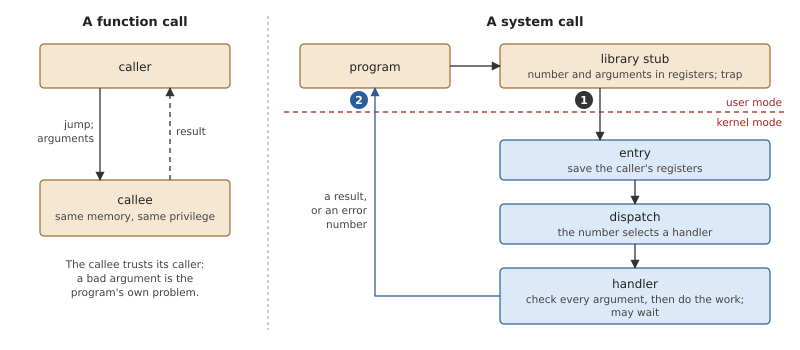
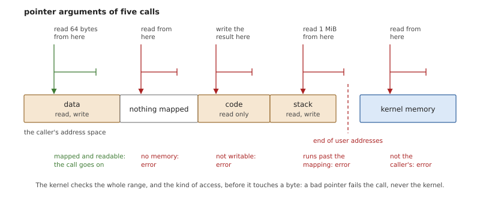
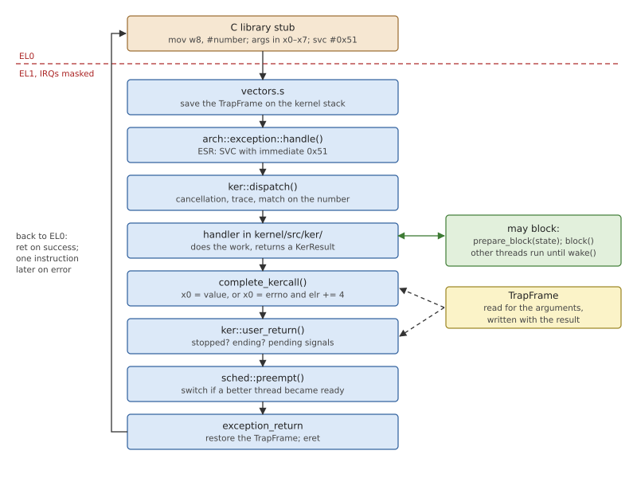
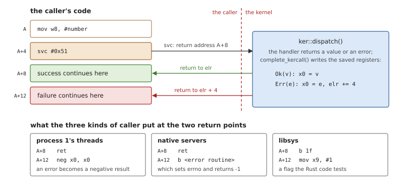
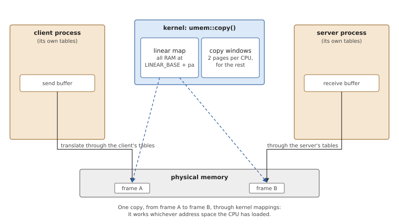
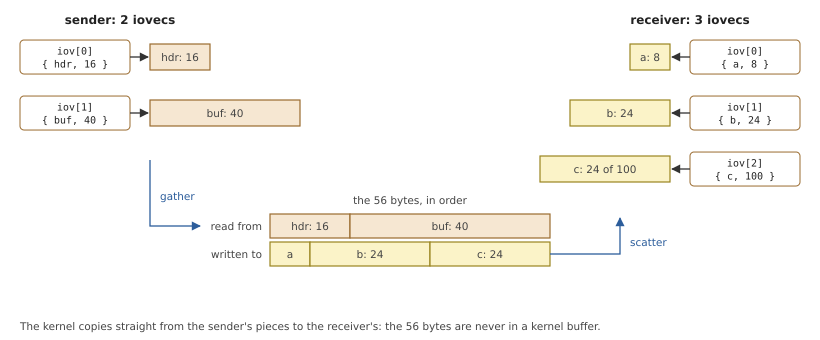
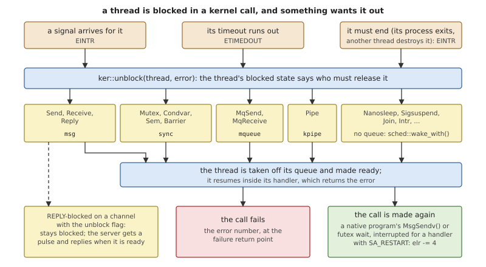

# Kernel Calls

A *kernel call* is how a thread asks OsCraft's microkernel for
something: send a message, create a thread, wait on a lock, arm a
timer. There are fewer than a hundred of them, and nothing else leads into
the kernel on purpose. Opening a file or creating a process is not a
kernel call; it is a message to a server, and sending that message is.
This chapter is about what all the calls have in common: how one enters
the kernel, how its arguments are checked, how it reaches the caller's
memory, how it reports failure, and what happens when it has to wait.
The calls themselves are explained, group by group, in the chapters
that follow.

## System calls

### A call across a boundary

To the program, a *system call* looks like a function: it passes
arguments and gets a result. Underneath, it is a different thing. The
kernel's code runs at a higher privilege and cannot be jumped to. The
program executes a *trap* instruction, the processor enters the kernel
at the one address the kernel prepared, and the kernel works out what
was asked.



*Figure 7.1: A function call stays inside one program. A system call
passes through a small library routine, a trap, and the kernel's
dispatch before any work is done.*

Since the kernel has a single entry, the two sides need a *calling
convention*: a rule for where things are. The usual one is that each
call has a number, the caller puts the number and the arguments in
agreed registers, and the kernel puts the result in an agreed register
before returning. Programs do not write this by hand. A library has one
small routine per call, a *stub*, that loads the registers and traps,
and the rest of the program calls the stub as an ordinary function.

Inside, the kernel saves the caller's registers, reads the number, and
uses it to choose a *handler*. An unknown number is an error like any
other.

### Trusting nothing

What makes a system call different from a function call is trust. A
function may assume its caller is part of the same program. The kernel
may assume nothing: its caller can be wrong by accident or on purpose,
and the worst outcome must be an error returned to that caller, never a
crash of the kernel or a look at memory the caller does not own.

Numbers are easy to check: a length too large, an identifier that
names nothing. Pointers are the hard part, because the kernel is able
to read and write far more than the caller is.



*Figure 7.2: Five pointer arguments. Only the first can be honoured;
the other four must fail the call without the kernel ever following
them.*

A pointer may lead to nothing at all, and following it would make the
kernel itself fault. It may lead to memory the caller can read but not
write, and a kernel that wrote a result there would do for the program
what the program may not do. It may start in valid memory and run off
its end. And it may lead into the kernel's own memory, where a "read
this buffer" would leak secrets and a "store the result here" would
overwrite the kernel. So a kernel never uses a caller's pointer
directly. It goes through a small set of copy routines that check the
whole range and the kind of access first, and report failure as an
error.

### Reporting failure

A call must be able to say that it failed, and why. The reason is an
*error number*, a small integer with a conventional name (`EINVAL`: an
argument is invalid; `EFAULT`: a pointer is bad). The difficulty is the
success case: a result can be any value, so no value is free to mean
"failed". Conventions solve it with a second channel next to the
result: a processor flag, a second register, or a different return
address. The stub turns either outcome into what C programs expect: the
result, or -1 with the number stored in `errno`.

### Calls that wait

Many calls cannot finish at once: the lock is held, no message has
arrived, the time has not come. The calling thread *blocks*: the kernel
marks it as waiting and runs other threads until whatever it waits for
happens.

A wait can also end for a reason that has nothing to do with the call:
a signal arrives for the thread, or a time limit runs out. The call
then fails with a number that says so (`EINTR`, `ETIMEDOUT`), and the
caller decides whether to try again. Some systems retry on the
program's behalf: after the signal handler has run, the kernel makes
the same call again, and the program never sees the interruption. Such
a call is *restartable*, and only calls that have had no effect yet can
be.

### How many calls

A monolithic kernel has a system call for everything a program can ask
of the system, several hundred of them: files, sockets, processes,
mounts. A microkernel keeps those services in servers, so its own calls
are few and of one kind: threads, synchronization, time, and above all
passing messages. The familiar functions still exist, but as library
code that sends messages. A short list has a practical merit beyond
tidiness: every call is a door into the most privileged code in the
system, and each one has to be made safe.

## Kernel calls in OsCraft

OsCraft's programs are FreeBSD programs, and they do not make kernel
calls themselves. They call FreeBSD's C library, whose bottom layer,
*libsys*, implements each FreeBSD system call with OsCraft kernel calls
and messages (Chapter 24). The callers that use the kernel calls by
name are libsys, the native servers, and the threads of process 1.

### Entering

A caller puts the call's number in register `w8` and the arguments in
`x0` upward, and executes the instruction `svc #0x51`. No call takes
more than six arguments. The result comes back in `x0`.



*Figure 7.3: A kernel call from the stub to the handler and back. The
handler may block in the middle; the saved registers, the `TrapFrame`,
carry the arguments in and the result out.*

Chapter 6 covered the top and the bottom of this path: the processor
enters EL1, the vector code saves the caller's registers as a
`TrapFrame`, and the exception handler recognises the `svc` with that
immediate value. It then calls `dispatch()` in `kernel/src/ker/mod.rs`,
which is the kernel's table of calls: one `match` on the number, each
arm passing the argument registers to a handler function with the types
that handler expects. A number with no arm fails with `ENOSYS`, and the
kernel prints a line on the console, so that a program needing a
missing call says so.

`dispatch()` does a few things around the handler that would otherwise
be repeated in every call:

- it emits trace events for the entry and the exit when tracing is on
  (Chapter 35);
- it notes whether the caller had interrupts enabled, which decides
  whether a long copy inside the call may pause to let a more urgent
  thread run;
- it drops an armed timeout once the call it was meant for has been
  made (Chapter 13);
- for the calls that can wait, it checks whether the thread has been
  asked to cancel itself, and if so sends it to its cancellation
  routine instead of returning normally;
- it completes the call, as the next section describes, and runs the
  checks every return to user mode needs.

The threads of process 1 run in kernel mode, and could call the
handlers as functions. They do not: they execute the same `svc`
through a stub in `kernel/src/arch/aarch64/kercall.rs`, so that a
manager thread waiting for a message blocks, is scheduled and is
traced exactly as a server in user mode is. There is one path into the
calls, not two.

### Results and errors

Every handler returns the same type, `KerResult`: a 64-bit value, or an
error number. OsCraft's second channel for failure is the return
address. On success the kernel returns to the instruction after the
`svc`. On failure it returns one instruction further on, with the error
number in `x0`.



*Figure 7.4: A kernel call has two return points, four bytes apart.
Each kind of caller puts there what suits it.*

The kernel's side of the rule is five lines.

*Listing 7.1: Completing a kernel call, `complete_kercall()`
(`kernel/src/arch/aarch64/exception.rs`).*

```rust
{{#include ../../../kernel/src/arch/aarch64/exception.rs:complete_kercall}}
```

`self` is the caller's saved registers, and `elr` the address it will
resume at. Nothing is returned in the usual sense: the frame is
changed, and the caller finds the change when the frame is loaded back.

The error numbers are FreeBSD's. `kernel/src/ker/errno.rs` takes its
constants from `user/proto/src/errno.rs`, which is generated from
FreeBSD's header (`tools/freebsd/gen-errno.sh`), and the same file is
what libsys and the native servers use. A native program therefore
gets from the kernel the very number its C library will store in
`errno`, with no table in between. Appendix B lists them. The kernel
has three errors that FreeBSD has no number for, such as the one for a
server whose own buffer was bad; they carry a mark inside the kernel,
and a native program sees them as `EIO`.

Handlers are written so that an error has no side effects. A typical
one finds the object its arguments name, checks that the caller may
use it, does the work, and writes any result structure to the caller's
memory as its last step, in one copy.

### The call groups

The handlers live in `kernel/src/ker/`, one module per subject.

*Table 7.1: The kernel calls by group. Appendix A lists every number.*

| Group | Calls | Chapter |
|---|---|---|
| Channels and connections | `ChannelCreate()`, `ChannelDestroy()`, `ConnectAttach()`, `ConnectDetach()`, `ConnectDupfd()`, the connection queries | 10 |
| Messages | `MsgSendv()`, `MsgReceivev()`, `MsgReplyv()`, `MsgError()`, `MsgReadv()`, `MsgWritev()`, `MsgInfo()`, `MsgSendPulse()` | 10 |
| Events | `MsgDeliverEvent()`, `MsgRegisterEvent()`, `MsgVerifyEvent()` | 11 |
| Message queues and pipes | `MsgQueueOpen()` and its family, `PipeOpen()`, `PipeCtl()`, `PipeClose()` | 12 |
| Threads and scheduling | `ThreadCreate()`, `ThreadDestroy()`, `ThreadJoin()`, `ThreadCtl()`, `SchedGet()`, `SchedSet()`, `SchedYield()`, `SchedCtl()` | 8 |
| FreeBSD's threads | thread creation as FreeBSD's `thr_new()`, the thread's own ID, and a futex for the C library's locks | 8, 9, 23 |
| Synchronization | `SyncCreate()`, `SyncMutexLock()`, `SyncMutexUnlock()`, `SyncCondvarWait()`, `SyncSemWait()` and the rest | 9 |
| Clocks and timers | `ClockTime()`, `ClockPeriod()`, `TimerCreate()`, `TimerSettime()`, `TimerTimeout()` | 13 |
| Signals | `SignalKill()`, `SignalAction()`, `SignalProcmask()`, `SignalSuspend()`, `SignalWaitinfo()`, `SignalReturn()` | 14 |
| Interrupts | `InterruptAttach()`, `InterruptWait()`, `InterruptMask()`, `InterruptUnmask()` | 15 |
| Tracing | `TraceEvent()` | 35 |

Two things are absent from the table. There are no calls for files,
sockets or devices, which belong to servers. And there are no calls
for processes or memory: `fork()`, `mmap()` and their relatives are
messages to process 1 (Part III).

### Reaching the caller's memory

All access to a caller's memory goes through one file,
`kernel/src/ker/umem.rs`. A handler never turns an argument into a
pointer and follows it.

The file starts from the question of *whose* memory an address is in.
The translation tables loaded on a processor are those of one process,
but a message is copied from one process to another, and at most one of
the two is loaded. So a buffer is described together with its owner: a
`Space` is either the kernel (the buffers of process 1's own threads)
or a particular user process. Each address is then translated through
the tables of its owner, whichever tables the processor happens to
have loaded.



*Figure 7.5: A copy between two processes. Each address is translated
through its own process's tables to a page of physical memory, and the
kernel copies between the pages through mappings of its own.*

The function that does this for one address is where the rules of
Figure 7.2 are enforced.

*Listing 7.2: From a caller's address to a pointer the kernel may use,
`access()` (`kernel/src/ker/umem.rs`).*

```rust
{{#include ../../../kernel/src/ker/umem.rs:access}}
```

- The first test in the user case refuses any range that reaches the
  end of user addresses. It is written as `len > USER_END - addr`
  because the obvious `addr + len > USER_END` can overflow: a huge
  length would wrap around to a small sum and pass.
- `translate_cached()` finds the page as the owning process would reach
  it, and fails unless the page is mapped and, for a write, writable.
  If that process's tables are loaded it asks the processor
  (Chapter 6); otherwise it walks the tables. A page that is not there
  yet but is due to the process, such as the next page of its stack, is
  supplied first.
- Ordinary memory is then reached through the kernel's permanent
  mapping of all RAM (Chapter 16), with no mapping work at all. Other
  memory, such as a buffer the process maps uncached, is mapped into
  one of the processor's two *copy windows*.
- The pointer is good only to the end of the page. The next page of the
  same buffer may be anywhere in physical memory, so the caller comes
  back for each page.

Any failure is `EFAULT`, and a copy also says which side failed, the
source or the destination. Message passing needs that: a bad buffer of
the client's and a bad buffer of the server's are reported to different
threads (Chapter 10).

A copy runs with interrupts masked, which is what makes the windows
safe without a lock: they belong to the processor, and nothing else can
run on it meanwhile. While it runs, the copy is also counted in each
process it touches, and an `munmap()` in that process waits for the
count before freeing pages, so that a copy cannot write to a page that
has just been given to someone else. Long copies are cut into pieces of
64 KiB with a point between them at which interrupts are taken and a
more urgent thread may have the processor.

### I/O vectors

Many calls take a message, and a message is often in several places: a
small header in one variable, the data in the program's buffer. OsCraft
lets each side describe its message as a list of *parts*, an *I/O
vector*: an array of (address, length) pairs, 16 bytes each. The kernel
gathers from the sender's parts and scatters into the receiver's, and
the two lists need not match.



*Figure 7.6: 56 bytes described as two parts by the sender and received
into three. The bytes are never together in a buffer of the kernel's.*

The message calls take a buffer as a pointer and a count. A positive
count means the pointer leads to an array of that many parts. A
negative count means there is no array: the pointer is the buffer, and
the count, negated, its length. The common case of one buffer thus
costs no array and no extra read.

The array is itself in the caller's memory, so `parse()` in the same
file reads it with the checked copy, 64 entries at a time: a bad array
pointer is an `EFAULT` like any other, found before the kernel has
allocated anything. The parts are kept in place, without the heap, up
to four, which covers nearly every message. Each part is then checked
as it is used, by the function of Listing 7.2.

### Blocking and unblocking

OsCraft has a kernel stack per thread (Chapter 6), so a handler that
must wait does so in the middle of its own code. It marks the thread
blocked in a *state* that names what it waits for, puts it on the
queue of the object concerned, and calls the scheduler. When another
thread wakes it, the handler continues after that call, finishes and
returns its result. Chapter 8 has the protocol.

Three things can end a wait early: a signal for the thread, a timeout
it armed for this call, and the end of the thread itself, when its
process exits or another thread destroys it. All of them use one
function.

*Listing 7.3: Ending any wait, `unblock()`
(`kernel/src/ker/mod.rs`).*

```rust
{{#include ../../../kernel/src/ker/mod.rs:unblock}}
```

The thread's state says which part of the kernel knows how to release
it. Message passing, synchronization, message queues and pipes each
have queues to take the thread out of, under their own locks. The
remaining states have no queue, and the scheduler wakes the thread
directly, leaving the error where the handler will find it.



*Figure 7.7: What happens to a blocked call when a signal, a timeout or
the thread's end wants it out.*

The figure shows the three outcomes.

**The call fails.** The thread resumes in its handler, which returns
the error, and the caller gets `EINTR` or `ETIMEDOUT` at the failure
return point.

**The call is made again.** FreeBSD restarts some system calls after a
signal handler that was installed with `SA_RESTART`, and programs rely
on it. In OsCraft the calls concerned are messages to servers and lock
waits, so `dispatch()` does the same for a native program's
`MsgSendv()` and futex wait: when one fails with `EINTR` and the signal
about to be delivered has such a handler, the saved return address is
moved back four bytes, onto the `svc`. The arguments are still in the
frame. The handler runs, returns, and the thread executes the call
again.

**The thread is not released.** A client whose message a server is
already working on cannot always just leave. If the server's channel
asks for it, the client stays blocked and the server is told with a
pulse; this is the `false` that `unblock()` can return (Chapter 10).

The last act of every call is `user_return()`, which runs whenever a
thread is about to go back to user mode. It is the one place where a
thread acts on what others asked of it while it was busy: it stops
there if its process has been stopped, ends there if it must end, and
takes its pending signals there, which may rewrite the frame to enter a
handler (Chapter 14). At that point the thread holds no kernel lock and
has no call half done, so all of this is safe.

### One boundary, two personalities

The kernel calls are the same for every program: the same instruction,
the same numbers, the same handlers. This interface is also that of QNX
8.0's kernel, which is what allows a QNX program to run unmodified as
an option (Part VI). What differs between a native program and a QNX
one is a matter of numbering, and it is settled at this boundary. Inside
the kernel every error number and signal number is FreeBSD's. A native
process gets them as they are. For a QNX process, `dispatch()` converts
the error number to QNX's just before the call completes, and converts
the one a QNX server passes to `MsgError()` on the way in; the signal
calls convert signal numbers the same way. The calls that exist for
FreeBSD's thread library refuse a QNX process with `ENOSYS`, and a QNX
process's calls are never restarted. Chapter 23 describes the native
side of this boundary and Chapter 32 the QNX side.

## Summary

- A system call is a function call across a privilege boundary: a stub
  loads a number and arguments and traps, and the kernel dispatches on
  the number. The kernel trusts none of the arguments.
- A microkernel has few calls. OsCraft's are about threads,
  synchronization, time, signals, interrupts and messages; files and
  processes are messages to servers. Native programs reach the calls
  through libsys.
- An OsCraft kernel call is `svc #0x51` with the number in `w8`.
  Success returns to the next instruction; failure returns one
  instruction later, with a FreeBSD error number in `x0`.
- Handlers never follow a caller's pointer. `umem` checks the range,
  translates each page through its owner's tables, and returns `EFAULT`
  instead of faulting.
- A message is a list of parts; a negative count stands for a single
  buffer.
- A handler blocks in place on its thread's kernel stack. `unblock()`
  ends any wait early; the call then fails, or, for a native program
  with a restarting signal handler, is made again.
- The two personalities share the calls. The kernel's numbers are
  FreeBSD's, and are converted for a QNX process only at this boundary.
