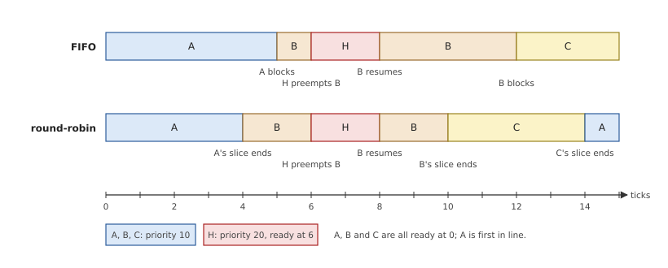
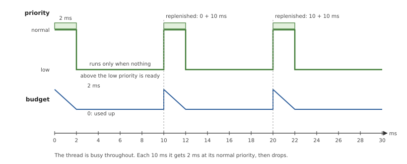
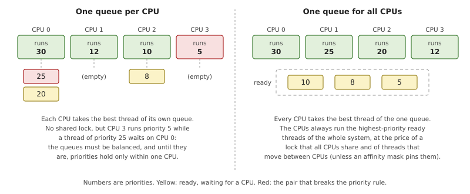
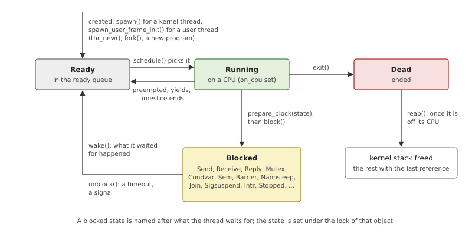
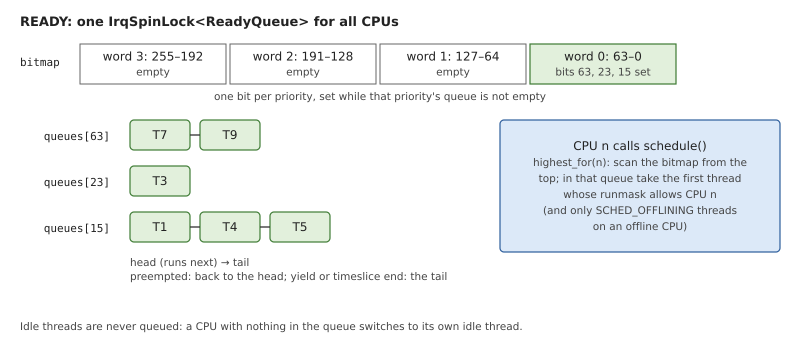
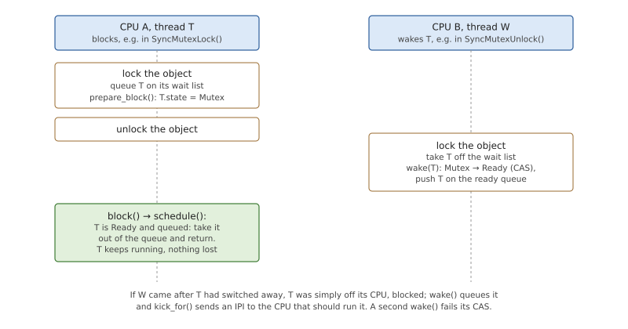
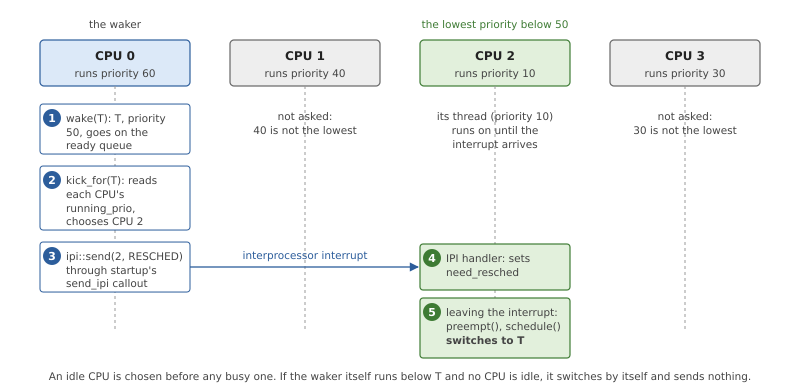
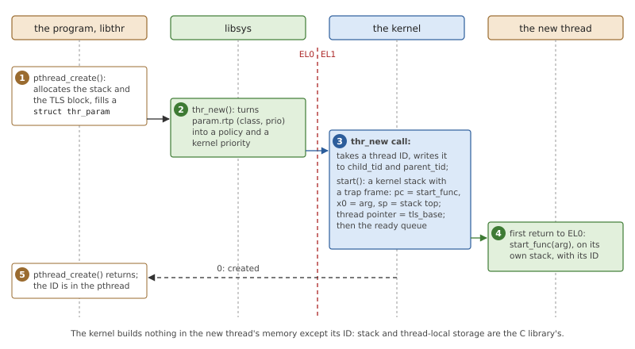

# Threads and Scheduling

A computer has a few processors and many things to do. The part of the
kernel that decides which of them each processor does now is the
*scheduler*, and in a real-time system its rules matter more than
anything else in the kernel: they decide how long a piece of work can be
kept waiting. This chapter first explains threads and the common ways of
scheduling them, then shows OsCraft's scheduler: what a thread is to the
kernel, how the ready threads are kept, how a thread stops to wait and is
woken, and how four processors share the work. It ends with the way a
FreeBSD program's threads and priorities arrive in that scheduler.

## Threads and how to schedule them

A *thread* is one flow of execution: a program counter, a stack and a set
of register values moving through a program. A *process* is the container
its threads share: an address space, open files, credentials. The threads
of one process see the same memory and run the same program, each at its
own place in it. The thread, not the process, is what a scheduler
schedules.

At any moment a thread is in one of three conditions. It is *running* on
a processor; or it is *ready*, able to run but waiting for a processor;
or it is *blocked*, waiting for something that has not happened yet: a
message, a lock, a timer. Scheduling is the choice, on every processor,
of which ready thread becomes the running one, and of when a running
thread must give its processor up.

### Priorities and preemption

The simplest useful rule gives every thread a number, its *priority*, and
always runs the ready thread with the highest one. The rule is
*preemptive* if it holds at every instant: when a thread of higher
priority becomes ready, because its message arrived or its timer fired,
it takes the processor from the running thread at once, in the middle of
whatever that thread was doing. The preempted thread is not told. It
becomes ready again and continues later from where it stopped.

Priority says nothing about threads of the *same* priority that are ready
together. A second rule, the *scheduling policy*, settles that.

- **FIFO** (first in, first out): the thread runs until it blocks or
  gives the processor up by itself (it *yields*). Others of its priority
  wait, however long that takes.
- **Round-robin**: the same, except that the thread also gives way after
  a fixed amount of processor time, its *timeslice*, and goes to the back
  of the line. Threads of one priority then take turns.



*Figure 8.1: Three threads of priority 10 on one processor, under FIFO
and under round-robin. A thread of priority 20 that becomes ready at
tick 6 preempts whoever runs, under either policy.*

The policy only matters between equals. A FIFO thread never delays a
thread of higher priority, and a round-robin thread's timeslice never
lets a lower one in. One detail in the figure is easy to miss: the thread
that was preempted (B) continues when H is done, before C gets a turn. A
preempted thread did not use up its turn, so it goes back to the *front*
of its priority's line; a thread that yields or finishes its timeslice
goes to the *back*.

### Why real-time systems fix priorities

A general-purpose system changes priorities by itself. Its scheduler
watches what threads do, favours those that wait for input over those
that compute, and makes sure that everything gets some processor time. It
aims at good average behaviour, and it gets it by overruling the numbers
the programs asked for.

A real-time system must answer a different question: will this thread
have finished within 2 ms of its interrupt, every time? That can only be
answered if the scheduler does exactly what the priorities say. With
*fixed priorities*, a thread can be delayed only by threads of higher
priority (and by those of equal priority, according to the policy), and
the designer can add up how long those can run. The price is that
fairness is the designer's problem: a high-priority thread that never
blocks stops everything below it, for ever, and the kernel lets it.

### Bounding a high-priority thread: sporadic scheduling

That price is sometimes too high. A thread that handles events from
outside needs a high priority to react quickly, but if events arrive in
a burst it should not take the whole processor. *Sporadic scheduling*
gives such a thread two priorities and an allowance:

- a *normal priority*, at which it may run for a *budget* of processor
  time;
- a *low priority*, to which it drops when the budget is used up, and at
  which it runs only when nothing more important is ready;
- a *replenishment period*: time used at the normal priority is given
  back to the budget one period after the run that used it began.



*Figure 8.2: A sporadic thread with a budget of 2 ms and a period of
10 ms that always has work. In every period it gets 2 ms at its normal
priority, then drops to its low one.*

In any window of one period the thread takes at most its budget at the
normal priority, however many events arrive. For the threads below it,
it behaves like a periodic thread with a known cost, which is something
a designer can add up.

### More than one processor

With several processors the rule "run the highest-priority ready thread"
becomes "run the *N* highest", and the question is where the ready
threads are kept.



*Figure 8.3: Two ways to keep ready threads on four processors. With a
queue per CPU, a high-priority thread can wait behind one CPU while
another runs something lower. With one queue, that cannot happen.*

A queue per processor is what large systems use: no lock is shared, and
a thread stays on the processor whose cache holds its data. But
priorities are then only exact within one processor, until some
balancing code moves threads across. One queue for all processors makes
the rule exact at every instant, at the cost of a lock that every
processor takes and of threads that move freely.

Two more mechanisms belong to every multiprocessor scheduler. An
*affinity mask* names the processors a thread may run on, for threads
that must stay next to a device's interrupt or away from a processor
reserved for something else. And because the processor that makes a
thread ready is often not the one that should run it, processors need a
way to interrupt each other: the *interprocessor interrupt* (IPI).

## Scheduling in OsCraft

OsCraft's scheduler is preemptive, with 256 fixed priorities, the FIFO,
round-robin and sporadic policies, and one ready queue for all
processors. The kernel never changes a priority on its own judgment. A
thread's priority changes only when a program sets it or when the thread
inherits one, from a message (Chapter 10) or a lock (Chapter 9). The
scheduler is in `kernel/src/sched.rs`, sporadic scheduling in
`kernel/src/sporadic.rs`, interprocessor interrupts in
`kernel/src/ipi.rs`, and the kernel calls that create and control
threads in `kernel/src/ker/thread.rs` and
`kernel/src/personality/native.rs`.

*Table 8.1: Priorities.*

| Priority | Who |
|---|---|
| 0 | the idle threads, one per CPU; no other thread may have it |
| 1 to 63 | any thread |
| 64 to 253 | threads of processes with the priority ability (Chapter 17) |
| 254 | the clock's interrupt thread (Chapter 13), and the two special policies below |

The upper limit of ordinary threads is one below the clock's priority,
which is 254 unless the kernel was started with another.

### The thread object

A thread is a `Thread` structure, created once and shared by counted
references. Each subsystem keeps its per-thread state in it rather than
in a table of its own, so it is large; the scheduler's part is small.

*Table 8.2: The scheduler's fields of a `Thread`.*

| Field | Meaning |
|---|---|
| `tid`, `ptid` | a number unique in the kernel, and the thread's ID within its process (the first thread of a process is 1) |
| `prio`, `base_prio` | the priority the scheduler uses, and the one the thread was given; they differ while the thread inherits |
| `policy` | FIFO, round-robin, `SCHED_OTHER`, sporadic, or one of two special ones |
| `state` | running, ready, dead, or what it is blocked on |
| `on_cpu` | set while a CPU runs it or is still saving its registers |
| `runmask` | the CPUs it may run on, one bit each |
| `slice_end`, `ss` | where its timeslice ends; its sporadic budget |
| `cpu_ns`, `run_since` | the processor time it has used |

`SCHED_OTHER` is scheduled exactly like round-robin and only reports
itself differently. The two special policies are FIFO policies that may
go up to priority 254: one for threads that handle interrupts
(Chapter 15), one for a thread that takes a CPU out of use
(`kernel/src/ker/offline.rs`).

Nearly every field is an atomic value or sits behind its own lock, so
any CPU can read or change a thread without a global lock. The saved
registers are the exception: only the CPU that runs the thread, or that
is switching to or from it, touches them.



*Figure 8.4: The states of a thread in OsCraft and the functions that
move it between them.*

There is one blocked state for each thing a thread can wait for: `Send`,
`Receive` and `Reply` for message passing, `Mutex`, `Condvar`, `Sem` and
`Barrier` for locks, `Nanosleep`, `Join`, `Sigsuspend`, `Sigwaitinfo`,
`Intr`, `Stopped`, and a few more for message queues, pipes and tracing.
The state is how the rest of the kernel knows which queue a blocked
thread is on when it must be taken off early, by a timeout or a signal.

A thread that ends marks itself `Dead` and switches away for the last
time. It cannot free its own kernel stack, because it is still running on
it; so it puts itself on a list, and the next pass through the scheduler
on any CPU frees the stacks of dead threads that have left their CPU
(`reap()`). The structure itself goes with the last reference to it.

### The ready queue

All CPUs share one ready queue: an array of 256 lists, one per priority,
and a bitmap with one bit per priority that is set while that priority's
list is not empty. One lock that also masks interrupts protects both.



*Figure 8.5: The ready queue. Finding the best thread means finding the
highest set bit of the bitmap and taking the first thread of that list
that may run on the asking CPU.*

Finding the highest set bit of a 64-bit word is one instruction, so in
the common case (no thread restricted to other CPUs) the choice costs a
few operations however many threads are ready. Insertion is at the tail
of a list, or at its head for a preempted thread. The running threads
are not in the queue, and neither are the idle threads: a CPU that finds
nothing in the queue switches to its own idle thread.

The lock is held for these few operations only. In exchange the rule is
exact, as in the right half of Figure 8.3: no CPU ever runs a thread
while a higher-priority thread that it could run is ready.

### Choosing the next thread

Every switch goes through one function, `schedule()`, called for one of
four reasons: the running thread must be *preempted* (something better
is ready, or its timeslice ended), it *yields*, it *blocks*, or it
*exits*. The decision itself is short enough to read.

*Listing 8.1: Who runs next, from `schedule()` (`kernel/src/sched.rs`).*

```rust
{{#include ../../../kernel/src/sched.rs:schedule_choice}}
```

`q.highest_for()` is the best priority in the queue that this CPU may
run, `prio` the current thread's, and `runnable` says whether the
current thread could continue here. The four arms are the scheduling
rules:

- the current thread cannot continue (it blocked or ended, its runmask no
  longer includes this CPU, or it is the idle thread): take the best
  ready thread;
- a higher priority is ready: take it, which is preemption;
- an equal priority is ready, and the current thread is yielding or has
  used its timeslice: take it, which is round-robin;
- otherwise nobody is taken, and the current thread runs on.

A thread that is replaced while still able to run goes back into the
queue: at the head if a higher priority preempted it, at the tail
otherwise. One case goes to the tail although it was preempted: a thread
whose timeslice ended at the same tick, so that a thread woken on every
tick cannot keep its equals from ever getting their turn.

The chosen thread may have been running on another CPU a moment ago, and
that CPU may still be saving its registers. `on_cpu` covers the gap: the
old CPU clears it only when the registers are saved, and the switch on
the new CPU waits for that. Chapter 6 shows the switch itself.

### Blocking and waking

A thread that must wait, for a message or a lock, leaves the CPU, and
some other thread wakes it when the event happens. The classic mistake
here is the *lost wakeup*: a thread sees that its message is not there
and decides to sleep; the message arrives before it is asleep; the
sender finds nobody to wake; the thread then sleeps with its message
waiting, perhaps for ever.

OsCraft closes the gap with an order of operations and one atomic step.
The blocking side takes the lock of the object it waits on (a channel, a
wait queue), puts itself on the object's list, sets its blocked state
with `prepare_block()`, releases the lock, and only then calls `block()`.
The waking side takes the same lock, removes the thread from the list
and calls `wake()`.



*Figure 8.6: A wake that arrives after the blocking thread has released
the object's lock but before it has left its CPU. The thread is found
ready again and simply continues.*

Since the state was set under the object's lock, a waker that finds the
thread on the list always finds it in a blocked state, even if the
thread has not reached `block()` yet. The waker then makes it ready:

*Listing 8.2: Making a blocked thread ready, `wake_as()`
(`kernel/src/sched.rs`).*

```rust
{{#include ../../../kernel/src/sched.rs:wake}}
```

- The change from blocked to ready is a compare-and-exchange. Of two
  wakers (the event and a timeout, say) one wins, and the other is told
  that the thread was not blocked. Only the winner's reason for the wake
  is kept, as the error the thread's kernel call returns.
- The thread goes on the ready queue even if it is still on its CPU on
  the way to sleep. `schedule()` checks for exactly that when it starts:
  a current thread that is ready and queued is taken back out of the
  queue and keeps running. That is the green box of Figure 8.6.
- The last lines decide who should run the thread now: this CPU, if the
  thread is higher than what it runs (it sets a flag and switches on its
  way out of the kernel), or another one.

### Timeslices and the tick

Each CPU takes a clock interrupt, the *tick*, every millisecond by
default (Chapter 13), and the scheduler does its periodic work there. A
round-robin thread's timeslice is four ticks less a quarter tick,
3.75 ms, counted in the thread's own run time rather than in wall-clock
time: a thread that is preempted or blocks keeps what is left of its
slice. On each tick the CPU compares the run time of the thread it is
running with the end of that thread's slice, and asks for a switch when
it is reached. Because the check happens on ticks, two round-robin
threads that share a CPU alternate every four ticks.

The tick does not switch threads itself. It sets a per-CPU flag,
`need_resched`, as `wake()` does, and the switch happens at the next
*preemption point*: on the way out of the interrupt or of a kernel call,
or at marked places inside long kernel operations such as the copy of a
large message.

A sporadic thread's budget is kept the same way, as a point in its run
time. Its accounting works in chunks: each time the thread blocks at its
normal priority, the run time it used is added to a pending
*replenishment*, due one period after the run began. The thread drops to
its low priority when it reaches the end of its budget, checked on
ticks, or when the number of chunks reaches the limit set with the
policy. When the replenishment is due, a thread that had dropped returns
to its normal priority with a fresh budget, and one that had not has its
budget extended by the amount. The drop and the return are ordinary
changes of the thread's own priority, so a lock that raises the thread
(Chapter 9) keeps it raised through both.

### Four processors

QEMU's `virt` machine has four cores. Each has its own current thread,
its own idle thread and its own `need_resched` flag, and all take
threads from the one ready queue. What remains is to get the right CPU
to look at the queue at the right time.

When a thread becomes ready, the CPU that readied it decides who should
run it, in `kick_for()`. Each CPU publishes the priority of what it is
running, so the decision needs no lock.

*Listing 8.3: Choosing a CPU for a thread that became ready, `kick_for()`
(`kernel/src/sched.rs`).*

```rust
{{#include ../../../kernel/src/sched.rs:kick_for}}
```

The candidates are the other CPUs that the thread's runmask allows and
that run something lower than the thread. An idle CPU wins. Otherwise
the one running the lowest priority is interrupted, unless the calling
CPU is about to switch to the thread itself. The `kicked` flag keeps two
threads woken in a row from being sent to the same idle CPU.



*Figure 8.7: A thread of priority 50 is woken on CPU 0, which runs
something higher. CPU 2 runs the lowest priority, so it is interrupted
and switches.*

The kernel does not know the machine's interrupt controller. It sends an
IPI through a function that the startup program left in the system page
(Chapter 5), which records the command for the target CPU and raises the
interrupt there. The target takes it like any interrupt; its handler
sets `need_resched`, and the CPU reschedules on its way out. The same
interrupt is used to make a CPU look at its timers again, and to reach a
thread that is running on another CPU when its priority was lowered or
it must end.

A **runmask** is OsCraft's affinity mask: one bit per CPU, all set for a
new thread. A thread sets its own; the kernel refuses a mask with no
online CPU, and does not set another thread's. The change is immediate:
a thread that excludes the CPU it is running on is put back in the queue
and continues on a CPU it allows.

The **idle thread** of a CPU is what its boot code turns into when it
has nothing left to do (`kernel/src/smp.rs` starts the other three CPUs,
Chapter 5). Its loop calls the scheduler, and if nothing is ready it
stops the CPU's tick and waits for an interrupt. Interrupts are masked
between the check for work and the wait, and the wait instruction ends
on a pending interrupt even when masked, so an IPI that arrives in
between is not slept through. This is the lost wakeup again, solved at
the lowest level.

### Threads of a FreeBSD program

A native program is a FreeBSD program, and its threads come from
FreeBSD's thread library, libthr, unchanged. On FreeBSD
`pthread_create()` ends in the system call `thr_new()`. On OsCraft that
call is a function of libsys (Chapter 24), which makes a kernel call of
the same name.



*Figure 8.8: `pthread_create()` in a FreeBSD program. libthr prepares
the thread's memory, libsys translates its scheduling parameters, and
the kernel creates a thread that starts directly in libthr's entry
function.*

The kernel's side is small because FreeBSD's interface leaves the
thread's memory to the library. The kernel reads the parameter block,
allocates a thread ID and writes it where both the creator and the new
thread will look for it, before the thread exists: the thread may run on
another CPU the moment it is made. Then it builds a kernel stack whose
saved user state has the program counter at the library's start
function, the stack pointer at the top of the stack the library
allocated, and the thread pointer at the library's block of thread-local
storage. The new thread inherits its creator's signal mask, and its
creator's policy and priority unless the call names others. It is put on
the ready queue like a woken thread, so an idle CPU picks it up at once.

Thread IDs seen by a FreeBSD program are the kernel's per-process IDs
plus 100000. FreeBSD's own start there, and libthr stores them in lock
words in which small numbers have special meanings.

A thread ends in `thr_exit()`: libsys writes the "terminated" mark into
a word libthr gave it, wakes whoever waits on that word, and destroys
the thread. `pthread_join()` is a wait on that word (Chapter 9 explains
such waits); the kernel is not otherwise involved in joining.

FreeBSD describes a thread's scheduling as a *class* and a priority
within it (`struct rtprio`), where a smaller number is more urgent.
libsys maps them onto the kernel's policies and priorities
(`user/libsys/src/thread.rs`):

*Table 8.3: FreeBSD's scheduling classes on OsCraft's priorities.*

| FreeBSD class | POSIX policy | Kernel policy | Kernel priority |
|---|---|---|---|
| `RTP_PRIO_FIFO`, priority 0 to 31 | `SCHED_FIFO` | FIFO | 42 down to 11 |
| `RTP_PRIO_REALTIME`, priority 0 to 31 | `SCHED_RR` | round-robin | 42 down to 11 |
| `RTP_PRIO_NORMAL` | `SCHED_OTHER` | `SCHED_OTHER` | 10 |
| `RTP_PRIO_IDLE` | | `SCHED_OTHER` | 1 |

So an ordinary FreeBSD thread runs round-robin at priority 10, every
real-time thread is above every ordinary one, and the 32 real-time
levels that `sched_get_priority_max()` reports keep their order. When
`pthread_create()` is given scheduling attributes, the kernel creates
the thread with them instead of changing it afterwards: a thread that
ran even briefly at its creator's priority could already be waiting for
a lock by then, and have lent the lock's holder the wrong priority.
`rtprio_thread()` reads and sets the same values on a living thread, and
`cpuset_setaffinity()` sets the calling thread's runmask.

Chapter 23 covers the rest of what the kernel does specifically for
FreeBSD programs. Programs for the optional QNX personality create their
threads with a different call, `ThreadCreate()`, which lays out the
thread's memory the way their C library expects; the scheduler does not
tell the two kinds of thread apart (Part VI).

## Summary

- A thread is running, ready or blocked. The scheduler runs the ready
  threads of highest priority, preempting at once, and the kernel never
  adjusts priorities by itself: that is what makes delays computable.
- Among equal priorities the policy decides: FIFO runs until it blocks,
  round-robin also gives way after 3.75 ms of its own run time. A
  preempted thread returns to the head of its line.
- A sporadic thread has a budget of time at its normal priority and
  drops to a low one when it is spent, which bounds what a high-priority
  thread can take.
- One ready queue, an array of lists with a bitmap, serves all CPUs, so
  the priority rule is exact across the machine.
- A thread sets its blocked state under the lock of what it waits on,
  and a wake is one compare-and-exchange; a wake that comes early finds
  the thread still on its CPU and lets it continue.
- A CPU that readies a thread picks the idle or lowest-priority CPU
  allowed by the thread's runmask and interrupts it.
- FreeBSD's `thr_new()` creates a kernel thread on memory the C library
  prepared, and FreeBSD's scheduling classes map onto fixed kernel
  priorities: 10 for ordinary threads, 11 to 42 for real-time ones.
