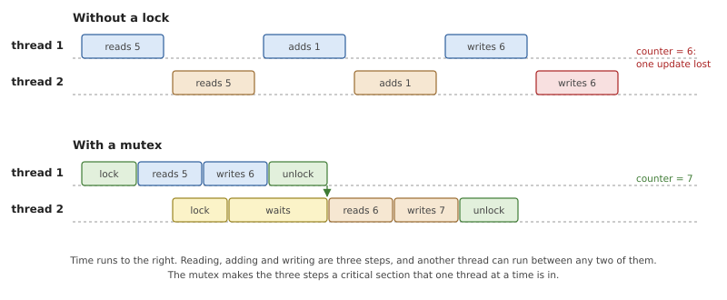
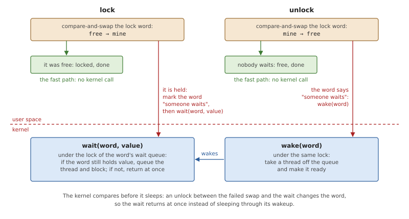
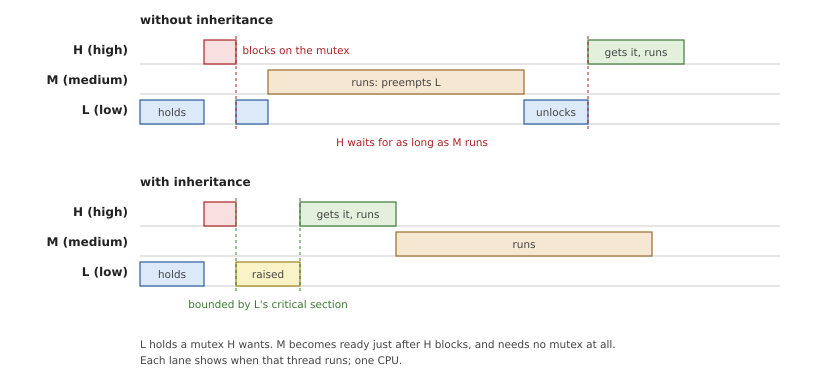
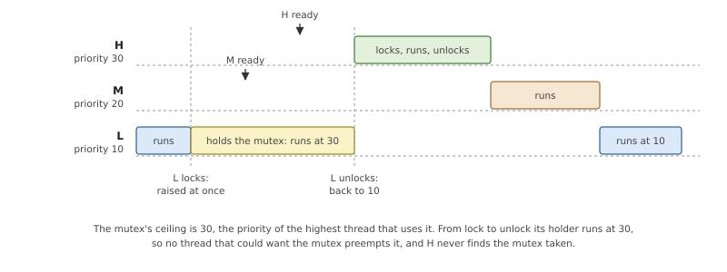
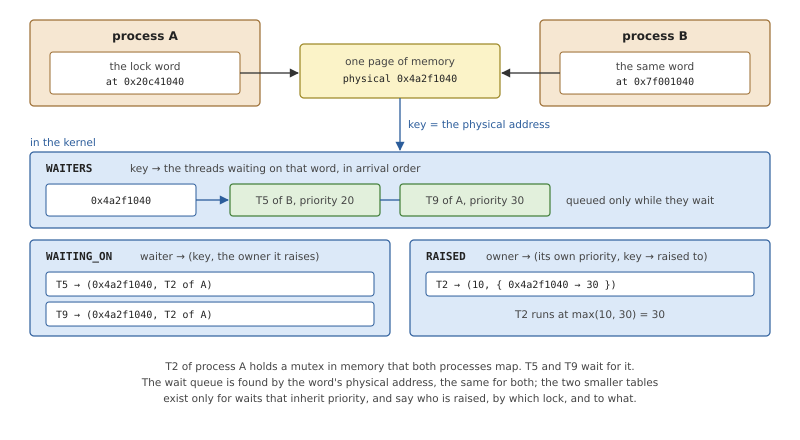
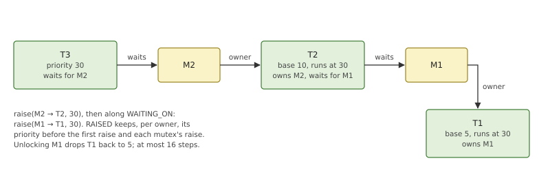
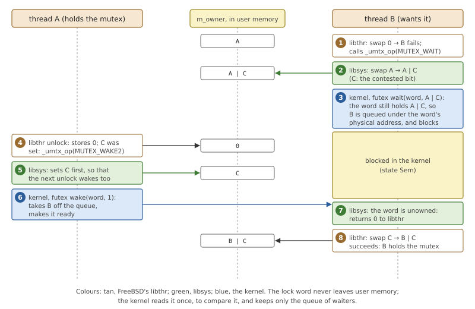

# Synchronization Objects

The threads of a process share its memory. That is what makes them
useful, and it is also their main danger: two threads that change the
same data at the same time can leave it wrong. *Synchronization objects*
are the tools threads use to take turns and to wait for each other:
mutexes, condition variables, semaphores and a few relatives. This
chapter explains what they do and what they need from a kernel, then
shows the kernel's part in OsCraft, and finally how the locks of a
FreeBSD program, which FreeBSD's thread library implements, reach it.

The kernel's own internal locks are a different subject, covered in
Chapter 4.

## Taking turns

Adding 1 to a counter in memory is three steps: read the value, add,
write the result. If two threads do this to the same counter, their
steps can interleave.



*Figure 9.1: Two threads each add 1 to a counter that holds 5. Without a
lock both read 5 and both write 6. With a mutex the second thread waits
until the first has finished.*

A stretch of code that must not be interleaved with others touching the
same data is a *critical section*, and the property wanted is *mutual
exclusion*: at most one thread inside at a time. The object that
provides it is the **mutex**. A thread *locks* the mutex before the
critical section and *unlocks* it after; a thread that tries to lock a
mutex another thread holds waits until it is unlocked. The thread that
holds a mutex is its *owner*.

### The fast path and the slow path

Most of the time a mutex is free when a thread locks it. A kernel call
costs an exception, some hundreds of instructions and the return;
testing that a word in memory says "free" and changing it to "mine" is
one atomic instruction, the *compare-and-swap*: "if this word still
holds the value I expect, replace it with this other value, and tell me
whether you did", as one step that no other processor can split.

So the lock itself is a word in the program's own memory, and locking a
free mutex or unlocking one that nobody waits for never enters the
kernel. That is the *fast path*. The one thing a program cannot do by
itself is wait: stopping a thread and starting it again needs the
scheduler. The kernel is called only for that, on the *slow path*.



*Figure 9.2: A lock in user memory. The kernel provides only two
operations, to sleep and to wake, both named by the address of the lock
word.*

The two paths must fit together without a gap. A thread that finds the
mutex held first marks the lock word ("someone is waiting"), so that the
owner's unlock cannot take the fast path, and then asks the kernel to
wait. Between those two steps the owner may unlock. If the kernel put
the thread to sleep regardless, it would sleep with the mutex free and
nobody left to wake it: the lost wakeup of Chapter 8. The kernel
therefore sleeps *conditionally*: the caller says what value it expects
the word to hold, and the kernel compares and queues the thread under
one lock, the same lock a wake takes. A wait-and-wake service of this
kind, keyed by an address in user memory, is commonly called a *futex*.

### Waiting for a condition, and counting

A mutex protects data. It cannot express "wait until the queue has
something in it". A **condition variable** does. It is used together
with a mutex and with a condition on the data the mutex protects. The
waiting thread locks the mutex and, while the condition is false, waits
on the condition variable; that wait unlocks the mutex while the thread
sleeps and locks it again before it returns. The other thread locks the
mutex, changes the data, signals the condition variable and unlocks.
Unlocking the mutex and starting to wait must be one step as far as the
signalling thread can tell, or a signal sent in between would be lost.
The waiter tests its condition in a loop, because another thread may
have taken the item first; that also makes it harmless for a wait to
return without a signal, a *spurious wakeup*, which implementations are
allowed.

A **semaphore** is a counter with two operations: *wait* takes one unit,
or blocks while the count is zero; *post* adds one unit, or hands it to
a waiting thread. Unlike a mutex it has no owner, so any thread may
post, which makes it the usual way to count free slots or to signal from
one thread to another.

Two more objects are built from the same parts. A **read-write lock**
admits many readers at once or a single writer, for data that is read
often and changed rarely. A **barrier** holds threads back until a given
number have arrived, then releases them together.

### Priority inversion

In a system with fixed priorities, a lock can undo them. Suppose a
low-priority thread L holds a mutex, and a high-priority thread H tries
to lock it and waits. That alone is fine: L will unlock soon. But now a
thread M of medium priority, which needs no lock at all, becomes ready.
It preempts L, because its priority is higher. H waits for L, and L
waits for M, which may run for as long as it likes. H is in effect
running below M. This is *priority inversion*.



*Figure 9.3: Without inheritance, M delays H for as long as it runs.
With inheritance, L runs at H's priority until it unlocks.*

There are two standard cures.

**Priority inheritance.** While H waits for the mutex, its owner L runs
at H's priority. M cannot preempt it, L finishes its critical section
and unlocks, and H is delayed by the length of L's critical section and
no more. The owner is raised only when someone actually waits, and the
raise must follow chains: if L itself is waiting for a second mutex, the
owner of that one must be raised too.

**Priority ceilings.** Each mutex is given, in advance, a *ceiling*: a
priority at least as high as that of any thread that will ever lock it.
A thread that locks the mutex is raised to the ceiling at once, whether
or not anyone waits.



*Figure 9.4: A mutex with a ceiling of 30. Its holder cannot be
preempted by any thread that uses the mutex, so those threads never find
it locked.*

Inheritance needs no planning and costs nothing until there is
contention. Ceilings need the designer to know who uses each mutex, and
they raise the owner on every lock, but the worst case is simpler to
calculate, and the raise does not depend on the kernel discovering a
chain at run time.

## Synchronization in OsCraft

In OsCraft every synchronization object lives in user memory, and the
kernel's part is the slow path: queues of waiting threads, and the
priorities of the threads they wait for. The kernel allocates nothing
when an object is created and knows nothing about an object that nobody
waits on. All of this is in `kernel/src/ker/sync.rs`.

There are two ways in, and both end in the same queues:

- a **futex**, which is all that a FreeBSD program's locks need, because
  FreeBSD's thread library does the rest in user space. Every native
  program uses this one; the last section of the chapter follows it.
- the **synchronization calls** (`SyncMutexLock()`, `SyncCondvarWait()`,
  `SyncSemWait()` and others), with which the kernel implements complete
  objects: it reads and writes the lock word itself, hands a mutex from
  one thread to the next, and keeps priority ceilings.

### Naming a lock

To find the threads waiting on an object the kernel needs a name for
it. The object's address will not do: memory shared by two processes
may be mapped at different addresses in each, and the same address
means different memory in different processes. What is the same for
everyone is the *physical* address of the lock word, so that is the
key.



*Figure 9.5: The kernel's synchronization state. A lock in shared memory
has one key whatever address each process sees it at.*

Three maps hold everything, all under the lock of the first.

- `WAITERS`: for each key, the threads waiting on that object, in order
  of arrival. An entry exists only while someone waits.
- `WAITING_ON`: for each thread waiting for a lock that inherits
  priority, the lock's key and its owner.
- `RAISED`: for each owner that is raised, the priority it had before,
  and for each lock that raises it, the priority that lock asks for.

Because the key is physical, a lock in shared memory works between
processes with no further arrangement. A thread waiting here is blocked
by the protocol of Chapter 8: it queues itself and sets its state while
`WAITERS` is locked, and a waker takes it off the queue under the same
lock.

### The synchronization calls

An object of these calls is two 32-bit words in user memory. For a mutex
the first holds flags (the protocol, whether it is recursive, shared
between processes, or robust) and the second, the *owner word*, says who
holds it: a value made of the owner's process and thread IDs, with the
top bit set while other threads wait. For the other objects the second
word is a constant that says what kind of object it is.

*Table 9.1: The synchronization calls.*

| Call | What the kernel does |
|---|---|
| `SyncTypeCreate()` | initializes a mutex or a semaphore from its attributes |
| `SyncMutexLock()` | waits for a mutex that is held, and takes it |
| `SyncMutexUnlock()` | hands a mutex to the best waiter, or frees it |
| `SyncCondvarWait()` | releases a mutex, waits on a condition variable, takes the mutex again |
| `SyncCondvarSignal()` | wakes the first waiter, or all of them |
| `SyncSemWait()`, `SyncSemPost()` | take a unit or wait for one; give a unit |
| `SyncRWLock()` | the slow paths of a read-write lock |
| `SyncBarrierWait()` | waits for the barrier's number of threads |
| `SyncCtl()` | reads or changes a ceiling, repairs a robust mutex |
| `SyncDestroy()` | marks an object destroyed; `EBUSY` while threads wait |

**Mutexes.** A library locks a free mutex with a compare-and-swap of the
owner word from 0 to its own value, and calls `SyncMutexLock()` when
that fails. By then the mutex may be free again, so the kernel repeats
the decision under its lock, as one compare-and-swap on the same word:
free, take it; held by the caller, `EDEADLK`; held by another thread,
set the waiting bit and queue. The kernel updates the owner word with
the same atomic instructions the library uses, so neither can overwrite
a change the other made.

Unlocking with the waiting bit set brings the owner to
`SyncMutexUnlock()`. The kernel does not free the mutex and let the
waiters race for it. It picks the waiter of highest priority (the
earliest of them, if several share it), writes *that thread's* value
into the owner word, and wakes it. The woken thread returns from its
call owning the mutex. A thread that unlocks a mutex it does not hold
gets `EPERM`, and nothing is touched.

**Condition variables.** `SyncCondvarWait()` checks that the caller
holds the mutex, queues it on the condition variable and releases the
mutex, all while `WAITERS` is locked. `SyncCondvarSignal()` takes the
same lock, so a signal cannot fall between the release and the wait.
After waking, the thread takes the mutex again, by the fast path if it
is free and by `SyncMutexLock()` if not.

**Semaphores.** These have no fast path: the count is the first word of
the object, and every wait and post is a kernel call. A post that finds
a waiter gives its unit straight to that thread and leaves the count
alone, so a thread that posts and immediately waits again cannot take
back the unit it gave away. Named semaphores are objects of process 1
(Chapter 22) and use the same two calls.

**Barriers and read-write locks.** A barrier's waiters queue until their
number reaches the barrier's count; the last to arrive wakes them all
and is told that it was the last. For a read-write lock the library
counts readers itself in the lock word, and the kernel handles writers
and the cases where someone must wait; when the lock becomes free it
wakes the first waiting writer, or else all the readers, and each woken
thread tries again.

These calls are the base of the C library of a QNX program (Part VI),
and native code can make them as well; the bindings for native servers
are in `user/kercall/src/neutrino/sync.rs`.

### Inheritance along chains

A mutex of these calls inherits priority unless it was created with
another protocol. The whole mechanism is one function, `raise()`, and
the two small maps of Figure 9.5.



*Figure 9.6: T3 waits for M2, whose owner T2 waits for M1. Raising T2 is
not enough: T1 must run at 30 as well, or T3 still waits behind a thread
of priority 5.*

*Listing 9.1: Raising an owner and following the chain, `raise()`
(`kernel/src/ker/sync.rs`).*

```rust
{{#include ../../../kernel/src/ker/sync.rs:raise}}
```

What to look for:

- An owner's entry in `RAISED` holds its own priority and one
  *contribution* per lock: the priority that lock's waiters ask for.
  The thread runs at the highest of all of them. Setting or removing a
  single contribution is therefore all any caller does; a thread that
  holds three contended mutexes and unlocks one drops to what the other
  two ask for, in any order.
- After changing the owner's priority, the function looks the owner up
  in `WAITING_ON`. If the owner itself waits for a lock, its new
  priority changes what *that* lock's waiters ask for, and the loop
  continues with that lock's owner. This is the chain of Figure 9.6.
- The loop runs at most 16 times, which bounds the work, also when
  threads wait for each other in a cycle.

`raise()` is called at each point where the set of waiters changes: when
a thread starts to wait, when a waiter leaves early because of a
timeout, and at unlock, which removes the lock's contribution from the
old owner and gives the new owner the contribution of the waiters that
remain.

A thread's own priority can change while it is raised: a program sets
it, or a sporadic thread's budget runs out (Chapter 8). The new value
replaces the remembered one in `RAISED`, and the thread keeps running at
the highest contribution until the locks let go.

### Ceilings

A mutex created with the ceiling protocol has its ceiling stored in the
kernel, in a map by key, and a flag in its first word that tells the
library never to use the fast path: the kernel must see every lock and
unlock. Taking the mutex adds a contribution to the owner's `RAISED`
entry, the ceiling, kept apart from what waiters of the same mutex might
ask for. Releasing it removes that contribution.

Because a ceiling is one more contribution, several of them combine
without special code. A thread at priority 10 that takes mutexes with
ceilings 20 and then 30 runs at 30; if it unlocks the second it is back
at 20, and if instead it unlocks the *first*, it stays at 30 until the
second is unlocked too. A thread whose own priority is above a mutex's
ceiling may not lock it (`EINVAL`), and for that test the ceilings the
thread already holds do not count: under a ceiling of 30 it can still
take a mutex whose ceiling is 20.

`SyncCtl()` reads a ceiling and changes it. A caller that does not hold
the mutex takes it for the change, waiting if it must; a holder's
priority follows the new ceiling.

### Robust mutexes

A thread may die holding a mutex. An ordinary mutex then stays locked
for ever. A *robust* mutex tells the next thread that locks it what
happened, with the error `EOWNERDEAD`, and lets that thread have the
mutex so that it can repair the data. The kernel learns of the death in
one of two ways. A robust mutex shared between processes always uses
the slow path, so the kernel knows who holds it, and when a process
ends its mutexes are marked and handed to their best waiters. For any
other mutex the death is noticed lazily: the next `SyncMutexLock()`
finds an owner word that names no living thread.

Either way the mutex is then *inconsistent*, and the kernel remembers
who holds it. That thread either declares the data repaired, through
`SyncCtl()`, or unlocks without doing so; in the second case the mutex
becomes unusable, and every waiter and every later lock fails with
`ENOTRECOVERABLE`.

### Ending a wait early

Every wait can carry a timeout (Chapter 13), and a signal may arrive
for a waiting thread (Chapter 14). Either takes the thread off its
queue, and if it was raising an owner, that owner's contribution is
recomputed from the waiters left.

*Table 9.2: How waits end early.*

| Waiting for | Timeout | Signal |
|---|---|---|
| a mutex, a read-write lock | `ETIMEDOUT` | the wait continues |
| a condition variable | `ETIMEDOUT`, with the mutex taken again | returns 0: a spurious wakeup |
| a semaphore, a barrier | `ETIMEDOUT` | `EINTR` |
| a futex | `ETIMEDOUT` | `EINTR` |

### The locks of a FreeBSD program

A native program's `pthread_mutex_lock()` is FreeBSD's, from FreeBSD's
thread library libthr, compiled unchanged. libthr's objects are
FreeBSD's structures, with FreeBSD's lock words: a mutex's owner word
holds the owner's thread ID, and its top bit, *contested*, says that
someone waits. libthr does the fast paths itself. For everything else it
calls FreeBSD's system call `_umtx_op()`, which takes an object, an
operation (wait for this mutex, signal this condition variable, and
some twenty more) and arguments.

On FreeBSD those operations are kernel code. On OsCraft `_umtx_op()` is
a function of libsys (Chapter 24), in `user/libsys/src/umtx.rs`, which
carries out each operation in user space and uses the kernel for only
two things: to wait on a word and to wake waiters on a word. That pair
is the kernel call `futex`, available to native programs only
(`kernel/src/personality/native.rs`).

*Listing 9.2: The conditional wait, `futex_wait()`
(`kernel/src/ker/sync.rs`).*

```rust
{{#include ../../../kernel/src/ker/sync.rs:futex_wait}}
```

This is the kernel half of Figure 9.2 in full. The word is compared
with the expected value while `WAITERS` is locked, and the thread is
queued under the word's physical address before that lock is released.
A wake takes the same lock, so it comes either before the comparison,
which then fails with `EAGAIN`, or after the thread is queued. A wake
removes up to a given number of threads from the queue and reports how
many it woke and how many are still waiting.



*Figure 9.7: Thread B waits for a mutex that thread A holds, and gets
it. libthr, libsys and the kernel each do one part; the lock word is
only ever changed in user space.*

The figure shows how the three layers share the work. Two details carry
the correctness. In step 2 libsys sets the contested bit *before* it
waits, and waits for the value that includes the bit, so A's unlock
either sees the bit or changes the word before B sleeps. In step 5 the
bit is set again before the wake:

*Listing 9.3: Waking one waiter of a mutex, `wake_one_contested()`
(`user/libsys/src/umtx.rs`).*

```rust
{{#include ../../../user/libsys/src/umtx.rs:wake_one_contested}}
```

The kernel has no idea that the word is a mutex, so libsys must make
sure that the *next* unlock also comes to wake someone while threads
still wait. Setting the bit first means that whoever takes the mutex
next takes it with the bit on, and its unlock leaves the fast path. If
the wake finds that nobody was waiting after all, the bit is cleared
again.

The other objects follow the same pattern, each with its own way of
closing the gap between deciding to wait and waiting:

- A **condition variable** has a sequence number. A waiter reads it,
  unlocks the mutex, and waits on the number while it still has the
  value read; a signal adds 1 and wakes one waiter, a broadcast wakes
  all. A signal sent after the unlock changes the number, so the wait
  returns at once.
- A **semaphore**'s count word has a "has waiters" bit; a waiter sets it
  and waits on the word while the count is zero, and a post wakes one
  waiter when the bit is set.
- A **read-write lock**'s waiters, readers and writers alike, wait on
  its state word. An unlock clears the waiters' bits and wakes them all,
  and each tries again.

A thread blocked in a futex is in the state `Sem`, like a thread waiting
for a semaphore. Timeouts are armed by libsys before the wait, with the
clock and the absolute time FreeBSD's interface gave.

**Priority inheritance** needs the kernel to know the owner, which a
plain futex does not tell it. For a mutex created with
`PTHREAD_PRIO_INHERIT`, libsys reads the owner's thread ID from the
lock word and passes it to a third futex operation, a wait that names
an owner. The kernel records the waiter in `WAITING_ON` and calls
`raise()` exactly as for its own mutexes, so chains work, including
chains that mix both kinds of lock. The contribution is recomputed when
a waiter is woken or leaves early.

> [!NOTE]
> A waiter raises the thread that held the mutex when the waiter went
> to sleep. After an unlock wakes one waiter, the others are still
> asleep on the same word and still name the previous holder: they go
> on raising it, not the new holder, until each of them is woken in
> turn.

What libsys does not do is part of the picture as well. A priority
ceiling is accepted and not applied: a FreeBSD mutex with
`PTHREAD_PRIO_PROTECT` locks correctly but raises nobody. The list of
robust mutexes that libthr registers is accepted and not used, so the
death of an owner is not reported to the next locker. And FreeBSD wakes
exactly the readers or the writer that can proceed on a read-write
lock, where libsys wakes every waiter and lets them sort it out.

## Summary

- A lock is a word in user memory. Taking a free lock and releasing an
  uncontended one are single atomic instructions; the kernel is needed
  only to wait and to wake.
- The kernel's wait compares the lock word with an expected value and
  queues the thread under one lock, so an unlock in between cannot be
  missed.
- Waiters queue in the kernel under the physical address of the lock
  word, which makes locks in shared memory work between processes. An
  object nobody waits on costs the kernel nothing.
- The synchronization calls implement complete objects on a two-word
  layout: an unlock hands the mutex directly to the highest-priority
  waiter.
- Priority inheritance keeps, for each raised owner, one contribution
  per lock and runs it at the highest; `raise()` follows the chain when
  an owner is itself waiting. A ceiling is one more contribution, set
  at lock time.
- A FreeBSD program's locks are libthr's. libsys implements
  `_umtx_op()` in user space on the kernel's futex, with priority
  inheritance through a wait that names the owner; ceilings and robust
  lists are not carried through.
