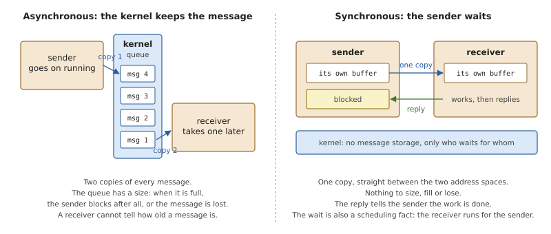
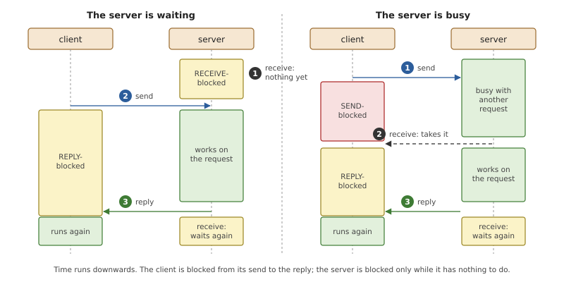
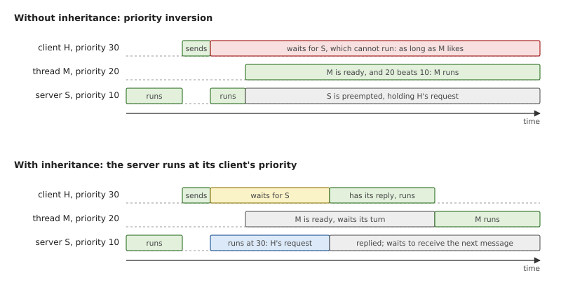
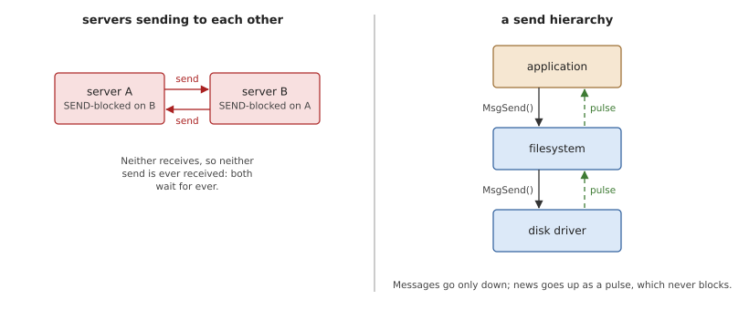
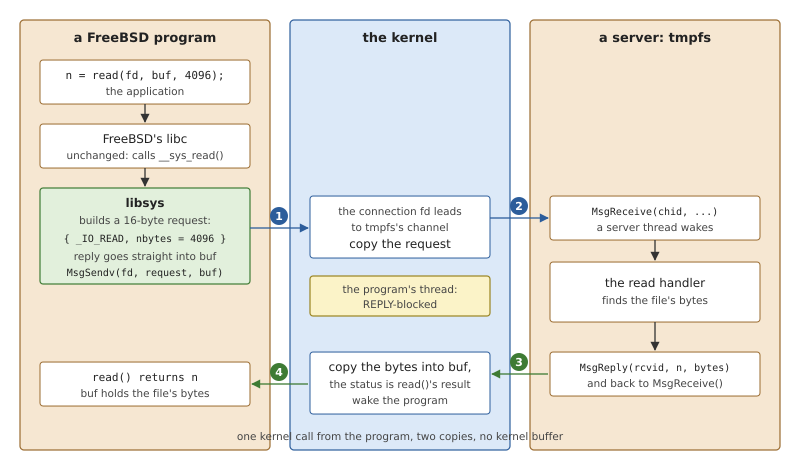
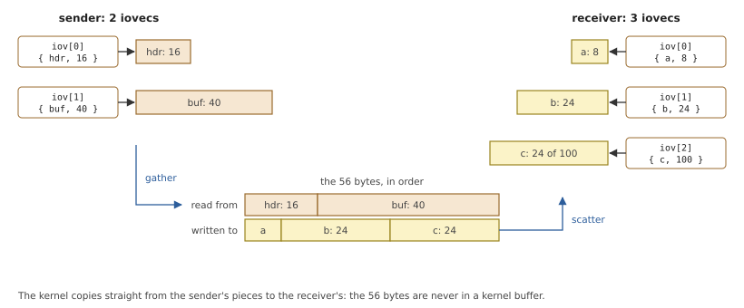
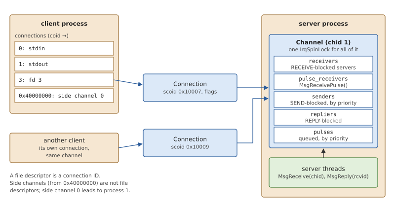
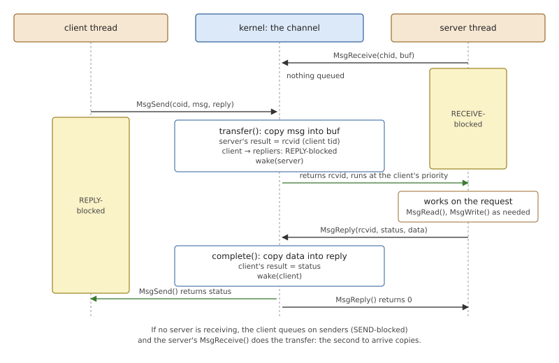
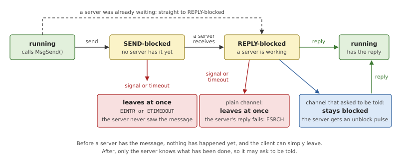

# Message Passing

A microkernel keeps almost nothing in the kernel. File systems, the
network stack, device drivers and even the code that starts programs are
ordinary processes, each in its own address space. That only works if
those processes can ask each other for things cheaply and safely, and
*message passing* is how they do it. In OsCraft, `read()` on a file is a
message to a file system server; `socket()` is a message to the network
server; `fork()` is a message to the process manager. This chapter
explains the mechanism those calls stand on.

## Ways for processes to cooperate

Two processes that must work together cannot simply call each other's
functions: each has its own memory, and that separation is the point.
There are two basic ways across it.

**Sharing memory** maps the same pages into both processes. It is as
fast as memory, and it leaves everything else to the two programs: who
may write when, how one tells the other that something changed, what
happens when one of them dies in the middle. It suits large amounts of
data between programs that trust each other.

**Passing messages** has the kernel carry a block of bytes from one
process to the other. The kernel knows who sent it, the receiver gets a
complete request or nothing, and neither side can see anything the other
did not put in a message. This suits requests and answers between
programs that do not trust each other, which is what an operating
system mostly consists of.

Message passing comes in two forms, and the choice shapes the whole
system.



*Figure 10.1: With asynchronous messages the kernel stores each message
until the receiver takes it. With synchronous messages the sender waits,
so its own buffer is the storage.*

With **asynchronous** messages the sender hands its message to the
kernel and continues. The kernel must keep the message until the receiver
asks for it, which means a queue, and a queue has a size. Something has
to happen when it is full: the sender blocks after all, or the message
is dropped, and either way the simple model has a second, rarer
behaviour that every program must be ready for. Each message is also
copied twice, in and out of the queue.

With **synchronous** messages the sender blocks until the receiver has
taken the message and answered it. Now the kernel never stores a
message: while the sender waits, the message lies in the sender's own
buffer, and the kernel copies it from there straight into the
receiver's. There is one copy and no queue of data. The sender also
learns something an asynchronous send can never tell it: when the call
returns, the work has been done, and the reply says how it went.

A synchronous exchange has three steps: the client *sends*, the server
*receives*, the server *replies*. The first two can happen in either
order, and each step may leave a thread waiting. The names of those
waits come up everywhere in a system built this way.



*Figure 10.2: The three steps of an exchange. On the left the server was
already waiting, so the client's message is taken at once. On the right
the server was busy, and the client waits to be received before it waits
for its reply.*

- A client that has sent is *SEND-blocked* until a server takes its
  message, and *REPLY-blocked* from then until the reply: its request is
  being worked on.
- A server that asks for a message when none is waiting is
  *RECEIVE-blocked* until one arrives.
- Replying never blocks: the client is known to be waiting for it.

A function call has the same shape (pass arguments, wait, get a result),
which is why synchronous message passing can sit underneath an existing
programming interface without changing it. The client does not need to
know that the function it called ran in another process.

### What the waiting costs: priorities

A blocked client depends on its server, and in a real-time system that
dependency must not undo priorities. Suppose a high-priority client
sends to a server that normally runs at low priority. The client now
waits for the server, and any thread of medium priority can preempt the
server for as long as it likes. The high-priority client is in effect
running below the medium one. This is *priority inversion*.



*Figure 10.3: A client at priority 30 sends to a server at priority 10.
Without inheritance a thread at 20 keeps the server, and so the client,
from running. With inheritance the server does the client's work at the
client's priority.*

The cure is *priority inheritance*: while a server works for a client,
it runs at that client's priority. The server's own priority then hardly
matters; work is done at the priority of whoever asked for it, across
any number of processes.

The same rule matters in the other direction. A server that kept a high
priority of its own would do a low-priority client's work at that high
priority, ahead of threads the client could never have preempted by
itself. So a server takes its client's priority whether that raises it
or lowers it.

### What the waiting costs: deadlock

If server A sends to server B while B sends to A, each waits for a reply
the other will never give. Systems built on synchronous messages avoid
this by design, with a *send hierarchy*: servers are arranged in levels,
and a message only ever goes down, from an application to a file system,
from a file system to a disk driver. When a lower level needs to tell a
higher one something ("your data has arrived"), it must not send. It
uses a small message that never blocks its sender and expects no reply,
called a *pulse*.



*Figure 10.4: Two servers that send to each other deadlock. With a send
hierarchy, messages go down and notifications come back up as pulses.*

## Message passing in OsCraft

OsCraft's message passing is synchronous, copies each message once, and
inherits priorities. It follows the model of QNX's kernel, whose
real-time behaviour OsCraft's core is built to have; everything in the
system uses it, whatever the personality of the program. The rest of
this chapter goes through it: how an ordinary system call becomes a
message, the kernel objects involved, the exchange itself, and the
rules for priorities and for interrupting a wait. The code is in
`kernel/src/ker/channel.rs` and `kernel/src/ker/msg.rs`.

### A system call is a message

OsCraft's programs are FreeBSD programs: they are compiled for FreeBSD
and linked with FreeBSD's C library, unchanged. On FreeBSD, `read()`
ends in a trap into a kernel that contains the file systems. OsCraft's
kernel contains none, so the layer under the C library, *libsys*
(Chapter 24), turns the call into a message to the server that owns the
file.



*Figure 10.5: `read()` in a FreeBSD program on OsCraft. libsys sends a
16-byte request on the file descriptor; the server's reply is copied
directly into the caller's buffer.*

Three details of the figure matter for the rest of the chapter.

- **The file descriptor is the address.** `open()` connected the program
  to the server that owns the path, and the descriptor it returned is
  the number of that connection. No lookup happens on `read()`.
- **The request is small and the data moves once.** libsys describes its
  message in parts: one part to send (the request) and one part for the
  reply (the caller's own buffer). The kernel copies the file's bytes
  from the server's memory to the caller's buffer directly.
- **The program's thread is blocked throughout.** From the kernel's
  point of view `read()` is one call, `MsgSendv()`, that returns when
  the server has replied; its return value is the server's status,
  which becomes `read()`'s.

### Messages in parts

The request in Figure 10.5 and the data it asks for are in different
places: a small header on libsys's stack, and the caller's buffer. If a
message had to be one contiguous block, one side or the other would
first have to copy them together. Instead, each side describes its
message as a list of *parts*, each a pointer and a length, and the two
lists need not match.



*Figure 10.6: The sender describes 56 bytes as two parts, the receiver
has room in three. The kernel copies the bytes in order from one list to
the other.*

This is what lets a file system answer a read with a header from its
stack and data straight from its cache blocks, wherever they lie, and
lets a client receive the header and the data into separate variables.
A server whose buffer was too small for a whole message reads the rest
later, by receive ID, and may write its reply in several pieces the same
way.

A program for the optional QNX personality sends on the same channels
through the same kernel calls, with QNX's message layouts; a translation
service converts them for the native servers (Part VI). Nothing in the
kernel's message passing depends on which kind of program is sending.

### Channels and connections

To send, a client must say where the message goes. Naming a server
thread would not do: servers run several threads and replace them. So
the two sides meet at an object the server creates, a *channel*, and the
client refers to it through a small number of its own, a *connection*.



*Figure 10.7: Connections lead from clients' connection tables to a
server's channel. The channel queues every thread taking part in message
passing on it.*

A **channel** belongs to a server process. Any number of the server's
threads may receive on it, and all of them are interchangeable to
clients. A **connection** belongs to a client process and leads to one
channel. Many connections can lead to the same channel, from the same
client or from different ones.

A client's connections are numbered in a table per process, and there
are two ranges of numbers. Those from 0 are the process's *file
descriptors*: a file descriptor is nothing but a connection to the
server behind the open file. Those from `0x40000000` are *side
channels*, connections that are not files, such as the one every process
has to the process manager. A child made by `fork()` gets copies of its
parent's file descriptors, and of its side channels only those that lead
to process 1.

The server sees its clients from the other end. Each client process
connected to a channel has a *server connection ID* there, by which the
server recognises it across requests and keeps per-client state, and
which the kernel uses to tell the server, with a pulse, that a client
has gone.

A channel holds four queues of threads, and one lock for all of them.

*Table 10.1: A channel's queues.*

| Queue | Who is in it | Order |
|---|---|---|
| receivers | server threads waiting for a message (RECEIVE-blocked) | arrival |
| pulse receivers | server threads waiting for pulses only | arrival |
| senders | clients whose message no server has taken yet (SEND-blocked) | priority, then arrival |
| repliers | clients whose message is being worked on (REPLY-blocked) | none |

Pulses that arrive while no server is waiting are queued too, in the
same order as senders. Because senders are ordered by priority, a server
that works through its queue serves its clients in priority order
without knowing anything about priorities.

The single lock is the key simplification of the design. A thread's
message-passing state (the description of its buffers, the result its
call will return) is written by the thread itself before it joins a
queue, and afterwards only by whoever holds the lock of the channel it
is queued on. The channel's lock therefore protects the queues and every
thread in them, and no message operation takes any other lock.

### The exchange

A message transfer is a rendezvous between two threads that arrive in
either order. Whichever arrives second does the work.



*Figure 10.8: One message, with the server waiting first. Each copy is
made once, straight between the two threads' buffers.*

**The server waits first** (the figure). The client's send finds a
RECEIVE-blocked thread, takes it off the queue, copies the message into
that thread's receive buffer, puts itself among the repliers, and wakes
the server. The client is REPLY-blocked without ever having been
SEND-blocked.

**The client arrives first.** No server is waiting, so the client joins
the senders, in priority order, and blocks. A server's later receive
takes the first sender and does the same copy, in the other direction of
control: this time the server's thread runs the transfer.

Either way the server's receive returns a *receive ID*, which names this
one message from now on. The server uses it to reply, and, for a message
longer than its receive buffer, to read the rest in pieces or to write
the reply in pieces. In OsCraft the receive ID is the client thread's
ID, which makes finding the client from it trivial.

The copy itself is the part worth reading in code, because it is where
the design's claims are kept: one copy, between two address spaces, with
neither thread reachable by anyone else while it happens.

*Listing 10.1: Moving a message from the client's buffers to the server's,
`transfer()` (`kernel/src/ker/msg.rs`).*

```rust
{{#include ../../../kernel/src/ker/msg.rs:transfer}}
```

- The caller has already taken the other thread off the channel's queue,
  so the copy runs with the channel *unlocked*. A long message does not
  hold up other clients of the same server, and a higher-priority thread
  can preempt the copy.
- Both sides' memory may be bad, and the two failures are told apart: a
  client whose message cannot be read fails its own send; a server whose
  buffer cannot be written fails its receive, and the client gets
  `ESRVRFAULT`, so a faulty server cannot make its clients look guilty.
- The last step before returning is priority inheritance, the subject of
  the next section.

Replying is simpler, because the client is known to be waiting: the
server's reply data is copied into the client's reply buffer, the status
becomes the result of the client's send, and the client is made ready.
The server does not block and does not wait for the client to run. A
server that has only bad news replies with an error number and no data,
and the client's call fails with it.

A client never waits for a server that no longer exists. When a channel
is destroyed, or its process ends, every thread queued on it is released
at once, and the clients' sends fail with `ESRCH`.

### Priorities

OsCraft applies inheritance at two moments.

**When a server receives a message**, the receiving thread takes the
sender's priority, up or down, and keeps it until it receives the next
message. This is not a temporary boost on top of the thread's priority;
it becomes the thread's priority, which is what a program sees if it
asks. A pulse works the same way with the priority it carries.

**When a message has to queue**, no server thread is receiving: they are
all busy, perhaps with low-priority work. The thread that last received
on the channel is then raised to the new message's priority, so that it
finishes what it is doing at that priority and comes back for the new
message. This is the case of Figure 10.3.

Raising one thread is a remedy, not a cure: the kernel cannot know
which of a server's busy threads will be the first to come back for the
message, so it picks the one that received last. A server that always
keeps a thread waiting to receive never needs it, because then every
message is taken, and its priority inherited, the moment it is sent.

*Listing 10.2: Raising the last receiver when work queues behind it,
`boost()` (`kernel/src/ker/msg.rs`).*

```rust
{{#include ../../../kernel/src/ker/msg.rs:boost}}
```

Both are capped: a server never runs above the highest priority its own
process is allowed, whatever its client's. An unprivileged server cannot
be driven above priority 63 by a client at 100, which keeps a client
from using a server to outrank threads it could not outrank itself. A
server that wants none of this creates its channel with fixed
priorities, and its threads keep their own.

### Interrupting a wait

A client blocked in a send may have to leave early: a signal arrives for
it, or the timeout it set runs out. What may happen depends on how far
its message got.



*Figure 10.9: A client's wait has two halves, and leaving early means
something different in each.*

While the client is SEND-blocked, no server has seen the message. The
client is taken off the queue and its call fails with the reason
(`EINTR`, `ETIMEDOUT`); for the server, the request never existed.

Once the client is REPLY-blocked, a server holds the request and may be
half-way through acting on it: part of a file written, a device
operation started. On an ordinary channel the client still leaves at
once, and the server's eventual reply fails with `ESRCH` because nobody
is waiting for it. A server for which that is not acceptable creates its
channel with the *unblock* flag. The client then stays blocked, and the
kernel sends the server a pulse carrying the receive ID. The server
decides what to do, typically undoing its work and replying with
`EINTR`, and the client leaves when that reply arrives. The price is
that a client can only be interrupted as fast as its server answers.

One case is treated specially. A signal that interrupts a request to
process 1 before it was received leaves the request queued, marked as
asking to leave. Process 1 answers it like any other, so that calls such
as `mmap()` never fail with `EINTR` merely because a signal arrived in
the instant they were sent.

### Pulses

A pulse is a message that fits in the kernel and never blocks its
sender: a priority, an 8-bit code and a 64-bit value, with no reply. If
a server thread is waiting, the pulse is delivered to it at once, and
the receive call returns 0 instead of a receive ID. Otherwise the kernel
queues it on the channel, by priority as it queues senders, and raises
the last receiver as for a message.

Pulses are what makes the send hierarchy of Figure 10.4 workable. They
are also how the kernel itself talks to servers: a client's last
connection closing, a thread of the server's own process ending, and the
unblock request above all arrive as pulses on the channel that asked for
them. Chapter 11 shows how timers, interrupts and other events become
pulses.

## Summary

- Synchronous message passing lets separate processes act like one
  system: a request and its answer, with the caller blocked in between.
  The caller's own buffer is the message's storage, so the kernel copies
  once and stores nothing.
- A server receives on a channel; a client sends on a connection, and a
  file descriptor is a connection. A system call such as `read()` is one
  message to the server behind the descriptor.
- One lock per channel protects its queues and the message state of
  every thread queued on it. The second thread to arrive at a rendezvous
  does the transfer, with the channel unlocked.
- A server works at its client's priority, both when it receives and
  when work queues behind it, up to the limit of its own process.
- A wait can be ended early for free before a server has the message,
  and only with the server's cooperation after.
- What must flow against the direction of requests travels as pulses,
  which never block.
