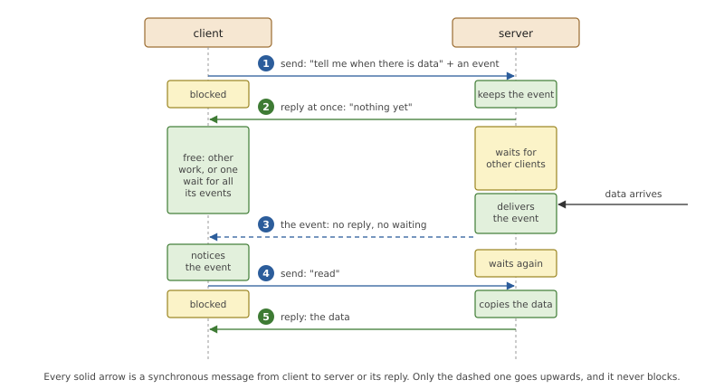
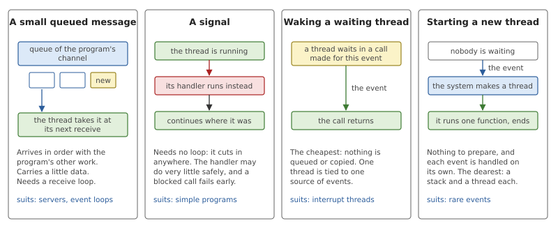
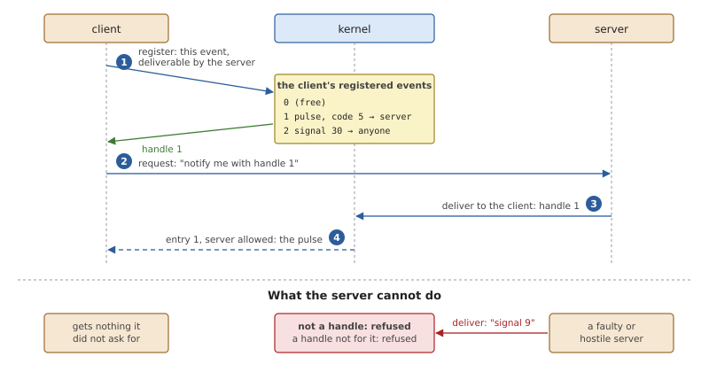
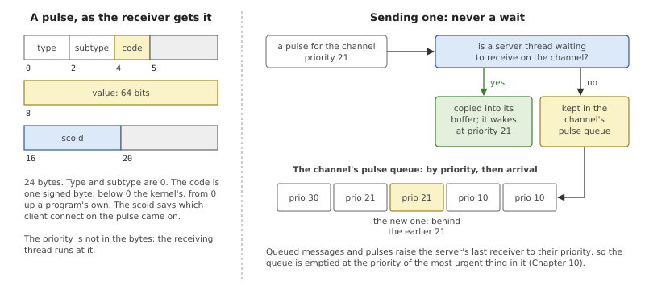
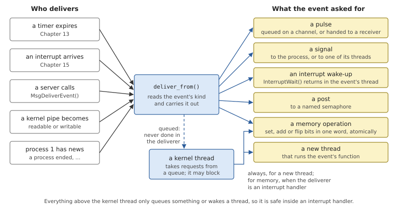
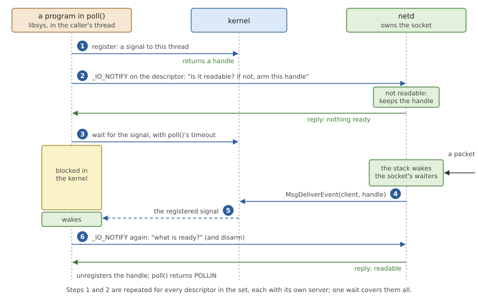

# Pulses and Events

Chapter 10 built the system on one kind of exchange: a client sends, a
server replies, and the client is blocked in between. That covers every
request. It does not cover news. A timer expires, a network packet
arrives, a key is pressed: something must tell a thread that did not ask
at that moment, and whoever tells it must not wait for an answer. This
chapter is about that second kind of communication, the *asynchronous
event*, and about the rule that keeps it safe between processes that do
not trust each other.

## Telling without waiting

### Why a reply is not enough

Take a program that wants to read from a network connection on which
nothing has arrived yet. It can send a read request and stay blocked
until data comes, and often that is exactly right. But a program that
also has a second connection, a timer and a terminal to watch cannot
block on any one of them: it has to wait for all of them at once, and a
synchronous send waits for one server only.

There are two ways out that need nothing new, and both are poor. The
program can ask each server in turn, without blocking, and go round
again: *polling* in the bad sense, which burns processor time and still
reacts late. Or it can start one thread per source, each blocked in its
own request, which works but costs a thread and a stack for every thing
it might ever wait for.

The server cannot simply send the news either. Chapter 10 showed why: a
server that sends to its client is blocked until the client receives and
replies, and a client that happens to be sending to that server at the
same moment waits for it in turn. The two are deadlocked. Even without a
deadlock, a server blocked on one slow client serves nobody else.

What is needed is a third operation, beside the request and the reply: a
notification that goes from the server up to the client, carries almost
nothing, and never blocks the one who delivers it.



*Figure 11.1: Asking to be told. The client leaves an event with the
server and is free at once; the server delivers the event when there is
news, and the client then asks for the data with an ordinary request.*

Figure 11.1 shows the pattern that results, and three things in it are
worth noticing.

- **The notification carries no data.** It says "look now"; the data
  still travels in a reply, copied once into the client's buffer, as
  every other piece of data does. So the notification can be tiny, and
  the kernel can afford to store it.
- **The server never waits.** Delivering takes the same time whether the
  client is ready, busy or stuck.
- **Messages still flow one way.** Requests go from client to server
  and only the notification goes back, so the send hierarchy of
  Chapter 10 is kept.

The same mechanism serves the kernel's own news. A timer that expires
and a device that interrupts are events with no server behind them, and
the kernel delivers them to a thread in the same way.

### What an event is

An *event* is a description of how to notify someone, filled in by the
one who wants to be notified and handed to the one who will have the
news. That division of labour is the whole idea. The network server does
not know, and should not care, whether its client is built around a
receive loop, a signal handler or a pool of threads. The client knows.
So the client writes down "when it happens, do this", and the server
keeps that description and has it carried out when the time comes,
without understanding it.

There are four basic things an event can ask for.



*Figure 11.2: The four ways to be notified. They differ in what the
receiving program must have prepared, and in what a delivery costs.*

**A small queued message.** The notification is put in the queue the
program already receives its work from. A server waits for requests on a
channel; if its notifications arrive there too, one receive call waits
for everything, and the notifications are handled in order with the
rest. This is the *pulse* of Chapter 10: a code and a value, small
enough for the kernel to hold.

**A signal.** The notification interrupts whatever the thread is doing
and runs a handler. A program needs no loop to get one, which is why
signals are the classic Unix answer. The price is that a handler runs at
an arbitrary point of the program and may safely do very little
(Chapter 14).

**Waking a thread** that is blocked in a call made for the purpose. No
message is built and nothing is queued. It is the cheapest form, and
the natural one for a driver thread that does nothing but wait for its
device's interrupt.

**Starting a thread** to run a function. The program prepares nothing
and each event gets its own flow of control, at the cost of creating a
thread every time.

Two smaller forms exist for special uses: changing a word of the
program's memory, for a program that only wants to count or to set a
flag, and posting a semaphore.

### Whose event is it?

Now consider what a server holds when a client has handed it an event:
an instruction that the kernel will carry out *on the client*. If the
server could deliver any event it liked to any client that has ever
sent it a message, a faulty or malicious server could send its clients
signals they never asked for, including ones that kill; start threads in
them at addresses of its choosing; or write to their memory. A client
would have to trust every server it talks to with its life. That is the
opposite of what a microkernel is for.

The cure is to take the event out of the server's hands. The client
*registers* its event with the kernel first, naming the server that may
deliver it, and receives a small number, a *handle*. It gives the server
the handle, not the event. When the server delivers the handle, the
kernel looks it up in the client's own table, checks who is asking, and
delivers what the client stored there.



*Figure 11.3: A registered event. The server holds only a number; what
it stands for is kept by the kernel on the client's side, with the name
of the one server allowed to use it.*

A server can now do exactly one thing to a client: trigger a
notification the client itself wrote, as often as it likes. The worst a
bad server can do is deliver it at the wrong time, and a correct client
treats a notification only as a hint to go and look.

## Pulses and events in OsCraft

OsCraft has all of the above: pulses, events of ten kinds, one delivery
function that every source of events goes through, and registration
that servers cannot avoid. The kernel's side is in
`kernel/src/ker/event.rs` and in the pulse functions of
`kernel/src/ker/msg.rs`. The native system's main use of it is
readiness notification, the mechanism under `poll()`, `select()` and
`kqueue()`, which closes the chapter.

### Pulses

Chapter 10 introduced the pulse as a message that fits in the kernel.
Here is the rest: what is in one, and what the kernel does with it.



*Figure 11.4: Left, the 24 bytes a receiver gets for a pulse. Right,
what sending one does: it goes straight to a waiting thread, or into the
channel's queue in priority order.*

A thread sends a pulse with `MsgSendPulse()` on a connection, giving a
priority, a code and a value. A priority of -1 means the sender's own. A
negative connection number names one of the sender's own channels,
which is how a process pulses itself. Sending a pulse to a process of
another user takes a privilege (an *ability*, Chapter 17), except to
process 1, whose channels accept pulses from anyone.

What happens next is the same whether a program, a server or the kernel
is the sender, and it is short enough to read.

*Listing 11.1: Putting a pulse on a channel, `channel_pulse()`
(`kernel/src/ker/msg.rs`).*

```rust
{{#include ../../../kernel/src/ker/msg.rs:channel_pulse}}
```

- The priority is capped first, at the highest priority the receiving
  process is allowed, so that nobody can raise a server above its limit
  by pulsing it.
- A thread that waits for pulses only is preferred over one that waits
  for anything. If one is found, the pulse is copied into its receive
  buffer, the thread takes the pulse's priority, and its receive call
  returns 0, where a message would have returned a receive ID.
- Otherwise the pulse is queued, behind the pulses of the same
  priority, and the channel's last receiver is raised to that priority,
  as for a queued message.
- Nothing in the function can block. It takes only the channel's lock
  and locks that are safe with interrupts off, because pulses are also
  sent from interrupt handlers.

The queue has no fixed length: a queued pulse takes a little kernel
memory until it is received. A pulse sent to a channel that is being
destroyed is dropped, and so is one for a thread whose receive buffer is
too small to hold it; the sender is not told. A pulse is a hint, and a
program must not depend on counting them.

The kernel is itself a steady sender of pulses with negative codes: a
client's connection to the channel has gone, a thread of the server's
process has ended, a client blocked on the server wants to leave
(Chapter 10). A server asks for each of these when it creates its
channel.

### Events

An event is 32 bytes that a program fills in: a kind, with a few flag
bits beside it, and fields whose meaning depends on the kind. Table 11.1
lists the kinds and Figure 11.5 shows where they come from and where
they go.

*Table 11.1: The kinds of event.*

| Kind | What delivery does | What the event holds |
|---|---|---|
| none | nothing | |
| signal | a signal to the process | the signal's number and a value |
| signal with code | the same, with a code the handler can read | number, value, code |
| signal to a thread | a signal to the thread the event belongs to | number, value, code |
| pulse | a pulse on one of the process's connections or channels | connection, priority, code, value |
| unblock | nothing: used with timeouts, where expiry itself ends the wait (Chapter 13) | |
| interrupt | the event's thread returns from `InterruptWait()` | |
| thread | a new thread runs a function | function, argument, thread attributes |
| memory | an atomic operation on one 32-bit word | address, operation, operand |
| semaphore | a post to a named semaphore | the semaphore's connection |

An event is checked when it is handed over, not when it fires: a signal
number out of range or a thread event without a function fails the call
that supplied it, such as `TimerCreate()`, where the program can still
do something about it. A thread event also needs an ability of its own,
because it makes the kernel create threads on the program's behalf.



*Figure 11.5: Every source of events calls one function, which does
what the event's kind says. Two kinds are handed to a kernel thread
because the deliverer may be an interrupt handler.*

All deliveries go through `deliver_from()`. Its callers are the timer
code when a timer expires, the interrupt code when an attached interrupt
arrives, `MsgDeliverEvent()` on behalf of a server, the kernel's pipes
when one becomes readable or writable (Chapter 12), and process 1 for
its own news, such as the end of a process someone asked to hear about.
Each passes the process the event is for and the thread it belongs to:
the thread that armed the timer, attached the interrupt or sent the
request.

That thread matters in three places. A signal "to a thread" goes to
it; if it has ended in the meantime, the signal goes to the process's
first thread, not to a later thread that happens to have been given the
same number. An interrupt event wakes it. And a pulse whose priority is
-1 takes that thread's priority, which is how a timer's pulse arrives at
the priority of the thread that set the timer.

The function may run inside an interrupt handler, so every branch is
limited to what is safe there, which is queueing things and waking
threads. Signals and pulses do only that, and a semaphore post does
what `sem_post()` does. The interrupt kind sets a flag on the thread and wakes it if it
is already waiting, under a lock that `InterruptWait()` takes too, so a
delivery cannot fall between that call's check of the flag and its
going to sleep.

Two kinds need more than an interrupt handler may do. Creating a thread
allocates a stack, and may have to wait for memory. Changing a word of
a process's memory may need a page brought in first. For these the
kernel *defers* the work: delivery puts a request on a queue and wakes
a kernel thread kept for the purpose, which carries it out a moment
later in a context that may block. A thread event is always deferred; a
memory event only when the deliverer really is an interrupt handler. A
new thread gets the stack its attributes name, or one mapped by the
kernel, 256 KiB unless the attributes say otherwise, with an
inaccessible guard page below it.

In the native system the common events are few. A timer made with
FreeBSD's `timer_create()` reaches the kernel as a signal with a code
(libsys translates FreeBSD's event structure into the kernel's).
Drivers in `netd`, `pcid` and `usbd` wait for their interrupts with the
interrupt kind, one thread per interrupt handler (Chapter 15). Servers
built on the resource-manager library receive pulses on their channel.
And `poll()` uses signals to a thread, as shown below.

### Registered events

A server delivers an event to a client with `MsgDeliverEvent()`, naming
the client by the receive ID of a message it got from it. It may do so
long after replying to that message: the receive ID names the client's
thread, and stays good for this purpose while the thread exists.

The client's side is `MsgRegisterEvent()`. It takes the event and a
connection, stores a copy of the event in a table that belongs to the
calling process, together with the process ID of the server behind that
connection, and returns the table index as the handle. Two special
values in place of the connection allow any server, or only the process
itself. A process may hold 256 registered events at a time; one more
fails with `EAGAIN` until one is unregistered.

What the client then puts in its request is an event with the *handle*
flag set and the handle where the signal number would be. The kernel
turns it back into the real event in one function.

*Listing 11.2: From a handle to the event it stands for, `resolve()`
(`kernel/src/ker/event.rs`).*

```rust
{{#include ../../../kernel/src/ker/event.rs:resolve}}
```

The lookup is in `p.events`, the table of the process being notified,
never in anything the deliverer supplies, and the check compares the
deliverer's process ID with the one recorded at registration. The last
lines are the one freedom a client may grant: if it registered the
event as *updateable*, the server's copy may replace the value, or the
code, so that a server can say a little about what happened.

`MsgDeliverEvent()` itself is where the rule is enforced.

*Listing 11.3: A server delivers an event, `msg_deliver_event()` and its
checks (`kernel/src/ker/event.rs`).*

```rust
{{#include ../../../kernel/src/ker/event.rs:deliver_event}}
```

`check_registered()` is the rule in one line: an event delivered to
another thread must be a handle, whatever its kind, or the call fails
with `EACCES`. A thread delivering to itself (a receive ID of 0) is
exempt, since it can do nothing to itself that it could not do anyway.
`resolve()` then fails with `EPERM` if the handle is registered for a
different server, and with `EINVAL` if no such handle exists. A boot
argument of the kernel, `-U`, lifts the requirement for a whole
system; without it the rule holds. `MsgVerifyEvent()` runs the same
checks without delivering anything, so that a server can refuse a bad
event when the client hands it over and not discover it later.

The kernel's own deliveries are not servers' deliveries. A timer or an
interrupt takes an event straight from the program that owns it, so
there is nothing to protect, and an event given to `TimerCreate()` need
not be registered.

### Readiness: poll(), select() and kqueue()

FreeBSD programs wait for several descriptors with `poll()`, `select()`
or `kqueue()`. On FreeBSD these are kernel services. On OsCraft the
descriptors belong to different servers, and no single party knows the
state of them all, so libsys builds the wait out of the parts of this
chapter: one registered event per descriptor, one question to each
server, and one wait in the kernel (`user/libsys/src/poll.rs`).



*Figure 11.6: `poll()` on one socket. The server answers the question
at once and delivers the caller's registered event later; the caller
then asks again to learn what is ready.*

For each descriptor libsys registers an event, a signal to the calling
thread, deliverable only by the server behind that descriptor. The
signal's number is one the kernel reserves for this use: it is always
blocked and always queued, so it never runs a handler and can only be
collected by a thread that waits for it. libsys then sends the
descriptor's server a *notify* message with the conditions it cares
about (input, output, exceptional data) and the handle. The request
means "tell me which of these hold now; if none does, keep this handle
and deliver it when one does".

If any server answers that something is ready, `poll()` has its result
and does not wait. Otherwise the thread waits for the signal, with
`poll()`'s timeout as the limit of the wait. When it wakes, it sends
each server a second notify message that only asks, which also disarms
what was armed, unregisters the handles, collects any signals left over
so that they do not cut the next `poll()` short, and returns. The
second question is what makes the result trustworthy: the signal says
that something changed, and the server's answer says what is true now.

A server that does not implement the notify message at all, such as one
serving plain files, is taken to be always ready, which is what FreeBSD
says of a regular file.

`select()` is the same code: its three sets are turned into a list of
descriptors for `poll()` and the answers are turned back. `kqueue()` and
`kevent()` are built on `poll()` too (`user/libsys/src/kqueue.rs`). A
queue is a small table inside the process; its read and write filters
become descriptors to poll, its timer filters become the timeout, and
its user filters are triggered by the process's own changes. Filters
that have no counterpart yet, for signals, files and processes, are
refused with an error per change, which programs take as a reason to
fall back on polling.

On the other side, a server needs two things: to answer the question,
and to deliver the handle later.

- The small native servers get both from the resource-manager library
  (`user/resmgr/src/iofunc.rs`). The server keeps a short list per
  condition for each open object. Its handler for the notify message
  calls `iofunc_notify()` with the conditions that hold now, which
  writes the reply and files the client's handle under the conditions
  that do not. When the server's state changes, for instance when the
  pseudo-terminal server has received input for a terminal, it calls
  `iofunc_notify_trigger()` for that condition, which delivers every
  handle filed there with `MsgDeliverEvent()` and removes it.
- `netd` holds FreeBSD's network stack, which has its own way of
  recording who waits for a socket. Its notify handler
  (`user/netd/src/server.rs`) notes the client's handle against the
  socket's wait record and asks the stack whether the socket is ready.
  When the stack wakes a socket's waiters, the hook that stands in for
  FreeBSD's wake-up function finds the handles noted against that
  record and delivers them.
- For a pipe, readiness is known only to the kernel, which holds the
  buffer. The pipe server passes the question on, and the kernel later
  delivers the event itself, as if from the pipe server, which is the
  server the client registered it for (Chapter 12).

A server can be a client of this too. One that must watch descriptors
of its own while serving requests uses the library's `select_attach()`
(`user/resmgr/src/select.rs`), which registers a *pulse* to the
server's own channel for each descriptor. The readiness of those
descriptors then arrives in the server's receive loop, in order with
its clients' requests: the first form of Figure 11.2, chosen by the
program that receives it, as the design intends.

## Summary

- A system built on synchronous messages needs one more operation: a
  notification that never blocks its sender and carries almost nothing.
  It says "look now"; the data follows in an ordinary reply.
- An event is a description of how to notify, written by the one to be
  notified and carried out by the kernel: a pulse, a signal, waking a
  thread, starting a thread, a memory operation or a semaphore post.
- A pulse goes straight to a waiting receiver or into the channel's
  queue by priority. Sending one never blocks, and it can be done from
  an interrupt handler.
- Timers, interrupts, servers, kernel pipes and process 1 all deliver
  through `deliver_from()`. What an interrupt handler may not do,
  creating a thread or touching memory that may not be present, is
  handed to a kernel thread.
- A server may deliver only what its client registered for it. It holds
  a handle; the kernel looks the event up in the client's table and
  checks the deliverer.
- `poll()`, `select()` and `kqueue()` are built in libsys from these
  parts: a registered signal per descriptor, a notify message to each
  server, one wait, and a second question to learn what is ready.
