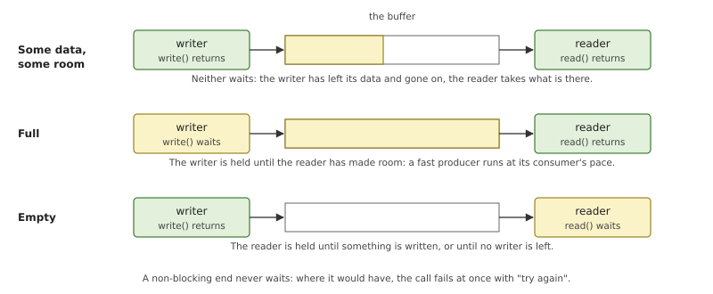
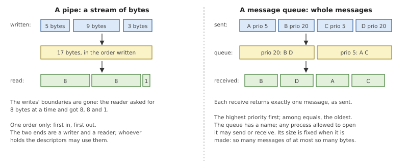
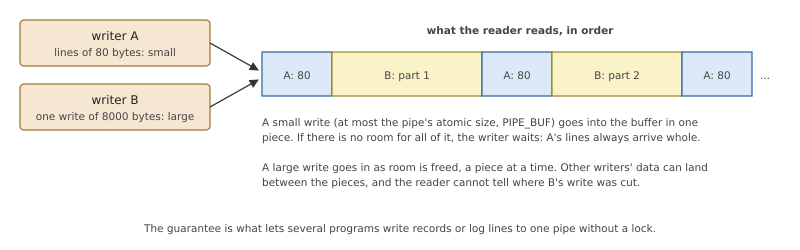
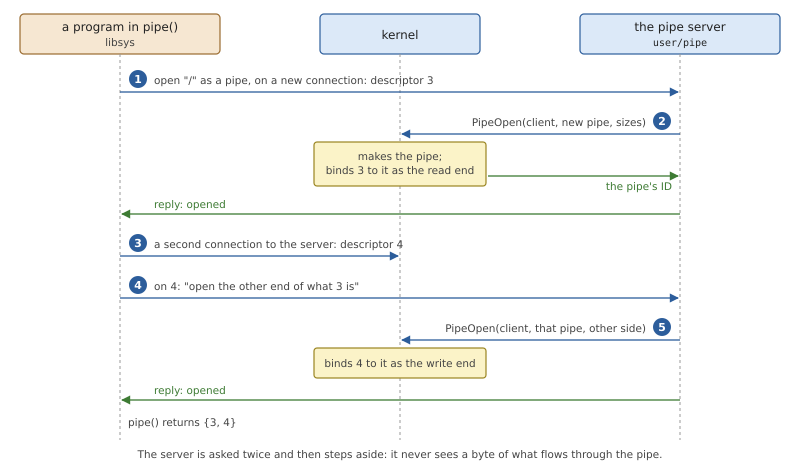
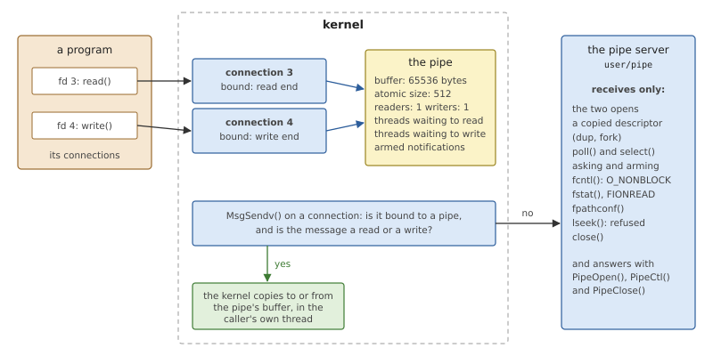
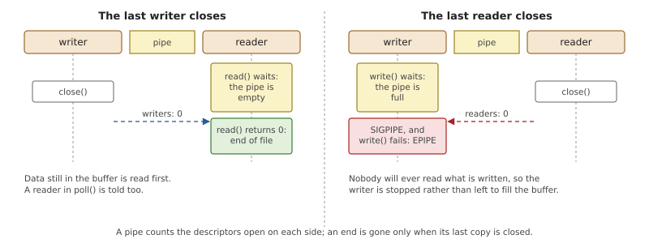

# Message Queues and Kernel Pipes

The message passing of Chapter 10 is a conversation: one side asks, the
other answers, and the one who asked waits. Much of what programs say to
each other is not a conversation. `ls | wc` is one program pouring
bytes out and another taking them in, and neither wants to know when
the other runs. For that an operating system offers *buffered*
communication, where the sender leaves its data and goes on. This
chapter explains the two classic forms, the pipe and the message queue,
and then how OsCraft provides them: with buffers inside the kernel, and
a small server that only sets them up.

## Buffered communication

### When not to wait

A synchronous send ties the sender to the receiver twice over. The
sender cannot continue until the receiver has taken the message, and it
learns the outcome from the reply. Both are what a request needs. Both
are wrong when:

- **there is no answer to wait for.** A program writing its output, a
  sensor task publishing readings, a logger: the data flows one way.
- **the two sides run at different paces.** A producer that works in
  bursts and a consumer that works steadily should each run when it
  suits them. A buffer between them absorbs the bursts.
- **the two sides should not know each other.** A shell joins two
  programs that were written without any knowledge of each other. All
  they share is the convention of reading and writing bytes.

Putting a buffer between two programs *decouples* them, and the buffer
itself then has to be managed. It has a size, and three situations
follow from that.



*Figure 12.1: A bounded buffer. Most of the time neither side waits.
When the buffer is full the writer is held, when it is empty the reader
is.*

The two waits at the edges are not a flaw; they are *flow control*. A
writer that is held when the buffer is full cannot outrun its reader by
more than the buffer's size, so a fast producer is slowed to its
consumer's pace without either program doing anything about it. The
alternative, a buffer that grows without limit, turns a slow consumer
into a system that runs out of memory.

Each end can also be made *non-blocking*. A non-blocking write to a full
buffer, or read from an empty one, fails at once with "try again". A
program that serves many descriptors uses this together with the
readiness notification of Chapter 11: it asks to be told when the
descriptor is usable and does something else meanwhile.

### Bytes or messages

What goes into the buffer decides what kind of object it is.



*Figure 12.2: The same buffer idea with two contracts. A pipe keeps
the order of bytes and forgets the writes; a message queue keeps each
message whole and orders them by priority.*

A **pipe** carries a *stream of bytes*. Bytes come out in the order
they went in, and nothing else is kept: three writes may be read as one
read, or one write as three. That is exactly what programs that process
text want, and it makes a pipe look like a file, which is why the same
`read()` and `write()` work on both. A pipe has no name. `pipe()`
returns two descriptors, one for each end, and the only way to share
them is to hand them to a child process, which is what a shell does
when it builds a pipeline. A *FIFO* is a pipe that does have a name in
the file system.

A **message queue** carries *discrete messages*. Each send adds one
message, each receive removes exactly one, whole. Every message has a
priority, and a receive returns the oldest message of the highest
priority present, so urgent messages overtake routine ones. A queue has
a name and outlives the programs that use it; its capacity, a number of
messages and a largest size for each, is fixed when it is created.
Message queues suit programs that exchange commands or records and
care about urgency: the POSIX interface for them (`mq_open()`,
`mq_send()`, `mq_receive()`) comes from the real-time part of the
standard.

### What a pipe promises several writers

A pipe usually has one writer, but nothing forbids several: every
program started from one shell command may inherit the same pipe as its
error output. If each writes a line, do the lines arrive whole, or
shredded into each other?



*Figure 12.3: Two writers on one pipe. Small writes land in one piece;
a large write is fed in as room appears, and other data may land in
between.*

POSIX answers with a size, `PIPE_BUF`. A write of at most that many
bytes is *atomic*: it goes into the pipe as one piece or, if there is
not yet room for all of it, not at all, and the writer waits. A larger
write carries no such promise. It is put in piece by piece as the
reader makes room, and may be interleaved with other writers' data. A
non-blocking small write that does not fit fails as a whole; a
non-blocking large write may put in part and say how much.

### How a pipe ends

A stream needs an end, and a pipe finds it by counting. The pipe knows
how many descriptors are open for writing and how many for reading,
counting every copy made by `dup()` or inherited by a child.

- When the last writer closes, a reader first gets whatever is still in
  the buffer, and then a read returns 0 bytes: *end of file*. This is
  how `wc` learns that `ls` has finished.
- When the last reader closes, nobody will ever take what is written.
  A writer gets the signal `SIGPIPE`, which by default ends the
  program, and if it survives that, its write fails with `EPIPE`. This
  is how `ls` stops when `head` has seen enough.

The counting is why a program that forgets to close its copy of a
pipe's write end makes the reader wait for ever: the end is not gone
until every copy is.

### Where the buffer lives

In a monolithic kernel the question does not arise: the buffer is in
the kernel, like everything else. In a microkernel system a pipe could
be an ordinary server. It would hold the buffer, and `write()` and
`read()` would be messages to it. That is correct and simple, and
slow in exactly the place where pipes are used hardest: every write is
a message, a switch to the server, a copy into its buffer, a reply and
a switch back, and every read is the same again. Two programs joined by
a pipe would run through a third for every line.

The alternative is to keep only the *data path* in the kernel. A server
still owns everything that is rare and complicated (creating the
object, permissions, the file-like operations), and when a client opens
the object the server asks the kernel to attach a kernel buffer to that
client's descriptor. From then on reads and writes are done by the
kernel, in the calling thread, with one copy and no other process
involved. OsCraft takes this second way.

## Message queues and pipes in OsCraft

OsCraft's kernel has both objects, in `kernel/src/ker/kpipe.rs` and
`kernel/src/ker/mqueue.rs`, and both follow the pattern just described:
a manager process creates the object and *binds* a client's connection
to it with a kernel call, and the kernel then serves the data
operations on that connection itself.

The two are used very differently, and it is best to say so at once.

*Table 12.1: Who uses what.*

| Object | Kernel calls | Native system | QNX personality |
|---|---|---|---|
| Pipes | `PipeOpen()`, `PipeCtl()`, `PipeClose()` | used by every pipeline: FreeBSD's `pipe()` in libsys, served by the native pipe server, `user/pipe` | the same server, reached through translation |
| Message queues | `MsgQueueOpen()`, `MsgQueueSend()`, `MsgQueueReceive()`, `MsgQueueCtl()`, `MsgQueueClose()` | not used: there is no native queue manager, and libsys answers FreeBSD's `mq_*` system calls with `ENOSYS` | used by QNX's own queue manager and C library (Part VI) |

So pipes are part of the native system and the rest of this chapter is
mostly about them. Message queues are implemented in the kernel and
tested, but today only a QNX program can reach them; they are described
briefly at the end.

### Making a pipe

A FreeBSD program calls `pipe()` or `pipe2()`. On OsCraft that is a
function of libsys (`user/libsys/src/fd.rs`) which makes two
connections to the pipe server and asks it, on each, for one end of a
pipe.



*Figure 12.4: `pipe()` on OsCraft. Two short conversations with the
pipe server, each of which ends with the server binding one of the
caller's connections to a pipe in the kernel.*

The pipe server is started by the boot script. It
registers with the path manager not under a path but as the server of a
*file type*: any open that asks for an unnamed pipe is routed to it
(Chapter 21). It also creates `/dev/pipe`, a device that does nothing
except show that the server is up, which the boot script waits for.

libsys first opens a pipe on a new connection, which becomes the first
descriptor. The server, while the caller is blocked waiting for its
reply, calls `PipeOpen()` with the caller's connection, the number -1
for "a new pipe", and a small configuration: 65536 bytes of buffer and
an atomic write size of 512 bytes, FreeBSD's `PIPE_BUF`. The kernel
creates the pipe, binds the connection to it as the reading end, and
returns the pipe's ID, which the server remembers.

libsys then makes a second connection to the same server and sends on
it a request that means "open the other end of what my first descriptor
has". The server calls `PipeOpen()` again, with the ID this time, and
the kernel binds the second connection as the writing end. The two
connections are deliberately separate ones, not shared, so that each
end can be closed, copied and counted on its own.

Internally a pipe has two buffer slots, and each bound end records which
one it reads from; it writes to the other. For the pipe that `pipe()`
makes, only one slot exists, so one end can only read and the other can
only write. The kernel can also make a pipe with both slots, where each
end reads what the other wrote, but the native server never asks for
one.

### Who answers what

After `pipe()` returns, the program has two ordinary descriptors and
uses them with ordinary calls. libsys does not know they are pipes: it
sends a read message for `read()` and a write message for `write()`, as
for any file. The kernel is what treats them differently.



*Figure 12.5: After `pipe()`. The two connections are bound to one
pipe. Reads and writes are taken by the kernel; every other message
goes to the pipe server as on any other descriptor.*

`MsgSendv()` looks at the connection before doing anything else, and
the test is short.

*Listing 12.1: Taking a pipe's reads and writes out of message passing,
`msg_send()` (`kernel/src/ker/kpipe.rs`).*

```rust
{{#include ../../../kernel/src/ker/kpipe.rs:pipe_msg_send}}
```

- A connection with no binding returns `None` on the first line, and
  the message is sent normally. This is the whole cost of kernel pipes
  to every other message in the system.
- Only the first 16 bytes of the message are read, to see its type.
  Anything other than a plain read or write also returns `None` and
  goes to the server.
- A read or write at an explicit offset (`pread()`, `pwrite()`) fails
  with `ESPIPE`: a stream has no positions.
- The binding is taken out of the connection as a counted reference and
  the connection's lock is released before any data is touched, because
  copying from the caller's memory may have to bring a page in.

To the program nothing is different: it sent a message and got a
result. But no server ran. The calling thread did the work in the
kernel, and if it had to wait it waited in a thread state of its own,
not as a client blocked on a server.

Everything else still reaches the server, which answers most of it by
asking the kernel. `fstat()` reports a FIFO whose size is the number of
bytes waiting. `fcntl()` setting `O_NONBLOCK` is recorded by the server
and passed to the binding with `PipeCtl()`. `lseek()` is refused.
`poll()`'s question (Chapter 11) is passed on with `PipeCtl()` too: the
kernel answers whether the end is readable or writable now, and
otherwise keeps the caller's registered event with the pipe and
delivers it itself when data or room appears, in the pipe server's
name, since that is the server the event was registered for.

Copies of a descriptor need care, because the kernel's count of readers
and writers must match the descriptors that exist. When a connection is
copied, by `dup2()` or because a child inherits it, the kernel copies
the binding with it and counts the new end at once. The server is told
about the copy as well and calls `PipeOpen()` for it, which finds the
connection already bound and changes nothing.

### Writing and reading

The rules of Figure 12.3 are one function.

*Listing 12.2: Writing to a pipe, `write()`
(`kernel/src/ker/kpipe.rs`).*

```rust
{{#include ../../../kernel/src/ker/kpipe.rs:pipe_write}}
```

Read it as a loop that puts in one piece per turn.

- **No reader** is checked first, every turn: the process gets
  `SIGPIPE` and the call fails with `EPIPE`.
- **How much must fit** is the line that computes `want`. For a write
  of at most the atomic size it is everything that is left, so the
  write goes in whole or waits. For a larger write it is whatever room
  there is, at least one byte.
- **Not enough room**: a non-blocking end returns what it has put in so
  far, or `EAGAIN` if that is nothing. A blocking end joins the pipe's
  waiting writers and sleeps; a reader that takes data wakes it, and
  the loop starts again.
- **The copy is made without the lock.** The pipe's lock is a spin lock
  with interrupts off, and the caller's memory may fault, so the bytes
  are first copied into a kernel buffer with the lock released, in
  pieces between which a higher-priority thread may run. Then the lock
  is taken again and everything is checked again, because the last
  reader may have closed or another writer may have used the room in
  the meantime.
- **After adding data**, one waiting reader is woken; if none is
  waiting, the events armed by `poll()` for input are delivered.

Reading mirrors this. A read takes what is there, up to the size asked
for, and returns; it does not wait for the full amount. With the buffer
empty it returns 0 if no writer is left, fails with `EAGAIN` on a
non-blocking end, and otherwise waits. After taking data it wakes one
waiting writer, or delivers the events armed for output once at least
an atomic write's worth of room is free. If copying to the reader's
buffer faults, the read fails with `EFAULT` and the bytes are put back
at the front of the pipe, so that a bad pointer does not destroy data.

A thread waiting in a pipe can be interrupted like any blocked thread:
a signal ends the wait with `EINTR` and a timeout with `ETIMEDOUT`
(Chapter 13). A write that had already put part of its data in returns
the count instead of the error.

### Closing



*Figure 12.6: The pipe counts its readers and its writers. When either
count reaches zero, the other side is woken and told.*

When a bound connection is closed, the kernel unbinds it as part of
destroying the connection, whatever the server does. Threads of that
process still waiting through it are released, events it had armed are
dropped, and the count for its side goes down. If that was the last
writer, every waiting reader is woken and finds end of file; if it was
the last reader, every waiting writer is woken and finds `EPIPE`. In
both cases the events armed by `poll()` on the other side are delivered,
and a native program's `poll()` reports the hang-up as `POLLHUP`, as
FreeBSD's does.

The pipe server hears of the close as well and keeps its own count of
open ends per pipe. With the last one it calls `PipeClose()`, which
only makes the kernel forget the pipe's ID. The pipe itself is freed
when the last connection bound to it has gone. If the server itself
ends, the kernel forgets the IDs of all its pipes in the same way.

What the native system does not have yet is the named kind. `mkfifo()`
exists in libsys and asks for a FIFO node to be made, but the pipe
server serves unnamed pipes only.

The same server also serves programs of the QNX personality, whose
`pipe()` arrives as the same two requests after translation. The server
can tell which kind of program is asking and gives those pipes QNX's
atomic size of 5120 bytes instead of 512 (Part VI).

### Message queues

The kernel's message queues are built to the same plan, for a manager
that owns the queues' names. When a client opens a queue, the manager
calls `MsgQueueOpen()` with the receive ID of the client's open
request, and either -1 with a message size and a capacity, to create a
queue, or the ID of an existing one. The kernel binds the client's
connection to the queue, and the client's later sends and receives are
kernel calls on that descriptor, `MsgQueueSend()` and
`MsgQueueReceive()`, which the manager never sees.

A queue keeps its messages in one first-in, first-out list per
priority, of which there are 32, and a receive takes the head of the
highest list that is not empty: the order of Figure 12.2. A send to a
full queue and a receive from an empty one wait, in thread states of
their own, unless the binding is non-blocking, and signals and timeouts
end those waits as they end any other. A message longer than the
queue's message size is refused with `EMSGSIZE`, and so is a receive
whose buffer is smaller than that size. A process can also leave an
event with a queue (Chapter 11), which is delivered once, when a
message arrives at an empty queue that nobody is waiting on.

As with pipes, a send copies the caller's bytes into kernel memory
before taking the queue's lock, so that a fault in the caller's memory
never happens with the lock held.

None of this is reachable from a native program today. FreeBSD's
`mq_open()` and its relatives end in system calls that libsys answers
with `ENOSYS`, and no native server manages queue names. The calls
exist because QNX programs expect them, and with the QNX personality
installed QNX's own queue manager runs on them unchanged (Part VI). A
native manager would be a small server in the style of `user/pipe`, on
kernel calls that are already there.

## Summary

- Buffered communication decouples two programs: the sender leaves its
  data and goes on. A bounded buffer gives flow control, by holding the
  writer when it is full and the reader when it is empty.
- A pipe is a stream of bytes without boundaries; a message queue holds
  whole messages and returns the oldest of the highest priority.
- A pipe makes writes of at most `PIPE_BUF` bytes atomic, and ends by
  counting: no writers means end of file, no readers means `SIGPIPE`
  and `EPIPE`.
- OsCraft keeps the buffers in the kernel. A manager binds a client's
  connection to a kernel object; the kernel then serves the data
  operations in the caller's thread, and every other operation still
  goes to the manager.
- FreeBSD's `pipe()` is two requests from libsys to the native pipe
  server, `user/pipe`. Afterwards `read()` and `write()` on the
  descriptors are intercepted in `MsgSendv()` and never reach a server.
- Data is copied to and from user memory with the pipe's lock released,
  and the pipe's state is checked again once the lock is retaken.
- The kernel's message queues work the same way, but only the QNX
  personality uses them: the native system has no queue manager, and
  FreeBSD's `mq_*` calls fail with `ENOSYS`.
