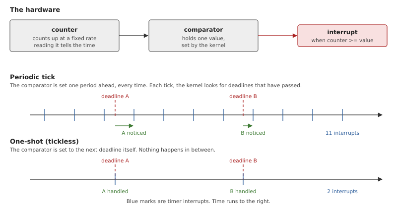
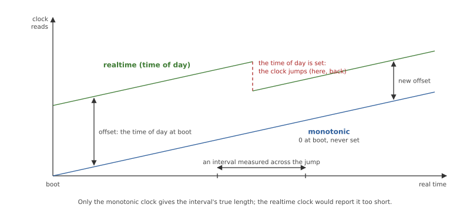
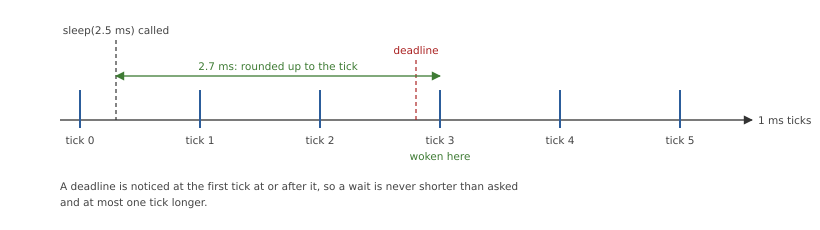
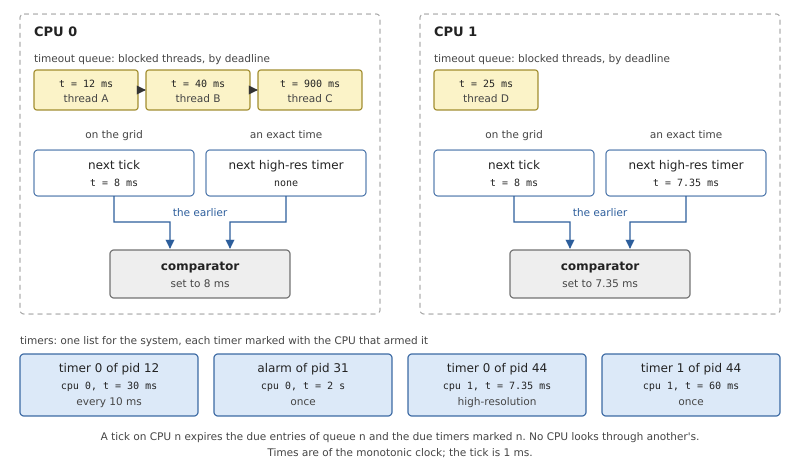
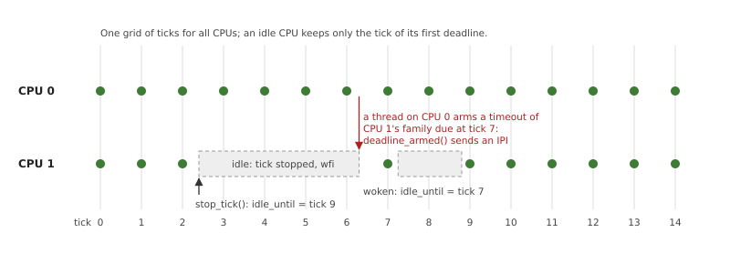
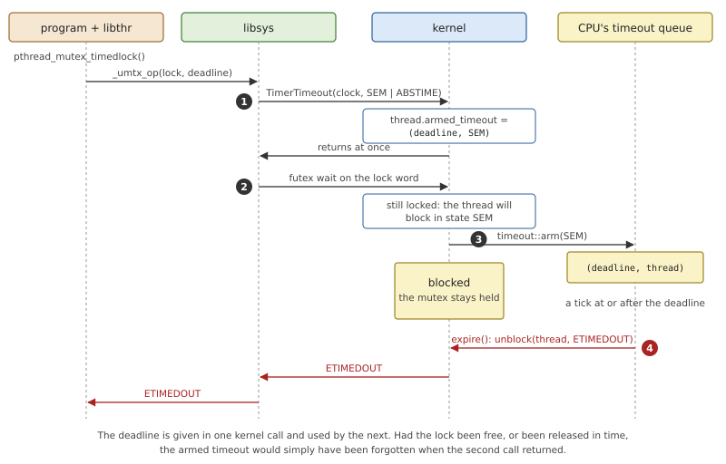
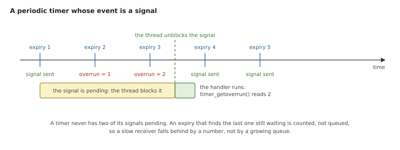

# Clocks, Timers and Timeouts

A kernel deals with time in three ways. It answers the question "what
time is it?", which is a *clock*. It ends a wait that has gone on too
long, which is a *timeout*. And it makes something happen at a chosen
moment, once or repeatedly, which is a *timer*. A real-time system
depends on all three being predictable: a program that asks to be woken
in 10 ms must know how far from 10 ms the answer can be.

This chapter first explains how any kernel keeps time, and the choices
it has. Then it shows OsCraft's: the Arm generic timer of QEMU's `virt`
machine, a tick that stops on idle processors, timeouts on every
blocking kernel call, and timers that deliver the events of Chapter 11.
It ends with the path from FreeBSD's `clock_gettime()`, `nanosleep()`
and `timer_create()` down to those mechanisms.

## Keeping time

### A counter and a comparator

All timekeeping rests on two pieces of hardware. A *counter* is a
register that counts up at a fixed frequency; reading it tells how much
time has passed. A *comparator* holds a value chosen by the kernel and
raises an interrupt when the counter reaches it. Reading the counter
answers "what time is it?"; the comparator is the only way to make
something happen *at* a time. Everything else is software.



*Figure 13.1: The hardware, and the two ways to drive the comparator.
With a periodic tick, a deadline is noticed at the tick after it. With
one-shot programming, the interrupt comes at the deadline itself.*

There are two ways to use the comparator, and Figure 13.1 shows both.

A **periodic tick** sets the comparator one fixed period ahead, again
and again: every millisecond, say. On each tick the kernel looks at its
list of deadlines and acts on those that have passed. The kernel's
time-related work then happens at known moments and at a known rate,
whatever programs ask for. The costs are a *resolution* of one tick (a
deadline between two ticks waits for the second) and an interrupt every
period on every processor, even one with nothing to do.

A **one-shot** or *tickless* design sets the comparator to the next
deadline exactly. Deadlines are met to the precision of the hardware and
an idle processor is left alone. In exchange, the number and the timing
of timer interrupts are now decided by the programs: a thousand timers
with a thousand different deadlines are a thousand interrupts, each
arriving in the middle of whatever was running.

Many systems mix the two: a periodic tick while a processor is busy,
no tick while it is idle, and exact programming for the few timers that
need it.

### Monotonic time and the time of day

A system has more than one notion of "now".

The **realtime** clock (`CLOCK_REALTIME`) is the time of day: seconds
since 1 January 1970, what a wall clock shows. It can be *set*, by an
administrator or by a network time service, so it can jump, even
backwards.

The **monotonic** clock (`CLOCK_MONOTONIC`) starts from an arbitrary
point, usually boot, and only moves forward at a steady rate. Nobody
can set it.



*Figure 13.2: Two clocks driven by the same counter. The realtime clock
is the monotonic clock plus an offset, and setting the time of day
changes the offset.*

The rule that follows is simple: use the realtime clock to say *when*
something happened, and the monotonic clock to measure *how long*
something took or to wait for an interval. A program that sleeps "until
realtime reaches T" sleeps for the wrong time if the clock is set
meanwhile. A kernel usually keeps one of the two as its base, derives
the other with an offset, and converts every deadline to the base
before storing it.

When the time of day is only slightly wrong, jumping is the worst
correction: timestamps would repeat or go backwards. The alternative is
to *slew* the clock: run it a little fast or slow for a while, until
the error is gone.

There are also clocks that do not measure real time at all. A
*CPU-time* clock counts how long one thread, or all the threads of one
process, have actually been running. It stands still while they wait.

### Resolution and jitter

Two numbers describe how good a system's timing is.

*Resolution* is the smallest step in which time can be asked for or
observed. Reading a clock usually has the resolution of the counter,
tens of nanoseconds. Waiting on a ticking kernel has the resolution of
the tick.



*Figure 13.3: A 2.5 ms sleep, started 0.3 ms after a tick. Its deadline
falls between two ticks, and the sleeper is woken at the second: after
2.7 ms.*

A system must choose in which direction to round, and the usual rule is
the one in Figure 13.3: a wait is never shorter than asked. A program
that asks for 2.5 ms gets at least 2.5 ms and less than one tick more.

*Jitter* is the variation in that lateness from one time to the next.
A periodic task that should run every 10 ms, and runs after 10.0, 10.4
and 9.7 ms, has a jitter of several hundred microseconds, and its
control loop sees it as noise. Rounding to a tick is one source of
jitter. The others are the time the timer interrupt itself may be
held off (code running with interrupts masked) and the time until the
woken thread actually gets a processor, which is a matter of priority
(Chapter 8). A real-time kernel does not promise zero for any of these;
it promises a bound.

### Timeouts on blocking calls

Any call that can wait (for a lock, a message, a reply) may need a
limit. There are two ways to offer one. Each blocking call can take an
extra argument, as `pthread_mutex_timedlock()` does next to
`pthread_mutex_lock()`; the set of calls doubles. Or one separate call
can arm a timeout that applies to *whatever the thread blocks on next*.
The second form needs care (the timeout must not survive to a later,
unrelated call) but it gives every blocking call a timeout with no
change to any of them, including calls that did not exist when the
mechanism was designed.

Either way, the kernel must be able to take a blocked thread out of
whatever queue it waits in when the time comes, and make its call fail
with a "timed out" error. That is the same operation as interrupting a
wait for a signal (Chapter 10), which is why the two usually share
their code.

### Where deadlines are kept

A kernel can hold thousands of deadlines. On each timer interrupt it
must find the ones that are due, and before a processor goes idle it
must find the earliest. An ordered structure answers both from its
front.

On a multiprocessor there is a second question: one structure for the
system, or one per processor? A single list needs a single lock, which
every processor takes on every tick and on every sleep. With a queue
per processor, each processor's interrupt handles only its own
deadlines, and the work a tick can cost is bounded by what was armed on
that processor. The price is bookkeeping when a processor sleeps or
goes away while holding deadlines that are still wanted.

## Time in OsCraft

OsCraft keeps time with one hardware counter shared by all processors.
Its base clock is the monotonic clock. Work happens on a periodic tick,
1 ms by default, on a grid of tick times common to all CPUs; an idle
CPU stops ticking; a timer that asks for it gets an exact, one-shot
interrupt. Timeouts and timers are kept per CPU. The code is in
`kernel/src/clock.rs` (the tick), `kernel/src/timeout.rs` (timeouts),
`kernel/src/ker/timer.rs` (the timer calls) and `kernel/src/ker/clock.rs`
(the clock calls).

### The generic timer

Every AArch64 processor has the same timer built in, the *generic
timer*, so nothing in this chapter depends on the board. It provides a
64-bit counter that all CPUs read the same value from (`CNTVCT_EL0`), a
register that gives its frequency (`CNTFRQ_EL0`), and a comparator per
CPU (`CNTV_CVAL_EL0`) that raises a per-CPU interrupt. The whole driver
is three functions in `kernel/src/arch/aarch64/timer.rs`: `frequency()`,
`counter()` and `arm_at(deadline)`.

The kernel never assumes a frequency or an interrupt number. The
startup writes both into the system page (Chapter 5), and `clock::init()`
checks the frequency against the register and takes the interrupt from
there. On QEMU's `virt` the counter runs at 62.5 MHz, one count every
16 ns, and the timer interrupt is number 27, as the boot log says:

```text
clock: 1000 Hz tick on vector 27 (62500000 Hz counter), clock priority 254
```

### The clocks

The monotonic clock is the counter, converted to nanoseconds, counted
from the value the counter had when the kernel started.

*Listing 13.1: The monotonic clock, `now_ns()` (`kernel/src/clock.rs`).*

```rust
{{#include ../../../kernel/src/clock.rs:now_ns}}
```

The kernel uses no floating point, so the conversion is two integer
divisions: whole seconds first, then the rest of a second. The result
is exact and rounded *down*. Its inverse, which turns a deadline in
nanoseconds into the counter value to wait for, rounds *up*. Together
they guarantee the rule of Figure 13.3: at the counter value a deadline
was programmed for, the clock reads at least that deadline, so the
kernel never finds a timer "not quite due" and makes it wait another
tick.

The realtime clock is the monotonic clock plus one number, the offset
of Figure 13.2, which is kept in the system page. Setting the time of
day with `ClockTime()` only replaces the offset, and needs the ability
to set the clock (Chapter 17). `ClockAdjust()` slews instead: it asks
for a number of nanoseconds to be added to the offset on each of the
next *n* ticks.

Every deadline inside the kernel is a monotonic time. A timeout or
timer given as an absolute realtime value is converted once, by
subtracting the offset, when it is armed.

CPU-time clocks come from the scheduler's accounting of each thread's
run time (Chapter 8). A process's clock is the sum over its threads.
`ClockId()` returns a clock ID for any process or thread, so that one
program can read another's CPU time if it has the same user or the
ability to query other processes.

### The tick and its grid

At boot, `clock::init()` turns the tick rate into a period in counter
cycles: 62,500 cycles for 1 ms on `virt`. The rate can be changed with
the kernel option `-C`, up to 100,000 ticks per second. If the counter's
frequency does not divide evenly, the tick is the closest whole number
of cycles, and the kernel reports the real length.

Each CPU keeps the counter value of its next tick and programs its
comparator for it. All CPUs' ticks fall on one *grid*: the time of CPU
0's first tick plus whole multiples of the period. A thread that goes
to sleep on one CPU and is woken by another still sleeps a whole number
of ticks.

The timer interrupt is short enough to read in full.

*Listing 13.2: The timer interrupt of a CPU, `tick()`
(`kernel/src/clock.rs`).*

```rust
{{#include ../../../kernel/src/clock.rs:clock_tick}}
```

- The interrupt may have come for a high-resolution timer and not for a
  tick, so the tick's work is done only `if now >= due`.
- A late tick moves the next one a full period on from *now*. If QEMU
  was descheduled by its host for 50 ms, the kernel takes one tick, not
  fifty in a burst.
- `family` is the set of CPUs whose deadlines this CPU looks after:
  normally just itself. The CPU that looks after CPU 0's also does the
  work that exists once per system: clock slewing and the replenishment
  of sporadic budgets (Chapter 8).
- Then the due timeouts and timers are expired, and `sched::tick()`
  lets the scheduler count the running thread's time slice.
- `hrt_changed()`, last, programs the comparator for whichever comes
  first: the next tick or the next high-resolution timer.

One more rule belongs here. Clock work has a priority of its own, 254
by default. A thread running at or above it holds the clock back on its
CPU: the timer interrupt silences itself and returns, and the tick's
work is done as soon as the CPU drops to a lower priority. Only threads
with special scheduling can run that high, and they do so to finish
work that must not be interrupted even by timers.

### Per-CPU queues

A timeout or a timer belongs to the CPU on which it was armed, and that
CPU's tick expires it.



*Figure 13.4: What each CPU keeps. The comparator is set to the earlier
of the next tick and the next high-resolution timer. CPU 1's interrupt
will come 0.65 ms before its tick.*

Each CPU has a *timeout queue*: the threads blocked with a deadline,
ordered by deadline, under a lock of its own. Timers created by
programs are fewer and are kept in one list, each marked with its CPU.
On a tick, a CPU takes due entries from the front of its own queue, one
at a time, and wakes each thread with the queue unlocked. It never
walks past entries that belong to other CPUs, so the time a tick takes
depends only on how many deadlines are due on that CPU at that tick.

A CPU's family changes only when a CPU is taken offline: it hands its
deadlines to another CPU, which from then on expires both sets on its
own tick.

### Tickless idle

A CPU with nothing to run does not need an interrupt every millisecond.
Before the idle loop waits for an interrupt, it calls `stop_tick()`,
which finds the earliest deadline the CPU is responsible for, rounds it
up to the grid, and programs only that tick, or none at all if there is
no deadline. When any interrupt wakes the CPU, `restart_tick()` puts it
back on the grid.



*Figure 13.5: CPU 1 goes idle with nothing due before tick 9 and stops
its tick. A timeout armed for it meanwhile, due at tick 7, wakes it
with an interprocessor interrupt.*

The figure also shows the difficulty. While CPU 1 sleeps until tick 9,
something may arm a deadline that it is responsible for and that falls
earlier. So a sleeping CPU publishes the time it sleeps until, and
whoever queues a deadline calls `deadline_armed()` afterwards.

*Listing 13.3: Waking a sleeping CPU for an earlier deadline,
`deadline_armed()` (`kernel/src/clock.rs`).*

```rust
{{#include ../../../kernel/src/clock.rs:deadline_armed}}
```

The two sides can still race: the sleeper is choosing its wake-up time
while the other CPU is queuing. Each side therefore writes its own
variable first and reads the other's second. The sleeper publishes
`idle_until` and then looks at the queues once more; the arming CPU
queues the deadline and then reads `idle_until`. The `SeqCst` fence
between each write and the read that follows forbids the processor from
reordering them, so at least one side sees the other: either the arming
CPU sends the interrupt, or the sleeper notices the new deadline and
does not sleep.

### Timeouts

A timeout is a deadline attached to a blocked thread. OsCraft offers
the second form described earlier: one kernel call, `TimerTimeout()`,
arms a timeout for the thread's *next* kernel call.

`TimerTimeout()` takes a clock, a time (relative, or absolute with a
flag), and a mask that says which kinds of wait the timeout applies to:
one bit per blocked state of Chapter 8, such as waiting on a semaphore,
for a reply, or for a signal. The call stores the deadline and the mask
in the thread and returns at once. Nothing is queued yet.



*Figure 13.6: A timed wait is two kernel calls. The first arms the
timeout; the second blocks, and only then is the deadline put in the
CPU's queue.*

When the next kernel call is about to block, its blocking code calls
`timeout::arm(state)` with the state it will block in. If the thread
has an armed timeout whose mask includes that state, the deadline goes
into the CPU's timeout queue (step 3 in the figure). Every blocking
path in the kernel has the same three steps: `arm()`, `block()`,
`disarm()`.

When a tick finds the deadline passed, it takes the thread out of
whatever it waits on with `ker::unblock()`, the same function a signal
uses, and the call fails with `ETIMEDOUT`.

Three rules keep the mechanism safe.

- **A timeout lasts for one kernel call.** The dispatcher forgets an
  armed timeout after any call other than `TimerTimeout()` itself
  (Chapter 7). If the call did not block, or blocked in a state the
  mask does not name, the timeout is gone and cannot end some later
  wait by accident.
- **The timeout belongs to the call, not to its first wait.** A call
  that is woken with nothing to return and blocks again does so with
  the same deadline.
- **A deadline that has already passed is honoured at once** for waits
  on signals: the call returns `ETIMEDOUT` without waiting for a tick.
  This is how `poll()` with a timeout of zero collects what is ready
  and returns.

Sleeping is the special case with nothing to wait for. `TimerTimeout()`
with the *nanosleep* bit blocks the thread itself until the deadline.
If a signal ends the sleep early, the call fails with `EINTR` and
reports the time that was left.

Because timeouts expire on ticks, a timed wait ends at the first tick
at or after its deadline, as in Figure 13.3.

### Timers

A timer is a kernel object that a process creates with `TimerCreate()`,
giving it a clock and an *event* (Chapter 11) to deliver when it
expires: a signal, a pulse to a channel, or any other event.
`TimerSettime()` arms it with a first expiry, relative or absolute, and
optionally an interval after which it repeats. `TimerInfo()` reads back
the time left, and `TimerDestroy()` removes it. A process's timers
disappear when it ends.

On the tick of the CPU that armed it, a due timer *fires*. If it has an
interval, its next expiry is one interval after the one that was due,
so a periodic timer does not drift. If that moment has already passed
as well, the next expiry is one interval from now: missed periods are
skipped, not delivered in a burst. An ordinary timer's interval is at
least one tick.

What happens to the event depends on its kind. A pulse is sent at every
expiry. A signal is treated more carefully.



*Figure 13.7: A periodic timer and a thread that has its signal blocked
for a while. Expiries 2 and 3 are counted as overruns.*

A timer has at most one of its signals pending. An expiry that finds
the previous signal still undelivered adds one to the timer's *overrun*
count and sends nothing. The program reads the count with
`timer_getoverrun()` and knows exactly how many periods it missed.
Without this rule, a thread that fell behind a fast timer would
accumulate a queue of signals without limit.

Three kinds of timer differ from this picture.

**High-resolution timers.** A program may give a timer a *tolerance*.
A tolerance smaller than the tick makes it a high-resolution timer: its
CPU's comparator is programmed for the exact deadline, as on CPU 1 in
Figure 13.4, and it fires in that interrupt, not at the next tick. This
is the one-shot design of Figure 13.1, and it has that design's cost,
so it is opt-in and needs an ability (Chapter 17): a process cannot
raise a CPU's interrupt rate without permission.

**CPU-time timers.** A timer on a CPU-time clock expires when a thread
or process has *run* for a given time. Such a deadline is not a moment
that can be programmed in advance, so it is checked on every tick, and
a CPU with such a timer armed does not stop its tick.

**The alarm.** Each process has one alarm, set with `TimerAlarm()`: a
timer without an ID that sends `SIGALRM` after a time and optionally
every interval after. Setting it again replaces it.

### From FreeBSD's calls to the kernel's

A FreeBSD program uses none of these kernel calls by name. It calls
FreeBSD's C library, and libsys (Chapter 24) turns each of FreeBSD's
system calls into the kernel calls above.

*Table 13.1: FreeBSD's time calls in libsys (`user/libsys/src`).*

| FreeBSD call | What libsys does |
|---|---|
| `clock_gettime()` | `ClockTime()` on the matching kernel clock |
| `clock_getres()` | answers 1 ns, without a kernel call |
| `nanosleep()`, `clock_nanosleep()` | `TimerTimeout()` with the nanosleep bit |
| `timer_create()`, `timer_delete()` | `TimerCreate()`, `TimerDestroy()` |
| `timer_settime()` | `TimerSettime()` |
| `timer_gettime()`, `timer_getoverrun()` | `TimerInfo()` |
| `setitimer()`, `getitimer()` | `TimerAlarm()` |
| a timed lock or condition wait | `TimerTimeout()`, then the wait |
| `poll()`, `select()`, `sigtimedwait()` | `TimerTimeout()`, then a wait for a signal |
| `kevent()` with a timer filter | a deadline kept in libsys, and `poll()`'s timeout |

**Clocks.** FreeBSD has more clock IDs than the kernel has clocks, and
libsys folds them. `CLOCK_REALTIME` and its `_PRECISE` and `_FAST`
variants are the realtime clock. `CLOCK_MONOTONIC`, `CLOCK_UPTIME` and
their variants are the monotonic clock. `CLOCK_PROCESS_CPUTIME_ID` and
`CLOCK_THREAD_CPUTIME_ID` are the caller's CPU-time clocks. The kernel
answers in nanoseconds and libsys splits the number into a `timespec`.

**Sleeping.** FreeBSD's C library implements `sleep()` and `usleep()`
with `nanosleep()`, so all three arrive in libsys as one call. It
becomes a `TimerTimeout()` with the nanosleep bit, and on `EINTR`
libsys writes the remaining time where the caller asked for it.

**Timed waits.** FreeBSD's thread library asks the kernel to wait with
`_umtx_op()`, which carries an optional deadline. libsys implements
`_umtx_op()` on OsCraft's futex call (Chapter 9), and when there is a
deadline it first arms a `TimerTimeout()` for the state the futex
blocks in. This is the sequence of Figure 13.6. `poll()`, `select()`
and `sigtimedwait()` wait for a signal, and arm their timeout for that
state the same way.

**POSIX timers.** `timer_create()` reaches libsys as FreeBSD's
`ktimer_create()`. libsys translates the `sigevent`: a timer that asks
for a signal gets one with the code `SI_TIMER` and the program's value,
and a timer that asks for no notification is created without one. No
other kind of notification is accepted (`EINVAL`).
`timer_getoverrun()` reads the overrun count and resets it.

**Interval timers.** `setitimer(ITIMER_REAL)` is the process's alarm,
and FreeBSD's `alarm()` is built on it. The virtual and profiling
interval timers are not provided (`ENOTSUP`).

**kqueue timers.** These use no kernel timer. A kqueue is a table
inside libsys, and a timer filter is an entry in it with a deadline and
a period. `kevent()` waits with `poll()`, giving it the time until the
nearest of those deadlines as its timeout, and when it wakes it reports
each timer that is due with the number of periods that have passed. The
precision is that of any timed wait: one tick.

## Summary

- Timekeeping needs a counter to read and a comparator to interrupt.
  A periodic tick gives bounded, regular kernel work at a resolution of
  one tick; one-shot programming gives exact times at the price of
  interrupts that programs control.
- The monotonic clock is the generic timer's counter since boot, in
  nanoseconds, rounded down. The realtime clock adds an offset, and
  setting the time of day changes only the offset. All deadlines are
  kept in monotonic time.
- OsCraft's CPUs tick on one shared grid, 1 ms apart by default. A wait
  ends at the first tick at or after its deadline: never early, less
  than a tick late.
- Each CPU keeps its own queue of timeouts and expires only its own. An
  idle CPU stops its tick and keeps only the one for its earliest
  deadline; a deadline armed for it meanwhile wakes it with an
  interprocessor interrupt.
- `TimerTimeout()` arms a timeout for the next kernel call only, for
  chosen kinds of wait, and the wait ends with `ETIMEDOUT`. With the
  nanosleep bit it is the sleep itself.
- A timer delivers an event on expiry. Periodic timers neither drift
  nor make up missed periods, and a timer's signal is never pending
  twice: further expiries are counted as overruns.
- A timer with a tolerance below the tick is programmed exactly and
  needs an ability.
- libsys maps FreeBSD's `clock_gettime()`, `nanosleep()`, POSIX timers,
  `setitimer()` and timed waits onto these calls; kqueue timers are
  kept in libsys and realised with `poll()`'s timeout.
