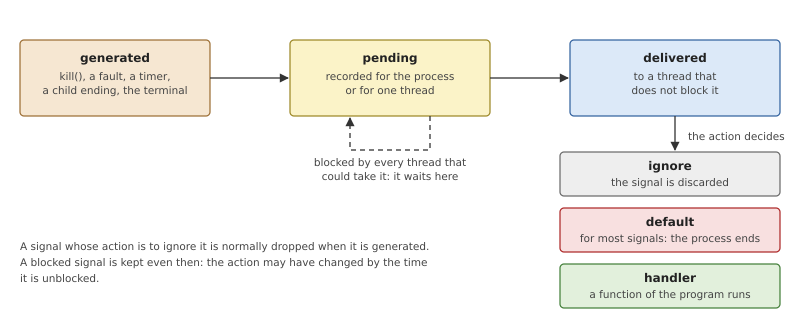
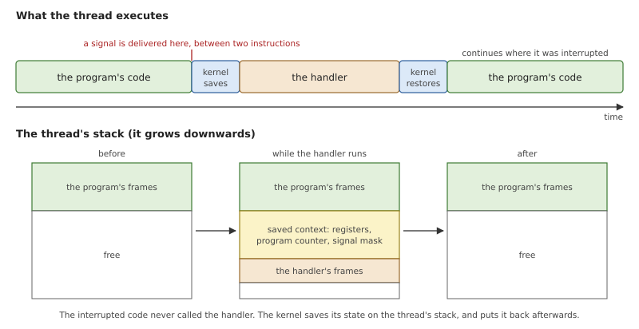
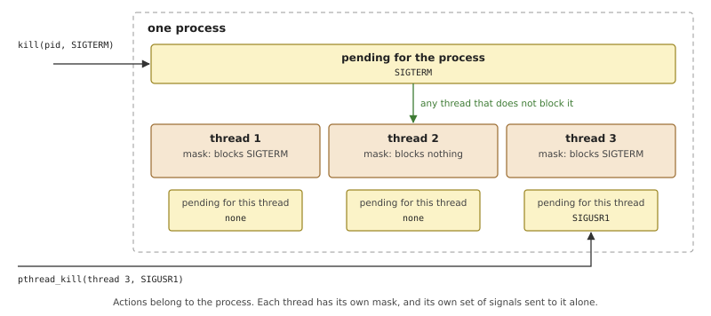
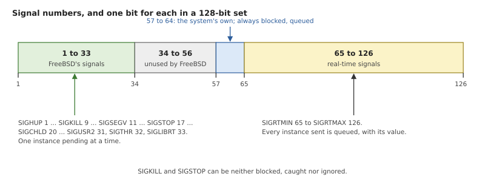
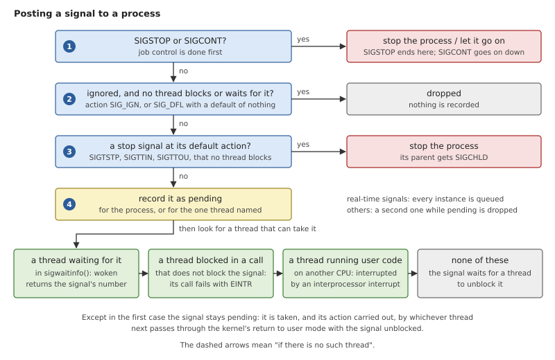
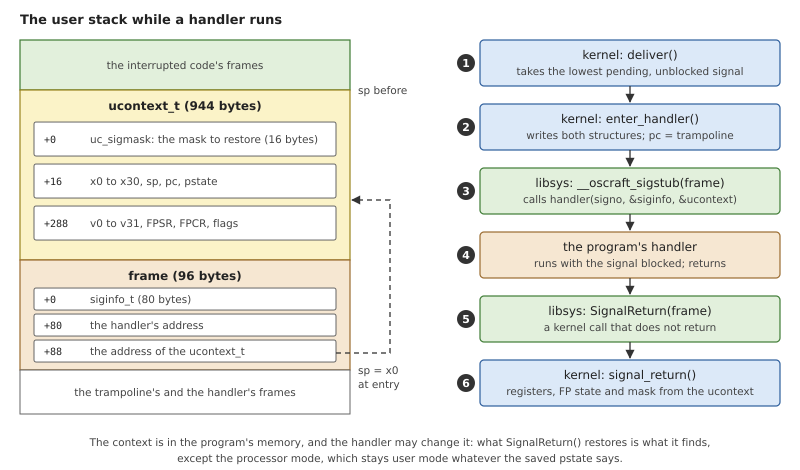
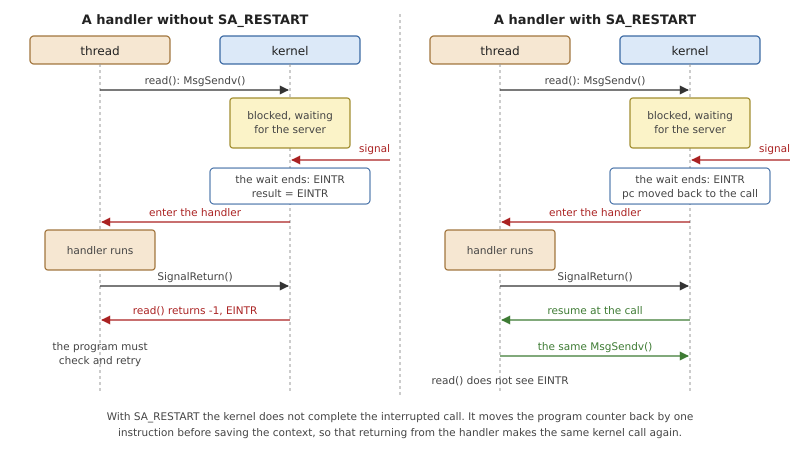

# Signals

A signal is the oldest way UNIX has of telling a process that something
happened: the user pressed Ctrl-C, a child ended, a timer expired, the
program touched memory it does not have. It is also the one mechanism
by which the system makes a program run code it did not call. That makes
signals useful, and difficult, in the same measure.

This chapter first explains what signals are and why they are hard to
use correctly. Then it shows OsCraft's implementation: how a signal is
recorded, which thread takes it, how the kernel makes a thread run a
handler and gets it back afterwards, and what the kernel does for
faults, for job control and when a child ends. OsCraft's signals are
FreeBSD's, number for number and structure for structure.

## What a signal is

A signal is a small notification sent to a process or to one of its
threads. It carries a number, which says what kind of event it is
(`SIGINT`, `SIGSEGV`, `SIGCHLD`), and a little information about the
event. Signals come from other programs (`kill()`), from the kernel
(a fault, a timer, a child ending) and from terminals (Ctrl-C).

For each signal number the process chooses an *action*:

- **ignore** the signal: it is thrown away;
- take the **default** action, which depends on the signal: most end
  the process, a few stop it, a few do nothing;
- **catch** it with a *handler*, a function of the program that runs
  when the signal arrives.

Two signals leave no choice. `SIGKILL` always ends the process and
`SIGSTOP` always stops it, so that a process can never make itself
impossible to control.



*Figure 14.1: A signal is generated, stays pending for as long as it is
blocked, and is delivered to a thread, where the action decides what
happens.*

Figure 14.1 gives the standard terms. A signal is *generated* when the
event occurs, and *delivered* when the process acts on it. In between
it is *pending*. The time between the two is usually very short, but a
thread can stretch it on purpose by *blocking* the signal.

### Masks and pending sets

Each thread has a *signal mask*: the set of signals it currently
blocks. Blocking is not ignoring. An ignored signal is discarded; a
blocked signal stays pending and is delivered when the thread unblocks
it. Programs block signals around code that a handler must not
interrupt, and unblock them afterwards.

The pending signals are a *set*, one bit per signal number, not a
count. If `SIGINT` is generated three times while it is blocked, the
process sees it once. The exception is the range of *real-time signals*
that POSIX added later: these are *queued*, so each instance is
delivered, and each can carry a value from its sender (`sigqueue()`).

### Synchronous and asynchronous signals

Signals come in two kinds, and the difference matters for everything
that follows.

A **synchronous** signal is caused by the thread's own instruction: a
load from an unmapped address (`SIGSEGV`), an undefined instruction
(`SIGILL`). It is generated at a precise point in the program, it
concerns that thread only, and it cannot be put off: the instruction
cannot complete, so the thread cannot simply go on.

An **asynchronous** signal comes from outside: `kill()` from another
process, a timer, a key on the terminal. It has nothing to do with what
the thread is executing, and it can arrive between any two
instructions.

### Handlers

When a caught signal is delivered, the thread stops what it was doing,
runs the handler, and then continues exactly where it stopped.



*Figure 14.2: The handler runs in the thread it interrupted, on the
same stack. The interrupted code's registers are saved below its stack
frames and restored when the handler returns.*

The interrupted code did not call the handler, so nothing in it saved
any registers. The kernel does that instead. It writes the thread's
complete processor state, the *context*, onto the thread's own stack,
and arranges for the thread to start executing the handler with a fresh
frame below it. When the handler returns, a second step, usually a
dedicated system call, restores the context, and the program continues
as if nothing had happened. The saved context together with the
handler's arguments is called the *signal frame*.

Between the kernel and the handler there is normally a small piece of
library code, the *trampoline*. It gives the handler something to
return to, and it makes the call that restores the context.

While a handler runs, the signal that caused it is blocked, along with
any other signals the program listed when it installed the handler.
This keeps a handler from interrupting itself. The previous mask comes
back with the context.

### Signals and threads

Signals were designed when a process had one thread. With several, the
rules are these.



*Figure 14.3: A signal sent to the process is taken by any one thread
that does not block it. A signal sent to a thread waits for that
thread.*

- **Actions belong to the process.** There is one handler for `SIGTERM`,
  whichever thread ends up running it.
- **Masks belong to threads.** Each thread blocks what it wants.
- **A signal sent to the process** is delivered to exactly one thread,
  any thread that does not block it. Which one is not specified.
- **A signal sent to a thread** (`pthread_kill()`, and every
  synchronous signal) is delivered to that thread only.

A common design follows from this: block the asynchronous signals in
every thread, and have one dedicated thread collect them with
`sigwaitinfo()`. That call waits for a signal and returns it as a value,
without running any handler.

### Why signals are hard to use correctly

A handler for an asynchronous signal can run between any two
instructions of the program. Three kinds of trouble follow.

**Re-entrancy.** Suppose the signal arrives while the program is inside
`malloc()`, half-way through updating the heap's lists, and the handler
calls `malloc()` too. The heap is corrupted, or the handler waits for a
lock its own thread already holds, for ever. A handler may therefore
call only functions that are *async-signal-safe*, a short list that
excludes most of the C library. The dependable handler does almost
nothing: it sets a flag or writes one byte to a pipe, and the main
program does the work later.

**Interrupted calls.** A signal that arrives while a thread is blocked
in a system call has to end the wait, or the handler could be delayed
without limit. So the call fails with `EINTR`, and every blocking call
in the program needs a loop around it. The alternative is to ask, when
installing the handler, for interrupted calls to be *restarted*
automatically (`SA_RESTART`).

**Races.** "Check a flag, then wait" loses a signal that arrives
between the check and the wait. Calls such as `sigsuspend()` exist to
close that gap: they change the mask and start waiting in one step.

For new designs, a message or a pulse (Chapter 11) is a better
notification than a signal: it arrives when the program asks for it.
Signals remain because UNIX programs, shells and terminals are built on
them.

## Signals in OsCraft

The kernel implements signals itself, in `kernel/src/ker/signal.rs`.
It keeps each process's actions and pending signals and each thread's
mask, delivers signals as threads return to user mode, and builds the
signal frame. The numbers, the sets, `struct sigaction`, `siginfo_t`
and the saved context are all FreeBSD's, so FreeBSD's C library and
thread library use them unchanged; libsys (Chapter 24) passes most
signal calls straight through.

### Numbers and sets

A signal set is 128 bits, FreeBSD's `sigset_t`, with bit *n*−1 for
signal *n*.



*Figure 14.4: The signal numbers. FreeBSD defines 1 to 33 and the
real-time signals from 65; OsCraft keeps eight of the numbers in
between for itself.*

Signals 1 to 33 are FreeBSD's ordinary signals, with FreeBSD's numbers:
`SIGKILL` is 9, `SIGSTOP` 17, `SIGCHLD` 20. Each can be pending once.
Signals 65 to 126 are the real-time signals, and each instance sent is
queued with its own `siginfo_t`. A program can install a handler for,
and send, only these two ranges.

FreeBSD leaves 34 to 64 unused. OsCraft reserves 57 to 64 for
notifications inside the system. They are always blocked, they are
queued, and they cannot be caught, so they stay pending until a thread
collects them with `SignalWaitinfo()`. libsys builds `poll()` and
`select()` on one of them: each server that has something ready sends
the signal to the waiting thread, and no notification is lost if it
arrives before the thread starts to wait.

A program for the optional QNX personality sees QNX's own numbers and
64-bit sets, converted at the kernel's boundary (Part VI).

Three kernel calls manage this state. `SignalAction()` reads or sets
one action, which holds the handler, the flags and the mask to add
while the handler runs. `SignalProcmask()` changes the calling thread's
mask, or reports which blocked signals are pending. A new thread starts
with the mask of the thread that created it. On `exec()`, caught
signals go back to their default action, because the handlers no longer
exist; ignored ones stay ignored.

### Posting a signal

Every source of signals ends in one function, `post_to()`: `kill()` and
`sigqueue()` through the `SignalKill()` kernel call, events of the
signal kind from timers and servers (Chapter 11), faults, a child's
end, a write to a pipe with no reader (`SIGPIPE`), and the console.



*Figure 14.5: What `post_to()` decides, in order. Most signals reach
step 4; the last row shows who is disturbed so that the signal is taken
promptly.*

Steps 1 to 3 handle the signals that never become pending. `SIGSTOP`
and `SIGCONT` act on the whole process at once, as described under job
control below. A signal that would be discarded on delivery anyway is
dropped now, unless some thread blocks it or is waiting for it: a
blocked signal must be kept, because the program may install a handler
before unblocking it.

Step 4 sets the pending bit and stores the signal's information, for
the process or, when the signal is aimed at one thread, for that
thread. Queues of real-time signals have no fixed limit. To keep a
process from exhausting the kernel by queuing signals, a queue that
would have to grow into the kernel's memory reserve (Chapter 16) makes
`SignalKill()` fail with `ENOMEM`.

Then `post_to()` looks for a thread to take the signal, going through
the process's threads:

- A thread that is waiting for this signal in `SignalWaitinfo()` is
  woken, and its call returns the signal.
- A thread that does not block the signal and is blocked in an
  interruptible kernel call (a message send, a sleep, a wait on a
  condition variable or semaphore) is taken out of its wait with
  `EINTR`, through the same `ker::unblock()` that timeouts use
  (Chapter 13). A wait for a mutex is not interruptible.
- If no blocked thread can take it, a thread that is running user code
  on another CPU with the signal unblocked is sent an interprocessor
  interrupt, so that it enters the kernel now and not at its next tick.

In the last two cases the signal is still pending. Nothing is reserved
for the thread that was disturbed; the signal is taken by whichever
thread next reaches the delivery point with the signal unblocked. That
is all POSIX asks: one thread, any thread.

A client that is waiting for a server's reply cannot always leave at
once (Chapter 10). If the server asked to be told, the client stays
blocked until the server lets it go, and the signal waits with it.

`SignalKill()` also decides who may send. The sender's real or
effective user ID must equal the target's real or saved user ID, or the
sender must hold the signal ability (Chapter 17). A negative or zero
process ID addresses a process group, and the signal goes to every
member the sender is allowed to signal. Signal 0 checks only that the
target exists, and process 1 accepts no signals.

### Delivery

Signals are delivered in one place: `ker::user_return()`, the last
kernel code a thread runs before every return to user mode, whether
from a kernel call, an interrupt or a fault (Chapter 7). At that point
the thread holds no kernel lock, no kernel call is half done, and its
complete user state lies in one structure, the trap frame.

`deliver()` runs there, in the thread that will take the signal. A
flag in the process lets it return immediately when nothing is pending.
Otherwise it takes the lowest-numbered signal that is pending for the
thread or the process and not blocked, the thread's own first, and
applies the action:

- ignore, or a default action of "nothing": discard it and look for the
  next;
- a default action of "stop": stop the process, and park this thread
  until it is continued;
- any other default action: end the process, recorded as killed by
  this signal;
- a handler: redirect the thread into it and return. Further pending
  signals are delivered when the thread next passes this point, at the
  latest on the handler's return.

### Entering and leaving a handler

The kernel cannot call a user function. User code runs only after a
return from exception. So `enter_handler()` makes the coming return
*look like* a call: it saves the interrupted state in the thread's
memory and rewrites the trap frame so that the thread resumes somewhere
else.



*Figure 14.6: The two structures the kernel writes on the user stack,
and the six steps from delivery to resumption.*

Two structures go on the user stack, below the interrupted code's
frames (Figure 14.6, left). The upper one is FreeBSD's `ucontext_t` for
AArch64: the signal mask to restore, the general registers with the
stack pointer, program counter and processor state, and the
floating-point registers. Below it is a small frame: FreeBSD's
`siginfo_t`, the handler's address, and the address of the context.

Then the kernel changes three registers in the trap frame. The program
counter becomes the address of the trampoline, which `SignalAction()`
recorded when the handler was installed. The stack pointer and `x0`
both point at the small frame. It also sets the thread's mask for the
handler: the old mask, plus the action's mask, plus the signal itself
unless the action has `SA_NODEFER`. If the action has `SA_RESETHAND`,
the action went back to the default when the signal was taken.

If the structures cannot be written, because the stack has overflowed
or the stack pointer is invalid, there is no way to run the handler,
and the process ends as if killed by `SIGSEGV`.

The trampoline is part of libsys and is the whole user-space side of
signal delivery.

*Listing 14.1: The trampoline, `__oscraft_sigstub()`
(`user/libsys/src/sigaction.rs`).*

```rust
{{#include ../../../user/libsys/src/sigaction.rs:sigstub}}
```

It reads the signal number and the handler from the frame and calls the
handler with the three arguments of an `SA_SIGINFO` handler; the frame
begins with the `siginfo_t`, so its address serves as the second. A
plain one-argument handler ignores the other two. When the handler
returns, the trampoline makes the `SignalReturn()` kernel call, which
never returns to it.

*Listing 14.2: Restoring the context, `signal_return_native()`
(`kernel/src/ker/signal.rs`).*

```rust
{{#include ../../../kernel/src/ker/signal.rs:signal_return_native}}
```

`SignalReturn()` is unlike every other kernel call: it does not return
a value, it replaces the caller's whole user state. Two details of the
listing are rules.

- **Everything comes from user memory.** The context was in the
  program's hands while the handler ran, and the handler may have
  changed it on purpose: a different program counter to resume
  somewhere else, a different mask. The kernel restores what it finds.
- **Except the processor mode.** Of the saved processor state only the
  four condition flags are taken (`& 0xf000_0000`). Whatever a program
  writes there, the thread resumes in user mode with interrupts
  enabled.

`sigaltstack()` is accepted, and libsys remembers the setting so that
it can report it back, but libsys does not pass it to the kernel: a
FreeBSD program's handlers run on the stack of the thread that takes
the signal.

### Interrupted calls and SA_RESTART

A signal that takes a thread out of a blocking kernel call makes the
call fail with `EINTR`. For a FreeBSD program most blocking system
calls are messages to servers, so the kernel call in question is
usually `MsgSendv()`.



*Figure 14.7: The same interrupted `read()`, with and without
`SA_RESTART` on the handler that interrupted it.*

FreeBSD programs expect the kernel to honour `SA_RESTART`, and OsCraft
does it in the kernel-call dispatcher. When a message send or a futex
wait of a FreeBSD process ends with `EINTR`, the dispatcher looks at
the signal the thread is about to take. If its handler has
`SA_RESTART`, the call is not completed. The saved program counter is
moved back by one instruction, to the instruction that made the kernel
call, with the call's arguments still in their registers. The handler
is entered from there, and when it returns, the thread makes the same
call again. The program sees a `read()` that took a little longer.

### Waiting for signals

Two kernel calls wait for signals without relying on a handler
interrupting something.

`SignalSuspend()`, which is `sigsuspend()`, replaces the thread's mask
and blocks until a signal is delivered, in one step. It always fails
with `EINTR`. The old mask is restored when the handler returns: the
context saved by `enter_handler()` holds the mask from before the call,
not the temporary one.

`SignalWaitinfo()` waits for any of a set of signals, blocked or not,
and returns the one it takes with its `siginfo_t`. No handler runs. A
thread waiting this way is the first choice of `post_to()`. libsys
builds `sigwaitinfo()`, `sigtimedwait()` and `sigwait()` on it, the
timed form by arming a timeout first (Chapter 13), and uses the same
call inside `poll()`.

### Faults

A synchronous exception from user code, such as an access to an
unmapped address, reaches the kernel's exception handler (Chapter 6).
If a debugger is attached and wants the fault, the process stops for it
(Chapter 36). Otherwise the fault becomes a signal for the faulting
thread.

*Table 14.1: Faults and their signals.*

| Fault | Signal |
|---|---|
| access to an unmapped address | `SIGSEGV` |
| access that the page's permissions forbid | `SIGSEGV` |
| misaligned access, misaligned stack pointer or program counter | `SIGBUS` |
| undefined instruction | `SIGILL` |
| breakpoint instruction, single step | `SIGTRAP` |

The `siginfo_t` carries the faulting address. What happens next depends
on one question: would the thread run a handler for this signal now? If
it has a handler installed and does not block the signal, the signal is
posted to the thread and delivered on the way back to user mode, and
the handler runs with the context of the faulting instruction. In every
other case, the signal ignored, blocked or at its default, the process
ends at once, killed by that signal. Returning to an instruction that
cannot complete would only fault again, so a synchronous signal is
never left pending.

### Job control and SIGCHLD

Stopping and continuing a process is done by the kernel, because it
means parking every thread of the process.

`SIGSTOP` is never made pending. Posting it marks the process as
stopped, and each of its threads parks itself at its next pass through
`user_return()`, before it would run any more user code. The three
stop signals a terminal produces, `SIGTSTP` (Ctrl-Z), `SIGTTIN` and
`SIGTTOU`, do the same when their action is the default; unlike
`SIGSTOP` they can be caught, ignored or blocked, and a blocked one
stops the process when it is finally delivered.

`SIGCONT` wakes the parked threads and discards any pending stop
signals, then is posted like any other signal so that a handler for it
can run. `SIGKILL` wakes parked threads too, since a stopped process
must still be able to die.

The parent learns of all this through `SIGCHLD`. The kernel posts it to
the parent when a child ends, with the child's process ID, its exit
status, and a code that says whether it exited or was killed. It posts
it as well when a child stops, unless the parent set `SA_NOCLDSTOP`.
`SIGCHLD`'s default action is to do nothing, so a parent that never
asks is not disturbed. A parent blocked in `wait()` is waiting for a
reply from the process manager, which answers when the child's state
changes (Chapter 18).

Terminals generate the signals of job control. The pseudo-terminal
server (Chapter 25) and the kernel's console (Chapter 22) each run a
line discipline. When it sees the interrupt, quit or suspend character
it sends `SIGINT`, `SIGQUIT` or `SIGTSTP` to the terminal's foreground
process group. When a session leader ends, the foreground group of its
terminal receives `SIGHUP`.

## Summary

- A signal is generated, stays pending while it is blocked, and is
  delivered to one thread, where the action (ignore, default or
  handler) decides what happens. Actions belong to the process; masks,
  and signals sent to one thread, belong to the thread.
- Handlers for asynchronous signals can run between any two
  instructions, which is why they may do very little, and why blocking
  calls fail with `EINTR`.
- OsCraft's signals are FreeBSD's: the same numbers, 128-bit sets,
  `siginfo_t` and `ucontext_t`. Signals 1 to 33 are pending at most
  once; the real-time signals 65 to 126 are queued. Signals 57 to 64
  are the system's own and carry `poll()`'s notifications.
- `post_to()` records a signal and disturbs one thread that can take
  it: a waiter in `SignalWaitinfo()`, a thread in an interruptible
  call, or a thread running on another CPU.
- Delivery happens in `user_return()`, in the thread that takes the
  signal. For a handler, the kernel saves the context on the user stack
  and resumes the thread in libsys's trampoline, which calls the
  handler and then `SignalReturn()`.
- `SignalReturn()` restores what the handler left in the context,
  except the processor mode. With `SA_RESTART`, an interrupted message
  send or lock wait is made again after the handler.
- A fault is a signal for the faulting thread, and ends the process
  unless a handler will take it. Stopping, continuing and `SIGCHLD` are
  done by the kernel as part of posting.
