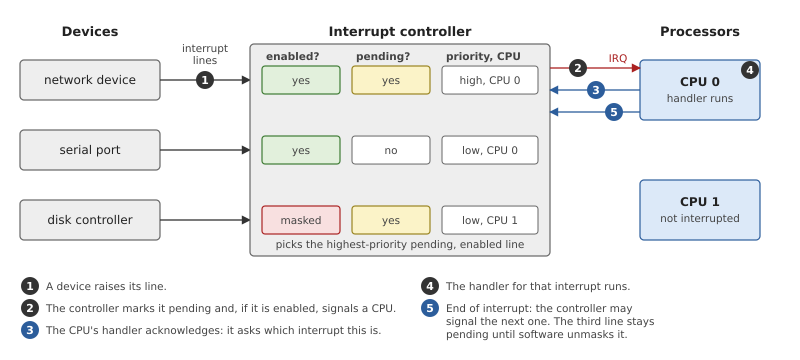
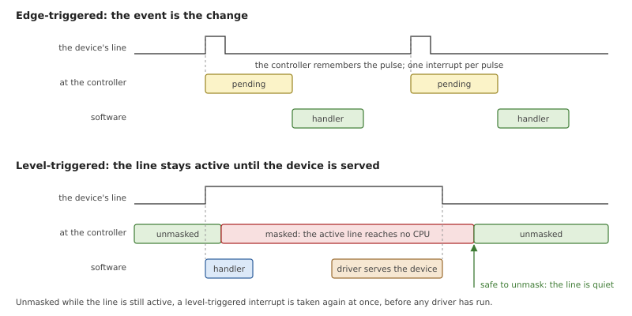
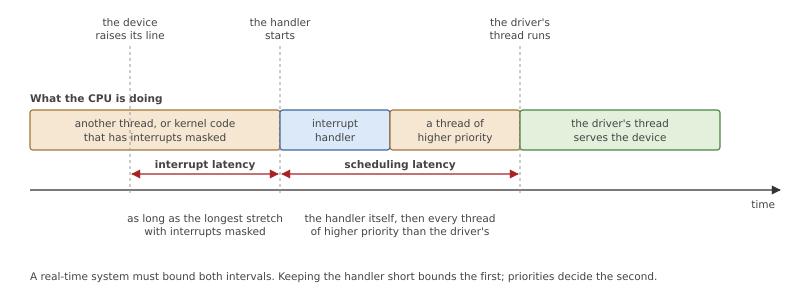
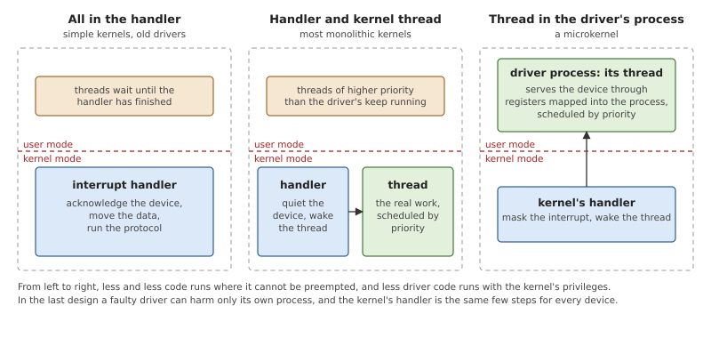
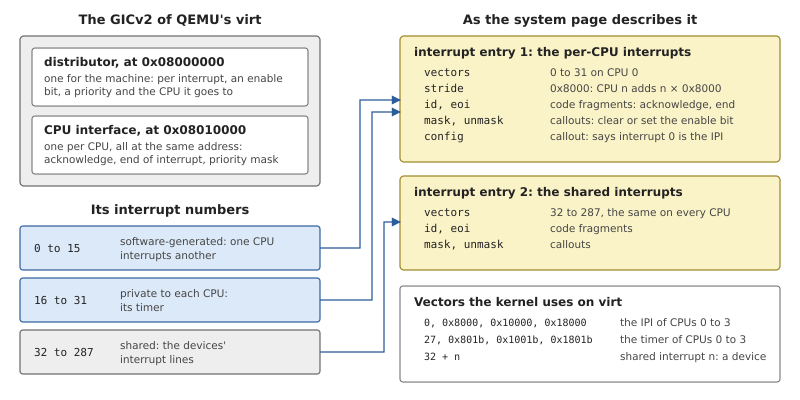
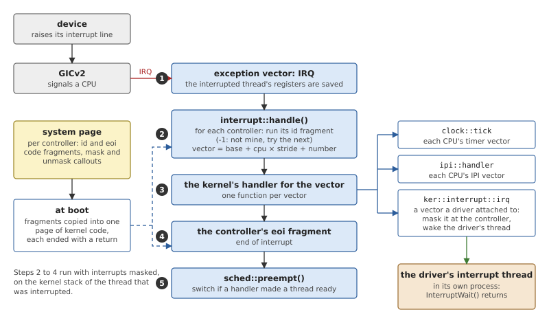
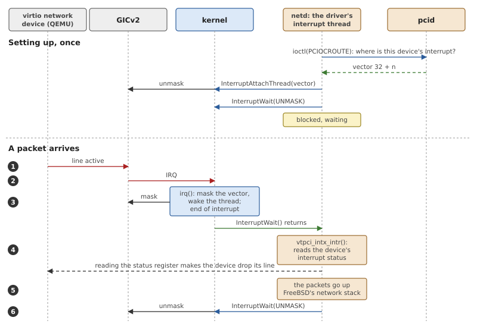

# Interrupts

A device does not wait to be asked. A packet arrives, a key is pressed, a
timer runs out, and the device says so by raising an *interrupt*: a
signal that makes a processor stop what it is doing and run other code.
Interrupts are where the outside world enters the system, and for a
real-time system they are where time starts counting: the deadline of a
piece of work is measured from the interrupt that announced it.

This chapter first explains interrupts in general: the hardware between
a device and a processor, the two ways a device can signal, and the
question every kernel must answer, which is where the driver's work
runs. Then it shows OsCraft's answer. The kernel takes every interrupt,
but does nothing for the device; it masks the interrupt and wakes a
thread of the driver, which is an ordinary process.

## From a device to a processor

A machine has dozens of devices and a handful of processors, so devices
are not wired to processors directly. Their interrupt lines go to an
*interrupt controller*, which decides what reaches which processor, and
when.



*Figure 15.1: An interrupt controller between three devices and two
processors. The first device's interrupt is being handled; the third
has raised its line too, but is masked.*

For each line the controller keeps a little state.

- Whether the line is **pending**: the device has asked and nobody has
  taken the interrupt yet.
- Whether it is enabled or **masked**. A masked interrupt stays pending
  but is not passed on. Masking is how software says "not now" without
  losing the request.
- A **priority**, and which processor the interrupt goes to. Of the
  pending, enabled interrupts the controller signals the most urgent
  one first.

Taking an interrupt is a short conversation between the processor's
handler and the controller, the numbered steps of Figure 15.1. The
controller signals the processor with a single line that says only
"something is pending". The handler *acknowledges*: it asks the
controller which interrupt it is, and gets a number back. It runs the
code for that number. Then it tells the controller that it has finished,
the *end of interrupt*, and the controller is free to signal the next
one.

Not every interrupt comes from a shared device. A processor has
interrupts of its own, such as its timer, which exist once per
processor. And processors interrupt each other, to say "look at your
run queue again"; that is an *interprocessor interrupt*, or IPI.

### Level and edge

A device can signal in two ways, and the difference decides how its
driver must be written.



*Figure 15.2: An edge-triggered interrupt is a pulse that the controller
remembers. A level-triggered interrupt lasts until the device has been
served, so it must stay masked until then.*

An **edge-triggered** interrupt is the change itself: the line pulses,
the controller records that it did, and the handler runs once per pulse.
A second event that arrives before the first was taken is easily lost,
because a line that is already pending cannot become more pending.

A **level-triggered** interrupt is a state: the device holds its line
active for as long as it has something to report, and lets go only when
software has served it, typically by reading a status register. Nothing
is lost, because the line simply stays active while there is work. But
there is a trap. If the handler returns while the line is still active,
the controller signals the same interrupt again at once, and the system
does nothing else. So a level-triggered interrupt must either be
quietened at the device inside the handler, or masked at the controller
until some later code has quietened it.

### Latency

What a real-time system needs to know about an interrupt is how long it
takes from the device raising its line to the code that serves the
device running. That time has two parts.



*Figure 15.3: The time from an interrupt to the code that serves it.
Both intervals must have an upper bound.*

**Interrupt latency** is the time until the handler starts. A processor
takes an interrupt between two instructions, unless interrupts are
masked on that processor, which kernels do around their shortest and
most delicate sections. The worst case is therefore the longest such
section anywhere in the kernel, including other interrupt handlers.

**Scheduling latency** is the time from the handler to the thread that
does the work, when the work is done in a thread. It is the handler's
own running time plus the time taken by every thread of higher priority
than that one.

The two pull in the same direction: code that runs in a handler delays
every other interrupt and every thread, whatever their priorities,
because a handler is outside the scheduler's control. Code that runs in
a thread delays only what is less important than itself.

### Where the driver's work runs

That observation gives three designs.



*Figure 15.4: The same work in three places. The further right, the
less code runs outside the scheduler's control.*

**Everything in the handler.** The handler reads the data from the
device, processes it and returns. This is the simplest design and the
fastest for the device concerned. It is the worst for everything else: a
network handler that takes a millisecond delays a motor-control thread
by a millisecond, at a moment nobody chose.

**A short handler and a thread.** The handler does the minimum, which is
to make the device stop interrupting and to note that there is work, and
wakes a thread in the kernel that does the rest. The thread has a
priority, so the system designer decides what the network may delay.
Most monolithic kernels work this way today.

**A thread in the driver's own process.** A microkernel takes the last
step. The driver is not in the kernel, so the kernel's handler cannot
call it; it can only make the driver's thread ready. And since the
kernel knows nothing about the device, it cannot quieten the device
either. It masks the interrupt at the controller instead, and leaves it
masked until the driver, having served its device, asks for it back.
This is exactly the remedy for level-triggered interrupts described
above, applied to every interrupt.

The third design costs a thread switch per interrupt, and for a
level-triggered device a few more instructions to mask and unmask. It
buys three things. The kernel's handler is the same few steps for every
device, so the kernel's interrupt latency does not depend on which
drivers are installed. Driver work is scheduled like all other work. And
a driver is a process, with its own address space: a driver that goes
wrong can be stopped and restarted, and cannot corrupt the kernel.

## Interrupts in OsCraft

OsCraft uses the third design throughout. No driver code runs in the
kernel, and there is no way to install any: a process attaches a thread
or an event to an interrupt, and the kernel delivers. The kernel's own
handlers are three, for the timer, for interprocessor interrupts, and
one shared by all the interrupts that drivers attached to.

The kernel also contains no code for any particular interrupt
controller. What it knows about the controller of the machine comes
from the system page that the startup wrote (Chapter 5). The code is in
two layers: `kernel/src/interrupt.rs` takes interrupts and finds out
which they are, and `kernel/src/ker/interrupt.rs` implements the kernel
calls for drivers.

### The controller, as the startup describes it

QEMU's `virt` machine has an Arm GICv2. The startup knows it
(`startup/src/arch/aarch64/gic_v2.rs`), sets it up, and describes it to
the kernel in terms the kernel can use without knowing what a GIC is.



*Figure 15.5: The GIC numbers its interrupts in three ranges. The
startup describes them as two entries in the system page, and the
kernel names every interrupt by a vector.*

A GIC has two parts. The *distributor* exists once: it holds the enable
bit, the priority and the target processor of every interrupt. The *CPU
interface* exists once per processor, and is what a processor reads to
acknowledge an interrupt and writes to end it. The GIC's interrupt
numbers fall into three ranges: 0 to 15 are generated by software, and
serve as IPIs; 16 to 31 are private to each processor, the timer among
them; and those from 32 are the shared lines of the devices.

The startup turns this into entries of the system page, one per group
of interrupts that behave alike. Each entry gives:

- a range of **vectors**. A vector is the kernel's name for an
  interrupt, and the number a driver gives when it attaches. For an
  entry of per-processor interrupts there is also a *stride*: the
  distance between one processor's vectors and the next's, so that the
  timer of CPU 0 and the timer of CPU 1 are different vectors;
- two **code fragments**, `id` and `eoi`. The first acknowledges: it
  finds out whether one of this entry's interrupts is the one being
  signalled, and which. The second ends the interrupt;
- two **callouts**, `mask` and `unmask`, which are small functions that
  disable and enable one interrupt of the entry;
- for the per-processor entry, a `config` callout that says which
  interrupt is the IPI.

On `virt` there are two entries. The first covers the GIC's interrupts
0 to 31, as vectors 0 to 31 with a stride of 0x8000; the system tick is
the timer's interrupt 27, so it is vector 27 on CPU 0 and vector 0x801b
on CPU 1. The second covers the shared interrupts, as vectors from 32,
the same on every processor. The boot log's line `GICv2: 288
interrupts` counts both ranges, which leaves 256 shared ones.

The startup also makes the choices that are the machine's to make. It
sends every shared interrupt to the boot processor, configures them all
as level-triggered, and leaves them all masked; the kernel unmasks an
interrupt when something attaches to it.

The `id` and `eoi` fragments are not functions. They are a few
instructions meant to be placed in the middle of a kernel's interrupt
path, they end without a return instruction, and they pass their
results in fixed registers. At boot the kernel copies each fragment
into one page of its own, adds a return instruction after it, and makes
the page executable (`kernel/src/arch/aarch64/intrgen.rs`). To run one,
it goes through a small assembly routine that loads the registers the
fragments use from a save area and stores them back afterwards, so that
what one fragment leaves in a register is there for the next. The GIC's
fragments rely on this: the first `id` fragment reads the GIC's
acknowledge register, which must be read exactly once per interrupt
because reading it is the acknowledgement, and leaves the value in a register for the second entry's `id` fragment and
for `eoi`.

### Taking an interrupt



*Figure 15.6: Every interrupt takes the same path. What differs per
machine is the yellow box; what differs per interrupt is the handler
chosen in step 3.*

An interrupt enters the kernel through the exception vectors like any
other exception (Chapter 6), with the interrupted thread's registers
saved, and reaches `handle()`.

*Listing 15.1: Identifying an interrupt, running its handler and ending
it, `handle()` (`kernel/src/interrupt.rs`).*

```rust
{{#include ../../../kernel/src/interrupt.rs:interrupt_handle}}
```

- The loop is the acknowledge step. Each entry's `id` fragment is asked
  in turn, and the first that answers with a number other than -1 owns
  the interrupt.
- The vector is computed from the entry and the processor: the entry's
  base, plus this processor's multiple of the stride, plus the number.
- Each vector has at most one handler, a plain function. An interrupt
  that has none is masked on the spot, because a level-triggered
  interrupt that nobody will ever serve would otherwise repeat for
  ever.
- The entry's `eoi` fragment ends the interrupt, with the number put
  back in the register where `id` had left it.
- If no entry claims the interrupt, it is counted as spurious and
  ignored.

The handler runs with interrupts masked on its processor, on the kernel
stack of whichever thread was interrupted, and so it must not block.
When it returns, the kernel calls the scheduler: if the handler made a
thread ready that has a higher priority than the interrupted one, the
switch happens now, before the return from the exception.

The kernel attaches handlers to three kinds of vector. Each processor's
timer vector gets the clock's tick (Chapter 13). Each processor's IPI
vector gets the handler for what other processors ask of it
(Chapter 8). And every vector that a driver attaches to gets the same
handler, `irq()`, the subject of the next section. The table of handlers
is small and fixed, 32 entries, searched by vector; it keeps, for each,
a count of interrupts taken and the time of the last.

### A driver attaches

A driver asks for an interrupt with one of two kernel calls.

`InterruptAttachThread()` attaches the calling thread to a vector. The
thread then waits for the interrupt with `InterruptWait()`. A thread can
be attached to one vector in this way, and it is called that
interrupt's *interrupt thread*.

`InterruptAttachEvent()` attaches an event instead (Chapter 11): a
pulse to a channel, for a server that wants its interrupts in the same
receive loop as its messages, or a signal. The kernel delivers the
event each time the interrupt comes.

Both return an identifier for the attachment, and both need the
process to hold the ability to attach interrupts (Chapter 17). Several attachments, from the same process
or from different ones, may name the same vector, unless one of them
asked to be the only one. A vector that the kernel uses itself, such as
the timer's, cannot be attached to: the call fails with `EBUSY`.

The first attachment to a vector installs `irq()` as its handler, which
also unmasks the vector at the controller. From then on the interrupt
can come.

*Listing 15.2: The kernel's handler for every interrupt a driver
attached to, `irq()` (`kernel/src/ker/interrupt.rs`).*

```rust
{{#include ../../../kernel/src/ker/interrupt.rs:irq}}
```

This is all the kernel does for a device interrupt, whatever the
device.

- It marks every attachment of the vector as masked, and masks the
  vector at the controller with the entry's `mask` callout. The device's
  line may stay active; it no longer reaches a processor.
- It delivers each attachment's event. For an interrupt thread that is
  an event of its own kind, which sets a flag in the thread and, if the
  thread is blocked in `InterruptWait()`, makes it ready.

Then `handle()` ends the interrupt, and the scheduler runs. If the
driver's thread has the highest priority of the ready threads, it is
the next code to run after the kernel's handler.

Each attachment has its own mask, and a vector is unmasked at the
controller only when none of its attachments is masked. That is what
lets several drivers share a line: the interrupt stays off until every
one of them has looked at its device and said so.

A driver unmasks its attachment with `InterruptUnmask()`, or more
often by passing a flag to its next `InterruptWait()`, which unmasks and
waits in one call. The flag in the thread closes the gap between the
two: an interrupt that arrives after the unmasking but before the
thread has blocked sets the flag, and the wait returns at once instead
of blocking. A spin lock orders the test of the flag against its
setting on another processor, so the interrupt is never missed.

`InterruptWait()` can be given a timeout like any blocking call
(Chapter 13). `InterruptMask()` masks an attachment by hand,
`InterruptDetach()` removes one, and all of a process's attachments are
removed when it ends, which leaves their vectors masked if nobody else
is attached.

An interrupt thread is an ordinary thread, and its priority is the
priority of the device's work. A thread that must run ahead of
everything else can be given a scheduling policy reserved for interrupt
threads, which allows priorities up to 254, the priority of the clock's
own work.

### The virtio network device in netd

The network device of `virt` shows all of this at work. Its driver is
FreeBSD's `vtnet`, unchanged, running inside the server `netd` on the
layer called bsdkern (Chapter 27). FreeBSD's drivers expect their bus to
give them their interrupt and to call their handler; bsdkern provides
that with the kernel calls above.



*Figure 15.7: The network driver's interrupt. `pcid` is asked once,
where the interrupt is; after that the path is device, kernel, driver.*

**Finding the vector.** The device is on the PCI bus, and the PCI bus
belongs to another server, `pcid` (Chapter 29). When the driver asks
its bus for its interrupt, the bus in `netd` asks `pcid` with an
`ioctl()` on `/dev/pci`. `pcid` runs FreeBSD's PCI code, which has
worked out from the machine's device tree which of the GIC's shared
interrupts the device's interrupt pin is wired to, and it answers with
the vector: 32 plus that interrupt's number. `pcid` takes no further
part. The driver's interrupts do not pass through it.

**Attaching.** When the driver sets up its handler, bsdkern creates a
thread for it. FreeBSD does much the same in its own kernel, where a
driver's handler runs in an interrupt thread; here the thread is a user
thread of `netd`.

*Listing 15.3: A FreeBSD driver's interrupt thread in a server,
`nexus_ithread()` (`user/bsdkern/kern/nexus.c`).*

```c
{{#include ../../../user/bsdkern/kern/nexus.c:interrupt_thread}}
```

The thread attaches itself to the vector, and then loops: wait, with
the flag that unmasks, and call the driver. FreeBSD lets a driver
register a quick *filter* and a slower handler; both run here, in the
thread, the handler only if the filter asks for it or there is none.

**A packet arrives.** The device raises its line, and the GIC signals
the boot processor. The kernel identifies the vector, masks it, makes
`netd`'s thread ready and ends the interrupt. The thread returns from
`InterruptWait()` and calls the virtio driver's handler. That handler
begins by reading the device's interrupt status register, and for a
virtio device reading it is also what makes the device release its
line. The driver then takes the received packets from the device's
queue and passes them up FreeBSD's network stack, in this thread and at
its priority. When the handler returns, the loop comes back to
`InterruptWait()`, which unmasks the vector. If more packets arrived in
the meantime the line is active again, and the interrupt is taken again
immediately; otherwise the thread blocks.

Between the device and the driver, the kernel ran its handler once.
Everything that takes time, and everything that knows what a network
packet is, ran in a process.

## Summary

- An interrupt controller holds, for each device's line, whether it is
  pending and whether it is masked. A handler acknowledges an interrupt
  to learn its number, and ends it when done.
- A level-triggered interrupt stays active until its device is served,
  so it must be masked from the moment it is taken until then.
- Work done in an interrupt handler delays everything; work done in a
  thread delays only what has a lower priority. A microkernel moves
  the driver's work into a thread of the driver's own process.
- OsCraft's kernel has no code for any controller. The startup
  describes the GIC of `virt` in the system page as ranges of vectors
  with code fragments to acknowledge and end an interrupt and callouts
  to mask and unmask one.
- For a device's interrupt the kernel does one thing: it masks the
  vector and wakes the thread, or delivers the event, that a driver
  attached with `InterruptAttachThread()` or `InterruptAttachEvent()`.
- The driver serves its device at its own priority and unmasks the
  vector with its next `InterruptWait()`. A vector shared by several
  attachments stays masked until all have unmasked.
- A FreeBSD driver in a server gets the same: bsdkern runs its handler
  in a thread that attaches to the vector, which `netd` learns from
  `pcid`.
