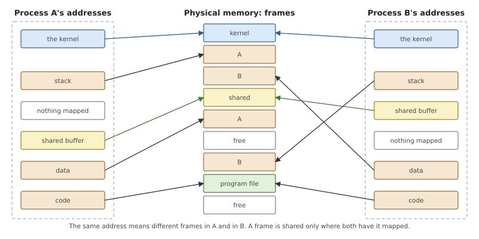
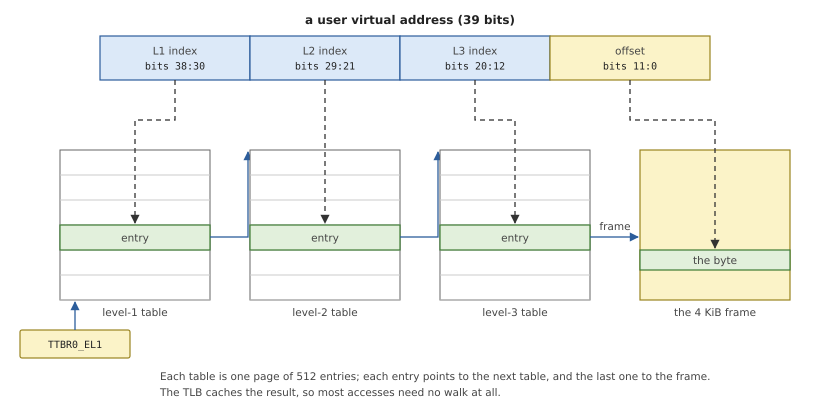
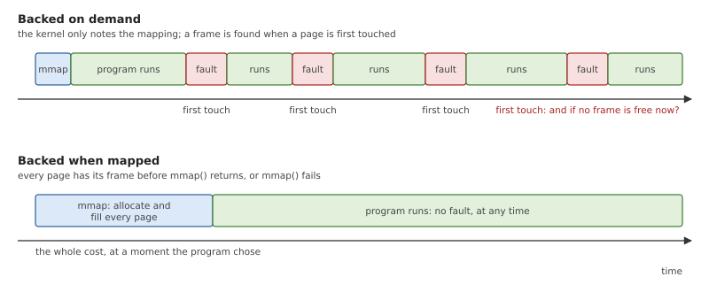
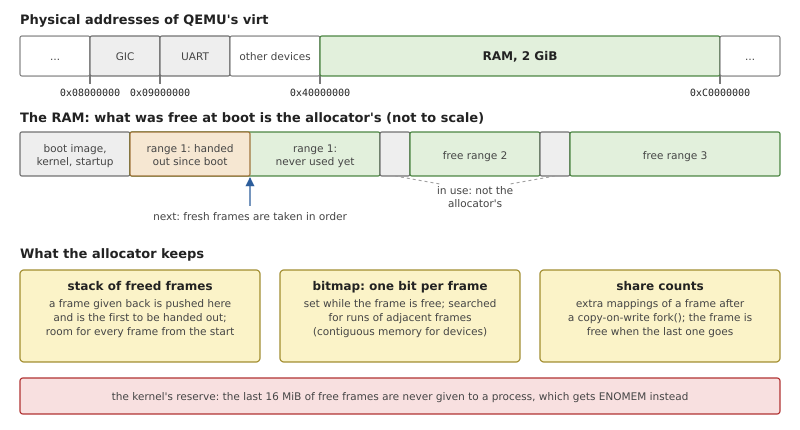
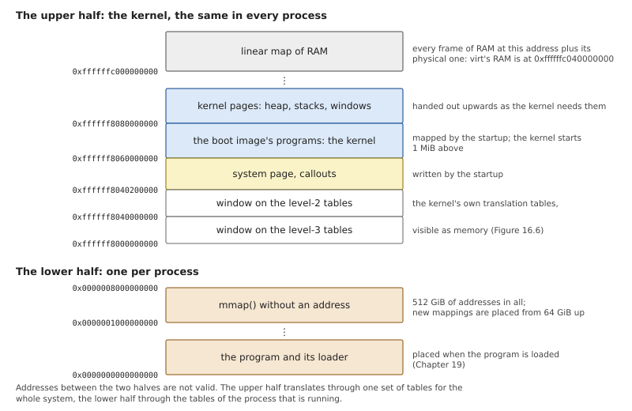
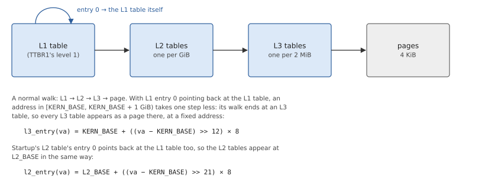
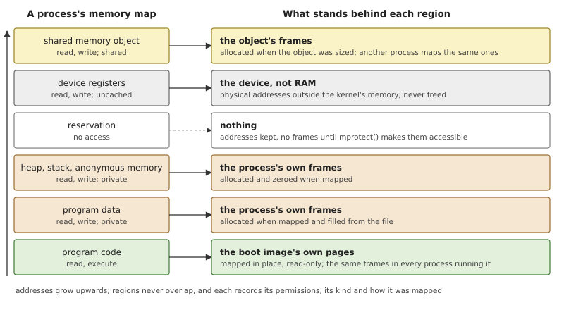
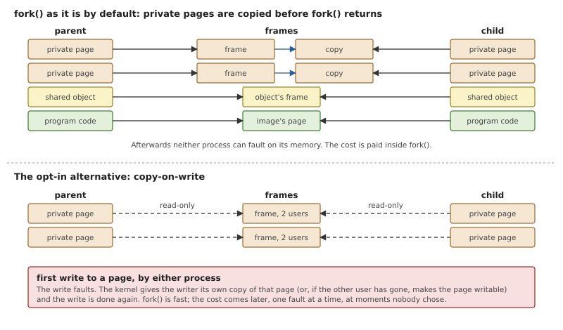

# Memory

Every process believes it has the machine's memory to itself, starting
at address zero, and none can see another's. The processor and the
kernel keep up that belief together: the processor translates every
address a program uses, and the kernel writes the tables it translates
with. This chapter explains how that works, and then one decision that
sets a real-time kernel apart from a general-purpose one: *when* a
program's memory is actually given to it.

The chapter covers the kernel's side: the memory of the machine, the
kernel's own addresses, the address space of a process and what is
recorded about it. How a program asks for memory, with `mmap()` and
shared memory objects, is the business of the memory manager in process
1, in Chapter 20.

## Virtual memory

The memory of a machine is one long array of bytes, the *physical*
memory, and each byte has a physical address. Programs never use those
addresses. Every address a program uses is a *virtual* address, and a
part of the processor, the *memory management unit* or MMU, translates
it to a physical one on every access, using tables that the kernel
writes and the program cannot touch.

Translation works in blocks of 4 KiB. A block of virtual addresses is a
*page*, a block of physical memory is a *frame*, and a table entry says
which frame a page is in. The set of translations that one process runs
with is its *address space*.



*Figure 16.1: Two processes, each with its own translations onto the
same physical memory.*

Everything a kernel does with memory is visible in Figure 16.1.

- **Isolation.** A process can reach only the frames its tables map.
  There is no address by which process A could name B's data.
- **Sharing**, where it is wanted. A frame can be mapped in two address
  spaces, at different addresses if need be. Two processes that share a
  buffer, or run the same program, have frames in common.
- **Holes.** An address with no translation is not memory. Touching it
  makes the MMU raise a *page fault*, an exception that enters the
  kernel (Chapter 6).
- **The kernel, everywhere.** The kernel's own pages are mapped in
  every address space, at the same addresses, marked so that only
  kernel-mode code can use them. A kernel call or an interrupt then
  needs no change of translation.

Each entry also carries permissions: whether the page may be read,
written and executed, and by whom. A write to a read-only page is a
page fault too.

### Translation tables

One flat table for a whole address space would be enormous and almost
entirely empty, so the tables form a tree. The virtual address is cut
into fields; the top field selects an entry in the first table, which
points to a second table, and so on down to the entry for the page.



*Figure 16.2: Translating an address with three levels of tables. Each
9-bit field selects one of a table's 512 entries; the last 12 bits are
the offset within the 4 KiB frame.*

A table is itself one frame, holding 512 entries of eight bytes. Where
an address space has nothing mapped, the tree simply has no branch: one
empty entry in the first table stands for a whole gigabyte of
addresses. An entry in the middle level may also map a 2 MiB *block*
directly, with no table below it, which is economical for large
uniform areas.

Walking the tree costs several memory accesses, so the processor
remembers recent translations in a cache, the *translation lookaside
buffer* or TLB. That makes the common case fast and gives the kernel a
duty: after changing or removing a translation it must make every
processor forget the old one, or programs could go on using memory that
is no longer theirs. To avoid emptying the TLB at every switch between
processes, each address space has a small number, its *address space
identifier* or ASID; TLB entries are tagged with it, and those of
several processes coexist.

AArch64 divides virtual addresses into two halves with a table tree
each. The lower half, from zero up, belongs to the running process, and
the register that holds its tree is changed when another process runs.
The upper half, at the top of the address range, is the kernel's, and
its register stays the same.

### When is memory given?

A program asks for memory in large pieces, a megabyte for a stack, a
gigabyte for a buffer it may or may not fill. The kernel can respond in
two ways.



*Figure 16.3: With demand paging the cost of memory is spread over the
program's run as page faults. Backed when mapped, the cost is paid
once, in the call that asked.*

**On demand.** The kernel notes that the addresses now belong to the
program and maps nothing. The first touch of each page faults; the
kernel finds a frame, fills it, maps it and lets the program continue
as if nothing had happened. This is *demand paging*. Memory a program
asks for but never touches costs nothing, and the request itself
returns at once. General-purpose systems go further on the same
principle: they promise more memory than exists, on the expectation
that not all of it will be used, and they take frames back from idle
programs by writing their contents to disk.

*Copy-on-write* is the same idea applied to copying. When a process is
duplicated by `fork()`, nothing is copied; both processes map the same
frames, read-only, and the first write to a page by either one faults,
at which point the kernel copies that one page.

**When mapped.** The kernel allocates and fills every page before the
request returns. The request takes longer, and memory that is never
touched is still used. But once it returns, the memory is simply there.

For a real-time system the difference is not one of speed but of
*when*. Under demand paging, any first access to a page, anywhere in
the program, may take a fault, and the fault takes a time that depends
on the state of the whole system. Worst of all, it may come when no
frame is free, and then there is no good outcome: the program cannot be
told that its assignment to a variable has failed. A control loop that
met its deadline a thousand times can miss it on the first pass through
a new branch of its code. Systems that offer both let a program lock
its memory to get the predictable behaviour. A system built for real
time can make it the rule: memory is backed when it is mapped, a
request that cannot be met fails as a request, with an error the
program can handle, and a page fault is never anything but a bug.

## Memory in OsCraft

OsCraft backs memory when it is mapped. Nothing is paged in on demand,
nothing is overcommitted, nothing is written to disk, and `fork()`
copies. A page fault in a native program means the program touched an
address it does not have, and is delivered as a signal (Chapter 14).
The one exception is a copy-on-write `fork()` that can be switched on
when the system boots, for systems that prefer the speed.

The code is in `kernel/src/vm/`, with the processor's side in
`kernel/src/arch/aarch64/mmu.rs` for the kernel's half of the addresses
and `kernel/src/arch/aarch64/uspace.rs` for a process's half.

### Frames

The physical memory of `virt` is 2 GiB of RAM starting at address
0x40000000; the device registers are below it. By the time the kernel
starts, part of that RAM is in use: the boot image, the kernel itself,
and what the startup allocated. The startup lists the ranges that are
still free in the system page, and those are what the kernel's frame
allocator, `kernel/src/vm/pmem.rs`, hands out. The boot log reports
them:

```text
pmem: 1844 MiB free in 3 ranges
```



*Figure 16.4: The physical addresses of virt, the free ranges of its
RAM, and the allocator's three structures.*

The allocator serves one frame at a time, and its two sources are
visible in the code.

*Listing 16.1: Allocating one frame, `alloc_page()`
(`kernel/src/vm/pmem.rs`).*

```rust
{{#include ../../../kernel/src/vm/pmem.rs:pmem_alloc}}
```

- A frame that was used and given back is on a **stack**, and the stack
  is tried first. The stack is created at boot with room for every
  frame of the machine, so that giving a frame back never needs memory
  itself. That matters because the kernel's heap takes its pages from
  this allocator: a free that had to allocate could call itself.
- Otherwise the next frame of a range that has **never been used** is
  taken, in address order.
- Either way the frame must still be marked free in a **bitmap** that
  has one bit per frame. The bitmap exists for the other kind of
  request: a run of adjacent frames, which a device needs for a buffer
  it addresses physically. Such a run is found by searching the bitmap,
  and the frames it takes may still have entries on the stack; the
  check here skips them.

Giving a frame back is guarded by the same bitmap. A frame that is
already free, or that is not RAM the allocator owns, is left alone: the
first would later be handed out twice, the second would turn a device's
registers into somebody's memory.

One rule protects the kernel from the processes. The kernel needs
frames for itself, for its heap, its translation tables and its
threads' stacks, and running out of them is fatal. So frames for a
process come through a second entry point, which refuses once only 16
MiB are left free. A program that asks for all the memory there is gets
`ENOMEM`, and the kernel carries on.

### The kernel's half

The kernel occupies the upper half of the addresses. The startup built
its first translation tables, to map the kernel's image and the system
page, and the kernel keeps them and adds to them.



*Figure 16.5: The layout of virtual addresses. The upper half is the
same whatever process is running.*

From the bottom of Figure 16.5, the kernel's half holds: two windows
onto its own translation tables, explained below; the system page and
the callouts; the programs of the boot image, of which the kernel is
one; an area from which the kernel takes pages as it needs them; and,
far above, a map of all RAM.

**The linear map.** Every frame of RAM is mapped at its physical
address plus a constant, in 2 MiB blocks. On `virt`, the frame at
0x40000000 is at 0xffffffc040000000. So the kernel can read or write
any frame of RAM, including one that belongs to a process, without
setting up a mapping first: zeroing a new frame, copying a page for
`fork()`, and reaching a process's translation tables all go through
it. There is one exception to the uniformity. The blocks that contain
the kernel's own code and constants are mapped page by page, read-only,
so that the linear map is not a writable second door to the kernel's
code.

**Kernel pages.** The kernel's dynamic memory comes from
`kernel/src/vm/kmem.rs`, which maps fresh zeroed frames at new
addresses. A kernel stack is mapped with an unmapped *guard page* below
it, so that a stack that overflows faults immediately instead of
writing over its neighbour. Address ranges that are given back are kept
by length and reused, so that the kernel's tables do not grow without
end as threads come and go.

**The heap.** On top of that sits the allocator behind the kernel's
ordinary data structures (`kernel/src/vm/heap.rs`). It keeps eight
lists of free blocks, of 16 bytes to 2 KiB in powers of two; a request
is rounded up to the next size, and an empty list is refilled by
cutting up one new page. Anything larger gets whole pages, which go
back to the frame allocator when freed. It is deliberately simple:
an allocation or a free is a few steps under one lock.

**The windows on the tables.** To change a translation the kernel must
write a table entry, and to write it the table must itself be mapped
somewhere. The kernel's tables solve this with a trick: one entry of
the top table points back at the top table.



*Figure 16.6: An entry that points to its own table makes a walk one
step shorter, so that the tables themselves appear as pages at
addresses that can be computed.*

A walk that passes through that entry ends one level early, on a table
instead of on a page. All the last-level tables therefore appear, in
order, as a contiguous gigabyte of memory at the bottom of the kernel's
half, and the entry that maps any kernel address is at a position
computed from that address alone. Mapping a kernel page is then two
checks that the upper tables exist and one store, under a single lock
that covers all changes to the kernel's tables.

### A process's half

Each process has an address space of its own (`AddressSpace`, in
`kernel/src/arch/aarch64/uspace.rs`): a top-level table, an ASID, and a
record of the frames that hold its lower tables. It covers 512 GiB of
addresses with the three levels of Figure 16.2.

These tables are not reached through a recursive entry. A table is a
frame of RAM, so the kernel reaches it through the linear map, and
walks from the top table down in software, creating the lower tables it
finds missing. A lock per address space covers the walk and the change.
Tables are freed as they empty: when the last page under a last-level
table is unmapped, the table's frame is returned, but only after the
TLBs have been told, since a processor may still remember the way
through it.

User pages are tagged with the process's ASID, and are never executable
in kernel mode, so the kernel cannot be led into running a program's
code with its own privileges. A page with all access removed keeps its
frame, mapped for the kernel only, so its contents survive until access
is given back.

What is being mapped decides one more attribute. Ordinary memory is
cached by the processor. A device's registers must not be: reading a
status register has effects, so every access must reach the device,
once and in order. The kernel maps a device's registers into a driver's
address space as device memory, and can map a buffer that a device
reads behind the processor's back as uncached RAM.

Process 1 is a special case. Its threads run in kernel mode and use
only the upper half, so it needs no translations of its own, and the
kernel does not switch the lower half when one of its threads runs:
whatever process ran last on that processor stays loaded. A message to
process 1 and its reply therefore cost no change of address space at
all. The price is paid when a process ends. Its tables may still be
loaded on a processor that is running a thread of process 1, so the
top-level table and the ASID are put aside, and freed only when no
processor has them loaded.

### The memory map: what is mapped, and why

The translation tables say which frame is behind each page. They do not
say what the page *is*: whether the frame belongs to the process, what
should happen to it on `fork()`, whether it may be made writable. That
is recorded in the process's *memory map* (`MemMap`, in
`kernel/src/vm/map.rs`), an ordered set of *regions*. A region is a
range of pages mapped in one request, with the same permissions and the
same kind of backing.



*Figure 16.7: A process's regions, lowest addresses at the bottom, and
where the frames of each kind come from.*

There are four kinds of backing.

- **Private memory** is the process's own: its heap and stacks, and the
  writable data of its program. The frames are allocated when the
  region is mapped, and filled with the bytes they should start with (a
  part of a file, for program data) and zeros after that. They are
  freed when the region is unmapped.
- **Pages of the boot image, in place.** The files of the boot image are
  already in memory, and a program's code never changes. Where the
  file's layout allows, the code of a program or library is not copied
  but mapped where it lies, read-only, and every process that runs the
  program shares those frames. If such a page ever has to change, for
  instance because a debugger plants a breakpoint in it, the process
  first gets a private copy of that page.
- **A memory object** is memory that belongs to no address space
  (`kernel/src/vm/object.rs`): a size and a list of frames, alive as
  long as anything refers to it. A region can map part of one, and
  every process that does so sees the same frames. This is what shared
  memory is made of; Chapter 20 shows how objects are named and sized.
- **Physical memory** that is not the kernel's to hand out: a device's
  registers, mapped into its driver. The region remembers the physical
  address, and unmapping it frees nothing.

Besides its kind, a region records its permissions, the most that a
later `mprotect()` may raise them to (a mapping of an object opened
read-only can never become writable), and how it was mapped, which is
what a process's files under `/proc` report (Chapter 22).

A new region is placed where the program asked, replacing what was
there, or else at the address it suggested if that is free, or else in
the first gap that fits from 64 GiB up. The place is found and recorded
under the map's lock in one step, so that two threads mapping at once
cannot be given the same addresses. Then its pages are backed, and here
is the rule of this chapter as code.

*Listing 16.2: Giving a range of pages their permissions and their
frames, `apply()` (`kernel/src/vm/map.rs`).*

```rust
{{#include ../../../kernel/src/vm/map.rs:apply}}
```

- The loop visits **every page** of the range. A page that has no frame
  gets one now, with its initial contents, and is mapped. If a frame
  cannot be had, the function fails with `ENOMEM`; its caller removes
  the half-made region, and the program's request fails as a whole.
- A page that already has a frame only changes permissions, which is
  how the same function serves `mprotect()`.
- The one case in which no frame is allocated is a page with no access
  and no contents. A program may *reserve* addresses that way, as
  thread libraries and memory allocators do, at no cost in memory. The
  frames come when `mprotect()` opens the pages, in this same loop, and
  that is where the request can fail.
- A page that becomes executable has the processor's instruction cache
  brought up to date with it, so that code a program has just written
  is the code that runs.

So `mmap()` in OsCraft does not return until the memory exists, and the
program's later accesses to it cannot fail or wait.

### fork()

`fork()` makes a new process whose memory is a copy of its parent's.
The memory map says how to copy each region.



*Figure 16.8: What the child of a `fork()` shares with its parent and
what it gets a copy of; below, the optional copy-on-write.*

The child receives the parent's regions first, and then their pages.
Regions backed by a memory object, by the boot image or by a device are
mapped again onto the same frames: shared memory stays shared. Private
pages are copied, each into a new frame, before `fork()` returns. A few
regions are left out of the child because their creator marked them as
not to be inherited.

Recording the regions before the pages matters when memory runs out
half-way. The child is then an ordinary, if incomplete, address space,
and is taken apart like any other; the parent's `fork()` returns
`ENOMEM`.

Copying everything is the predictable choice, and it is expensive for
the most common use of `fork()`, a child that immediately replaces
itself with another program and throws the copy away. For systems that
would rather have a fast `fork()`, the kernel option `-mc` (Chapter 5)
turns on copy-on-write. Private pages are then
shared between parent and child, read-only in both, with a count per
frame of how many address spaces use it. The parent's pages are all
made read-only, and every processor's TLB told, before the child maps
the first one; otherwise a thread of the parent on another processor
could keep writing into pages that are supposed to be the child's
snapshot.

A write to such a page faults, and this is the only page fault the
kernel resolves.

*Listing 16.3: Resolving a write to a page shared since a `fork()`,
`cow_fault()` (`kernel/src/vm/map.rs`).*

```rust
{{#include ../../../kernel/src/vm/map.rs:cow_fault}}
```

The function first decides whether the fault is of this kind at all:
the address must lie in a region that is writable and private, on a
page that is mapped but read-only. Anything else is a real fault and
becomes a signal. If it is, the writer gets a frame of its own, a copy
if the frame still has other users, or the same frame made writable if
it is the last. With the option off, no page is ever shared in this
way and the function always answers no.

## Summary

- The MMU translates every address through tables the kernel writes,
  page by page. A process can reach only the frames its tables map; the
  kernel is mapped in every address space, for kernel mode only.
- Demand paging and copy-on-write give memory at the first touch, by
  way of a page fault. A real-time system cannot bound those faults, or
  answer one when memory has run out.
- OsCraft backs every page when it is mapped. A request for memory
  succeeds completely or fails with `ENOMEM`, and a page fault is an
  error in the program.
- Frames come from the RAM the startup left free: freed frames from a
  stack, fresh ones in order, with a bitmap for contiguous runs. The
  last 16 MiB are kept for the kernel.
- The kernel's half of the addresses holds a linear map of all RAM, its
  own pages and heap, and windows onto its translation tables made by
  an entry that points to its own table.
- A process has its own tables and ASID, and a memory map of regions
  that says what backs each range: private frames, the boot image's
  pages, a shared memory object, or a device.
- `fork()` copies private pages and shares the rest. Copy-on-write
  exists as a boot option, and is the one case in which the kernel
  resolves a fault.
