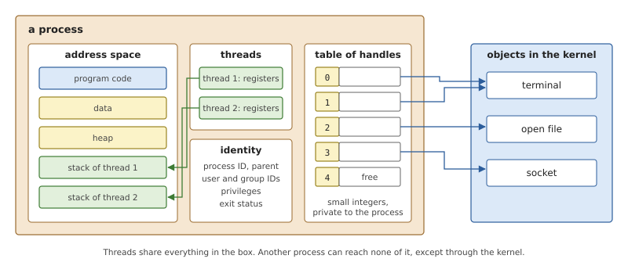
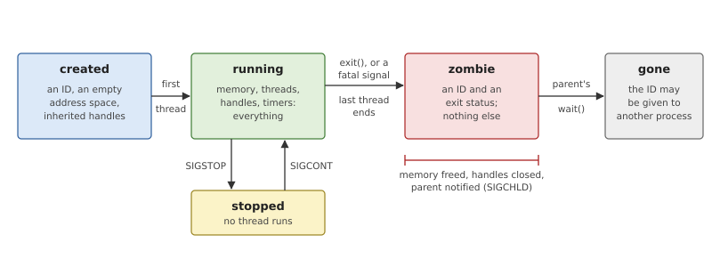
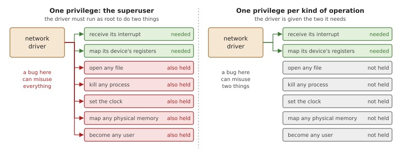
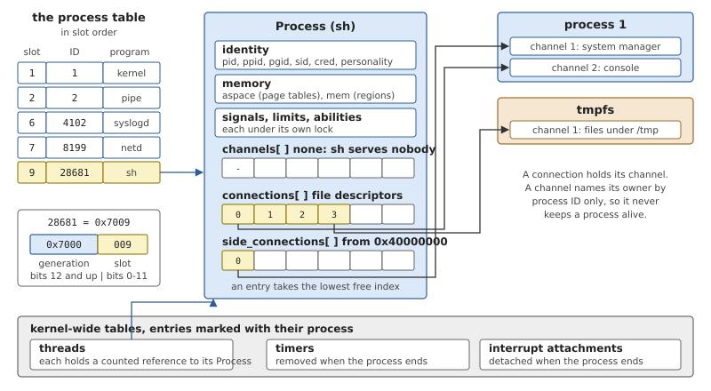
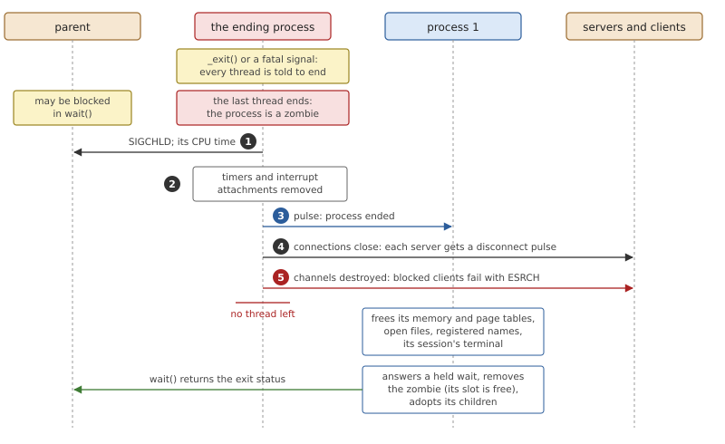
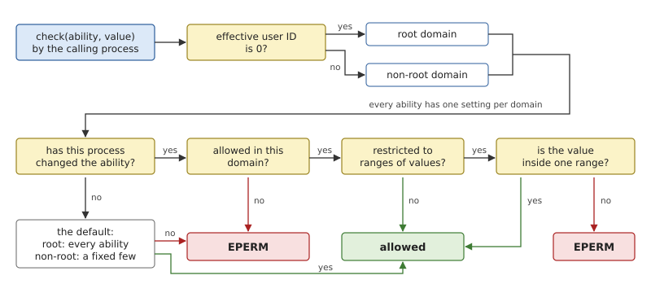
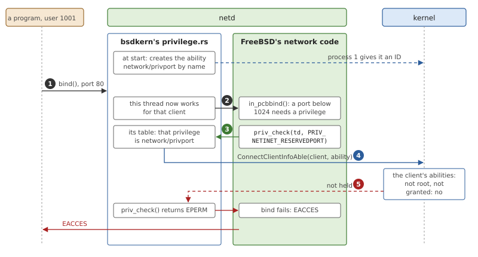

# Processes and Abilities

A thread is what runs; a *process* is what it runs in. The process owns
the memory, the open files and the identity that its threads share, and
it is the unit the rest of the system reasons about: a server checks
which process a request came from, `kill()` names a process, a parent
waits for a child process. This chapter describes what the kernel keeps
for a process and how a process ends, and then turns to the question
every operating system must answer about processes: which of them may
do what. OsCraft's answer is a set of fine-grained privileges called
*abilities*.

## What a process is

To a kernel, a process is a container. Nothing in it runs by itself;
its threads do. What the container holds is what those threads have in
common.



*Figure 17.1: A process: an address space, the threads that run in it,
an identity, and a table of handles that lead to objects in the kernel.*

**An address space.** The program's code and data, its heap and a stack
for each thread, mapped at addresses that mean something only inside
this process. This is the protection boundary: a process can neither
read nor damage what another has in memory.

**Threads.** Each has its own registers and stack, and all of them see
the same memory. A process starts with one thread and ends when the
last one does.

**A table of handles.** A process cannot hold a pointer to something in
the kernel, so it names kernel objects by small integers that index a
table of its own. A *file descriptor* is the best-known kind. The
number 3 means one thing in this process and another, or nothing, in
the next, and that is what makes a handle safe: a process can only name
what its own table holds.

**An identity.** A process ID, by which others name it; the ID of the
parent that created it; and its *credentials*, the user and group IDs
that say on whose behalf it runs. A process has three user IDs. The
*real* one says who started it. The *effective* one is what permission
checks use. The *saved* one remembers an effective ID the process has
given up for a while and may take back.

Processes also come in groups, for the benefit of terminals. A
*process group* is one job, such as the processes of the pipeline
`ls | wc`; a *session* is the set of groups started from one login.
Both are just two more numbers in each process.

### The life of a process

A process is created by another process, runs, and ends, but it does
not vanish when it ends.



*Figure 17.2: The life of a process. Almost everything it owns is
released when its last thread ends; its ID and exit status stay until
the parent has collected them.*

When the last thread ends, the memory can be freed and the handles
closed at once. One thing has to stay: the *exit status*, which says
how the process ended and which its parent will ask for with `wait()`,
perhaps much later. Until then the process remains in the kernel's
table as a *zombie*: an ID and a status, and nothing else. The ID must
not be given to a new process in the meantime, or the parent's `wait()`
would report on a stranger.

A process can also be *stopped*: its threads are kept from running
until it is continued. This is how a shell suspends a job.

### Who may do what

Some operations cannot be open to every program: killing another
user's processes, setting the clock, touching hardware. The traditional
Unix rule is short. A process whose effective user ID is 0, the
*superuser* or *root*, may do everything; all others may do only what
is harmless.

In a monolithic kernel this is tolerable, because the code that needs
the dangerous powers (drivers, file systems, the network stack) is
inside the kernel and does not need a user ID at all. In a microkernel
system that code is in ordinary processes. A network driver must
receive its device's interrupt and map its registers, and under the
traditional rule the only way to allow that is to run it as root.



*Figure 17.3: With a single superuser privilege, a driver that needs
two powers holds all of them. With one privilege per kind of operation
it holds the two.*

Every server in the system would then be all-powerful, and a bug in any
of them could do anything: the protection the microkernel gave with one
hand would be taken back with the other. The *principle of least
privilege* asks for the opposite, that each program hold exactly the
powers its job needs.

The usual remedy is to split the superuser's power into many separate
privileges, one per kind of operation, that can be granted and removed
one at a time. POSIX drafts and Linux call them *capabilities*; FreeBSD
names each privileged operation inside its kernel in the same spirit
(its `priv(9)` list). A process then holds a set of privileges, and
three questions need rules: what the set is by default, who may change
it, and what a new program started by the process inherits.

## Processes in OsCraft

The kernel's side of processes is small: a structure per process, a
table of them, and the code that ends one. It is in
`kernel/src/ker/process.rs`. Creating processes, waiting for them and
changing their IDs are requests to the process manager in process 1,
the subject of Chapter 18.

### The process structure



*Figure 17.4: The process table and one of its processes, the shell of
Chapter 3. Descriptor 3 stands for a file the shell might have open in
`/tmp`.*

The **process table** is a list of counted references in slot order.
Process 1 is in it too, as the one process that is not allocated: a
static structure that owns the kernel's own threads and the channels of
process 1's managers, with an empty user address space.

A **process ID** has two parts. Its low 12 bits are the process's slot
in the table, the lowest that was free when it was created. The bits
above are the table's *generation*, a counter that advances every time
a process is removed. You can read both in the output of `ps` in
Chapter 3: `syslogd` is process 4102, which is slot 6 in generation
0x1000, and the shell is 28681, slot 9 in generation 0x7000. A slot is
reused quickly, but the process that reuses it gets a different ID, so
a stale ID does not name it. A zombie keeps its slot.

A `Process` has no lock of its own. Each group of fields has its own
lock or is atomic, so that a thread changing its signal actions never
waits for one opening a file:

- **Identity**: the ID and the parent's; the credentials, a `Cred` with
  the real, effective and saved user and group IDs and the
  supplementary groups; the process group and the session, each stored
  as 0 until set, which reads as "my own ID"; the program's path.
- **Memory**: the address space, set once and never replaced, and the
  list of mapped regions (Chapter 16).
- **Handles**: three tables, described below.
- **State of the subsystems**: signal actions and pending signals
  (Chapter 14), registered events (Chapter 11), job-control and
  debugger state, resource limits, the working and root directories,
  the file creation mask, and the abilities.
- **Accounting**: the number of live threads, when the process started,
  the CPU time of its ended threads and of its ended children, and how
  it ended.

One more field is the **personality**: native, for a FreeBSD program,
or QNX. It is set when a program is loaded, from the operating system
its file names, and a forked child inherits it. The kernel consults it
where a result must be laid out for the program, such as the
`siginfo_t` a `wait()` returns. Chapter 23 describes the native
personality and Chapter 32 the QNX one; nothing else in this chapter
depends on it.

### Handles: channels and connections

OsCraft's handles are the objects of message passing (Chapter 10), and
a process has three tables of them.

- **Channels**, on which a server receives. Channel IDs start at 1.
- **Connections in the file-descriptor range**, from 0. A file
  descriptor *is* a connection to the server behind the open file, so
  this table is the process's descriptor table.
- **Side connections**, numbered from `0x40000000`: connections that
  are not files. Every process is born with the first of them,
  `0x40000000` itself, which leads to the system manager's channel in
  process 1.

All three follow the rule POSIX gives for descriptors: a new entry
takes the lowest free index, at or above the one asked for.

*Listing 17.1: The lowest free index, `alloc_slot()` (`kernel/src/ker/process.rs`).*

```rust
{{#include ../../../kernel/src/ker/process.rs:alloc_slot}}
```

The `limit` matters because the starting index comes from the program.
For descriptors it is the process's limit on open files, 1000 unless
changed, so that asking for descriptor 50000 fails with `EMFILE`
instead of making the kernel allocate a table that large.

Not everything a process owns hangs off its structure. Threads, timers
and interrupt attachments live in kernel-wide tables, each entry marked
with its process. Every thread holds a counted reference to its
process, and the process table holds one more. A channel, by contrast,
records only the ID of its owner. So a connection keeps its channel
alive, but nothing a *client* holds can keep a *server's* process
alive.

### Creating a process

The kernel has three ways to make a `Process`, which differ in what the
new process starts with.

*Table 17.1: The three constructors of a process.*

| Function | Used for | The new process gets |
|---|---|---|
| `create()` | programs the boot script starts | an empty address space, the connection to process 1, and descriptors 0 to 2 on process 1's console |
| `fork()` | `fork()` | copies of the parent's credentials, groups, limits, abilities, signal actions, directories, personality and every file descriptor |
| `spawn_child()` | starting a program directly | the parent's credentials, groups, limits and directories; the abilities marked to be inherited; the descriptors the caller listed, or all those not marked close-on-exec |

A copied descriptor is a *new* connection to the same channel. The
server sees a new client and has to be told that it stands for the same
open file; the child does that itself before it runs its first
instruction (Chapter 18). Of the side connections, `fork()` copies only
those that lead to process 1. None of the three creates a thread or
maps any memory; the process manager and the loader do that
(Chapters 18 and 19).

### The end of a process

A process ends because it calls `_exit()` or because a signal kills it.
Both arrive at the same function, which shows the rule in a few lines.

*Listing 17.2: Ending the calling process, `exit_current()` (`kernel/src/ker/process.rs`).*

```rust
{{#include ../../../kernel/src/ker/process.rs:exit_current}}
```

The first to call it records how the process ended. Every other thread
is marked to end at its next return to user mode, and those that are
blocked are woken so that they get there. Then the calling thread ends.
Nothing is torn down yet: that is the job of whichever thread turns out
to be the last.



*Figure 17.5: What the last thread of a process does as it ends
(`last_thread_exited()`), and what process 1 does when told.*

The last thread marks the process a zombie and then releases, in order,
everything other processes can see:

1. The parent's count of its children's CPU time grows by this
   process's, and the parent is sent `SIGCHLD` with the exit status.
2. The process's timers and interrupt attachments are removed.
3. Process 1 gets a pulse on its system-manager channel with the
   process's ID.
4. The connections close. Each server learns, by a disconnect pulse,
   that a client is gone, and frees what it kept for it.
5. The channels are destroyed. Clients blocked on them fail with
   `ESRCH`, and a process that asked to be told when one of its
   connections dies gets a pulse for each.

The order of the first step matters to one case. If the parent ignores
`SIGCHLD`, or set `SA_NOCLDWAIT`, it has declared that it will not
wait; the kernel decides this *before* marking the zombie, and such a
process is never reported to a `wait()` and is removed without one.

Process 1 does the rest when the pulse arrives: it frees the process's
memory and page tables and what its managers held for it, and answers
the parent's `wait()` if one is pending. Removing the zombie from the
table (`remove()`) frees its slot and advances the generation. The
address space itself is released only once no processor is still
running one of the process's threads, since the last thread is, to the
very end, running on those page tables.

## Abilities

OsCraft splits the superuser's power into about 70 privileges, called
*abilities*, each covering one kind of operation. The code is in
`kernel/src/ker/ability.rs`.

*Table 17.2: Some abilities and where they are checked.*

| Ability | Needed to | Checked in |
|---|---|---|
| `INTERRUPT` | attach to an interrupt (value: its number) | `InterruptAttach()` |
| `MEM_PHYS` | map physical memory (value: the address) | the memory manager |
| `PRIORITY` | give a thread a priority above 63 | thread creation, scheduling calls |
| `SIGNAL` | signal another user's process (value: the signal) | `SignalKill()` |
| `SETUID` | take another user ID (value: the ID) | the process manager |
| `CLOCKSET` | set the time | `ClockTime()` |
| `PATHSPACE` | register a name in the path name space | the pathname manager |
| `REBOOT` | reboot the machine | the system manager |
| `FORK`, `SPAWN` | create processes | the process manager |

### Two domains

A process does not hold a simple set of abilities. It holds every
ability twice: once for when its effective user ID is 0, the *root
domain*, and once for when it is not, the *non-root domain*. The
defaults make an untouched process behave exactly as Unix expects:

- in the root domain, every ability is allowed;
- in the non-root domain, a fixed few are, the ones every program
  needs: creating processes, executable mappings, process groups,
  public channels and a handful more.

So root can still do everything and others only what is harmless,
until someone changes a setting. A server that needs one interrupt can
then be started as an ordinary user with `INTERRUPT` allowed in its
non-root domain, or stay root and have everything else denied.

A process stores only the abilities it has changed; for the rest the
defaults apply. A setting has four parts: allowed or not, an optional
list of *ranges* of values, *locked* or not, and *inherited* or not.

### Checking

Every privileged operation calls `ability::check()` with the ability
and, where it has one, the value it is about to use. The call returns
`EPERM` unless the ability holds.



*Figure 17.6: How a check is decided. The effective user ID picks the
domain; the process's own setting, if it has one, replaces the
default.*

The ranges are what make a grant precise. `INTERRUPT` allowed with the
range 79 to 79 lets a driver attach to that interrupt and no other;
`SETUID` with a range lets a login program become ordinary users but
not root. The rule is one expression.

*Listing 17.3: An ability and its ranges, `allows_range()` (`kernel/src/ker/ability.rs`).*

```rust
{{#include ../../../kernel/src/ker/ability.rs:allows_range}}
```

A check that carries no value asks only whether the ability is allowed
at all. A check that carries a value, or a whole range of values, also
needs one of the setting's ranges to contain it, if the setting has
any.

Two uses of abilities are worth knowing because they are not simple
yes-or-no checks. The priority a process may give its threads is capped
at 63 without `PRIORITY`, and the same cap limits how far a client's
priority can raise a server (Chapter 10). And several checks that
compare two processes fall back on an ability: a process may signal
another if their user IDs match *or* it has `SIGNAL` for that signal.

### Changing and inheriting

A process changes abilities with a request to the process manager,
which ends in `ability::set()`. The request is a list; each entry names
an ability (or all of them), one or both domains, and operations:

- **deny** or **allow** the ability;
- add a **range** to an allowed ability, which restricts it to the
  values in its ranges; ranges accumulate and are never removed;
- **lock** the setting, after which no request changes it;
- mark it **inherited** or not.

Giving power away is itself privileged. Allowing an ability that the
non-root domain lacks by default, or adding a range to one, needs the
ability `ABLE_PRIV`; changing another process's abilities needs
`XPROCESS_ABLE`. Denying needs nothing, so any process can shed what it
will not use, and lock the result.

What a new process gets depends on how it is made. `fork()` copies all
settings, since the child is the same program. A newly started program
gets only the settings marked inherited, and the defaults for
everything else, so that a privilege granted to one program does not
leak into whatever it runs.

### A server asks about its client

The checks so far are made by the kernel or by process 1 about the
calling process. Servers have the same question about their *clients*:
may this client open a raw socket, or bind a port below 1024? Two
things let them use abilities for it.

First, abilities are not a closed list. A process with the ability
`ABLE_CREATE` can create a new one by name, such as
`network/privport`, saying which domains have it by default. Process 1
keeps the names and hands out IDs after the built-in ones; a second
server creating the same name gets the same ID.

Second, a server can ask the kernel about the process behind one of
its connections. `ConnectClientInfoAble()` takes the server connection
ID the kernel delivered with the message (Chapter 10) and a list of
abilities, each with a range of values, and marks which of them the
client holds, along with the client's credentials. The check runs in
the kernel, on the client's own settings; the server never sees or
copies them.

`netd` shows how far this goes. It runs FreeBSD's network stack
(Chapter 28), and that code already asks permission wherever it should:
FreeBSD's kernel calls `priv_check()` with the name of a privilege
before each privileged step, and on FreeBSD that function mostly asks
whether the caller is root. In `netd` the function is replaced
(`user/bsdkern/src/privilege.rs`).



*Figure 17.7: An unprivileged program binds port 80. FreeBSD's code
asks its usual question, and `netd` turns it into a question about the
client's abilities.*

At start, `netd` creates six abilities, `network/privport`,
`network/rawsocket`, `network/reuseport`, `network/ipsec`,
`network/jailroot` and `network/admin`, each allowed by default in the
root domain only. It also registers a table that maps FreeBSD's
privileges to them: `PRIV_NETINET_RESERVEDPORT` to `network/privport`,
the two raw-socket privileges to `network/rawsocket`, and every
privilege the table does not list to `network/admin`. One privilege,
`PRIV_NET_BPF`, is granted to everyone.

When a thread of `netd` takes a request, it notes which client it is
working for. Each `priv_check()` FreeBSD's code then makes on that
thread becomes one `ConnectClientInfoAble()` call about that client.
Threads that work for no client, FreeBSD's own, are always allowed.

Nothing in FreeBSD's code changed for this, and the default result is
FreeBSD's: root may, others may not. What is new is the middle ground.
A process allowed `network/privport` alone can bind port 80 without
being root, and `netd` needs to know nothing about that program.

## Summary

- A process is what its threads share: an address space, tables of
  handles, credentials and bookkeeping. The kernel keeps one structure
  per process, with a lock per group of fields and none for the whole.
- A process ID is a slot in the process table plus a generation, so
  slots are reused and IDs are not.
- OsCraft's handles are channels and connections. File descriptors are
  the connections numbered from 0; side connections start at
  `0x40000000`, and the first leads to process 1.
- A process ends when its last thread does. That thread makes it a
  zombie, notifies the parent and process 1, closes its connections
  and destroys its channels; process 1 frees the memory, and a
  `wait()` removes the zombie.
- Privilege is split into about 70 abilities, each held separately for
  the root and the non-root domain, optionally restricted to ranges of
  values. The defaults reproduce the Unix superuser.
- `fork()` copies abilities; a newly started program keeps only those
  marked inherited.
- Servers create abilities of their own and check their clients' with
  `ConnectClientInfoAble()`. `netd` answers FreeBSD's `priv_check()`
  that way.
