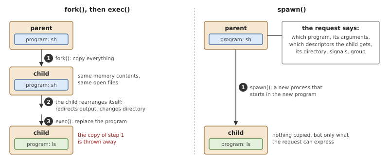
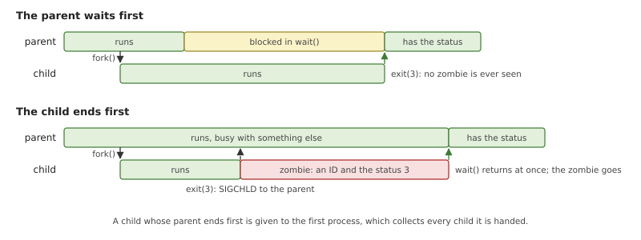
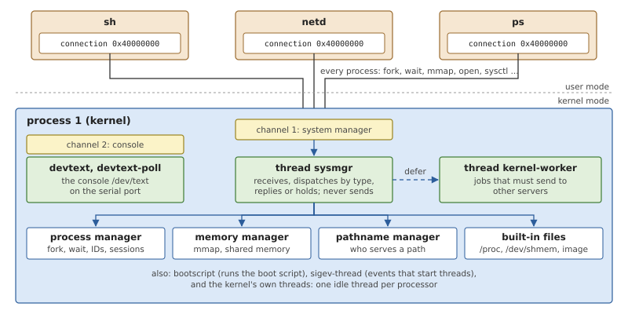
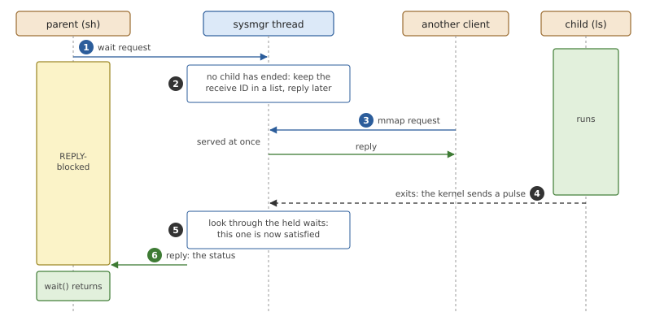
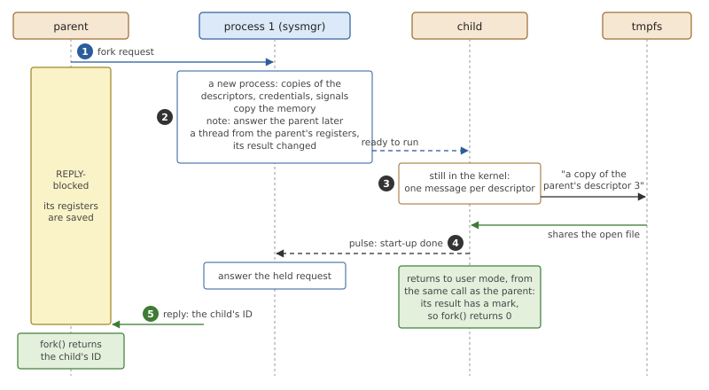
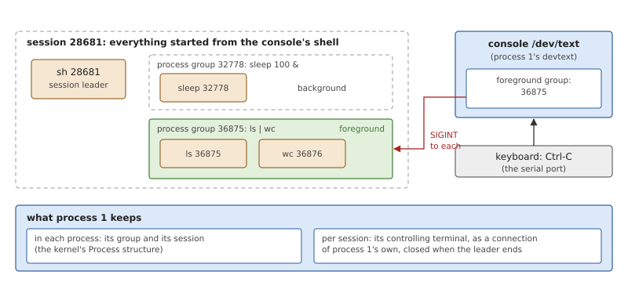
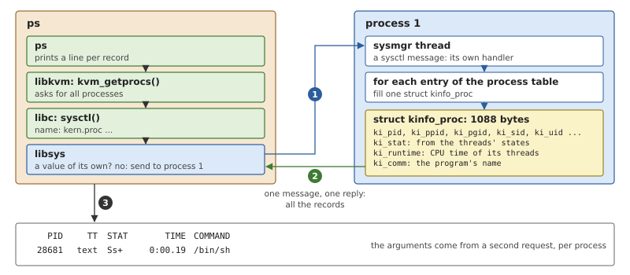

# The Process Manager

The kernel of Chapter 17 can hold a process and end one, but it has no
call that creates one. `fork()`, `wait()`, `setsid()` and their
relatives are requests to a server, the *process manager*, which lives
in process 1. This chapter explains why that work is done by a process,
what the work is, and how process 1 does it; then it follows FreeBSD's
process calls, and FreeBSD's `ps`, down to the messages they become.

## Managing processes from a process

A microkernel provides *mechanisms*: threads, address spaces, message
passing. Deciding what a new process inherits, who may wait for whom
and what happens to a child whose parent has gone is *policy*, and
there is a lot of it. Policy is easier to write, change and debug in a
server, where code may block, allocate and take its time, than in a
kernel call, which must be short and must not wait. So a microkernel
system gives the job to a process.

That process is an unusual one. It must be able to build address
spaces and start threads in *other* processes, which no ordinary
process may do, and every process must be able to reach it from its
first instruction. In practice it is a part of the system that is
trusted like the kernel but structured like a server: it receives
requests as messages and answers them.

### Two ways to start a program

Starting a program takes four things: a new process, the program's
code and data in its memory, a thread at the program's entry point, and
the parent's open files, or some of them, in the child. There are two
classic interfaces for it.



*Figure 18.1: Two ways to run `ls` from a shell. `fork()` copies the
shell and the copy turns itself into `ls`; `spawn()` creates the new
process directly from a description.*

**`fork()` and `exec()`** split the job in two. `fork()` makes the
child an exact copy of the parent: same memory contents, same open
files, running at the same point of the same program. It is called
once and returns twice, in the parent with the child's ID and in the
child with 0. The child then calls `exec()`, which replaces the program
in the calling process with another and keeps the process, its ID and
its open files. The strength of the pair is what can happen in between.
The child is still the parent's program, with all its knowledge, and
can arrange its own surroundings with ordinary calls: redirect its
output, change directory, drop privileges. No special interface is
needed for any of it.

The weakness is the copy. A process about to call `exec()` has no use
for a duplicate of the parent's memory. Most kernels avoid the cost by
sharing the pages and copying one only when it is written
(*copy-on-write*), at the price of page faults at moments the program
did not choose. A system that wants every mapping backed by real memory
from the start pays for `fork()` in full.

**`spawn()`** does the job in one step: the parent describes the child
(the program, its arguments, which descriptors it gets, its signal
settings) and the system builds it. Nothing is copied to be thrown
away. But the child can only be arranged in the ways the description
has a field for.

Unix programs use `fork()` everywhere, so a system that runs them must
have both.

### Waiting, zombies and orphans

A parent learns how its child ended by *waiting* for it. The two events
can come in either order.



*Figure 18.2: `wait()` and the end of the child, in both orders. The
zombie exists only to bridge the gap in the second.*

If the parent waits first, it blocks until the child ends. If the
child ends first, its exit status has to be kept somewhere until the
parent asks, and the dead process stays in the process table as a
zombie (Chapter 17). Either way the parent is also told
asynchronously, with the signal `SIGCHLD`, so that it need not sit in
`wait()`. A parent that declares it will never wait gets no zombies.

A child whose parent ends first is an *orphan*. Something must
eventually collect its status, so orphans are handed to the first
process, which waits for anything it is given.

### The first process

Every process has a parent except one. The first process cannot be
created by `fork()`, since there is nobody to fork, nor loaded from a
file by the process manager in the usual way, since the servers that
provide files are not running yet. A microkernel system therefore
builds it into what the boot loader loads, next to the kernel. Being
there from the start, and never ending, it is also the natural home
for the process manager itself, and the natural parent for orphans.

## The process manager in OsCraft

Process 1 is linked into the same file as the microkernel, runs in
kernel mode, and is a process like any other in the kernel's table
(`KERNEL`, Chapter 17). `ps` shows it as `kernel`, the name of its
file. It holds three managers, for processes, memory (Chapter 20) and
path names (Chapter 21), and a few built-in servers (Chapter 22). Its
code is in `kernel/src/proc/`; this chapter covers
`kernel/src/proc/sysmgr.rs`, `kernel/src/proc/procmgr.rs`,
`kernel/src/proc/session.rs` and their neighbours.

### Threads and channels



*Figure 18.3: Process 1. Every process has a connection to channel 1
from birth; one thread serves it and passes each message to the
manager it belongs to.*

Process 1's threads are kernel threads (Chapter 8), started at priority
10 at the end of the kernel's initialisation. They use the same kernel
calls as any server: they receive on a channel and reply. Because their
address space is the kernel's, the buffers they pass are kernel memory,
and a reply is copied straight from there to the client.

Channel 1 is the **system manager**. A process's connection
`0x40000000` leads to it, so every request of this chapter is a
message on that connection. One thread, `sysmgr`, serves the channel
in a loop: receive, look at the 16-bit type at the start of the
message, hand the message to the manager for that type. Process
messages go to the process manager, mapping requests to the memory
manager, path lookups to the pathname manager, and I/O messages on
files that process 1 serves itself to its built-in servers. The managers
are not threads; they are the functions `sysmgr` calls.

A message that is too short for its type is rejected before any
handler sees it, with `EBADMSG`, so no handler checks its own minimum
length. A handler either replies itself or keeps the request for later.

### Holding a request

One thread serves the whole system, so it must never wait for
something a client will take time to provide. Synchronous message
passing makes that easy: a server is not obliged to reply before it
receives the next message. The receive ID names the waiting client for
as long as it stays REPLY-blocked, so the server can put the request
aside and answer when it can. The client sees only a call that took
longer.



*Figure 18.4: A `wait()` held by process 1. The request is put aside,
other clients are served, and the child's end, reported by a pulse,
produces the reply.*

Three kinds of request are held: a `wait()` until a child ends, a
`fork()` until the child has finished starting, and a request to start
a program until it is loaded (Chapter 19). What ends the wait is
usually a pulse from the kernel on the same channel, which the loop
receives like a message.

A held client may get a signal. Channel 1 is created with the unblock
flag (Chapter 10), so the client does not simply leave: process 1 gets
a pulse naming it, and decides. A held `wait()` is answered with
`EINTR`, unless a child it was waiting for has ended in the meantime,
in which case it gets that child.

### The worker thread

A few requests require process 1 to send messages to *other* servers:
loading a program from a file that another server holds, or telling a
terminal's server which session now owns it. The `sysmgr` thread must
not do that. The other server may need something from process 1 to
answer, and would then wait for the very thread that is waiting for
it. Such work is handed to a second thread.

*Listing 18.1: Deferring work to the worker thread (`kernel/src/proc/worker.rs`).*

```rust
{{#include ../../../kernel/src/proc/worker.rs:worker}}
```

A job is a closure that carries the receive ID and replies to the
client itself when it is done. This is the send hierarchy of Chapter 10
applied inside one process: the thread everybody sends to never sends.

### fork()

`fork()` needs a new thread that will return from the same call as its
parent, with the same registers and stack contents. From the process
manager's side that is not hard, because of where the parent is while
it asks: blocked in a kernel call, with its complete user-mode state
saved on its kernel stack (Chapter 6). A copy of that saved state is a
thread that returns from the same call.



*Figure 18.5: `fork()` as a message. The parent is held until the
child has told every server about the descriptors it inherited.*

*Listing 18.2: The process manager's side, `fork()` (`kernel/src/proc/procmgr.rs`).*

```rust
{{#include ../../../kernel/src/proc/procmgr.rs:procmgr_fork}}
```

The steps behind the listing, and the figure:

1. **A new process.** `process::fork()` makes it with copies of the
   parent's descriptors, credentials, groups, limits, abilities and
   signal actions (Chapter 17).
2. **The memory.** Every private page of the parent is copied into a
   new page of the child, and shared mappings are shared. OsCraft
   copies at once, with no copy-on-write, in keeping with its rule that
   mapped memory is real memory (Chapter 16). The files process 1
   itself serves need no message: its own tables are updated on the
   spot.
3. **The thread.** It is made from the parent's saved registers, with
   the parent's priority and signal mask, and with one register
   changed: the result of the call, so that the two returns can be told
   apart.
4. **The other servers.** The child's descriptors are new connections
   (Chapter 17), and each server behind one must learn that the new
   client shares the parent's open file, with its position and mode.
   The child does this itself: before it returns to user mode, still in
   the kernel, it sends a message on each inherited connection naming
   the parent's. For this short time the kernel marks the child as a
   process being set up, which is what makes servers accept a claim
   on another process's open file.
5. **The reply.** The child then sends process 1 a pulse, and process 1
   answers the parent's request with the child's ID.

The listing shows two rules that are easy to break. The held request is
registered *before* the child's thread exists: a child on another
processor can finish step 4 and send its pulse before the process
manager gets any further, and a pulse that finds no registration would
leave the parent blocked for ever. And a failure half-way undoes
everything, the child's memory, its open files and its ID, so that the
parent sees only an error.

When `fork()` returns in the parent, the child is therefore complete:
every server knows it. Nothing of the child's has run in user mode
before that, apart from its return from the call.

### wait()

A wait request names the children it is about (any child, one process,
a process group) and options. The process manager answers in one of
four ways.

- No child matches: `ECHILD`, at once.
- A matching child is a zombie: the reply is a `siginfo_t` like the one
  its `SIGCHLD` carried, with how it ended and its status, and the
  zombie is removed from the process table. A child that has stopped
  or continued is reported the same way, once, if the options ask for
  it.
- Nothing to report and the caller asked not to block: an empty reply.
- Otherwise the request is held.

Held waits are looked at again whenever a process ends, stops,
continues or leaves its parent. Each is answered if it is now
satisfied, or failed with `ECHILD` if its last matching child is gone.
All of this runs on the `sysmgr` thread alone, which is why no wait is
ever answered twice or overlooked: there is no second thread to race
with.

An answered wait also takes back the `SIGCHLD` of that child if the
parent has not yet received it. A parent sitting in `wait()` gets its
answer and no signal for the same child afterwards.

### When a process ends

The kernel's part of ending a process was Figure 17.5; it finishes with
a pulse to process 1. On that pulse, process 1 releases what its
managers held for the process: its memory and page tables, its open
files on the built-in servers, shared-memory handles, message queues
and pipes it created, the path names it registered, and its session's
terminal if it led one. Then it rechecks the held waits, which is what
answers the parent.

Last, the orphans. Every child of the ended process becomes a child of
process 1. Process 1 waits for nobody, so its children leave no
zombies: one that has already ended is removed on the spot, and one
that ends later is removed as soon as its own exit pulse arrives. The
programs the boot script starts are process 1's children from the
beginning, which is why a server that dies does not linger.

### Sessions and the terminal

Process groups and sessions (Chapter 17) are two numbers in each
process, and the process manager owns the rules for changing them.

`setsid()` makes the caller the leader of a new session and a new
group, unless it already leads a group. `setpgid()` moves the caller or
one of its children to another group of the same session, and refuses
for a session leader and for a child that has already started a
program of its own. A forked child stays in its parent's group and
session.



*Figure 18.6: The console's session during `ls | wc`. The terminal
knows which group is in the foreground and signals all of it.*

A session may have a *controlling terminal*. Process 1 keeps one record
per session that has one: a connection of its own to the terminal,
with the terminal's name. The last line of the boot script starts the
shell as a session leader, and its terminal is the console the script
has just opened. The record is what `/dev/tty` resolves to, what puts
`text` in the `TT` column of `ps`, and what goes when the session
leader ends: process 1 sends `SIGHUP` to the terminal's foreground
group and closes its connection.

The *foreground group* is kept by the terminal itself. When the shell
starts a job it tells the terminal with `tcsetpgrp()`, a control
message on the terminal's descriptor. The console is one of process
1's built-in servers, with a line discipline of its own
(`kernel/src/proc/tty.rs`) that uses FreeBSD's `termios`: it edits and
echoes lines, and when it reads the interrupt, quit or suspend
character it sends `SIGINT`, `SIGQUIT` or `SIGTSTP` to every process
of the foreground group. A pseudo-terminal does the same from its own
server (Chapter 25).

## The native view

A FreeBSD program calls `fork()` and `wait4()`; it knows nothing of
messages. libsys (Chapter 24) is where each call becomes what the
previous sections described, and it is worth seeing how little is
left to do.

*Table 18.1: FreeBSD's process calls in libsys.*

| Call | What libsys does |
|---|---|
| `fork()` | a fork request to process 1 |
| `execve()` | a request to start a program, marked as replacing the caller (Chapter 19) |
| `wait4()` | a wait request; the `siginfo_t` of the reply becomes FreeBSD's status word |
| `_exit()` | the kernel call `ThreadDestroy()` for all threads |
| `kill()` | the kernel call `SignalKill()` (Chapter 14) |
| `getpid()` | no call at all: the ID is remembered |
| `getppid()`, `getuid()`, `getpgrp()` ... | one query to process 1, which returns all the IDs |
| `setsid()` | a session request to process 1 |
| `sysctl()` | answered locally, by process 1, or by `netd` |

Two rows are kernel calls, not messages: ending the process and
sending a signal are things the kernel does itself.

*Listing 18.3: `fork()` in libsys, `__sys_fork()` (`user/libsys/src/proc.rs`).*

```rust
{{#include ../../../user/libsys/src/proc.rs:sys_fork}}
```

The listing is the other end of Figure 18.5. Both returns come out of
the same `send()`. The parent's result is the child's ID. The child's
is its own ID with one bit set above it, the changed register of step
3; libsys stores the ID and returns 0. That stored ID is why
`getpid()` costs nothing. A process that was not forked finds its ID in
the auxiliary vector the loader gave it (Chapter 19).

`wait4()` translates in both directions. Its `pid` argument selects
one child, a group or all; its options are mapped to the process
manager's. The reply says how the child ended (exited, killed, stopped,
continued) and with what value, and libsys packs that into the status
word that FreeBSD's `WIFEXITED()` and `WEXITSTATUS()` take apart. The
resource usage `wait4()` can return is not reported yet and reads as
zeros.

### How ps sees the system

FreeBSD's `ps` and `top` do not read `/proc`. They call `sysctl()`,
FreeBSD's interface for reading named values from the kernel, and ask
for `kern.proc`: an array of `struct kinfo_proc`, one per process.
OsCraft has no monolithic kernel to hold such a tree of values, so
libsys answers a `sysctl()` in three stages. A few values it knows
itself, from the auxiliary vector (the number of processors, the page
size). Otherwise it sends the request to process 1. If process 1 does
not know the name, the request goes on to the network stack in `netd`,
which holds FreeBSD's own tree for everything about networking.



*Figure 18.7: `ps` on OsCraft. FreeBSD's program and libraries are
unchanged; process 1 produces the records they expect.*

Process 1's side is `kernel/src/proc/kinfo.rs`. For each process the
request selects (all, one ID, a group, a session, a user) it fills a
record of 1088 bytes at the offsets FreeBSD's header defines for
arm64. The interesting part is the fields that have no direct
counterpart:

- **State.** A zombie is a zombie. Otherwise the process is *running*
  if any thread is ready or on a processor, *stopped* if one is
  stopped, and *sleeping* if all are blocked, with a short word for
  what the reported thread waits on (`msg` for a thread blocked in a
  send, `recv` for a server waiting for a message).
- **Memory.** The size is the sum of the mapped regions, and the
  resident size is the same number, because every mapping is fully
  backed.
- **Time.** The CPU time of the process's threads, and when it started.
- **Terminal.** The session's controlling terminal, if process 1 has a
  record for it, and whether the process leads its session.

Now the output in Chapter 3 can be read:

```text
  PID   TT  STAT    TIME COMMAND
    1    -  RLs  0:39.12 kernel -v
 8199    -  Ss   0:01.34 netd
28681 text  Ss+  0:00.19 /bin/sh
```

Process 1 is always `R`: its threads include the idle threads, one of
which is running whenever a processor has nothing else to do, and their
time is counted in its `TIME`. `netd` is `S`: all its threads are
blocked.
Every process here has `s`, session leader, because a process the boot
script starts is the only member of its own session. Only the shell has
a terminal, and the `+` says its group is that terminal's foreground
group.

`top` needs a few more names, which process 1 also answers: the busy
and idle time of each processor, taken from the idle threads' CPU
times, the count of free pages, and the boot time.

## Summary

- Process management is policy, and lives in a server: the process
  manager in process 1, which is built into the kernel file because
  nothing could load it. `ps` calls it `kernel`.
- One thread, `sysmgr`, serves the channel that every process is
  connected to from birth, and dispatches by message type to the
  process, memory and pathname managers.
- That thread never blocks and never sends. Requests that must wait are
  held by their receive ID and answered on a later pulse; work that
  must send to other servers goes to a worker thread.
- `fork()` copies the process and its memory and makes the child's
  thread from the parent's saved registers. The child announces its
  inherited descriptors to their servers before the parent's `fork()`
  returns.
- `wait()` is answered from a zombie or held until there is one.
  Orphans go to process 1, whose children never become zombies.
- Sessions and groups are numbers in each process; process 1 keeps each
  session's controlling terminal, and the terminal keeps its foreground
  group and signals it.
- FreeBSD's process calls are thin in libsys: a message to process 1 or
  a kernel call. `ps` and `top` work unchanged because process 1
  answers `sysctl()` with FreeBSD's `kinfo_proc` records.
