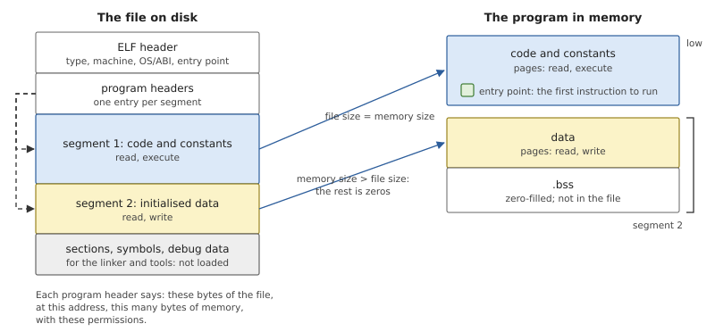
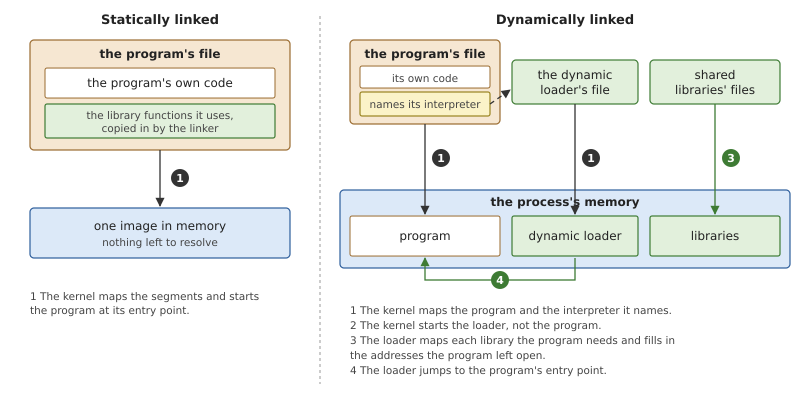
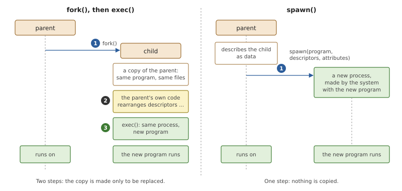
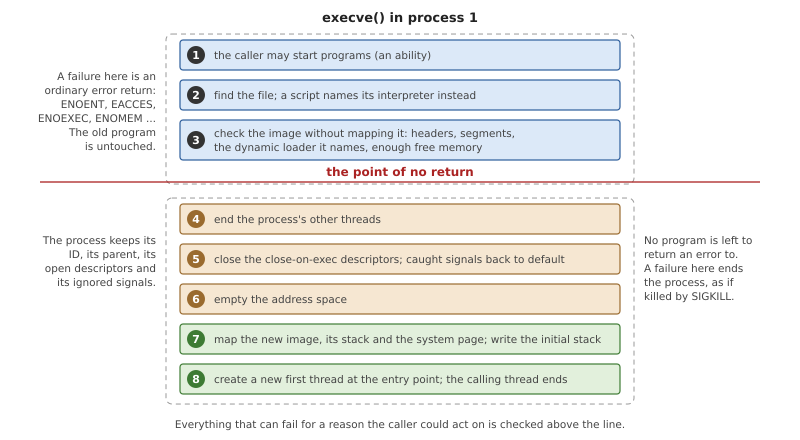
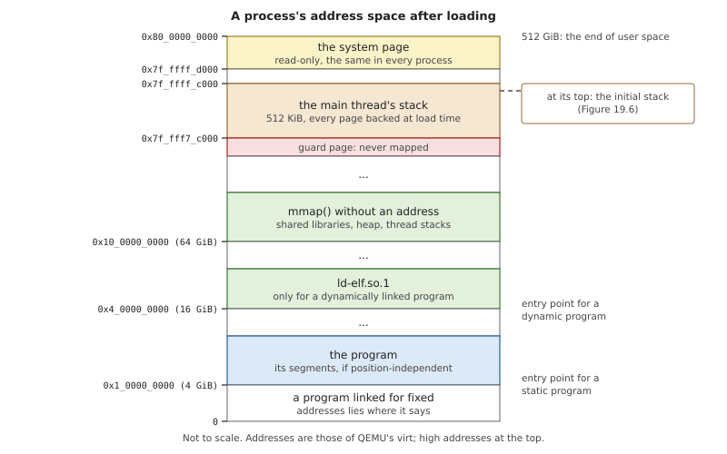
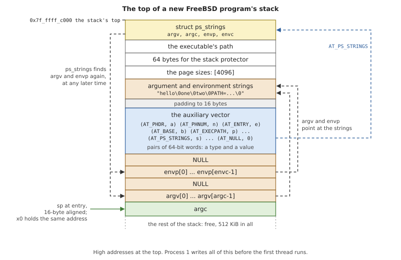
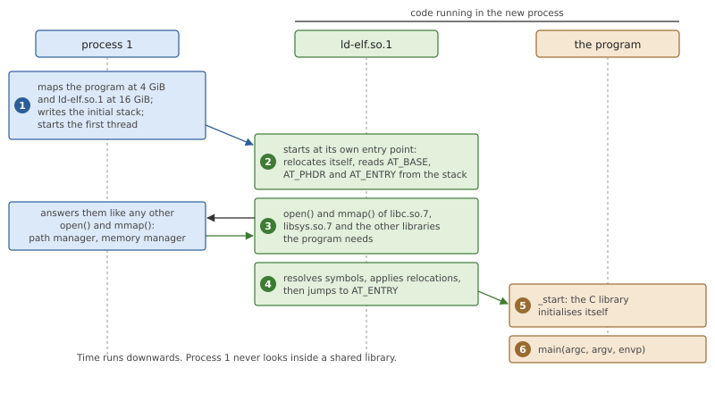
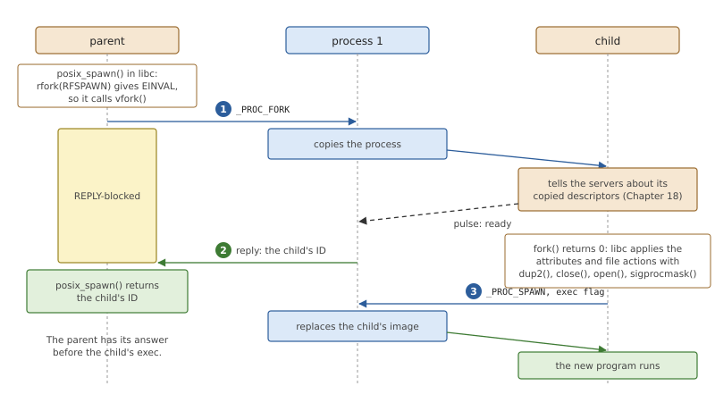

# Spawning and Loading Programs

A program is a file until something turns it into a running process: its
code has to be placed in memory, a stack has to exist, and the program has
to be told its arguments. This chapter explains what is in an executable
file, what a kernel must prepare before the first instruction can run,
and the two classic ways of starting a program, `exec()` and `spawn()`.
Then it follows a FreeBSD program through OsCraft's loader, which is part
of process 1.

## From a file to a running program

### What an executable file contains

On most Unix-like systems, FreeBSD among them, a compiled program is an
*ELF* file (Executable and Linkable Format). An ELF file describes its
contents twice. The *sections* (`.text`, `.data`, the symbol tables) are
the view of the linker and the debugger. The *segments* are the view of
whoever loads the program, and they are all a loader needs.



*Figure 19.1: The loader reads the ELF header and the program headers.
Each loadable segment becomes a run of pages; a segment that is larger in
memory than in the file ends in zeros.*

The *ELF header* at the start of the file says what kind of file this
is: the machine it was compiled for, whether it must be loaded at fixed
addresses or can go anywhere, which operating system's conventions it
follows (the *OS/ABI* byte), and the *entry point*, the address of the
first instruction to run. It also says where the *program headers* are,
one for each segment.

A segment of type `PT_LOAD` is an instruction to the loader: take this
many bytes at this offset of the file, place them at this virtual
address, make the memory this large, and give it these permissions. A
typical program has two. The first holds the code and the constants, and
is readable and executable. The second holds the variables, and is
readable and writable. In the second, the size in memory is larger than
the size in the file: the difference is the program's uninitialised
variables, its `.bss`, which need no bytes in the file because they all
start as zero.

An executable of type `ET_EXEC` was linked for fixed addresses, and its
segments must go exactly where they say. A *position-independent*
executable (type `ET_DYN`, the same type a shared library has) contains
only addresses relative to its start, so the loader chooses a base
address and adds it to everything.

### Static and dynamic linking

A program calls functions it does not contain: `printf()`, `malloc()`,
the whole C library. There are two ways to bring the two together.



*Figure 19.2: A statically linked program is complete in its file. A
dynamically linked one is completed in memory, by a program the kernel
loads beside it.*

With *static linking*, the linker copies the library functions the
program uses into the program's file. The file is self-contained, and
loading it is all there is to do. The price is that every program
carries its own copy of the library, on disk and in memory, and a fix to
the library reaches a program only when that program is linked again.

With *dynamic linking*, the library stays in a file of its own, a
*shared library*, and the program only records which libraries it needs
and which names it uses from them. Somebody must then, at every start,
map the libraries and fill in the addresses. That work is involved, and
none of it needs privileges, so the kernel does not do it. A dynamically
linked program names, in a segment of type `PT_INTERP`, the path of
another program that can: the *dynamic loader*, also called the
program's *interpreter*. The kernel maps the program and the interpreter,
and starts the interpreter. The interpreter maps the libraries, resolves
the program's references to them, and jumps to the program's entry
point. Read-only pages of a shared library can be the same physical
pages in every process that uses it.

### What the program finds when it starts

A new program needs more than its code. It needs a stack, its arguments
and its environment, and a dynamically linked program's interpreter must
learn where the kernel put the program it is to finish. There is no call
to ask for these things. By a convention between the kernel and the C
library's start-up code, they lie on the stack when the first
instruction runs, and the stack pointer points at them:

- the number of arguments, `argc`;
- the pointers to the argument strings, `argv[]`, ended by a null
  pointer;
- the pointers to the environment strings, `envp[]`, ended the same way;
- the *auxiliary vector*: pairs of a type and a value, by which the
  kernel passes facts that are not strings. Where the program's headers
  are in memory, its entry point, the base address of the interpreter
  and the page size are among them. A pair of type `AT_NULL` ends it.

The strings themselves lie above these, at the very top of the stack.
The start-up code of the C library reads all of this, sets the library
up, and calls `main(argc, argv, envp)`.

### `exec()` and `spawn()`

There remains the question of which process the new program runs in.
Unix answered it with two calls that each do half the job.



*Figure 19.3: Two ways to run a program in a new process. With `fork()`
and `exec()` the child prepares itself, with code of the parent's
program. With `spawn()` the parent describes the child, and the system
builds it.*

`fork()` makes a new process that is a copy of the caller. `exec()` does
not make a process at all: it replaces the program of the process that
calls it. The process keeps its identity (its process ID, its parent,
its open files), and everything that belonged to the old program (its
memory, its threads) is discarded. To run a program in a new process,
a process forks, and the child calls `exec()`. Between the two calls the
child, still running the parent's code, can arrange what the new program
will inherit: redirect its standard output, close files, change
directory. This is how a shell builds a pipeline, and its strength is
that no special interface is needed: the child uses the ordinary calls
on itself.

The weakness is the copy. The whole address space of the parent is
duplicated only to be thrown away a moment later. Systems avoid that
cost with copy-on-write memory, which a real-time system may not want
(Chapter 16), or with `vfork()`, which lends the parent's memory to the
child until it calls `exec()`.

`spawn()` is the other design: one call that creates a process directly
with a new program. Since no code of the parent runs in the child, what
the child should inherit must be said as data: a list of *file actions*
(close this descriptor, duplicate that one, open this file) and
*attributes* (signal mask, process group, scheduling). POSIX
standardised this as `posix_spawn()`.

## Loading programs in OsCraft

In OsCraft, starting a program is the work of process 1: it holds the
process manager, which owns processes, and the memory manager, which
owns address spaces, and loading a program needs both. The loader is in
`kernel/src/proc/loader.rs`, and the code that receives the request and
prepares the process in `kernel/src/proc/spawn.rs`. Only the loading is
done there. Dynamic linking is done by FreeBSD's own dynamic loader,
unchanged, running in the new process.

### One message for `execve()`

Process 1 has one message for starting a program, `_PROC_SPAWN`. It
carries a block of attributes, a list of file actions, the path of the
program, and the argument and environment strings. One flag in the
attributes decides between the two designs of Figure 19.3: without it
process 1 creates a child, and with it the sender itself is replaced.

libsys (Chapter 24) implements FreeBSD's `execve()` as this message with
the exec flag set and everything else at its default
(`user/libsys/src/proc.rs`). It does not copy the strings together
first. The message is sent in parts (Chapter 10): the header, the
attributes, the path, and then one part for each argument and each
environment string, straight from where the program keeps them.

Process 1 receives the message on the thread that serves all
process-manager requests, and that thread must never wait for another
server (Chapter 18). A program in the boot image is in memory already,
but a program on a file system that another server provides, such as
`/tmp`, must be read through that server. `handle()` therefore tries the
request once, and when the file turns out to be another server's, runs
it again on process 1's worker thread, which is allowed to block.

*Listing 19.1: Receiving a request to start a program, `handle()`
(`kernel/src/proc/spawn.rs`).*

```rust
{{#include ../../../kernel/src/proc/spawn.rs:spawn_handle}}
```

The program file comes from one of three places, tried in this order:
the boot image's file system, which process 1 serves itself and whose
files it can use in place; a file in `/dev/shmem`, copied out of its
memory object; or a file on another server, which process 1 opens and
reads whole as that server's client (`kernel/src/proc/client.rs`). A
file outside the boot image must be a regular file with an execute
permission bit, or the answer is `EACCES`.

A file that begins with `#!` is a *script*. The rest of its first line
names an interpreter and at most one argument for it. Process 1 loads
the interpreter instead, and gives it the arguments
`interpreter [argument] script`, followed by the caller's arguments
after the first. So `/tmp/job.sh one`, where the file starts with
`#!/bin/sh`, runs `/bin/sh /tmp/job.sh one`. The interpreter must itself
be an ELF program; a script naming a script is `ENOEXEC`.

### Replacing a program

`exec()` destroys the program that called it, so it has a property no
other call has: beyond a certain step it cannot fail in the ordinary
way, because there is nothing left to return to.



*Figure 19.4: `execve()` in process 1. Above the line the caller's
program is intact and gets an error number. Below it the old program is
being taken apart.*

OsCraft puts as much as it can above that line. `loader::check()`
examines the new image exactly as the load will, without mapping
anything: the ELF header, every segment's place in the file and in the
address space, the dynamic loader if one is named, and whether the pages
the segments and the stack need can be had. This last check is possible
only because memory is backed when it is mapped (Chapter 16): the loader
knows before it starts how many page frames the image will take, and can
refuse with `ENOMEM` while the caller is still there to hear it. A
malformed image is `ENOEXEC`. A dynamic loader that cannot be found has
no error number of its own in FreeBSD, and a native program sees `EIO`.

Below the line, the steps run in the order of the figure. The process's
other threads are ended first, and process 1 waits until they are gone.
Descriptors marked close-on-exec are closed. For a file on another
server, closing means telling that server, with a message only the
process itself may send; those descriptors are left for the new
program's first thread, which closes them in the kernel before it
executes its first instruction (the same mechanism a forked child uses
to announce its descriptors, Chapter 18). Signals that had a handler go
back to their default action, since the handler's code is about to
disappear; ignored signals stay ignored. Then the address space is
emptied, the new image is loaded into it, and a new thread is created at
the entry point with the old thread's signal mask. The thread that
called `execve()` ends as its send returns.

### The loader

`loader::load()` receives the file's bytes, the arguments and the
environment, and an empty address space. It maps the image, maps the
dynamic loader if the program names one, makes the stack, maps the
system page, and writes the initial stack. Its result is three numbers
for the first thread: an entry point, a stack pointer, and a value for
the first argument register.



*Figure 19.5: Where the loader puts things, in a user address space of
512 GiB.*

**Segments.** A position-independent program is loaded at 4 GiB. A
program linked for fixed addresses goes where its headers say. For each
`PT_LOAD` segment the loader chooses between two ways of mapping it.
A segment that is not writable, lies wholly in the file and shares no
page with another segment is mapped *in place* when the file is in the
boot image: the process's pages are the image's own page frames, and
every process running the same program shares them. Any other segment
gets fresh page frames, filled from the file, with zeros after the
file's bytes for the `.bss`. Every header field is checked first with
arithmetic that cannot overflow, because the file may come from
anywhere.

**The dynamic loader.** If the program has a `PT_INTERP` segment, the
file it names is looked up in the boot image, following links, and
mapped the same way at 16 GiB. FreeBSD's programs name
`/libexec/ld-elf.so.1`. The entry point of the first thread is then the
dynamic loader's, not the program's. An interpreter that names an
interpreter of its own is refused.

**The stack.** The main thread's stack is 512 KiB, ending four pages
below the top of user space. All of its pages are allocated and zeroed
at once. Below it, one page is recorded as a guard and never mapped, so
that a stack overflow faults instead of writing over whatever lies
below. The stack does not grow: libsys reports its size as the process's
stack limit.

**The system page.** The system page (Chapter 5) is mapped read-only at
the very top of every user address space, so that a program can read
the machine's description without a call. `adopt_user_syspage()` chooses
the address once, at boot: as far below the end of user space as the
system page and the per-CPU pages after it are long. On QEMU's `virt`
that is `0x7f_ffff_d000`, three pages. The address is the same in every
process and is recorded in the system page itself. The pages are mapped
as physical memory that the process does not own, so unmapping them
frees nothing and a forked child shares them.

### Choosing the personality

While it maps the program, the loader decides what kind of process this
is. OsCraft's programs are FreeBSD programs, and FreeBSD's toolchain
marks every binary it produces with FreeBSD's value in the OS/ABI byte
of the ELF header. That byte selects the process's *personality*.

*Listing 19.2: The personality of a program, from its ELF header,
`from_osabi()` (`kernel/src/personality/mod.rs`).*

```rust
{{#include ../../../kernel/src/personality/mod.rs:from_osabi}}
```

A native process gets everything described in this chapter. A program
without FreeBSD's mark is taken to be a QNX program, and is started the
way QNX's C library expects, with QNX's own dynamic loader; that is the
subject of Part VI. The personality belongs to the process, is set again
by each `execve()`, and is inherited by a forked child.

### The initial stack

For a native process the loader builds, at the top of the stack, what
FreeBSD's kernel builds for a FreeBSD program on arm64. FreeBSD's C
library and dynamic loader are used unchanged, so the layout must match
theirs word for word.



*Figure 19.6: The initial stack of a native process. The first thread
starts with its stack pointer at `argc`.*

At the very top is `struct ps_strings`, 32 bytes holding the addresses
and counts of the argument and environment pointers. FreeBSD keeps it so
that the arguments can be found again later without the original stack
pointer. Below it come the data that auxiliary-vector entries point to:
the path of the executable, 64 bytes of varying data, derived from the
timer's counter, for the C library's stack protector, and the list of
page sizes, which has the one entry 4096. Then come the argument and
environment strings, and below those, aligned to 16 bytes, the words of
Figure 19.6: `argc`, the `argv` pointers, the `envp` pointers and the
auxiliary vector.

The auxiliary vector is where the code is the clearest statement, since
the C library looks each entry up by its number:

*Listing 19.3: The auxiliary vector of a native process, from
`initial_stack()` (`kernel/src/proc/loader.rs`).*

```rust
{{#include ../../../kernel/src/proc/loader.rs:native_auxv}}
```

- `AT_PHDR`, `AT_PHENT` and `AT_PHNUM` locate the program's headers in
  memory, `AT_ENTRY` is the program's entry point, and `AT_BASE` is
  where the dynamic loader was mapped, or 0 for a static program. These
  five are all the dynamic loader needs to find the program.
- `AT_ARGV`, `AT_ENVV` and `AT_PS_STRINGS` point back into the stack
  itself, so their values are known only once the stack pointer is; the
  loader writes zeros first and patches them.
- `AT_NCPUS` comes from the system page. `AT_HWCAP` and `AT_HWCAP2`,
  which describe optional processor features, are 0: the C library then
  uses its plain versions of the routines that have optimised variants.
- `AT_USRSTACKBASE` and `AT_USRSTACKLIM` give the top and the size of
  the stack mapped above.
- `AT_OSCRAFT_PID`, number 1001, is OsCraft's one addition. It carries
  the process ID, which libsys reads the first time `getpid()` is
  called. libsys scans the vector for it itself, since FreeBSD's library
  does not know the number.

The first thread starts with the stack pointer at `argc`, the same
address in `x0`, as FreeBSD's arm64 kernel passes it, and the thread
pointer register `TPIDR_EL0` at 0. The kernel builds no thread-local
storage for a native process; FreeBSD's C library allocates it and sets
the register itself.

`tests/native/hello` is a program of a few lines of assembly and Rust,
with no C library, that prints what it finds at its entry. The test
suite (`tests/target.tests`) runs it as `hello one two` and expects,
among other lines:

```text
hello: argc=3 x0==sp:true sp%16=0 tpidr_el0=0x0
hello: argv: hello one two
hello: AT_EXECPATH /proc/boot/hello
hello: AT_ARGV ok:true
hello: AT_PAGESIZES [4096]
```

together with a line checking that `ps_strings` holds the same `argv`
and `envp` addresses and an argument count of 3.

### A dynamically linked program starts

FreeBSD's dynamic loader, `ld-elf.so.1`, is built from FreeBSD's source
with libsys linked into it, and installed in the boot image at
`/libexec/ld-elf.so.1` (`images/qemu-virt.build`). Process 1 does
nothing for dynamic linking beyond mapping this one extra file.



*Figure 19.7: Starting a dynamically linked program. Process 1 loads two
files; everything else happens in the new process, with ordinary
requests.*

The first thread begins in the dynamic loader. It finds the auxiliary
vector above the environment pointers, learns from `AT_BASE` where it
was loaded itself, and from `AT_PHDR` and `AT_ENTRY` where the program
is. For each library the program needs it calls `open()` and `mmap()`,
which reach process 1 as messages like any other program's (Chapter 20).
A library in the boot image is mapped as the program's own segments
were: read-only parts in place and shared, writable parts copied. When
every reference is resolved, the dynamic loader jumps to the program's
entry point, where the C library's start-up code takes over and calls
`main()`. The test `dyn` in `tests/target.tests` runs a program this
way, with `libc.so.7` and `libsys.so.7` mapped at start.

### `fork()`, `vfork()` and `posix_spawn()`

A native program that wants a child process forks. `fork()` is a message
to the process manager, described in Chapter 18, and it copies the
parent's memory at once. libsys's `vfork()` is the same call: there is
no lending of the parent's address space.

FreeBSD's C library implements `posix_spawn()` in the library, on top of
those calls, and OsCraft uses that implementation as it is.



*Figure 19.8: `posix_spawn()` in a FreeBSD program on OsCraft: a fork,
the file actions carried out by the child itself, and an `execve()`.*

The library first asks for a special, cheaper kind of fork with
`rfork(RFSPAWN)`. libsys answers `EINVAL`, which the library takes as
"not available" and falls back to `vfork()`. In the child it applies
the attributes and the file actions with ordinary calls and then calls
`execve()`. So the two halves of Figure 19.3 are, for a native program,
always two messages: `_PROC_FORK`, then `_PROC_SPAWN` with the exec
flag.

One consequence is visible to programs. FreeBSD's `posix_spawn()`
reports a failure in the child, such as a program that does not exist,
through a variable the child writes in the parent's memory, which a real
`vfork()` shares. Here the child has a copy, so the parent's
`posix_spawn()` returns success with the child's ID, and the failure
shows as the child's exit status, 127.

Process 1 also implements the other half of `_PROC_SPAWN`, the creation
of a child directly from file actions and attributes. FreeBSD's library
never asks for it; it serves programs of the QNX personality (Part VI).

### The first programs

The programs of the boot script (Chapter 5) have no parent to fork
from. Process 1 starts them itself (`kernel/src/proc/bootscript.rs`):
for each command it creates an empty process, gives it the console, or
the device the script last reopened, as its standard input, output and
error, and calls the same
`loader::load()` with the script's arguments and environment. From the
loader's point of view there is no difference between the first server
and a program started from a shell.

## Summary

- An ELF file tells the loader, in its program headers, which bytes go
  where in memory with which permissions. A dynamically linked program
  also names an interpreter, which the kernel loads beside it and
  starts in its place.
- A new program finds `argc`, `argv`, `envp` and the auxiliary vector on
  its stack. The auxiliary vector is how the system passes facts such
  as the program's location to the dynamic loader.
- In OsCraft, process 1 loads programs. `execve()` is one message,
  `_PROC_SPAWN` with the exec flag; a program on another server's file
  system is read on process 1's worker thread.
- `execve()` checks everything it can, including the memory the image
  will need, before the point of no return. After it, a failure ends
  the process.
- The OS/ABI byte of the ELF header selects the personality. A native
  process gets the initial stack FreeBSD's kernel would build, with
  `struct ps_strings`, FreeBSD's auxiliary vector and the stack pointer
  in `x0`.
- The main stack is 512 KiB, fully backed at load time, and the system
  page is mapped read-only at the top of every address space.
- Dynamic linking is done by FreeBSD's `ld-elf.so.1` inside the new
  process, with ordinary `open()` and `mmap()` requests.
- `posix_spawn()` is FreeBSD's library code: a fork, then an `execve()`
  in the child.
