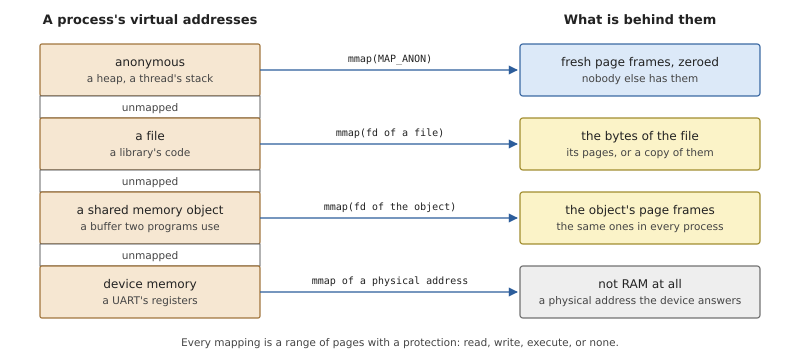
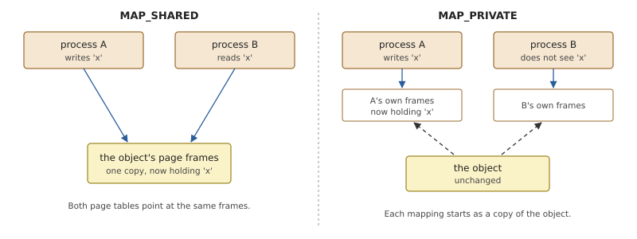
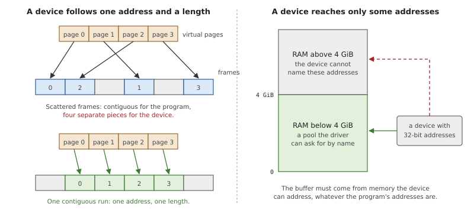
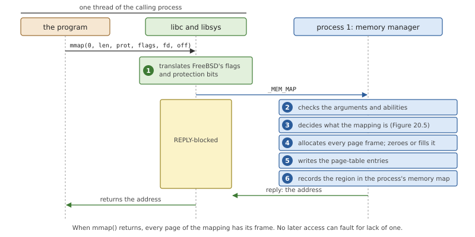
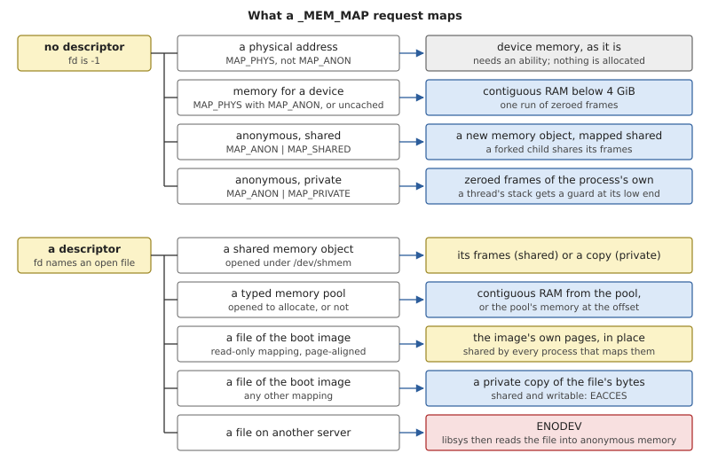
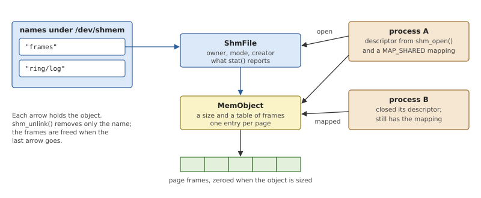
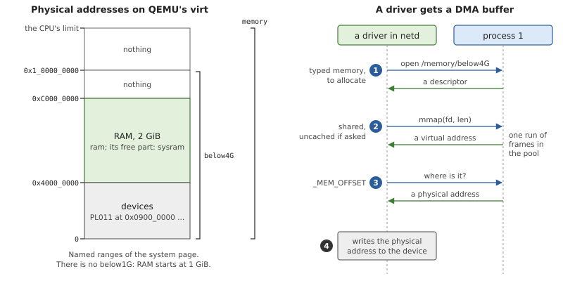

# The Memory Manager

Chapter 16 showed how the kernel builds address spaces: page frames,
translation tables, and the functions that put a frame behind a virtual
page. This chapter is about who decides. When a program calls `mmap()`,
something has to work out what the program is asking for (new memory, a
file, memory shared with another program, a device) and whether it may
have it. In OsCraft that is the *memory manager*, one of the three
managers in process 1.

## The `mmap()` model

Early Unix gave a process three areas of memory: its code, its data,
which could grow at the end, and its stack. Everything else that looked
like memory had its own interface. Modern systems replaced that
collection with one idea: a process's address space is a set of
*mappings*, and one call, `mmap()`, creates them all.

### What can be mapped

A mapping is a range of whole pages in a process's virtual address
space, together with a statement of what lies behind those pages.



*Figure 20.1: One call, four kinds of memory. The program sees a range
of addresses in each case; what differs is what the pages are.*

- **Anonymous memory** is fresh memory that starts as zeros and belongs
  to nothing else. It is what `malloc()` obtains when it needs more, and
  what a thread's stack is made of.
- **A file mapping** makes the contents of a file appear as memory.
  This is how the code of a program and of its shared libraries gets
  into an address space (Chapter 19).
- **A shared memory object** is memory with a name and no file behind
  it: an object that exists so that several processes can map it.
- **Device memory** is not memory at all. A device's control registers
  answer at certain physical addresses, and a driver that is an ordinary
  process maps those addresses to reach them.

Each mapping has a *protection*: any combination of read, write and
execute, or none. The processor enforces it on every access, and an
access the protection does not allow is a fault, delivered to the
program as a signal. A mapping with no access at all is still useful: it
reserves addresses, or stands as a *guard* at the end of a stack so that
an overflow faults instead of corrupting a neighbour. `mprotect()`
changes the protection of pages already mapped, and `munmap()` removes
a mapping.

### Shared and private

Independently of what is mapped, a mapping is either *shared* or
*private*, and the difference is what happens to writes.



*Figure 20.2: Two processes map the same object. Shared, they use the
object's page frames and see each other's writes. Private, each has its
own copy and the object never changes.*

A write to a shared mapping changes the thing mapped, and every other
process that maps it sees the change at once. This is *shared memory*,
the fastest way for two programs to pass data, because nothing is copied
at all. It leaves coordination to the programs: they need a lock or a
protocol of their own to take turns (Chapter 10 compares it with message
passing).

A write to a private mapping stays in the process that made it. The
program gets its own copy of the pages, and the file or object is not
changed. A program's initialised variables are a private mapping of its
file: every process that runs the program starts from the same values,
and none of them changes the file.

### Shared memory objects

For two unrelated programs to share memory they must be able to name
the same thing. POSIX uses the interface programs already know. A
*shared memory object* is created and opened by name with `shm_open()`,
which returns a file descriptor. It is given a size with `ftruncate()`,
mapped with `mmap()`, and its name is removed with `shm_unlink()`. Like
a file, the object stays alive after its name is gone for as long as
anyone has it open or mapped.

### Memory for devices

A driver needs two things from the memory system that no ordinary
program does. The first is the device's registers, described above. The
second is harder. Many devices move data by reading and writing main
memory themselves, without the processor: *direct memory access*, or
DMA. A network device is told "the next packet goes here", and writes it
there.



*Figure 20.3: A device uses physical addresses. A buffer for it must be
one run of page frames, in a part of memory whose addresses the device
can express.*

A device knows nothing about any process's virtual addresses. The driver
must give it a *physical* address, and that has two consequences.

- **Contiguity.** A buffer of several pages is contiguous in the
  program's address space, but its page frames can lie anywhere. A
  device that takes one address and a length needs the frames
  themselves to be consecutive.
- **Reach.** A device may be unable to express every physical address.
  One with 32-bit address registers cannot be handed a buffer above
  4 GiB, however much memory the machine has.

So a driver must be able to ask for memory by its physical properties,
and to learn the physical address of what it got. POSIX names the first
need *typed memory*: the system offers named pools of physical memory
("the memory below 4 GiB"), and a program opens a pool and maps memory
out of it.

## Memory management in OsCraft

The kernel side of memory, Chapter 16, is mechanism: it can map a frame
at an address in an address space, and it keeps, for each process, a
list of its mapped regions. The memory manager is the policy on top. It
is code in process 1 (`kernel/src/proc/memmgr.rs`) that receives the
memory requests of every process as messages, decides what each one
means, and calls the mapping functions. Shared memory objects are in
`kernel/src/proc/shmem.rs`, and typed memory in
`kernel/src/proc/tymem.rs`.

### `mmap()` is a message

There is no kernel call for `mmap()`. libsys (Chapter 24) sends a
message, `_MEM_MAP`, on the connection every process has to process 1,
and the calling thread waits for the reply like any client of any
server.



*Figure 20.4: `mmap()` from a FreeBSD program. All the work is done
while the caller is blocked, and the reply carries the address.*

The request is a fixed structure of 72 bytes with the arguments of
`mmap()` in it: the address wanted, the length, the protection, the
flags, the file descriptor, the offset, and an alignment. The reply
gives the size actually mapped, the page-aligned start of the mapping,
and the address `mmap()` returns.

`munmap()` and `mprotect()` are a second message, `_MEM_CTRL`, with a
subtype for each and the address and length. The range is rounded
outwards to whole pages. As Chapter 10 describes for all requests to
process 1, a signal that arrives just as `mmap()` is sent does not make
it fail with `EINTR`.

### From FreeBSD's flags to the message

A FreeBSD program passes FreeBSD's values for the protection and the
flags, and libsys cannot simply forward them. The memory messages keep
the layout and the bit values of QNX's memory messages, so that one
handler in process 1 serves programs of both personalities, and those
values differ from FreeBSD's: FreeBSD's `PROT_READ` is 1, the message's
is `0x100`; FreeBSD's `MAP_ANON` is `0x1000`, the message's is
`0x80000`. libsys translates each bit, and the translation also has to
bridge three differences of meaning.

*Listing 20.1: Translating FreeBSD's `mmap()` flags, from `__sys_mmap()`
(`user/libsys/src/mem.rs`).*

```rust
{{#include ../../../user/libsys/src/mem.rs:mmap_flags}}
```

- In FreeBSD, `MAP_STACK` implies anonymous memory, and `MAP_ANON`
  without a sharing flag is private. The message wants both stated, so
  libsys adds the missing bits.
- `MAP_GUARD` is FreeBSD's way to reserve a range of addresses with
  nothing behind it. It becomes an anonymous private mapping with no
  access, which the memory manager records without allocating frames.
- `MAP_ALIGNED(n)`, which FreeBSD encodes in the top byte of the flags,
  becomes the message's alignment field.

`madvise()` and `minherit()` never leave libsys: with all memory backed
and every mapping copied by `fork()`, there is nothing for them to
change, and they return success.

### Deciding what to map

The handler, `mem_map()`, first rejects what makes no sense: a sharing
type that is neither shared nor private, a length of zero, unknown flag
or protection bits, or a descriptor given together with a request for
anonymous or physical memory. Two requests need an *ability* (Chapter
17): a mapping at a fixed address, and a mapping that is both writable
and executable. Then the request is sorted by what is to be mapped.



*Figure 20.5: How `_MEM_MAP` is sorted. Each row ends in one of the
mapping functions of Chapter 16.*

Without a descriptor, the flags alone decide. Private anonymous memory
is the common case: zeroed frames that belong to the process. When the
request is for a thread's stack and gives a guard size, the pages at the
low end of the mapping are turned into a guard with no frames behind
them. Shared anonymous memory cannot simply be frames of the process,
because a child made by `fork()` must share it, so the memory manager
creates a nameless memory object and maps that. The two device cases are
described below.

With a descriptor, what matters is what the descriptor is open on, and
only process 1's own files can be mapped by process 1: shared memory
objects, typed memory pools, the files of the boot image, and
`/dev/zero`. For a file of the boot image the memory manager uses the
image itself where it can. A mapping that is not writable, of file data
that is page-aligned in the image, is made *in place*: the process's
pages are the image's own page frames, shared by every process that
maps the same file. The code of a shared library in the boot image can
therefore exist once in memory however many programs use it. Any other
mapping of an image file is
a private copy; a shared writable one is refused with `EACCES`, since
the image cannot be written.

A file on another server, such as one in `/tmp`, is beyond the memory
manager's reach: it would have to ask that server for the contents, and
process 1 does not wait for other servers. It answers `ENODEV`, and
libsys finishes the job in the caller's own thread: it maps anonymous
memory of the same size, reads the file into it with `pread()`, and sets
the protection the caller asked for. The result behaves as a private
mapping. A shared writable mapping of such a file is refused, because
changes could not find their way back to the file.

### Backed at map time

Whatever the kind, the mapping is complete when `mmap()` returns.
Chapter 16 states the rule from the kernel's side: every page has its
frame before the call returns, and no page fault is ever resolved by
allocating memory. For the memory manager this means that *running out
of memory is an error of `mmap()`*, reported as `ENOMEM` to a caller
that can deal with it, and never a fault in the middle of a computation.
A request that the free memory cannot satisfy fails at once, and one
that fails part-way gives back the frames it had taken.

The one mapping without frames is the one that asks for none: memory
with no access. A large `PROT_NONE` mapping is a reservation of
addresses, and `mprotect()` backs the pages that are later made
accessible. Going the other way, pages that are made inaccessible keep
their frames and their contents.

Since everything mapped is resident, the calls that manage paging have
nothing to do: `mlock()` and `mlockall()` check their arguments and the
caller's ability, and succeed. `msync()` has no backing store to write
to; what remains of it is processor cache maintenance over the range,
which drivers use around DMA.

### Shared memory objects

`shm_open()` in libsys is an ordinary `open()` of a path under
`/dev/shmem`, a part of the path name space that process 1 serves
itself (Chapter 21). The descriptor it returns is a connection to
process 1, and the object behind it has three layers.



*Figure 20.6: A name leads to a `ShmFile`, which holds a `MemObject`,
which holds page frames. Names, descriptors and mappings each keep the
object alive.*

The name is an entry in a table. The `ShmFile` holds what a file has:
an owner, permission bits, the answers for `fstat()`. The `MemObject`
(`kernel/src/vm/object.rs`) is the memory itself: a size and a table
with one page frame per page.

A new object has size zero. `ftruncate()` gives it its size, and here
the rule of the previous section applies to the object: growing it
allocates and zeroes every page up to the new end at once, or fails with
`ENOMEM` and leaves the object as it was. An object of 64 MiB takes
64 MiB of memory when it is sized, whether or not anything maps it yet.
Shrinking an object zeroes what lies past the new end but keeps the
frames, because some process may still have them mapped; they are freed
when the object goes.

Mapping the object is where shared and private part ways.

*Listing 20.2: Mapping a shared memory object, `mem_map_shm()`
(`kernel/src/proc/memmgr.rs`).*

```rust
{{#include ../../../kernel/src/proc/memmgr.rs:mem_map_shm}}
```

`map_shared()` enters the object's own frames in the caller's
translation tables, so that Figure 20.2's left half holds literally: two
processes, one set of frames. `map_copy()` makes an ordinary private
mapping and copies the object's pages into it. Before either, the
descriptor's access mode is checked against the request: a descriptor
not open for reading cannot be mapped, and one not open for writing
cannot be mapped shared and writable. Such a mapping also cannot be made
writable later with `mprotect()`; the limit is recorded with the region.

The object is reference-counted, and each arrow in Figure 20.6 is a
reference. `shm_unlink()` removes the name and nothing else. The frames
are freed when the last descriptor is closed and the last mapping
removed. Objects can also be read and written through their descriptor
with `read()` and `write()`, and they appear in directory listings of
`/dev/shmem`, with names that may contain `/`.

### Device registers

A driver maps its device's registers by sending `_MEM_MAP` with the
physical-memory flag, no descriptor, and the physical address in place
of the offset. On QEMU's `virt` the PL011 serial port, for example,
answers at `0x0900_0000`. The memory manager checks three things: that
the caller has the ability to map physical memory at that address, that
the range does not run past the last physical address the system page
describes, and that a fixed virtual address, if given, has the same
position within its page as the physical one. It then enters the
physical pages in the caller's tables. No frames are allocated and none
are freed when the mapping goes. With the message's no-cache protection
bit the pages are mapped uncached, as device registers must be.

### Memory for DMA

For DMA buffers OsCraft provides both mechanisms of the first half of
this chapter.

**Typed memory pools.** The startup program describes the machine's
physical address space in the system page as a tree of named ranges
(Chapter 5). The memory manager offers each name as a pool that can be
opened. A pool may be named by its path in the tree, and two names
joined with `&` mean the memory that is in both.



*Figure 20.7: The named ranges of QEMU's `virt`, and the three requests
by which a driver obtains a buffer and its physical address.*

On QEMU's `virt` the tree is small. The root, `memory`, is the whole
range the processor can address. Under it are `below4G`, the first
4 GiB, and `ram`, the 2 GiB of memory that start at 1 GiB; the part of
`ram` that was free when the kernel started is `sysram`. Boards whose
memory starts at address 0 often have a pool for the first gigabyte as
well, for devices with a shorter reach. Here there is none: no RAM lies
below 1 GiB.

A program opens a pool saying whether it wants to allocate from it.
Mapping a pool opened to allocate takes one contiguous run of free
frames within the pool's bounds, zeroes it and maps it. Mapping a pool
opened without that flag maps the pool's physical memory itself, at the
given offset.

**Contiguous anonymous memory.** A request for anonymous memory with the
physical-memory flag, or for uncached anonymous memory, gets one
contiguous run of frames below 4 GiB, a limit every device of the
machine can reach.

**The physical address.** Neither helps without the third request of
Figure 20.7. `_MEM_OFFSET` takes a virtual address and a length in the
caller's own address space, and answers with the physical address behind
it and how many bytes from there are physically contiguous. An address
with nothing mapped is `EACCES`.

The drivers that use all three are FreeBSD's, running in the servers
`netd`, `usbd` and `pcid` (Chapter 27). FreeBSD drivers ask FreeBSD's
kernel for DMA memory, stating the highest address their device can
reach. Inside those servers that request arrives at this function:

*Listing 20.3: A DMA buffer for a FreeBSD driver, `bsdkern_dma_alloc()`
(`user/bsdkern/src/dma.rs`).*

```rust
{{#include ../../../user/bsdkern/src/dma.rs:dma_alloc}}
```

`pool_for()` picks the pool that lies entirely within the device's
reach, `/memory/below4G` on this machine for a device that reaches at
least 4 GiB, and opens it once to allocate. If no pool fits, the
function falls back to contiguous anonymous memory. Either way it asks
for the physical address at once and hands it to the driver together
with the virtual one. Because the buffer was backed when it was mapped
and its frames never move, that physical address stays valid for as long
as the mapping exists.

## Summary

- `mmap()` creates every kind of mapping: anonymous memory, files,
  shared memory objects and device memory, each shared or private, each
  with a protection.
- In OsCraft, `mmap()`, `munmap()` and `mprotect()` are messages to the
  memory manager in process 1. libsys translates FreeBSD's flags and
  protection bits into the message's own.
- Every mapping is fully backed before `mmap()` returns, so a shortage
  of memory is an `ENOMEM` from the call and never a fault later. Only a
  mapping with no access has no frames.
- Read-only mappings of boot-image files use the image's pages in
  place. Files on other servers are mapped by libsys as a private copy.
- A shared memory object is a name under `/dev/shmem`, a `ShmFile` and a
  `MemObject`. It takes its memory when it is sized, and lives while a
  name, a descriptor or a mapping refers to it.
- Drivers map device registers by physical address, with an ability,
  and get DMA buffers as contiguous runs from typed memory pools or from
  memory below 4 GiB.
- `_MEM_OFFSET` gives the physical address of a mapping, which is what a
  driver programs into its device. On QEMU's `virt` the one pool below
  the root is `below4G`.
