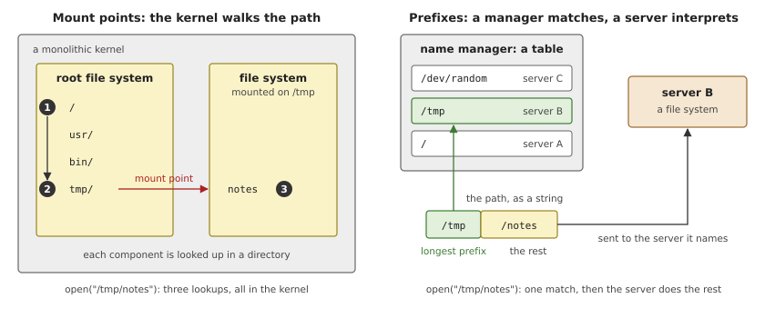
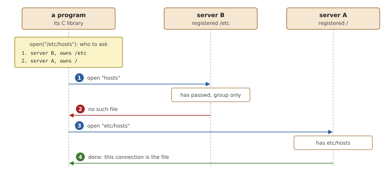
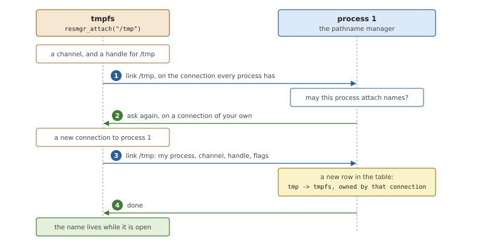
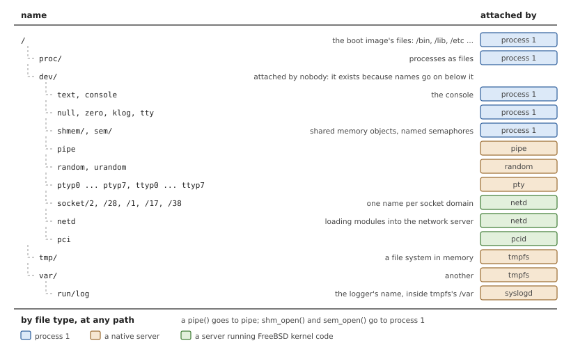
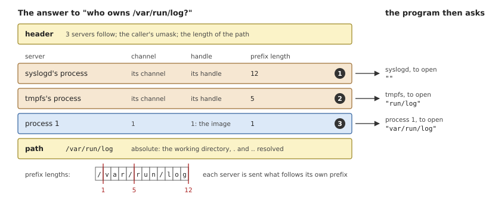
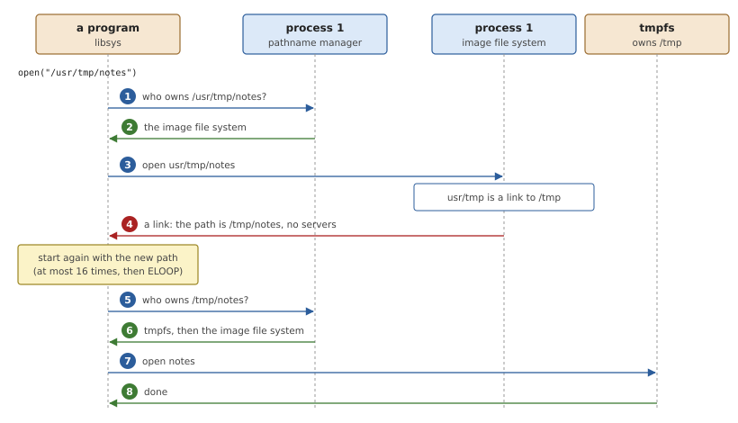

# The Pathname Manager

A program names what it wants with a path: `/tmp/notes`, `/dev/random`,
`/bin/sh`. In OsCraft each of those belongs to a different process, and
the kernel knows nothing about files. Something has to turn a path into
"this server, on this channel", and that is the job of the *pathname
manager*, one of the three managers in process 1. Chapter 2 showed an
`open()` at the level of who talks to whom. This chapter explains the
name space behind it: how servers put names into it, how a name is
resolved, what happens when several servers claim the same name, and
where symbolic links and the current directory fit in.

## A name space for a system of servers

Every operating system gives its files, devices and other objects names
in one tree. The tree is a convenience for people and a contract for
programs: a program written to open `/dev/random` must find the random
device there, whoever implements it. When the implementers are separate
processes, the tree has to be assembled from their parts, and there are
two classical ways to do it.

### Mount points and prefixes

In a monolithic kernel the file systems are inside the kernel, and so is
the code that resolves a path. It walks the path one component at a
time: it looks up `tmp` in the root directory, then `notes` in the
directory it found. A file system is added to the tree by *mounting* it
on a directory. The kernel keeps a table of such *mount points*, and
when the walk reaches one it continues in the root of the mounted file
system. The walk needs every file system's directory code within reach,
which a kernel that contains them has.

A microkernel has no directories to walk. The alternative is to treat a
path as a string and let each server *register* the beginning of the
paths it serves, its *prefix*. A manager keeps the table of prefixes.
Resolving a path is then a string comparison: find the registered
prefix that the path starts with, and hand the remainder of the path to
the server that registered it. The manager never looks inside any
server's part of the tree; only the server knows what `notes` means
below `/tmp`.



*Figure 21.1: Two ways to assemble a name space. With mount points the
kernel looks up every component itself. With prefixes a manager matches
the start of the path and the owning server interprets the rest.*

A prefix can be a whole subtree (`/tmp` and everything below it, for a
file system) or a single name (`/dev/random`, for a device). When
several registered prefixes match a path, the natural rule is that the
*longest* wins: `/tmp/notes` belongs to the server of `/tmp`, not to the
server of `/`.

### Unions

Prefixes may overlap, and the longest-match rule alone would make the
longer prefix hide everything under it. Often that is not what is
wanted. A small server that provides two files in `/etc` should not make
the rest of `/etc` disappear.

The answer is to treat the matching servers as an ordered list instead
of picking one. The client asks the server of the longest prefix first.
If that server says the name does not exist, the client asks the next
one, and so on. A directory covered by several servers then behaves as
the *union* of what each of them has in it, with the more specific
server taking precedence where both have the same name.



*Figure 21.2: Two servers cover `/etc/hosts`. The server of the longer
prefix is asked first; its "no such file" passes the request to the
next. Each server is sent only the part of the path after its own
prefix.*

Only "no such file" passes a request on. Any other answer, success or a
different error such as "permission denied", is final: the server that
gave it has the name, and has decided.

### Symbolic links

A symbolic link is a file whose content is another path. Following it
is part of resolving a name, but the link is stored inside some server's
file system, and the path it holds may lead to a different server. The
server that finds the link cannot open the target itself. So it does not
try: it answers "this is a link, and here is the path it stands for",
and whoever was resolving starts again with the new path. A limit on
the number of restarts catches links that point at each other.

### Who, not what

In all of this the manager answers one question: *who* serves this
name. It does not open the file, check permissions, or learn whether the
file exists. That restraint is deliberate.

- **The manager stays out of the data path.** It is consulted once per
  path. Every later operation on the open file goes directly to the
  server.
- **The manager never waits for a server.** If it forwarded requests,
  it would be blocked on whichever server was slow or stuck, and every
  other lookup in the system with it. A manager that only reads its own
  table always answers at once. It is also at the bottom of the send
  hierarchy (Chapter 10): everyone sends to it, and it sends to no one.
- **Each server keeps full authority over its names.** Whether a file
  exists, who may open it and what opening it means are decided in one
  place, by the process that owns the object.

The price is that resolving costs the client two exchanges instead of
one, and that the client's library, not the manager, drives the
protocol: it holds the list of candidates and tries them in order.

## The pathname manager in OsCraft

OsCraft's name space is built from prefixes, with unions. The manager is
`kernel/src/proc/pathmgr.rs`, part of process 1, and every process is
born with a connection to it. The client's half of the protocol lives in
libsys (`user/libsys/src/path.rs`) for programs and in
`user/kercall/src/path.rs` for native servers; the header comment of
the latter is a compact description of the whole exchange. Servers
register their prefixes through the server framework in
`user/resmgr/`.

### The table

The manager's state is one list of *mounts*, in a vector behind a
spinlock. A mount is a prefix and the address of the server that
attached it.

*Listing 21.1: One row of the name space, `Mount`
(`kernel/src/proc/pathmgr.rs`).*

```rust
{{#include ../../../kernel/src/proc/pathmgr.rs:mount}}
```

- **`prefix`** is stored without its leading slash, so the root is the
  empty string.
- **`pid` and `chid`** say where to connect. **`handle`** is a number
  the server chose and gets back in every request that arrives through
  this mount. A server that attaches several names on one channel tells
  them apart by it.
- **`file_type`** says what kind of object the server provides: 0 for
  ordinary files and devices, and distinct numbers for pipes, sockets,
  shared memory objects and named semaphores.
- **`flags`** refine the match. The important ones are *directory* (the
  mount also covers every path below its prefix; without it, only the
  prefix itself), *file type only* (the mount answers only requests for
  its own file type), and *opaque* (requests below this prefix are not
  offered to servers of shorter prefixes).
- **`owner`** ties the mount to the connection that created it, as the
  next section explains.

Process 1 puts its own names into the table at boot, before any other
process exists (`init()`): the image file system at `/`, the process
file system at `/proc`, and a handful of devices. Chapter 22 describes
what is behind each of them.

### Attaching a name

A server registers a prefix with `resmgr_attach()`, giving the path, the
handle, a file type and flags. The framework turns the call into a
*link* request to the pathname manager, in two steps.



*Figure 21.3: `tmpfs` attaches `/tmp`. The second request arrives on a
connection made for the purpose, and the new mount belongs to that
connection.*

The first request goes out on the connection that every process shares
with process 1. The manager checks that the caller is allowed to add
names to the name space (the path-space ability, Chapter 17; `EPERM`
otherwise) and replies with a redirection to itself. The client library
treats that like any other answer to a lookup: it opens a new connection
to the server named in the reply, here process 1 again, and repeats the
request there. On this second request `attach()` adds the mount, with
the new connection as its owner.

The detour gives every attachment a connection of its own, and that
connection is the attachment's lifetime. `resmgr_attach()` keeps it open
and returns an ID for it. When the server detaches the name, the
connection is closed and the mount is removed. When the server dies, the
kernel closes its connections like any others, and process 1 removes
every mount the dead process owned. A crashed server therefore leaves no
stale names behind: the next lookup simply no longer lists it.

A new mount goes to the front of the list, so among mounts with the same
prefix the most recent is tried first, unless the server asked to be
placed after the others. Every attach and detach also raises a
process-manager event (Chapter 18) carrying a hash of the path, for
programs that want to know when a name appears.

A server does not need a path to be reachable. The pipe server attaches
with no path at all, the pipe file type, and the *file type only* flag.
The framework registers that as the root prefix, restricted to its
type, and the result is a mount that matches no ordinary `open()` but
every request for a pipe. Process 1 does the same for shared memory
objects and named semaphores.

### The names of a running system

The boot script in `images/qemu-virt.build` starts the native servers
one after another. Each attaches its names as it comes up, and the
script's `waitfor` lines hold the next step until a name exists, by
asking the pathname manager's table every 100 ms.



*Figure 21.4: The name space once the boot script has run, and who
attached each name. Indentation shows the tree that the prefixes
imply.*

A few things in the figure are worth a second look.

- **`/dev` belongs to nobody.** No server attached `/dev`; it exists
  because names continue below it. The pathname manager serves such
  implied directories itself, as described below.
- **`tmpfs` is one process with two mounts**, `/tmp` and `/var`, each a
  separate file system, told apart by their handles.
- **`/var/run/log` is a mount inside another server's subtree.** The
  logger attached that single name; `tmpfs` owns everything else under
  `/var`.
- **`netd` attaches one name per socket domain**, `/dev/socket/2` for
  IPv4, `/dev/socket/28` for IPv6 and so on, using FreeBSD's
  address-family numbers. libsys implements `socket()` as an open of
  the domain's name with the socket file type (Chapter 28).
- **`/dev/pci` is not attached by OsCraft code as such.** `pcid` runs
  FreeBSD's PCI code, which creates a device named `pci`, and the
  bsdkern layer attaches a `/dev` name for every device the FreeBSD
  code creates (Chapter 27). `usbd`, when it runs, gets its names the
  same way.

Later attachments work no differently. Mounting a FAT volume
(Chapter 31) is the disk server attaching one more directory prefix.

### Resolving a path

Every call that takes a path begins the same way, whether it is
`open()`, `stat()`, `unlink()` or `mkdir()`. libsys builds a *connect*
message, which carries the kind of request, the wanted file type, the
open flags and the path, and sends it to process 1 with handle 0,
meaning "the pathname manager". `resolve()` then does three things.

**It makes the path absolute.** A relative path is joined to the
process's current directory, and `.` and `..` are removed textually, so
the table is always searched with a clean absolute path.

**It collects every mount that covers the path.** The whole rule fits
in one short function.

*Listing 21.2: Whether a mount covers a path, `covers()`
(`kernel/src/proc/pathmgr.rs`).*

```rust
{{#include ../../../kernel/src/proc/pathmgr.rs:covers}}
```

A typed mount is skipped unless the request asks for its type. The root
prefix covers everything if it is a directory mount. Any other prefix
covers the path if the path is exactly the prefix, or, for a directory
mount, if the path continues with a slash after it. That last test is
why `/tmpfile` is not taken for a file in `/tmp`.

Two refinements apply to the collected set. A process's own mounts are
left out, unless it attached them with the *self* flag, so that a file
system which opens a path under its own prefix reaches whatever lies
beneath it instead of itself. And if one of the mounts is opaque, those
with shorter prefixes are dropped.

**It orders them and replies.** The mounts are sorted by prefix length,
longest first. The sort is stable, so mounts with equal prefixes keep
their order in the table, which is newest first. The reply is not a
file. It is a *link reply*: the list of candidate servers and the
absolute path.



*Figure 21.5: The pathname manager's reply for `/var/run/log`. Three
mounts cover the path. Each entry carries the length of its prefix, so
the client knows what remains for that server.*

libsys copies the entries and works through them in order. For each one
it connects to the server's channel and sends the same connect message
again, now with that entry's handle and with only the part of the path
after the entry's prefix. The first server that accepts ends the
search, and the connection to it is the result: for `open()` it is the
file descriptor. A server that answers `ENOENT` causes the connection to
be dropped and the next entry to be tried. Any other error ends the
search with that error. If every server declined, the call fails with
`ENOENT`.

A reply holds at most 48 entries. Its header also carries the caller's
file-creation mask, which process 1 keeps for each process: libsys
clears those bits from the mode before it passes a creating request on,
so servers do not need to know about `umask()`.

Requests for a file type follow the same path with one more filter.
`pipe()` in libsys is an open of `/` with the pipe file type. Of all
the mounts at the root, `covers()` passes the pipe server's typed mount
and the image file system, and rejects the typed mounts of other kinds.
libsys then skips every entry whose type differs from the one it asked
for, which removes the image file system. The pipe server is the only
one asked, and the connection to it becomes the first end of the pipe
(Chapter 12).

### Directories that exist only in the name space

When the path is `/dev`, no mount has that prefix, but several have
prefixes that continue below it. The manager recognises this case and
adds an entry of its own to the reply, ahead of the servers of shorter
prefixes. That entry leads back to process 1, with a handle that
encodes the directory. Process 1 then serves the directory like a file
system would: `stat()` reports a directory, and reading it lists the
names attached below it, merged with what the boot image has at the
same path.

Each such directory has a numeric ID, assigned the first time its path
is seen and never reused. The handle and the inode number that `stat()`
and `readdir()` report are both made from it, so they stay the same
while servers come and go underneath.

The same merging makes `ls /` complete. The image file system serves
the root directory, and when it lists a directory it adds the first
component of every prefix attached below that path, so `tmp`, `dev` and
`proc` appear next to the image's own `bin` and `etc`.

### Unions in practice

On the system of Figure 21.4 every path is covered at least twice,
because the image file system has the root prefix and is a directory
mount. It is the fallback for everything. The boot image deliberately
contains empty directories at `/tmp` and `/var`, underneath the `tmpfs`
mounts.

This layering gives well-defined answers to requests that concern the
mount point itself. `mkdir("/var")` is answered by the pathname manager
without asking anyone: a server is attached at exactly that path, and
the directory exists, so the result is `EEXIST`. A request to create
`/var/db` goes to `tmpfs` first, which creates it. A request to create a
file under `/bin` reaches only the image file system, which creates
nothing.

### Symbolic links

The boot image contains links, for instance `/usr/tmp`, which points to
`/tmp`. Opening a file through it shows the restart described in the
first half of the chapter.



*Figure 21.6: `open("/usr/tmp/notes")`. The image file system finds a
link on the way and answers with the new path. libsys resolves that
path from the beginning, and this time `tmpfs` is first in the list.*

A server reports a link with the same kind of reply the pathname
manager uses, a link reply, but with no entries: a path and nothing
else. libsys replaces the path it was resolving and goes back to the
pathname manager. After 16 restarts the call fails with `ELOOP`. A request that must not follow links, such as `lstat()` on the
link itself, says so in its mode, and the server then answers for the
link instead of redirecting.

The mechanism serves a second purpose. `/dev/tty` means "the
controlling terminal of whoever asks". Process 1 owns that name and
answers an open of it with a link reply holding the path of the
caller's terminal, taken from its session (Chapter 18). The client
follows it like any link and ends up at the right server.

### The current directory

Relative paths need a starting point, and since the pathname manager is
the one place that sees every path, it keeps that starting point: each
process's current directory is a string in its process entry, copied to
the child by `fork()` and by a spawn.

`chdir()` is mostly done in libsys. It first resolves the new directory
with a probe, a connect message that is opened and closed in one
exchange and returns the file's status. The probe confirms that the
path exists, yields its absolute form, and lets libsys check that it is
a directory the caller may search. Only then does libsys send the
absolute path to process 1 in a small message of its own, and process 1
stores it. `getcwd()` is the same probe applied to `.`, returning the
absolute path the pathname manager produced.

The probe follows symbolic links, so the path that is stored is the
real one: after `cd /usr/tmp` the current directory is `/tmp`. Since
`..` is then removed textually from that real path, `cd ..` leads to
`/`, the parent of the directory the process is actually in.

The `*at()` functions, such as `openat()`, start from a directory
descriptor instead. If the descriptor leads to process 1, the pathname
manager looks up the path that descriptor was opened with. If it leads
to another server, libsys asks that server for the directory's path and
prepends it before resolving.

The manager also keeps a *root directory* per process and applies it:
an absolute path is taken relative to it, and `..` never climbs above
it. Setting it is a request that requires the corresponding ability.
libsys does not send that request yet, however. Its `chroot()` reports
`ENOSYS`, so on today's system every native process has the real root.

A process with the QNX personality has every path looked up under
`/compat/qnx` first, at the step where the path is made absolute
(Part VI).

## Summary

- A system of servers needs one name space. OsCraft builds it from
  prefixes that servers register, matched as strings, not from mount
  points walked by the kernel.
- The pathname manager in process 1 keeps a list of mounts: prefix,
  server process and channel, handle, file type and flags. It answers
  who serves a path and never opens anything, so it never waits for a
  server.
- A server attaches a prefix through a connection made for that
  purpose. Closing the connection, or the server's death, removes the
  name.
- A lookup returns every mount that covers the path, longest prefix
  first and newest first among equals. The client library tries them in
  order; `ENOENT` passes the request to the next server, and any other
  answer is final. Overlapping prefixes thus form unions.
- Typed requests such as `pipe()` and `socket()` are routed by file
  type: a server may attach for a type instead of, or as well as, a
  path.
- A symbolic link is reported by the server that finds it, and the
  client restarts with the new path, at most 16 times.
- The current directory is a path string that process 1 keeps for each
  process; relative paths are made absolute against it before the table
  is searched.
