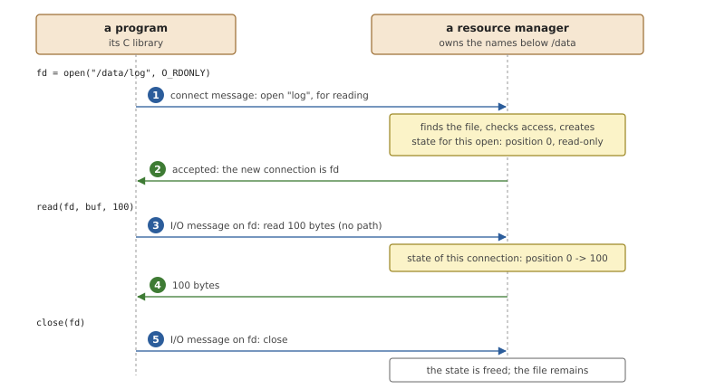
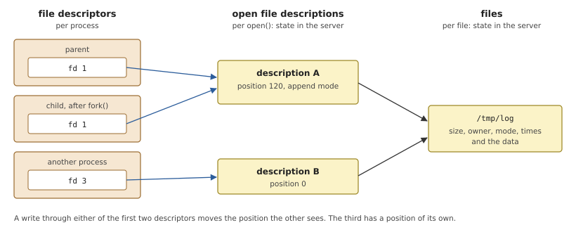
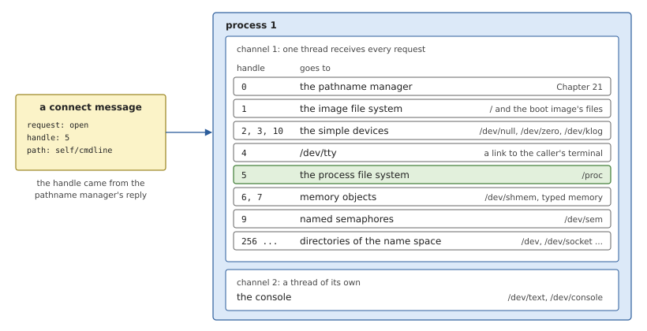
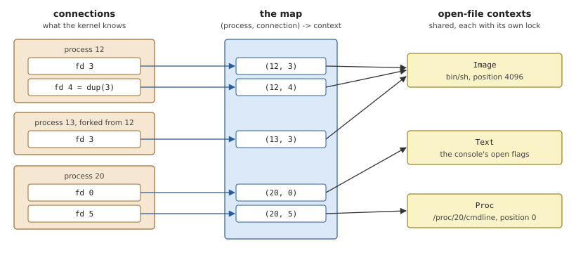
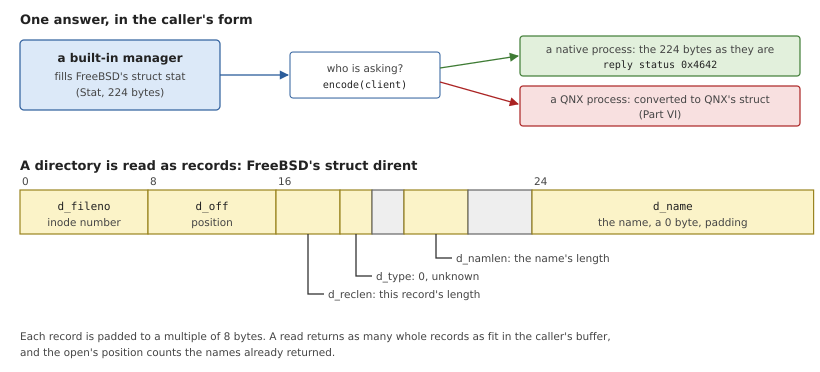
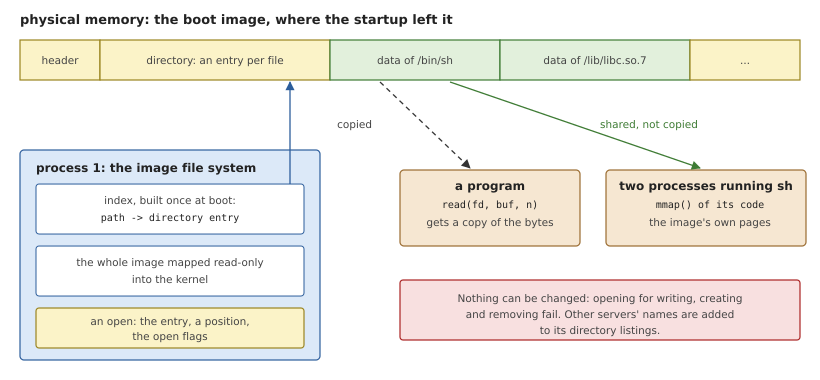
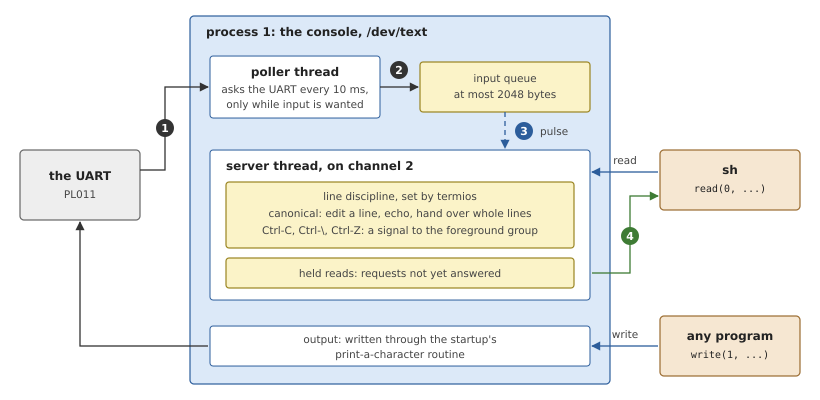

# Built-in Resource Managers

Almost every file in a running OsCraft system belongs to a server
outside the kernel file: `tmpfs`, the network server, the pipe server.
A few belong to process 1 itself. They are the files the system needs
before any server can be started, such as the programs in the boot
image and a console to print on, and the files that show the kernel's
own state. This chapter first explains what a server of files is and
what it has to remember, and then goes through the ones built into
process 1.

## Resource managers

A *resource manager* is a server that makes something look like files.
The something may be a real file system, a device, or a view of data
the server computes on request. To a program they are all the same:
it calls `open()` with a name, then `read()`, `write()`, `ioctl()` and
`close()` on the descriptor. The program need not know what is behind
the name, and one small set of functions reaches every service in the
system. Tools written for files, from `cat` to shell redirection, work
on all of them.

In a message-passing system each of those calls is a message
(Chapter 10), and a resource manager is, in the end, a loop that
receives messages and answers them. The messages come in two families.

### Connect messages and I/O messages

A **connect message** names its object by path. `open()` sends one, and
so do the calls that act on a name without keeping it open: `stat()`,
`unlink()`, `mkdir()`, `rename()`, `readlink()`. A connect message
arrives on a connection the client has just made, after the pathname
manager told it where to go (Chapter 21), and it carries the part of the
path that lies below the server's prefix.

An **I/O message** names its object by descriptor. `read()`, `write()`,
`lseek()`, `fstat()`, `ioctl()` and `close()` each send one on the
connection that an earlier open established. There is no path in it.
The server recognises the open file by where the message came from.



*Figure 22.1: The life of an open file, seen from the server. The
connect message creates the state for this open; the I/O messages find
it again by the connection they arrive on.*

Many calls need a path and one operation on it, and nothing afterwards.
`stat()` is the common case: open, get the status, close. Sending three
messages for that would triple the cost of the most frequent file
operation there is, so a connect message may carry an I/O message
inside it, with a flag that says whether the file stays open. The server
handles the two as one request. This is called a *combined* message.

### What a server remembers

POSIX distinguishes three things that are easily taken for one, and a
resource manager must keep state for two of them.



*Figure 22.2: Three levels. A descriptor is a number in one process. An
open file description is created by each `open()` and can be shared. A
file exists once.*

- A **file** has attributes that are the same for everyone: its size,
  owner, permissions, times and contents. This is *per-file* state.
- An **open file description** is the result of one `open()`: which
  file, the current position, and the mode it was opened in (read or
  write, append, non-blocking). This is *per-open* state. The usual
  name for the structure that holds it is an *open control block*, or
  OCB.
- A **file descriptor** is a small number in one process that refers to
  an open file description. In OsCraft it is a connection, and the
  kernel keeps it; the server keeps nothing per descriptor except the
  knowledge of which description it leads to.

The middle level exists because descriptors are copied. After `dup()`,
or in a child after `fork()`, two descriptors refer to the same open
file description, and POSIX requires that they share the position. That
is what makes `(echo a; echo b) > file` work: both commands inherit one
description, and the second writes after the first. A server therefore
cannot simply key its per-open state by descriptor. It must let several
connections lead to one OCB, and it is told when that happens: the
client's library sends a *dup* message on the new connection, naming the
old one.

### Why some live in the first process

A resource manager is normally an ordinary process, and that is where
it should be: outside the kernel, restartable, with only the privileges
it needs. Three kinds of service cannot be, or gain nothing from it.

- **What is needed to start the first server.** A server is a program,
  and a program is loaded from a file. Something must serve the files
  of the boot image before any process exists, and something must take
  the output of the first programs before a terminal driver runs.
- **What is a view of the first process's own data.** The list of
  processes, their address spaces and the memory objects they share are
  data structures of the process and memory managers. Presenting them
  as files from another process would mean copying them across with
  messages, only to copy them back to the reader.
- **What must never be absent.** A few names are assumed by nearly
  every program: a place to discard output, a source of zeros. They are
  trivial to implement and are simply provided.

## The built-in resource managers of OsCraft

Process 1 serves its files from `kernel/src/proc/resmgr.rs` and the
modules next to it. They speak the same connect and I/O messages as any
native server, so libsys treats them no differently.

*Table 22.1: What process 1 serves.*

| Name | What it is | Module |
|---|---|---|
| `/` | the boot image's files, read-only | `kernel/src/proc/imagefs.rs` |
| `/proc` | processes and kernel statistics as files | `kernel/src/proc/procfs.rs` |
| `/dev/shmem`, `/dev/sem` | shared memory objects, named semaphores | `kernel/src/proc/shmem.rs`, `kernel/src/proc/namedsem.rs` |
| `/dev/null`, `/dev/zero` | discard, and endless zeros | `kernel/src/proc/resmgr.rs` |
| `/dev/klog` | the kernel's messages, for the logger | `kernel/src/msgbuf.rs` |
| `/dev/tty` | the caller's controlling terminal | `kernel/src/proc/session.rs` |
| `/dev/text`, `/dev/console` | the console | `kernel/src/proc/devtext.rs`, `kernel/src/proc/tty.rs` |
| `/dev` and the like | directories that exist only in the name space | `kernel/src/proc/pathmgr.rs` |

### One channel, many managers

Process 1 has one channel for everything it is asked: process
management, memory management, path lookups and its files all arrive
there, received by a single thread. The built-in managers are told
apart by the *handle* in the connect message. When the pathname manager
answers a lookup, each entry of its reply carries a handle chosen by the
server that attached the name (Chapter 21), and the client sends it
back with the connect message. Process 1 chose a different handle for
each of its managers.



*Figure 22.3: A connect message for `/proc/self/cmdline` arrives with
handle 5 and the path below `/proc`. Handle 0 is the pathname manager
itself. The console has a channel and a thread of its own.*

The console is the exception, for a reason of timing. Printing a
character can take as long as the serial port needs, and a read from
the console may wait indefinitely for a key. Neither should hold up a
`fork()` or an `mmap()` queued behind it, so the console receives on a
second channel with its own thread.

### Open-file contexts

Process 1 keeps its per-open state in one map for all its managers. The
key is the pair of client process and connection number, which is
exactly what the kernel reports with every received message. The value
is a reference-counted *open-file context*, an enumeration with one
variant per kind of file.

*Listing 22.1: Process 1's per-open state, `Client`, `Ocb` and the map
(`kernel/src/proc/resmgr.rs`).*

```rust
{{#include ../../../kernel/src/proc/resmgr.rs:ocb}}
```

Each variant holds what that kind of file needs per open. An image file
keeps its directory entry, its path and a position. A `/proc` file keeps
which node it is and the snapshot of its contents. The devices keep
only the open flags. A directory keeps the count of names already
returned to `readdir()`.



*Figure 22.4: Connections on the left, contexts on the right. A `dup()`
and a `fork()` add keys that point to an existing context, so the
position is shared, as POSIX requires.*

The paths through the map follow the messages of Figure 22.1.

- **Connect.** The manager selected by the handle finds the named
  object and builds a context. `answer_open()` inserts it under the
  client's key and replies. If an I/O message was combined with the
  connect, it is run at once against the new context, and for a
  combined open-and-close the context is removed again before the
  function returns.
- **I/O.** The context is looked up by the message's origin and the
  operation is dispatched on the pair of message type and context kind.
  A message with no context behind it fails with `EBADF`; a type the
  file does not support fails with `ENOSYS`.
- **Dup.** The new key is given a clone of the reference, not a copy of
  the context. A `fork()` handled by process 1 does the same for all of
  the parent's keys in one step, without messages, since the child's
  connections carry the same numbers.
- **Close.** The key is removed. The context itself goes when its last
  reference does. When a process ends, all its keys are removed.

Two locks protect this structure, and both mask interrupts, so neither
may be held for long. The map's lock is held only to look up, insert or
remove a key. The operation then runs under the context's own lock.
Operations that can take long, such as reading megabytes of shared
memory or of another process's address space, run on a copy of the
context with no lock held, and only the new position is written back.
This is safe because the single receiving thread already serialises all
requests to process 1.

Large transfers are also not built in one buffer. A read of any size is
answered in one call, as `read()` requires for these files, but process
1 fills a 64 KiB buffer, writes it into the client's buffer with
`MsgWrite()`, and repeats; the final reply carries only the count. Long
writes are read from the client the same way.

### Answering in FreeBSD's structures

The results of `fstat()` and `readdir()` are structures, and their
layout is part of a system's binary interface. OsCraft's is FreeBSD's.
The built-in managers therefore fill in FreeBSD's `struct stat`, which
`user/proto/src/stat.rs` declares as `Stat`, and a native process
receives those 224 bytes exactly as they were filled in. libsys copies
them to the caller's buffer and is done.



*Figure 22.5: Top: a status reply is built once and encoded for the
caller. Bottom: one directory record in FreeBSD's layout, as the
built-in managers write it.*

The only decision is made at the last moment, when the reply is
encoded.

*Listing 22.2: Choosing the form of a status reply, `StatReply::encode()`
(`kernel/src/proc/resmgr.rs`).*

```rust
{{#include ../../../kernel/src/proc/resmgr.rs:stat_encode}}
```

The reply's status word tells the client which form the data has. For a
native process it is the value that means "FreeBSD's structure", and no
conversion happens anywhere. For a process with the QNX personality the
same `Stat` is converted on the way out, and the extra field carries
the few things QNX's structure has that FreeBSD's lacks (Part VI). The
managers themselves never see the difference: they compute one answer.

Directories work the same way. Each manager produces a list of names
with inode numbers, and one function, `dirents()`, packs as many
records as fit into the caller's buffer, in FreeBSD's `struct dirent`
layout for a native client. FreeBSD's C library asks for the position
after each batch and sets it on `rewinddir()`, so the context's
position for a directory is simply the number of names delivered so
far.

### The image file system

The boot image ends with a small read-only file system: a header, a
table of directory entries, and the files' contents (Chapter 5). The
startup records where it lies in the system page. At boot,
`imagefs::init()` maps the whole of it read-only into the kernel and
builds an index from path to directory entry, so that an `open()` is one
map lookup. Directories that no entry describes, but that the paths of
other entries imply, are added to the index as well.



*Figure 22.6: The image file system never copies the image. Reads copy
out of it; the code of programs and libraries is mapped from it, so
every process running the same program shares the same pages.*

Nothing is ever copied out of the image into other kernel memory. A
`read()` copies from the mapped image straight into the reply. When the
loader or `mmap()` maps a file's read-only contents, the memory manager
maps the image's own page frames into the process (Chapter 20), which
is how the code of FreeBSD's C library exists once in memory no matter
how many processes use it.

The file system is strictly read-only. An open for writing fails with
`EROFS`, as does removing an existing name. Symbolic links in the image
are reported to the client for it to follow, as Chapter 21 described.

Because the image file system owns the root prefix, it is also the
server of last resort for every path, and the one that lists `/`. Its
directory listings add the names that other servers have attached
below the directory being read. That is why `ls /` shows `tmp`, `proc`
and `dev`, and why the directories that exist only in the name space,
such as `/dev`, are listed through the same code.

### The process file system

`/proc` presents the process manager's tables as a directory tree. The
root lists the running processes by number. Each `/proc/<pid>`
directory, and `/proc/self` for the caller's own, contains a few files.

- `cmdline` holds the program's arguments, each followed by a zero
  byte. Process 1 reads them from the process's initial stack when the
  file is opened.
- `exefile` holds the path of the program.
- `personality` holds one line, `freebsd` or `qnx`.
- `as` is the process's address space: reading and writing at an offset
  reads and writes the process's memory at that address. A debugger
  uses it (Chapter 36).

The data files are snapshots taken at open, so a reader sees one
consistent version however slowly it reads. The files belong to the
process's effective user and group, and an opener who is neither that
user nor root is held to the mode bits: `cmdline` is readable by
anyone, `as` only by the owner.

Besides the processes there are `/proc/config`, with the kernel's
settings as lines of text, and counters under `/proc/vm` and
`/proc/ker`. A `stat()` of `/proc` itself reports the amount of free
memory as its size, and libsys uses exactly that to answer the FreeBSD
`sysctl` variables about free memory.

Native tools make little other use of `/proc`. FreeBSD's `ps` and `top`
read processes through `sysctl()`, which process 1 answers directly
(Chapter 18). The control file `ctl` in each process directory, and the
device-control requests on it, serve QNX's tools and are described in
Part VI.

### Memory objects, semaphores and the simple devices

`/dev/shmem` is the file-system face of the memory manager's shared
memory objects (Chapter 20). An object can be opened, read, written,
truncated, renamed and unlinked like a file, and listed in its
directory. `shm_open()` reaches it through a typed request, not through
the path. `/dev/sem` does the same for named semaphores: `sem_open()`
is a typed open, the context holds a reference to the semaphore, and
the directory lists the names. Advisory record locks, set with
`fcntl()`, are implemented for shared memory files in
`kernel/src/proc/locks.rs`: byte ranges per file and process, released
when the process closes the file or ends. A conflicting request fails
at once; waiting for a lock is not implemented.

The devices need little description.

- **`/dev/null`** reads as end of file and accepts any write.
- **`/dev/zero`** reads as zeros, in any quantity, and can be mapped to
  obtain zero-filled memory.
- **`/dev/klog`** hands out the kernel's own messages, kept in a 64 KiB
  ring from the first line of boot. Each byte is delivered once. Only
  root may open it, and only one process at a time, as on FreeBSD:
  `syslogd` is that process, and it files what it reads with the other
  log messages.
- **`/dev/tty`** is not a device at all. An open of it is answered with
  a redirection to the terminal of the caller's session.

### The console

`/dev/text`, also reachable as `/dev/console`, is the console that the
boot messages appear on. Every new process starts with its descriptors
0, 1 and 2 connected to it, until something gives it other ones, and
the boot script ends by starting FreeBSD's `sh` on it as the leader of
a session. It has to work without a driver, so it uses the only access
to the serial port the kernel has: the routines the startup left in the
system page for printing a character and for asking whether one has
arrived (Chapter 5). On QEMU's `virt` they drive the PL011 UART.



*Figure 22.7: Console input and output. Input is polled, queued and
passed through a line discipline before it answers a read. Output goes
straight to the startup's routine.*

**Output** is simple: the bytes of a write are printed through the same
path as the kernel's own messages, and the reply says how many were
taken.

**Input** has no interrupt, so it must be polled. A dedicated thread
does that every 10 ms, but only while somebody could want the input.

*Listing 22.3: The console's input poller, `poller()`
(`kernel/src/proc/devtext.rs`).*

```rust
{{#include ../../../kernel/src/proc/devtext.rs:devtext_poller}}
```

The first half of the loop is the idle case. Input is "wanted" while a
read or a `poll()` is waiting on the console, or while the terminal has
a foreground process group that a Ctrl-C would have to reach. Otherwise
the thread blocks with no timer running, so an idle system is not woken
a hundred times a second. In the second half, bytes that have arrived
go into a bounded queue, and a pulse tells the server thread to look at
it. The poller never touches the terminal state itself.

A read on the console is not answered until there is something to
return. The server keeps the request's receive ID in a list of *held
reads* and goes on serving other messages; when input arrives, it
replies to the oldest held read that can be satisfied. A read on a
non-blocking descriptor fails with `EAGAIN` instead of being held.

Between the queue and the reader sits a *line discipline*
(`kernel/src/proc/tty.rs`), the part of a terminal that decides when
typed characters become readable.

- In **canonical** mode it collects a line, echoes what is typed,
  applies the erase, word-erase and kill characters, and releases the
  line to readers only when it is ended. A line being edited holds at
  most 256 bytes and the input waiting to be read at most 2048;
  anything beyond is dropped, so typing cannot grow kernel memory.
- In **non-canonical** mode every byte is readable at once. FreeBSD's
  `sh` uses this mode, since its line editor does the editing itself.
- In either mode, with signals enabled, the interrupt, quit and suspend
  characters send `SIGINT`, `SIGQUIT` or `SIGTSTP` to the foreground
  process group and discard pending input.

The discipline's settings are FreeBSD's `struct termios`: four flag
words, twenty control characters and two speeds, 44 bytes
(`user/proto/src/termios.rs`). `tcgetattr()` and `tcsetattr()` in
FreeBSD's C library are `ioctl()` requests, which libsys sends as
device-control messages, and the console copies the structure in and
out unchanged for a native process. A new console starts in canonical
mode with echo and signals on, Ctrl-C, Ctrl-\\, Ctrl-Z and Ctrl-D in
their usual roles, and a nominal speed of 115200. The window size is
reported as 24 rows by 80 columns. The foreground process group is set
and read with `tcsetpgrp()` and `tcgetpgrp()`, which is all the job
control `sh` needs.

The console's per-open state is only the open flags, and it lives in
the same map as every other context (`Ocb::Text`), so that it follows a
descriptor through `dup()` and `fork()` like the rest. The three
descriptors a new process is born with were never opened and have no
context; they count as open for reading and writing.

## Summary

- A resource manager serves connect messages, which name an object by
  path, and I/O messages, which arrive on the connection an open
  created. One connect may carry one I/O message, which makes `stat()`
  a single exchange.
- A server keeps state per file and per open. Descriptors that were
  duplicated or inherited share one open file description, and with it
  the position.
- Process 1 contains the managers that must exist before any server
  can be loaded or that present its own data: the image file system,
  `/proc`, shared memory and semaphores, a few devices and the
  console. They share one channel and are told apart by handle; the
  console has its own channel and thread.
- All per-open state is in one map from (process, connection) to a
  shared context. Locks are held briefly, and long transfers run in
  64 KiB pieces with no lock held.
- Status and directory replies are built in FreeBSD's structures and
  reach a native process unconverted.
- The image file system serves and maps the boot image in place and
  never modifies it.
- The console polls for input only while someone wants it, holds reads
  until input arrives, and applies a FreeBSD `termios` line discipline
  in between.
