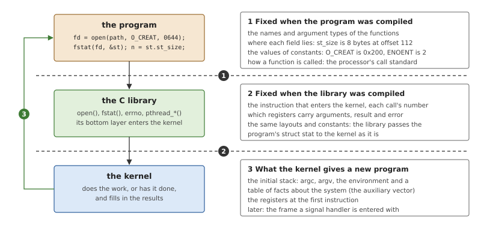
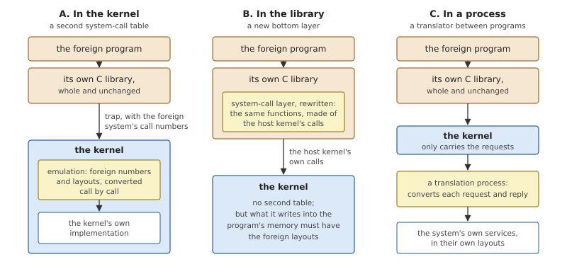
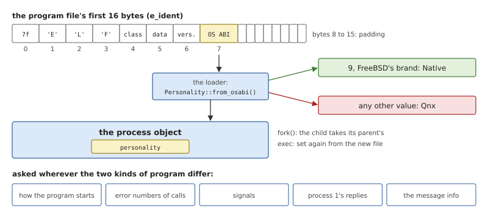
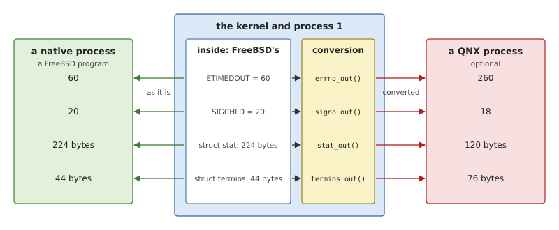
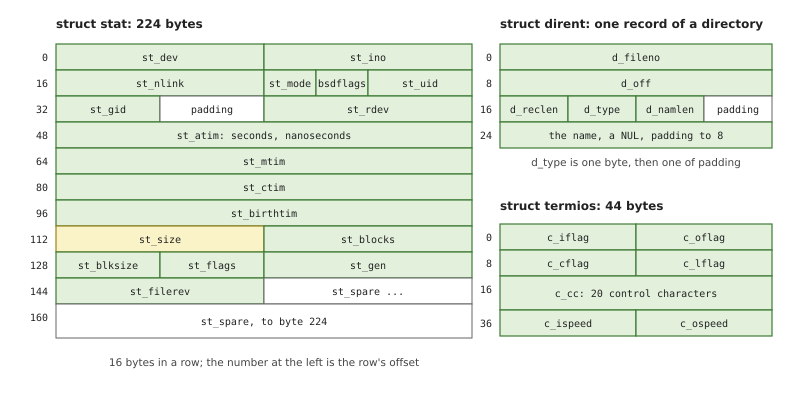
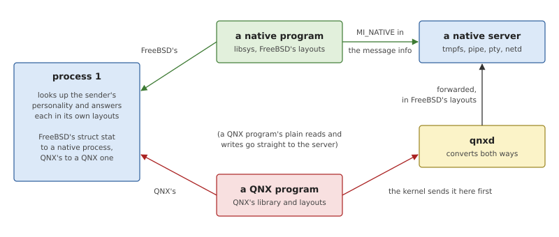

# The FreeBSD ABI in the Kernel

A program compiled for FreeBSD on AArch64 runs on OsCraft without being
compiled again. Nothing in it was written for OsCraft, and yet the
structures the kernel fills in for it, the error numbers it gets back
and the stack it starts on are the ones it expects. This chapter
explains what a compiled program expects of the system under it, the
ways a kernel can meet the expectations of programs built for another
system, and how OsCraft's kernel and process 1 came to speak FreeBSD's
conventions as their own.

## What a compiled program depends on

The interface a programmer sees is a set of functions and types in
header files: `open()`, `struct stat`, `ENOENT`. This is the
*application programming interface*, the API. Two systems with the same
API can compile the same source text.

Compiling turns that text into something much more specific. The
compiler replaces every name with a number: a field becomes an offset, a
constant becomes its value, a function call becomes a particular use of
registers. The resulting conventions are the *application binary
interface*, the ABI. Two systems can run the same compiled program only
if they agree on all of it, and nothing in the program says what it
assumed. If the system disagrees, the program simply reads the wrong
bytes.

*Figure 23.1: The assumptions built into a program and into its C
library. Each dashed line is a boundary across which both sides must
agree on numbers that neither can check.*

Figure 23.1 sorts those assumptions by the boundary they cross.

**Between the program and its library** (1): the names of the functions
and how arguments are passed to them, which on a given processor is set
by a document all compilers follow, the *procedure call standard*; the
*layout* of every structure that crosses the boundary, meaning the
offset, size and alignment of each field; and the values of the
constants. In FreeBSD's `struct stat` the file's size is the eight bytes
at offset 112, and a program that wants the size reads those eight
bytes.

**Between the library and the kernel** (2): the instruction that enters
the kernel, the number that selects each call, the registers that carry
arguments and results, and the way failure is reported. A C library is
written for one kernel. It also passes most structures through
untouched: the `struct stat` whose address the program gave to
`fstat()` is the one the kernel fills in, so the kernel must agree with
the *program* about its layout, not only with the library.

**From the kernel to a new program** (3): a program starts with nothing
but its registers and its stack, and the first code to run (part of the
C library) finds its arguments, its environment and a table of facts
about the system at fixed places on that stack. Later, when a signal
handler runs, it is given a description of the signal and the
interrupted state of the processor, again in a fixed layout.

Numbers are the least visible part. Every UNIX-like system has an error
called `EAGAIN` and a signal called `SIGCHLD`, with the same meaning.
The values differ from system to system, and a compiled program
contains only the values.

### Running another system's programs

Suppose a kernel is to run programs that were compiled for a different
system. Somewhere, each thing those programs expect has to be supplied
in their conventions, and each thing they hand over has to be
understood. There are three places to do it.

*Figure 23.2: The yellow box is the code that knows the foreign
system's conventions. What changes between the three designs is where
it runs and how much of the foreign system's code is kept.*

**In the kernel (A).** The foreign program keeps its entire C library,
including the part that traps. The kernel recognises such a program,
and gives its traps to a second table of system calls, where each entry
converts the arguments, calls the kernel's own implementation and
converts the results. FreeBSD runs Linux programs this way. The foreign
programs are truly unmodified, down to static executables. The price is
a second system-call interface inside the kernel, to be kept correct
for as long as the first.

**In the library (B).** The foreign C library is kept except for its
bottom layer, the functions that enter the kernel, and that layer is
written again for the host kernel. Everything above it, which is nearly
all of the library, is the foreign system's own code and behaves as it
always did. The kernel needs no second table. The limits are that a
program must reach the kernel through that layer, which a statically
linked program that carries its own copy of the old layer does not, and
that the layer can only translate what passes through it.

**In a process (C).** The foreign program and its library are left
whole, and their requests are delivered to a separate program that
translates them and passes them on. This fits a system whose services
are processes anyway. It adds a hop to every translated request.

### What only the kernel can do

Design B looks as if it frees the kernel of all knowledge of the
foreign system. It does not, because of the cases where the kernel
itself writes into a program's memory or decides a value the program
will see.

- The kernel builds the initial stack. No library code has run yet
  that could rearrange it.
- The kernel builds the frame a signal handler is entered with, and
  chooses the signal's number.
- The kernel reports its own failures as error numbers, and a library
  layer that had to renumber every one of them would cost every call
  an extra step.
- Services that answer the program directly (a file system filling in a
  `struct stat`) write that structure in some layout, and either they
  use the program's or something converts each reply.

So the real choice in design B is which conventions the kernel and the
system services use *internally*. If they keep conventions of their
own, the rewritten library layer converts everything, in both
directions, for ever. If they adopt the foreign system's conventions as
theirs, the layer converts nothing and only has to route each call to
whoever implements it. The second choice makes the "foreign" system the
native one.

## The FreeBSD ABI in OsCraft

OsCraft makes the second choice, with FreeBSD. Its programs are FreeBSD
programs with FreeBSD's C library, whose bottom layer is replaced by
libsys (design B; Chapter 24). And the kernel, process 1 and the native
servers use FreeBSD's error numbers, signal numbers and structures as
their own internal ones, so that nothing is converted on the way to a
FreeBSD program. The kernel calls themselves, their names, numbers and
arguments, stay OsCraft's (Chapter 7): no FreeBSD program makes them
directly, only libsys does.

The kernel can also run QNX programs, an option covered in Part VI.
They matter here for one reason: because of them the kernel has a word
for "which conventions does this process use", and the code that
answers it shows exactly where conventions matter.

### Personalities

A process's *personality* is the ABI its program was built for. There
are two values: `Native`, FreeBSD's, and `Qnx`. The type and everything
that depends on it are in `kernel/src/personality/`: `mod.rs` holds the
type and the questions the rest of the kernel asks of it, `native.rs`
what exists only for native processes, and `qnx.rs` the conversions for
QNX processes.

*Figure 23.3: The personality is read from one byte of the program
file when the program is loaded, stored in the process, and consulted
at the few places where the two kinds of program differ.*

Every ELF file begins with sixteen identification bytes, and the eighth
(index 7, `EI_OSABI`) names the operating system the file was built
for. FreeBSD's toolchain writes 9 there in every program it links. The
loader (Chapter 19) reads that byte when it maps a program:
9 gives `Native`, and any other value gives `Qnx`. Nothing else is
examined, and no list of known programs exists.

The value is kept in the process object. A child made by `fork()` has
its parent's personality, and loading a new program into a process
sets it again from the new file, so a native shell can start a QNX
program and the reverse. The file `/proc/<pid>/personality` shows it,
as `freebsd` or `qnx`.

The rest of the kernel does not test the personality freely. It asks
one of a small set of questions, and for a native process every answer
is "unchanged".

*Table 23.1: Where the kernel and process 1 consult a process's
personality, and what a native process gets.*

| Where | Question | For a native process |
|---|---|---|
| the loader | how does the program start? | FreeBSD's initial stack, no thread pointer set (Chapter 19) |
| the end of every kernel call | what number is this error? | the kernel's number, as it is |
| `MsgError()` | what error does this server mean? | the number given, as it is |
| the signal calls | which signal is number *n*? what does a set look like? | the kernel's numbers, 128-bit sets |
| signal delivery | which pending signal first? what frame? | the lowest number; FreeBSD's `siginfo_t` and `ucontext_t` (Chapter 14) |
| process 1's replies | which `struct stat`, `struct dirent`, `struct termios`? | FreeBSD's |
| `fork()` | how does the child learn it is the child? | from the call's result, for libsys |
| message information | what does the receiving server learn about the sender? | the `MI_NATIVE` flag is set |
| path lookup | is there an overlay directory to try first? | no |

### One set of numbers inside

The kernel's own error numbers are FreeBSD's. They are not typed into
the kernel: the crate `user/proto` holds them in `errno.rs`, a file
generated from FreeBSD's `<sys/errno.h>` by the script
`tools/freebsd/gen-errno.sh`, and `kernel/src/ker/errno.rs` re-exports
the ones the kernel uses. When a kernel call fails, the number its
handler returned is what a native process finds in the result register
(Chapter 7) and what libsys stores in `errno`.

*Figure 23.4: The kernel holds FreeBSD's values. A native process
receives them unchanged; for a QNX process they are converted as they
leave the kernel.*

Figure 23.4 shows the asymmetry that the whole design aims for. On the
native side there is no code at all: the arrows are plain copies. All
the conversion functions sit on the optional side, and they convert
from FreeBSD's values, because that is what is inside.

Two kernel errors have no FreeBSD number. They belong to message
passing: `ESRVRFAULT`, a server whose buffers could not be accessed,
and `ENOREMOTE`, a request that named another machine. Inside the
kernel they carry a mark bit above any real error number. A native
process that meets one sees `EIO`.

Signals follow the same rule, and Chapter 14 describes them: numbers 1
to 33 and the real-time signals from 65 are FreeBSD's, a set is
FreeBSD's 128-bit `sigset_t`, `struct sigaction` is read and written
in FreeBSD's layout, and a handler is entered with FreeBSD's
`siginfo_t` and `ucontext_t` on its stack. A signal a native program
asks to send must be one of FreeBSD's.

### The structures process 1 builds

Process 1 is a server as well as a manager. It serves the files of the
boot image, `/dev/null` and its relatives, the console, `/proc`, and
shared memory objects (Chapter 22), so it answers `fstat()`, reads of
directories and terminal requests. It answers a native process in
FreeBSD's structures, built directly.

*Figure 23.5: Three structures of FreeBSD's ABI, to scale. A FreeBSD
program reads `st_size` at offset 112 whoever filled in the structure.*

- **`struct stat`** is 224 bytes. Process 1 keeps the facts about each
  of its files in this structure and replies with its bytes. The
  reply's status carries a code that says the data is in FreeBSD's
  form, which matters to libsys, as the next chapter shows.
- **`struct dirent`** is a record of variable length: three fixed
  fields in 24 bytes, then the name, a terminating zero byte, and
  padding to a multiple of 8. A read of a directory returns as many
  whole records as fit.
- **`struct termios`** is 44 bytes: four words of flags, twenty control
  characters and two speeds. The console's settings are stored in this
  form.
- **A child's status**, the reply to `wait4()`, is FreeBSD's
  `siginfo_t` for `SIGCHLD`: the child's ID, the reason it stopped or
  ended, and its exit status or signal.

Process 1 also answers the part of FreeBSD's `sysctl()` that describes
the kernel itself, which is how FreeBSD's `ps` and `top` work without
change. `ps` asks for the list of processes with the name
`kern.proc`, and expects an array of `struct kinfo_proc`, a structure
of 1088 bytes per thread or process holding IDs, state, times, memory
sizes, the command name and the controlling terminal.
`kernel/src/proc/kinfo.rs` fills one in from the kernel's own process
and thread objects, field by field at FreeBSD's offsets, and translates
what has no exact counterpart: a thread's blocking state becomes the
short "wait message" `ps` prints, and the process state becomes one of
FreeBSD's state codes. `kernel/src/proc/sysctl.rs` answers the other names
that tools ask the kernel for, such as `kern.boottime`, `kern.cp_time`,
`vm.loadavg` and the page counts under `vm.stats.vm`, each with exactly
the type FreeBSD gives it, because a FreeBSD program rejects an answer
of any other size.

> [!WARNING]
> These layouts are written out by hand, as offsets measured once
> against FreeBSD's headers. They are correct for the FreeBSD version
> the userland is built from. When that version changes, check them
> again; `struct kinfo_proc` is the one most likely to have moved.

### Names: the plain one is native

The layouts and numbers that several parts of the system must agree on
are collected in one crate, `user/proto`, which contains only data
definitions and is compiled into the kernel, libsys and the servers
alike. Where FreeBSD and QNX each have their own version of something,
the crate holds both, and one rule decides the names everywhere in the
source tree: **the plain name is the native thing, and QNX's variant
carries a prefix.**

*Table 23.2: The naming rule, in `user/proto` and in the kernel.*

| Native (FreeBSD's) | QNX's | What |
|---|---|---|
| `errno::ENOENT` | `qnx_errno::ENOENT` | error numbers |
| `fcntl::O_NONBLOCK` | `qnx_fcntl::O_NONBLOCK` | flags of `open()` |
| `stat::Stat` | `stat::QnxStat` | `struct stat` |
| `termios::Termios` | `termios::QnxTermios` | `struct termios` |
| `Personality::Native` | `Personality::Qnx` | a process's personality |
| `enter_handler()` | `enter_handler_qnx()` | entering a signal handler |
| `initial_stack()` | `initial_stack_qnx()` | building a program's first stack |

The rule is more than tidiness. Code that uses a plain name handles
the system's own data and needs no thought about personalities. Every
place where conversion happens has `qnx` in a name, so the cost of the
optional personality can be found with a text search, and removed the
same way.

The conversions themselves are a second small crate, `user/qnxabi`:
pure functions from one layout or number to the other, with no
knowledge of when to apply them. The kernel's `personality/qnx.rs`,
libsys and the translation service each call them at their own
boundary.

### Three calls for FreeBSD's runtime

Almost everything FreeBSD's C library needs can be built from the
kernel calls of Chapter 7. Its thread library, libthr, needs three
things those calls do not offer in the form it expects, and the kernel
adds a call for each, numbered 120 to 122, after the general ones
(`kernel/src/ker/number.rs`, `kernel/src/personality/native.rs`).

- **`thr_new`** creates a thread the way FreeBSD defines it: on a stack
  the library has already allocated, with the thread pointer set to a
  block the library has already built, started directly at the
  library's entry function, and with its ID stored in the library's
  memory before it runs. The general `ThreadCreate()` call allocates
  and lays out that memory itself, for a different library. Chapter 8
  follows `thr_new` step by step.
- **`thr_self`** returns the calling thread's ID. FreeBSD's library
  asks the kernel for it; it has no block maintained by the kernel to
  read it from.
- **`futex`** waits while a 32-bit word in the program's memory holds a
  given value, or wakes threads waiting on a word. FreeBSD's locks
  keep their state in user memory in FreeBSD's own format, which the
  kernel's mutex calls do not understand, so libsys implements them on
  this one primitive (Chapter 9).

All three begin by checking the caller's personality and fail with
`ENOSYS` for anything but a native process.

**Thread IDs.** A thread's ID in the kernel is a small number, unique
within its process, and the lowest free one is reused. FreeBSD
programs see that number plus 100000. FreeBSD's own thread IDs start
above its largest process ID, and libthr relies on it: it stores the
owner's thread ID in a mutex's lock word, where a few small values
have other meanings. libsys subtracts the offset again whenever it
passes a thread ID to a kernel call that takes one.

**`fork()`.** A forked child resumes in the middle of the same call as
its parent and has to learn which of the two it is. For a native
process the kernel makes the call's result different: the parent gets
the child's process ID, and the child gets its own ID with an extra
high bit set, which libsys recognises, strips, remembers as the
process ID, and turns into the 0 that `fork()` must return.

**Restarting.** FreeBSD lets a signal handler declare, with
`SA_RESTART`, that an interrupted system call should start again when
the handler returns. In OsCraft the calls that block on behalf of a
FreeBSD system call are messages to servers and futex waits. So when
`MsgSendv()` or `futex` fails with `EINTR` in a native process and the
handler asked for it, the kernel moves the program counter back to the
call's instruction instead of completing the call (Chapter 14).

### Telling a server who is calling

A native server receives messages from native programs and, if the QNX
option is present, indirectly from QNX programs. Usually it need not
care, but sometimes the right answer depends on the caller's
conventions. The kernel already gives every server a small structure
describing the sender of each message: its process, its thread, its
priority. For a native sender the kernel also sets one bit in that
structure's flags, `MI_NATIVE`.

*Figure 23.6: The paths of a request, by the personality of the two
ends. Only the green paths exist in a system without the QNX option.*

`pipe`, for example, uses the bit when a pipe is created, to choose the
largest write that is guaranteed not to be interleaved with another:
512 bytes for a FreeBSD program, which is FreeBSD's `PIPE_BUF`, and a
different value for a QNX program, whose headers promise more.

Process 1 does not need the bit, since it can look the sender up in the
process table directly. That lookup is what selects FreeBSD's
`struct stat` over QNX's in Figure 23.6.

The opposite question, "what does this *server* speak", is answered by
`ConnectServerInfo()`, which fills a structure describing the server
behind a connection. One reserved word of it is non-zero when the
server is a QNX program. libsys checks it in the few calls where the
two layouts differ, so a native program can use a QNX server if one is
installed.

### What stays OsCraft's

It would be wrong to conclude that the kernel is FreeBSD's. Adopting
an ABI means adopting what compiled FreeBSD programs can observe, and
they cannot observe what only libsys touches.

- **The kernel calls** keep their own numbers and arguments.
- **Clocks, scheduling policies and priorities** are the kernel's own:
  priorities where a larger number is more urgent, and the kernel's
  own clock IDs. libsys maps FreeBSD's fourteen clock names onto four
  of the kernel's clocks, and FreeBSD's scheduling classes onto the
  kernel's priorities (Chapter 8 has the table).
- **The messages to process 1** use the message protocol's own
  encodings. A request to map memory carries protection and mapping
  flags with different values from FreeBSD's `PROT_READ` and
  `MAP_ANON`, and libsys rewrites them in `mmap()`.
- **The messages to servers** have the protocol's own headers. Only
  the data that the program itself supplied or will read, the
  `struct stat`, the `struct termios`, a socket address, is in
  FreeBSD's layout.

The dividing line is the one drawn in the first half of this chapter.
Where the kernel or a server writes something a program will read
without libsys in between, it writes FreeBSD's form. Where libsys
builds the request anyway, the request is in the system's own form,
and libsys is the only code that has to know both.

## Summary

- A compiled program has fixed the layout of every structure, the
  value of every constant, the way it calls its library, and the state
  it expects at its first instruction. An ABI is all of these together.
- A kernel can serve another system's programs with a second call
  table, with a rewritten bottom layer of their C library, or with a
  translating process. With the second, the kernel still supplies what
  no library can: the initial stack, signal frames, and the numbers and
  structures that reach the program directly.
- OsCraft uses FreeBSD's error numbers, signal numbers and structures
  inside the kernel, process 1 and the native servers, so a FreeBSD
  program's data is never converted.
- A process's personality is read from the `EI_OSABI` byte of its
  program file. The kernel consults it at a short list of places, and
  for a native process each answer is "as it is".
- In the source, a plain name (`Stat`, `errno`) is FreeBSD's and
  native; a name with `Qnx` or `qnx_` belongs to the optional
  personality. The shared layouts are in `user/proto`.
- Three kernel calls exist only for native processes: `thr_new`,
  `thr_self` and `futex`. Thread IDs are offset by 100000, a forked
  child is told so through the call's result, and interrupted messages
  and lock waits can restart.
- Servers learn the sender's personality from the `MI_NATIVE` flag in
  the message information; process 1 looks it up.
- The kernel calls and the message headers remain OsCraft's own.
  libsys is the one component that knows both sides.
