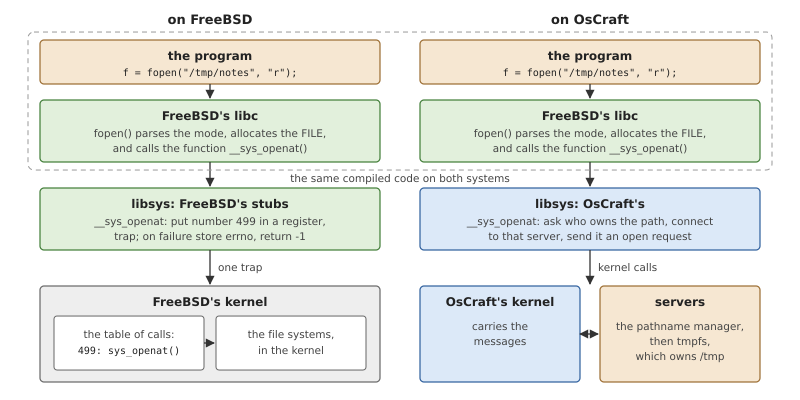
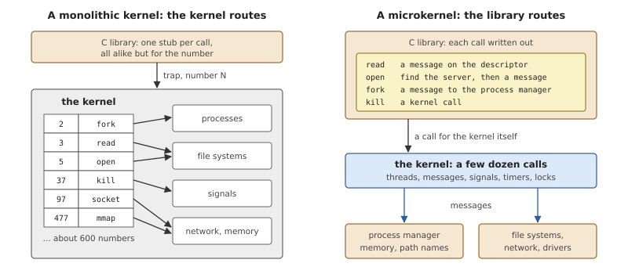
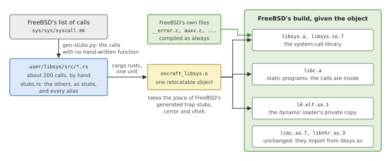
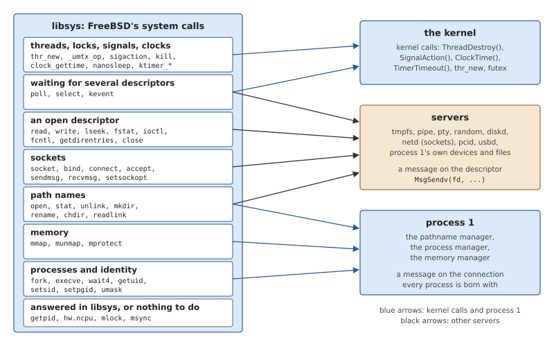
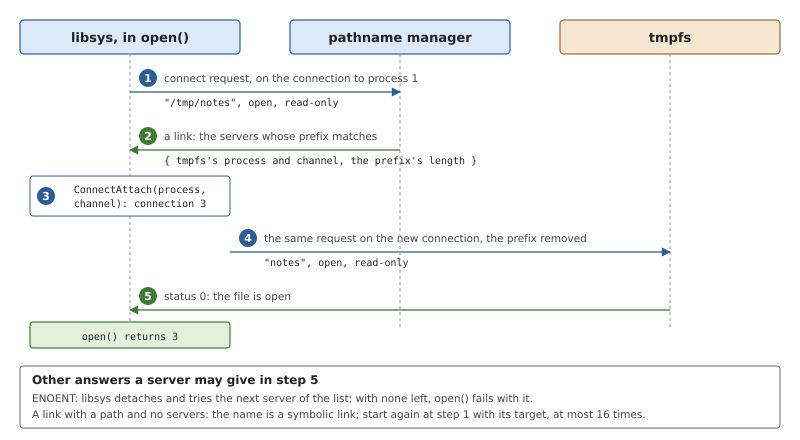
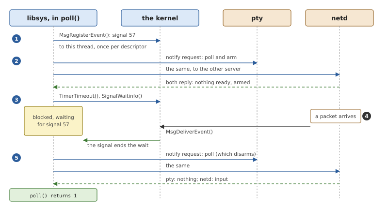

# libsys: System Calls as Messages

FreeBSD's C library expects a kernel that implements several hundred
system calls. OsCraft's kernel implements none of them: it has threads,
messages, signals and timers, and leaves files, sockets and processes
to servers. The component that joins the two is *libsys*, a library of
about two hundred functions, one per FreeBSD system call, each of which
does with kernel calls and messages what FreeBSD's kernel would have
done on a trap. This chapter explains where such a layer sits in a C
library, why a microkernel needs a different kind of layer than a
monolithic kernel, and how libsys implements each family of calls.

## The bottom of a C library

A C library has two kinds of function. Most of it is ordinary code that
runs entirely in the program: `strlen()`, `printf()`'s formatting,
`malloc()`'s bookkeeping. The rest are the *system calls*, the
functions that need something only the operating system can give, such
as `read()`, `fork()` and `mmap()`. The first kind is built on the
second: `fopen()` calls `open()`, `malloc()` calls `mmap()`.

In the library's source, a system call is hardly a function at all. On
a monolithic kernel it is a *stub*, a few instructions that put the
call's number in a register, execute the trap instruction, and on
return check whether the kernel reported an error; if so, the stub
stores the error number in `errno` and returns -1. The stubs are all
alike, and they are generated from a list of calls.

*Figure 24.1: The layers below one call to `fopen()`. Everything inside
the dashed frame is identical on the two systems; the layer below it is
what a system must supply.*

Because the stubs are the only code that touches the kernel, they form
a clean layer, and FreeBSD has made the layer a library of its own. Its
C library proper contains no trap instruction. It calls functions named
after the system calls with a prefix, `__sys_read()`, `__sys_openat()`,
and those live in a separate library called `libsys`. Each also has
*weak aliases*, alternative names for the same code that another
definition may override: `getpid` and `_getpid` are aliases of
`__sys_getpid`. A call that the thread library must be able to
intercept, such as `read()`, which is a point where a thread can be
cancelled, has no plain-named alias in `libsys`; the C library defines
`read()` itself, as a wrapper that ends in `__sys_read()`.

This matters for the rest of the chapter. Whoever provides those
symbols, with those meanings, has provided everything FreeBSD's C
library, thread library and dynamic loader need from a kernel. They
are compiled against the symbols and nothing lower.

### A table in the kernel, or routing in the library

What a stub leads to differs fundamentally between the two kinds of
kernel.

*Figure 24.2: In a monolithic kernel a number selects a kernel
function. In a microkernel the library decides, call by call, whether
the kernel or a server is asked, and which server.*

A monolithic kernel has a *system-call table*, an array of functions
indexed by the call's number. FreeBSD's has about six hundred entries.
All of them are in one place, the kernel, and each reaches the
subsystem it needs by an ordinary function call. The library's side is
trivial because the kernel does the routing.

A microkernel has far fewer calls, and they are of a different kind:
create a thread, send a message, set a timer. There is no `read` among
them. The knowledge of *who* implements `read()` for a given file has
to live outside the kernel, and the natural place is the library. So a
microkernel's system-call layer is real code: for each call it decides
whether the kernel can do the job directly or a server must be asked,
finds the server, builds a request in that server's protocol, and turns
the reply into the call's result.

One consequence is that a system call is no longer one unit of work in
the kernel. A call may be one kernel call, one message, several
messages to different servers, or no communication at all.

### An emulation layer under an unchanged library

Chapter 23 described the three places where a system can adapt to
programs built for another. A system-call layer in the library is the
second: keep the foreign C library, replace its bottom. When the
foreign library's bottom layer is already a separate library with a
fixed list of symbols, as FreeBSD's is, the replacement can be made
without changing a line of the library above it.

What makes such a layer hard is not any single call. It is that the
foreign system's calls carry assumptions about a kernel that is not
there: that a file descriptor is an index into a kernel table, that
`fork()` copies that table, that the kernel knows every thread's lock.
The layer has to recreate each assumption out of what the host kernel
does provide, and where it cannot, it must fail in a way the program
understands.

## libsys in OsCraft

OsCraft's libsys is the crate `user/libsys`, written in Rust. It
defines every symbol of FreeBSD's `libsys`: about two hundred calls
implemented by hand and the rest as stubs that report themselves and
fail. It uses no heap and no part of the C library, since it sits below
both; it does not even allow the compiler to turn its loops into calls
to `memcpy()`, because the dynamic loader, which contains a copy of
libsys, has only a few such functions.

Chapter 10 followed `read()` as an example of a message. That one call
already shows the pattern of most of libsys: build a small request on
the stack, describe the caller's buffer as the place for the reply,
make one `MsgSendv()` kernel call, and return the server's status. If
the kernel call fails, store the error number in `errno` and return -1.
Since the kernel gives a native process FreeBSD's error numbers
(Chapter 23), nothing is translated on the way.

### One object, three places

libsys is not linked like an ordinary library. It is compiled into a
single relocatable object, and FreeBSD's own build system puts that
object wherever its generated stubs would have gone.

*Figure 24.3: The Rust crate becomes one object file, which FreeBSD's
build takes in place of its trap stubs. The libraries above it are
built from FreeBSD's source without change.*

The top-level `Makefile`'s `libsys` target compiles the crate for the
target `aarch64-unknown-freebsd` as one code-generation unit with
link-time optimisation and asks the compiler for the object file
itself. FreeBSD's source tree is a fork with a few small patches
(`tools/freebsd/patches/`). Three of them concern libsys, and all three
are changes to makefiles: when the variable `OSCRAFT_LIBSYS_OBJ` names
an object, the build of FreeBSD's `libsys` uses it instead of
generating stubs and instead of its two hand-written assembly files,
and the build of the dynamic loader takes the same object into its
private library. FreeBSD's remaining libsys sources, such as the one
that implements `errno` and the one that reads the auxiliary vector,
are compiled as usual and linked next to it.

The object ends up in three places:

- `libsys.so` and `libsys.a`, the system-call library. A dynamically
  linked program reaches libsys through the shared one, which `libc.so`
  and `libthr.so` import from.
- `libc.a`, because a statically linked FreeBSD program gets its system
  calls from the static C library. Most of the native servers are
  linked this way.
- `ld-elf.so.1`, the dynamic loader, which must open and map libraries
  before any shared library, `libsys.so` included, is available.

A program can also be linked with the object alone and no C library at
all; one of the test programs is.

**The stubs.** The script `user/libsys/tools/gen-stubs.py` reads
FreeBSD's list of system calls and the crate's source, and writes
`stubs.rs`: for every call that has no hand-written `__sys_` function,
a function that prints `libsys: not implemented: <name>` on the
standard error and fails with `ENOSYS`. A program that needs a missing
call therefore says so the first time it tries. The same script emits
the weak aliases for all calls, written or not, following FreeBSD's
own rules about which calls get a plain-named alias, and the versioned
names FreeBSD keeps for old binaries.

### Where each call goes

*Figure 24.4: The routes out of libsys. A call's family decides whether
it becomes a kernel call, a message to process 1, or a message to the
server behind a descriptor.*

Figure 24.4 is the chapter in one picture, and Table 24.1 gives the
detail. There are only three destinations. The kernel is reached by a
kernel call. Process 1 is reached by a message on a connection every
process has from birth (Chapter 10). Any other server is reached by a
message on a file descriptor, which is a connection to that server.

*Table 24.1: FreeBSD's system calls by family, and what libsys makes of
each.*

| Family | Calls | Becomes |
|---|---|---|
| I/O on a descriptor | `read`, `write`, `readv`, `pread`, `lseek`, `fstat`, `ftruncate`, `fsync`, `fchmod`, `getdirentries` | one message to the descriptor's server |
| descriptors | `close`, `dup`, `dup2`, `fcntl` | a message to the server, plus `ConnectAttach()`, `ConnectDetach()` or `ConnectFlags()` |
| device control | `ioctl` | a device-control message to the descriptor's server |
| path names | `open`, `stat`, `access`, `unlink`, `mkdir`, `rename`, `link`, `symlink`, `readlink`, `chmod` | a connect request to the pathname manager, then to the server it names |
| working directory | `chdir`, `fchdir`, `getcwd` | requests to the pathname manager, which keeps it |
| pipes | `pipe2` | an open at the `pipe` server, and a second open through the first |
| sockets | `socket`, `bind`, `connect`, `listen`, `accept`, `sendmsg`, `recvmsg`, `getsockopt` | an open of `/dev/socket/<domain>`, then messages to `netd` |
| memory | `mmap`, `munmap`, `mprotect`, `shm_open2` | messages to the memory manager in process 1 |
| processes | `fork`, `vfork`, `execve`, `wait4`, `setsid`, `setpgid`, `umask` | messages to the process manager in process 1 |
| identity | `getuid`, `setuid`, `getgroups` and their relatives, `getppid` | messages to the process manager |
| exit | `_exit` | `ThreadDestroy()` of every thread |
| threads | `thr_new`, `thr_self`, `thr_exit`, `thr_kill`, `rtprio_thread` | kernel calls (Chapter 8) |
| locks | `_umtx_op` | work in libsys, and the `futex` kernel call to wait and wake (Chapter 9) |
| signals | `sigaction`, `sigprocmask`, `sigsuspend`, `sigtimedwait`, `kill`, `sigqueue` | kernel calls (Chapter 14) |
| time | `clock_gettime`, `gettimeofday`, `nanosleep`, `setitimer`, `ktimer_*` | kernel calls (Chapter 13) |
| readiness | `poll`, `select`, `kevent` | messages to each server, and kernel calls to wait |
| system information | `sysctl`, `getpid`, `getrlimit` | answered in libsys, else a message to process 1, else to `netd` |
| kernel modules | `kldload`, `kldstat`, `modfind` | a device-control message to `netd` |
| mounting | `nmount`, `unmount`, `getfsstat` | a request to the disk's server; a file the servers keep |

The sections below take the families in the order of the figure's
destinations: servers first, then process 1, then the kernel, and last
the calls that mix them.

### Descriptors: messages to whoever is behind them

A file descriptor is a connection (Chapter 10), and the calls on a
descriptor are the simplest in libsys. `write()` sends a 16-byte header
followed by the caller's data, as two parts of one message; `lseek()`
sends the offset and receives the new position; `fstat()` sends a
request and receives a `struct stat`. libsys does not know or care
which server answers. The same `read()` works on a file in `tmpfs`, a
pipe, a terminal and a socket.

A few calls on descriptors show how the kernel's idea of a descriptor
and FreeBSD's are reconciled.

- **`close()`** tells the server first, with a close message, and then
  detaches the connection. If the message is interrupted by a signal,
  the descriptor is left open, so the program may try again.
- **`dup()`** cannot copy an entry in a kernel table, because there is
  none. It makes a new connection to the same server and sends that
  server a message saying the new connection stands for the same open
  file as the old one.
- **Close-on-exec** is a flag of the connection, kept by the kernel.
  The other `fcntl()` flags, such as non-blocking mode, belong to the
  open file and are read and set with messages to the server.
- **`getdirentries()`** is a read with a marker that asks for directory
  entries. A native server replies with FreeBSD's `struct dirent`
  records, which go straight into the caller's buffer.

**`ioctl()`** needs translation of a different kind. FreeBSD encodes a
request as one number that packs a group letter, a number within the
group, the direction of the data and its size. The system's
device-control message has a command word built the same way, so most
requests are forwarded with their data unchanged, and the server
recognises FreeBSD's command. libsys looks at the group: terminal
requests (`t`) go to whoever serves the terminal, with a handful
rewritten because the system expresses them differently (making a
terminal the controlling one, for instance, sends the caller's process
ID); the file requests (`f`) for non-blocking mode and close-on-exec
are turned into the corresponding flag operations; network requests
(`i`) go to `netd`, and those whose structure contains a pointer to
more memory have that memory appended to the message, with a small
table saying where the pointers were; requests for PCI devices and
disks are passed to their servers as they are. A request from a group
libsys does not know fails with `ENOTTY` after a line on the standard
error.

### Path names: asking who owns a name

A call that names a file must first find the server. Chapter 2 gave the
outline; this is the exchange in full.

*Figure 24.5: `open("/tmp/notes")`. The first request goes to the
pathname manager, which answers with a list of servers; the second goes
to the server, on a connection that becomes the file descriptor.*

libsys sends a *connect request*, a header followed by the path, to the
pathname manager in process 1 (1). The header says what is wanted
(open, unlink, make a node, read a link) and with which flags. The
manager does not open anything. It replies with a *link*: the list of
servers whose registered prefix matches the path, longest prefix first
(2). libsys attaches a connection to the first server's channel (3),
choosing the lowest free descriptor number, and sends the same request
again with the server's prefix cut from the front of the path (4). If
the server accepts, the connection is the open file (5).

The loop around these steps (`connect_ex()` in
`user/libsys/src/path.rs`) handles the other answers. A server that
does not have the name answers `ENOENT`, and libsys detaches and tries
the next server in the list; this is how several servers can share one
directory. A server that finds a symbolic link replies with the link's
target, and libsys starts again from the pathname manager with the new
path, giving up with `ELOOP` after sixteen links. A path relative to an
open directory (`openat()`) is passed to the pathname manager with that
descriptor, or, if the directory belongs to another server, is first
made absolute by asking that server for the directory's path.

Calls that do not need a descriptor use the same loop with a *combined*
request. `stat()` sends a connect request that carries a stat message
inside it and asks for the connection to be closed at once: the server
resolves the path, answers the inner message, and forgets the client.
That is one round trip to the server, not an open, a stat and a close.
`chmod()`, `chown()` and `utimensat()` work the same way with their own
inner message.

`rename()` and `link()` name two paths that must be on the same server.
libsys resolves the first to find the server, then walks the second
path's resolution, sending the real request only to that server. If
the second path turns out to belong to a different one, the call fails
with `EXDEV`, FreeBSD's error for a rename across file systems.

### Sockets: messages to netd

FreeBSD's network stack runs in the server `netd` (Chapter 28), which
registers one name per protocol family under `/dev/socket`. `socket()`
is therefore an `open()`: libsys builds the path from the family's
number, and sends a connect request whose extra data holds the socket
type and protocol. The descriptor that comes back is a connection to
`netd`, and it works with `read()`, `write()`, `poll()` and `close()`
like any other.

The socket calls proper are messages on that descriptor
(`user/libsys/src/socket/`). `bind()`, `connect()`, `listen()` and
`shutdown()` are device-control messages carrying the socket address.
`sendmsg()` and `recvmsg()` are writes and reads with an extension
header that makes room for the address, the flags and the control
data, so the payload still moves in one copy between the caller's
buffers and the stack's. `accept()` opens a new connection to `netd`
from the listening one. Options are small messages of their own. The
addresses, options and control messages are in FreeBSD's layouts on
both sides, since `netd` is FreeBSD's code, so libsys copies them
without looking inside.

Two things cannot simply be copied. A file descriptor sent to another
process over a local socket (`SCM_RIGHTS`) is a number that means
nothing to the receiver. libsys registers the descriptor with the
kernel for the receiving side, sends the resulting handle, and the
receiver's libsys turns the handle into a connection of its own to the
same server. And a local socket's name is a path in the file system,
which `netd` does not serve; libsys creates or opens the node at the
server that owns the path and gives `netd` a handle to it.

`syslog()`'s socket is a special case. FreeBSD's C library logs through
a datagram socket connected to `/var/run/log`. libsys recognises that
address, maps a ring buffer shared with `syslogd` instead, and puts
each message into the ring without a kernel call.

### Process 1: memory and processes

**Memory.** `mmap()` is a message to the memory manager (Chapter 20).
libsys converts the request, since the manager's message has its own
encoding of the protection and mapping flags. It also bridges two
differences in meaning. FreeBSD's `MAP_GUARD` reserves addresses with
nothing behind them; OsCraft's memory is always backed when it is
mapped, so libsys asks for an inaccessible anonymous mapping. And the
memory manager can map only files it can reach itself. When it answers
that it cannot map a file served elsewhere, libsys maps anonymous
memory and reads the file into it, which is correct for a private
mapping; a shared writable mapping of such a file is refused.

Because memory is always backed and never paged out, several calls
have nothing to do. `mlock()`, `munlock()`, `mlockall()` and `msync()`
return success, and `mincore()` reports every page present.

**Processes.** `fork()` is one message to the process manager. Both
the parent and the child return from it, and libsys tells them apart by
the result (Chapter 23); the child also records its new process ID,
which libsys otherwise takes from the auxiliary vector at start.
`vfork()` is `fork()`. `execve()` is the process manager's spawn
request with a flag that says the new program replaces the caller;
libsys describes the path and each argument and environment string as
a separate part of the message, so nothing is copied together first
(Chapter 19). `wait4()` sends a wait request and receives a
`siginfo_t` describing the child, from which libsys builds the status
word that `WIFEXITED()` and its relatives take apart.

The process manager also holds what FreeBSD's kernel would keep per
process: user and group IDs, the process group and session, the file
creation mask. The calls that read or change them are small messages
to it.

### The kernel: threads, locks, signals and time

For these families the kernel has what FreeBSD needs, and libsys only
adapts the arguments.

- **Threads** use the kernel calls made for FreeBSD's thread library
  (Chapter 23). libsys converts FreeBSD's scheduling class and priority
  to the kernel's and FreeBSD's thread IDs to the kernel's.
- **Locks** are the one family where libsys contains the algorithm.
  `_umtx_op()` has some twenty operations, on mutexes, condition
  variables, semaphores and read-write locks. FreeBSD implements them
  in its kernel; libsys implements them in user space on the lock words
  themselves, and enters the kernel only to wait and to wake
  (Chapter 9).
- **Signals** pass through. Sets, actions and numbers are already in
  FreeBSD's form in the kernel, so `sigprocmask()` and `kill()` are
  single kernel calls. `sigaction()` adds one thing: the address of
  libsys's *trampoline*, the function the kernel starts when a signal
  is delivered, which calls the program's handler and then returns to
  the kernel to restore the interrupted state (Chapter 14).
- **Time.** `clock_gettime()` maps FreeBSD's clock to one of the
  kernel's and reads it. `nanosleep()` is a timeout the kernel applies
  to the thread itself. POSIX timers are the kernel's timers, and
  `setitimer()`'s real-time timer is the process's alarm (Chapter 13).

A wait with a time limit, in any family, uses the same device. FreeBSD
passes the limit as an argument of the call. The kernel's blocking
calls take none; instead a thread arms a timeout with `TimerTimeout()`
that applies to its next kernel call. So libsys makes two kernel calls
for a timed lock or a timed `sigtimedwait()`: one to arm, one to wait.

### Waiting for several things: poll, select and kqueue

`poll()` asks whether any of several descriptors is ready, and waits if
none is. On FreeBSD the kernel can look at all of them. On OsCraft each
may belong to a different server, and no server can be made to wait on
behalf of the others. libsys does it with a notification from each
server and one wait in the kernel.

*Figure 24.6: `poll()` on a terminal and a socket. libsys arms a
notification at each server, waits in the kernel for the first one, and
then asks each server what is ready.*

For each descriptor, libsys registers an *event* with the kernel, here
"send signal 57 to this thread" (1), and sends the server a notify
request with the conditions of interest and the event's handle (2). A
server that already has data says so at once. Otherwise it remembers
the handle, and will ask the kernel to deliver the event when a
condition comes true (4). If nothing was ready, libsys waits for the
signal with `SignalWaitinfo()`, after arming a timeout if `poll()` was
given one (3). Signal 57 is one of the numbers reserved for this, which
is always blocked and always queued (Chapter 14), so a notification
that arrives before the wait begins is not lost. When the wait ends,
libsys asks every armed server once more what is ready, which also
disarms it (5), removes the registrations, and collects any signals
left over so that they cannot wake the next `poll()`.

A server that does not implement notification, as a plain file's need
not, is treated as always ready, which is what FreeBSD reports for a
regular file. `select()` is the same code with the descriptor sets
converted to and from `poll()`'s array.

`kqueue()` has no counterpart in the kernel either. libsys keeps the
queues in a fixed table inside itself. A kqueue's descriptor is an
open of `/dev/null`, which makes it a real descriptor that is closed
and inherited like any other, and whose number finds the table entry.
`kevent()` then runs the read and write filters through `poll()`, keeps
deadlines for the timer filter, and handles the user filter itself. A
request for a filter it does not have, such as those on signals, files
or processes, is answered with an error for that one event, which
programs take to mean that they should fall back on `poll()`.

### Information about the system

FreeBSD programs learn about the system through `sysctl()`, a tree of
named values. libsys answers in three steps. A short list of values
that every program asks for at start, such as the number of CPUs, the
page size and the system's name, is answered inside libsys, mostly from
the auxiliary vector the kernel put on the initial stack. Other names
are sent to process 1, which knows the kernel's values, including the
process list that `ps` reads (Chapter 23). What process 1 does not know
is sent to `netd`, on a socket opened for the purpose, because the
network stack has its own large `sysctl` tree. A name is translated to
its numeric form the same way, by asking process 1 and then `netd`.

The module calls, `kldload()`, `kldstat()` and their relatives, are
passed whole to `netd` in a device-control message, since it is `netd`
that loads driver modules (Chapter 28).

### What is not there

About half of FreeBSD's calls are stubs. Among them are the families
OsCraft has no service for: asynchronous I/O (`aio_*`), System V
semaphores, message queues and shared memory, jails, access control
lists and extended attributes, `ptrace()`, `sendfile()`, `chroot()` and
`setrlimit()`. Each fails with `ENOSYS` and a line that names it.

A few calls fail quietly instead, because FreeBSD programs try them
routinely and cope: the capability-mode calls such as `cap_enter()`
return `ENOSYS` without a message. And some implemented calls are
partial. `wait4()` reports no resource usage, `fcntl()` has no record
locks, `ktimer_create()` accepts only some kinds of notification, and
`rfork()` supports only the combination of flags that means `fork()`.
The source says so at each one.

## Summary

- The system calls of a C library form its bottom layer. FreeBSD keeps
  that layer in a separate library, `libsys`, with a fixed set of
  symbols on which the rest of its userland is built.
- On a monolithic kernel the layer is a set of identical trap stubs and
  the kernel's table routes each call. On a microkernel the layer is
  real code: it decides who implements each call and speaks to them.
- OsCraft's libsys is a Rust crate compiled to one object, which
  FreeBSD's build takes in place of its stubs, into `libsys`, the
  static C library and the dynamic loader. FreeBSD's libraries above it
  are unchanged.
- Calls on a descriptor are messages to the server behind it. Calls on
  a path ask the pathname manager for the server first. Sockets are
  descriptors opened at `netd`.
- Memory and process calls are messages to process 1. Threads, signals
  and time are kernel calls. FreeBSD's locks are implemented inside
  libsys on a futex.
- `poll()` and `select()` arm a notification at each server and wait
  for a reserved signal; `kqueue()` is built on them inside libsys.
- `sysctl()` is answered by libsys, process 1 or `netd`, in that order.
- Calls without an implementation are generated stubs that name
  themselves and fail with `ENOSYS`.
