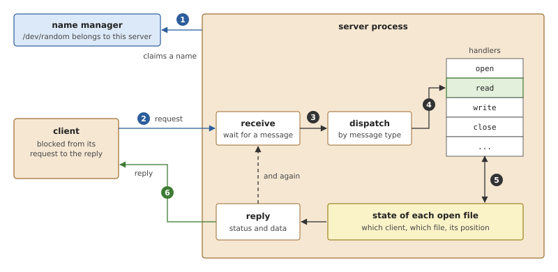
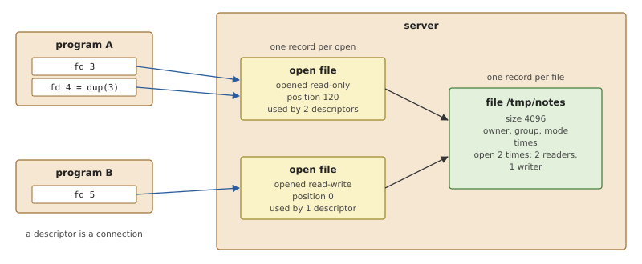
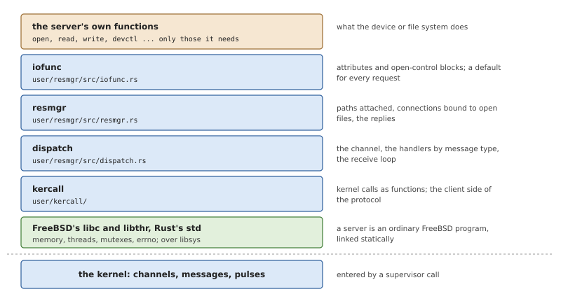
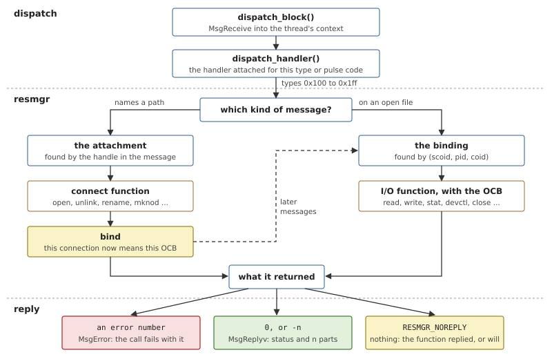
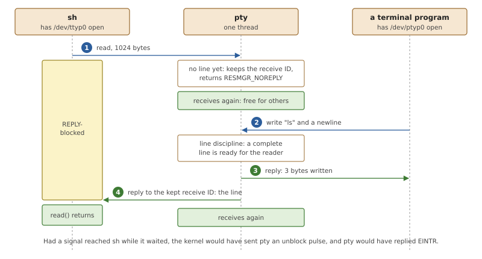
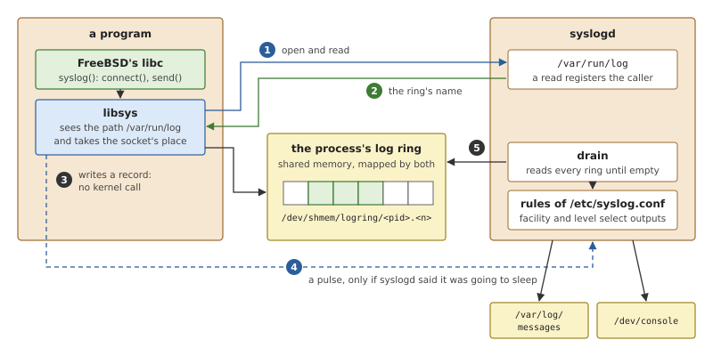
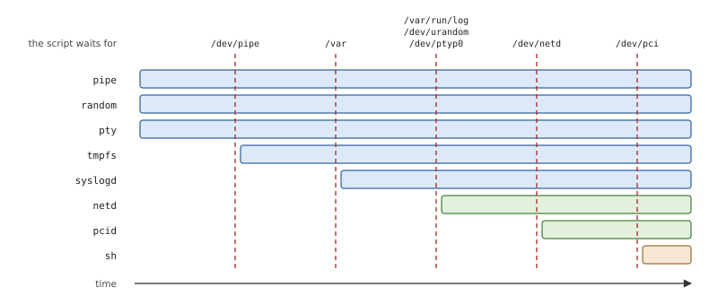

# Resource Managers and the Native Servers

In OsCraft a pipe, a pseudo-terminal, `/dev/random`, the files in `/tmp`
and the system log are each the work of an ordinary process. Such a
process is called a *resource manager*: it owns part of the path name
space and answers the messages that programs send when they open, read
and write what is there. This chapter explains what every such server
has to do, then the two libraries OsCraft's own servers are written
with, and then the small servers one by one. The large servers, which
run FreeBSD's kernel code, have their own chapters (27 to 31).

## What a server is made of

Chapter 10 showed the mechanism: a client sends a message and blocks, a
server receives it and replies. A server is the program built around
that mechanism, and all servers have the same five parts.



*Figure 25.1: A server. It claims a name once, then loops for ever:
receive a message, find the handler for its type, let the handler work
on the state of the open file concerned, reply.*

**A name.** Clients do not know process IDs. The server claims a name,
usually a path such as `/dev/random` or a whole directory such as
`/tmp`, with the system's name manager, and clients find it by opening
that path (step 1 of Figure 25.1).

**A receive loop.** The server waits for a message. While it waits it
uses no processor time; while it works, later clients queue behind it
in priority order.

**Dispatch by type.** Every request starts with a small header whose
first field is a *message type*: open, read, write, close and a few
dozen more. The server looks the type up in a table of *handlers* and
calls the one that matches. A type with no handler gets an error reply,
which is how a device that cannot seek says so.

**State for each open file.** A request such as "read 100 bytes" does
not say from which file or from where in it. The server must remember
that from the open, per client, and find it again when the read
arrives.

**A reply.** The handler's result goes back as the reply: a status,
which becomes the return value of the client's call, and for a read the
data. A server may also choose not to reply yet, and this is how
blocking works: a client that reads an empty terminal simply stays
blocked until the server has something to give it.

### Files and open files

The state a server keeps has two levels, and confusing them is the
classic mistake.



*Figure 25.2: One record per file and one per open. Program A opened
the file once and copied the descriptor; program B opened it again.*

A **file record** holds what is true of the file whoever uses it: its
size, owner, permissions and times, and how many times it is open. A
device has one too, though most of it never changes.

An **open-file record** holds what is true of one `open()`: whether it
was for reading or writing, and the current position. Two programs that
open the same file read it independently, so each has its own. Two
descriptors made by `dup()` or inherited by a child share one position,
so they share one record. The server must therefore count the
descriptors that use each record and discard it only with the last.

### One thread or many

A server with one thread handles one request at a time. That is simple,
since its data needs no locks, and it is enough when every request is
quick. It becomes a problem when a handler has to wait, for a disk or
for another server, because every other client waits with it.

There are two answers. The first keeps one thread and never waits
inside a handler: a request that cannot be finished is set aside
unanswered, and the server goes back to receiving. The second is a
*thread pool*: several threads receive on the same channel, each
handles one request to completion, and the data they share is locked. A
pool is usually given limits, such as a minimum number of threads kept
waiting so that a request never has to wait for a thread to be created,
and a maximum so that a flood of requests cannot exhaust memory.

### Why a framework

Most of what a server does is the same in every server. Checking that
the caller may open the file for writing, advancing the position after
a read, filling in the result of `stat()`, counting copies of a
descriptor, cleaning up when a client dies without closing: none of
this depends on what the device is. A system with many servers
therefore puts it in a library, and a server supplies only the handlers
that are particular to it and takes a default for the rest.

## Resource managers in OsCraft

OsCraft's own servers are written in Rust, against two libraries in the
repository: `user/kercall`, the kernel calls, and `user/resmgr`, the
server framework. The path name space they attach to is the pathname
manager's (Chapter 21), and the messages they receive are the ones
libsys sends for FreeBSD's system calls (Chapter 24). Process 1 has a
few servers built in, written the same way but inside the kernel file
(Chapter 22).



*Figure 25.3: What a native server is built from. Each layer of the
framework can be used without the ones above it.*

A native server is otherwise an ordinary FreeBSD program. It is built
for the same target as every other program, with Rust's standard
library, and linked statically against FreeBSD's C library, so a server
needs no shared library and no dynamic loader to start (Chapter 26
explains the build). It allocates memory with `malloc()`, starts
threads with `pthread_create()` and may open files like any client.

### The kernel-call library

`user/kercall` gives a server what the C library does not: the kernel
calls by name. Each is a function of a few instructions that puts the
call's number in a register and executes a supervisor call (Chapter 7).

Most calls come in two forms that differ only in how they report
failure. `MsgReply()` returns -1 and stores the error number in the
thread's `errno`; `MsgReply_r()` leaves `errno` alone and returns the
error number itself. The framework uses the second form throughout, so
that handling one request never disturbs the `errno` of another piece
of code.

The library also contains the client side of the protocol, because a
server is sometimes a client too. `user/kercall/src/path.rs` resolves a
path to a connection through the pathname manager, and
`user/kercall/src/io.rs` builds the read, write, `stat` and control
messages. The framework itself uses the first of these: attaching a
path is a request to the pathname manager.

### The framework

`user/resmgr` has three layers, each a module.

**dispatch** (`user/resmgr/src/dispatch.rs`) owns the channel.
`dispatch_create()` creates one, with the flags that make the kernel
send a pulse when a client disappears and when a blocked client wants
to leave. `message_attach()` and `pulse_attach()` register a handler
for a range of message types or for a pulse code. A thread that wants
to serve allocates a *context* with `dispatch_context_alloc()`: a
receive buffer, a description of the reply, and the kernel's
information about the sender of the message in the buffer. It then
alternates `dispatch_block()`, which receives into the context, and
`dispatch_handler()`, which calls the handler for what arrived. The
context belongs to the thread, so several threads can serve one channel
with one context each.

**resmgr** (`user/resmgr/src/resmgr.rs`) implements the protocol of
files. `resmgr_attach()` registers a path with the pathname manager and
records an *attachment*: the path, two tables of the server's
functions, and a pointer of the server's choice, the *handle*. The
first call also attaches the layer's own handler to dispatch for every
file message type and for the two pulses.

**iofunc** (`user/resmgr/src/iofunc.rs`) supplies the two records of
Figure 25.2 and a default handler for nearly every request. The file
record is the *attribute* (`IofuncAttr`): mode, owner, size, times, and
counts of readers and writers. The open-file record is the
*open-control block*, or OCB (`IofuncOcb`): a pointer to its attribute,
the access the open asked for, and the position.
`iofunc_func_init()` fills a server's two function tables with the
defaults, and the server then replaces the entries it wants to handle
itself.

The framework also has thread pools (`user/resmgr/src/pool.rs`), with
the low and high water marks and the maximum described above. None of
the servers in this chapter uses one. Each runs the loop on a single
thread and sets aside the requests that have to wait.

### A message's way through



*Figure 25.4: From receive to reply. A message that names a path
creates a binding; every later message on that connection is found by
it.*

The layer's handler sorts messages into two kinds.

A **connect message** names a path: it is what `open()`, `unlink()`,
`rename()` and `mkdir()` send. The pathname manager gave the client the
attachment's number when it resolved the path, and the client repeats
it in the message, so the framework finds the attachment directly and
calls its *connect function* for the request, with the attachment's
handle. The default connect function for an open checks the caller's
credentials against the attribute's mode and owner, allocates an OCB,
and *binds* it: the framework records that this client's connection now
means this OCB.

An **I/O message** arrives on a connection that is already open: read,
write, `stat`, seek, control requests, close. The kernel tells the
server, with every message, which process sent it and on which
connection. The framework looks that pair up in a hash table of
bindings and calls the *I/O function* for the message type with the
OCB. The server's function never searches for its state; it is handed
it.

Bindings are counted. When a descriptor is copied, the client's libsys
tells the server, and the framework binds the new connection to the
same OCB with one more reference. A close removes one binding, and the
last one calls the server's function for closing the OCB itself. If a
process dies, the kernel's disconnect pulse arrives instead, and the
framework closes every binding that process had. A server written with
the framework therefore cannot leak open files when clients crash.

What a function returns decides the reply, and the rule is short enough
to read in code.

*Listing 25.1: Turning a handler's result into a reply, `reply()`
(`user/resmgr/src/resmgr.rs`).*

```rust
{{#include ../../../user/resmgr/src/resmgr.rs:reply}}
```

- A positive result is an error number. The client's call fails with
  it, and no data is sent.
- Zero or a negative number is success. The status, which the function
  left in the context, becomes the return value of the client's call,
  and a result of -n sends the first n parts of the reply the function
  described there.
- `RESMGR_NOREPLY` means the function has replied already, or has kept
  the receive ID to reply later. The framework does nothing.
- `RESMGR_DEFAULT` means "not mine". The server may have registered a
  function for such messages; otherwise the client gets `ENOSYS`, the
  same answer as for a message type with no function at all.

### The smallest server

`random` serves `/dev/random` and `/dev/urandom`. Its whole use of the
framework fits in one listing.

*Listing 25.2: Setting up and serving, from `main()`
(`user/random/src/main.rs`).*

```rust
{{#include ../../../user/random/src/main.rs:serve}}
```

Two of the forty-two functions in the tables are replaced, read and
write. One attribute is initialised per path as a character device
with mode 0666, and each is passed to `resmgr_attach()` as the handle,
which is where the default open expects to find the attribute. From
then on the framework answers `open()`, `close()`, `stat()`, `fcntl()`
and `dup()` on these devices without any code in `random`.

## The native servers

*Table 25.1: The small native servers.*

| Server | Source | Serves |
|---|---|---|
| `pipe` | `user/pipe` | unnamed pipes, and `/dev/pipe` |
| `random` | `user/random` | `/dev/random`, `/dev/urandom` |
| `pty` | `user/pty` | pseudo-terminals: `/dev/ptyp0` and `/dev/ttyp0`, and on |
| `tmpfs` | `user/tmpfs`, `user/fsd` | `/tmp` and `/var`, in memory |
| `syslogd` | `user/syslogd`, `user/logring` | `/var/run/log`, the system log |

### random

The device is a ChaCha20 stream generator. A read returns the next
bytes of the stream, at most 65536 per request, and never blocks. The
read function calls the framework's `iofunc_read_verify()` first, which
checks that the descriptor was opened for reading, and then replies
directly with `MsgReply()` and returns `RESMGR_NOREPLY`.

The key comes from what the machine has of unpredictability at start:
the processor's cycle counter sampled around a few hundred short
sleeps, whose lengths vary with everything else the system is doing,
mixed with the time of day and the process ID. QEMU's `virt` machine
gives the server no hardware source of random numbers. Bytes written to
the device are mixed into the key, so a system that has better entropy
can supply it. After each write the generator is rekeyed from its own
output, so that earlier output cannot be reconstructed from the new
state.

### pipe

The pipe server is the unusual one: it attaches no path for its main
job, and it never sees the data. Chapter 12 describes it with the
kernel's pipes. In the terms of this chapter, it replaces the open
function, so that an open creates a pipe in the kernel and binds the
client's connection to it, and it leaves reads and writes to the
kernel. Its OCB is the framework's with two fields added, the pipe's ID
and which end this is. Its replaced I/O functions cover what still
arrives as messages: opening the other end, copies of descriptors,
`fstat()`, `O_NONBLOCK`, `poll()` and the last close of each end.

### pty

A *pseudo-terminal* is a pair of devices. What a program writes to the
*controller* (`/dev/ptyp0`) arrives as keyboard input on the *worker*
(`/dev/ttyp0`), and what is written to the worker can be read from the
controller. A shell runs on the worker and believes it has a terminal;
a terminal emulator or `sshd` holds the controller. The server creates
eight pairs unless told otherwise with `-n`.

Between the two devices sits a *line discipline*, the part of a
terminal that edits lines and turns keys into signals. In canonical
mode the server collects input until a line is complete, handling the
erase and kill characters, and only then lets a reader have it. The
interrupt, quit and suspend characters send `SIGINT`, `SIGQUIT` and
`SIGTSTP` to the terminal's foreground process group. Its settings are
FreeBSD's `struct termios`, read and changed with the usual `tcgetattr()`
and `tcsetattr()`, which arrive as control messages. FreeBSD's
`posix_openpt()`, `ptsname()` and `grantpt()` work through two more
control requests that the server answers.

The pty server is the clearest example of a single thread that never
waits.



*Figure 25.5: A read on an empty terminal. The server keeps the
request's receive ID and goes back to receiving; a later write from the
other side completes it.*

When the shell reads and no line is ready, the read function stores
the receive ID and the byte count in a list on the pseudo-terminal and
returns `RESMGR_NOREPLY`. The shell stays REPLY-blocked. When the
controller side writes, the write function feeds the bytes to the line
discipline and then runs one routine that moves everything that can
move: held reads are answered with `MsgReply()` on their saved receive
IDs, held writes are accepted as room appears, and `poll()` events are
delivered. A descriptor opened with `O_NONBLOCK` is never held; it gets
`EAGAIN`.

A held request must be interruptible. If a signal arrives for the
shell while it waits, the kernel sends the server an unblock pulse with
the receive ID (Chapter 10). The framework finds the binding and calls
the server's unblock function, which removes the request from its lists
and replies `EINTR`.

### tmpfs

`tmpfs` is a file system in memory with FreeBSD's tmpfs as its model:
directories, regular files and socket nodes, with owners, modes and
times. It is two pieces. `user/fsd` is the serving layer that every
file system server uses, described in Chapter 31 with the disk server:
it is a resource manager whose OCB holds a path, and it turns each
message into a call on a `FileSystem` trait. `user/tmpfs` implements
that trait over a map of nodes, each with its metadata, its bytes if it
is a file and its entries if it is a directory.

The boot script starts one `tmpfs` process for two mount points, with
the mode of each root given before its path: `/tmp` with mode 1777,
writable by all with the sticky bit, and `/var` with mode 755. Each
path gets its own empty tree. A tree can be given a limit in megabytes
(`-s`) and in nodes (`-n`), beyond which writes and creations fail with
`ENOSPC`; the boot script sets none. Nothing in either tree survives a
reboot, which for `/var` is a property of the image as it is today, not
a design goal: it is where the logger's files and the run-time state of
other servers go until there is a root file system on a disk.

### syslogd and the log rings

`syslogd` is FreeBSD's system logger rewritten in Rust. Outside, it
behaves like FreeBSD's: programs call `syslog(3)`, `/etc/syslog.conf`
selects by facility and level what goes to which file, to the console,
to a command or to another host, repeated lines are collapsed into
"last message repeated N times", and `SIGHUP` makes it reopen its
files. The image's configuration sends notices and above to
`/var/log/messages` and errors to the console. Kernel messages reach it
through `/dev/klog`, which one of its threads reads once a second.

Inside, the transport is different. FreeBSD's libc logs by sending a
datagram to a UNIX-domain socket at `/var/run/log`. OsCraft's logger
starts before the network server, which is where sockets live, and a
message per log line would also make every `syslog()` call wait for the
logger. So libsys recognises that one socket address and substitutes a
*log ring*, a block of memory shared between the process and the
logger.



*Figure 25.6: Logging. After a registration of two messages, a log
line costs a write to shared memory and, only when the logger is
asleep, one pulse.*

1. libc calls `connect()` on its socket. libsys
   (`user/libsys/src/logsock.rs`) sees the address and instead opens
   `/var/run/log`, which `syslogd` has attached as a device, and reads
   from it.
2. The read is the registration. `syslogd` creates a file for the
   process under `/dev/shmem/logring`, owned by the caller and with
   mode 0600, maps it, and replies with its name and size. libsys maps
   the same file and puts the connection at the socket's descriptor
   number.
3. Each `send()` on that descriptor writes one record into the ring.
   A writer reserves room with an atomic operation, copies the text,
   and marks the record complete; it never waits, for the reader or for
   another thread. When the ring is full the oldest records are
   overwritten, and the logger reports that messages were lost.
4. The ring's header has a flag that the logger sets before it goes to
   sleep. A writer that finds it set sends a pulse on its connection,
   which does not block. A burst of messages costs one pulse.
5. On a pulse `syslogd` reads every ring until all are empty, passes
   each message through its rules, sets the flags again and returns to
   receiving.

The ring is a file, not a private mapping, so that it outlives both
sides. If a process exits, `syslogd` learns of it from the close of the
connection, reads what is left and removes the file. If `syslogd` itself
is restarted, the new one finds the files, maps them and continues
where the old one stopped, because the reader's position is kept in the
ring's header. A process whose pulse fails because the old logger is
gone registers again; the message it had just written is already in the
ring and is not sent twice.

## Starting the servers

The servers are started by the boot script, the list of commands in the
boot image that process 1 runs at the end of boot (Chapter 5).

*Listing 25.3: The first part of the boot script
(`images/qemu-virt.build`).*

```sh
{{#include ../../../images/qemu-virt.build:script_servers}}
```

A command followed by `&` is started and not waited for. `waitfor`
then holds the script until a path exists, with a limit in seconds,
and since a path exists only once a server has attached it, this is how
the script knows that a server is ready and not merely started.



*Figure 25.7: The boot script as a timeline. Each dashed line is a
`waitfor`: nothing to its right starts before the names above it
exist.*

The order follows from what each server needs. The first three need
nothing but process 1. `tmpfs` comes next because the logger writes
under `/var`, and FreeBSD's `mkdir` and `chmod` then create the
directories that FreeBSD programs expect there. `syslogd` is started as
early as that allows; a program that logs before it is up loses the
message, exactly as on FreeBSD before its logger starts, and tries
again at its next `syslog()` call. The network server, the PCI server
and the shell follow (Chapters 28 and 29).

The other native servers are in the image but not in the script.
`usbd` and the disk server `diskd-md` are started by hand or by a test
when they are wanted (Chapters 30 and 31).

## Summary

- A resource manager is a process that claims a path and answers the
  messages sent to it: a receive loop, a table of handlers by message
  type, state for each file and each open, and a reply.
- `user/kercall` gives native servers the kernel calls; `user/resmgr`
  gives them the loop (dispatch), the file protocol with its bindings
  from connections to open files (resmgr), and attributes, OCBs and a
  default for nearly every request (iofunc).
- A handler's return value is the reply: an error number, a status
  with optional data, or `RESMGR_NOREPLY` when the server will answer
  later.
- The small servers each run one thread. A request that must wait,
  such as a read on an empty pseudo-terminal, is kept by its receive
  ID and answered when another request makes it possible; the unblock
  pulse lets the client leave early.
- The framework closes a dead client's files from the kernel's
  disconnect pulse, so servers do not leak state.
- `pipe` hands its data path to the kernel; `tmpfs` is the generic file
  system layer `fsd` over a tree in memory; `random` is a ChaCha20
  generator seeded from timing jitter.
- `syslog(3)` reaches `syslogd` through a ring of shared memory per
  process, written without a kernel call, with a pulse only when the
  logger sleeps.
- The boot script starts the servers in dependency order and uses
  `waitfor` on their path names to know when each is ready.
