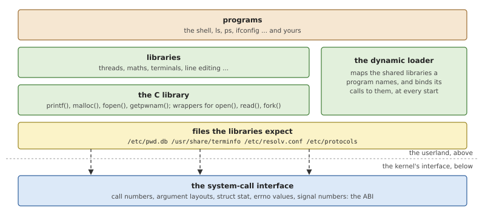
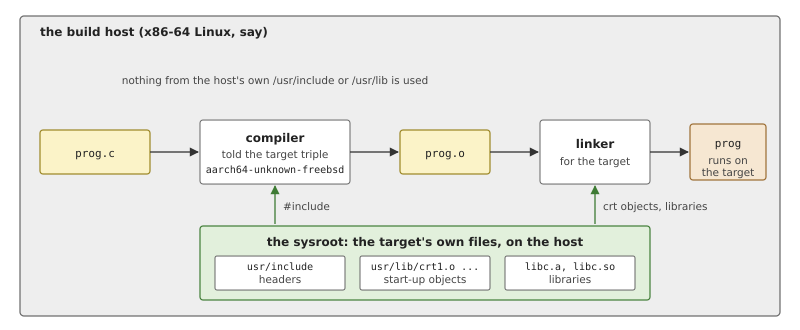
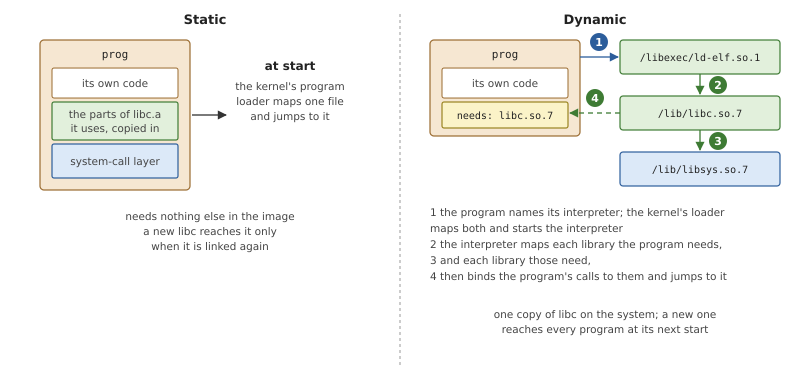
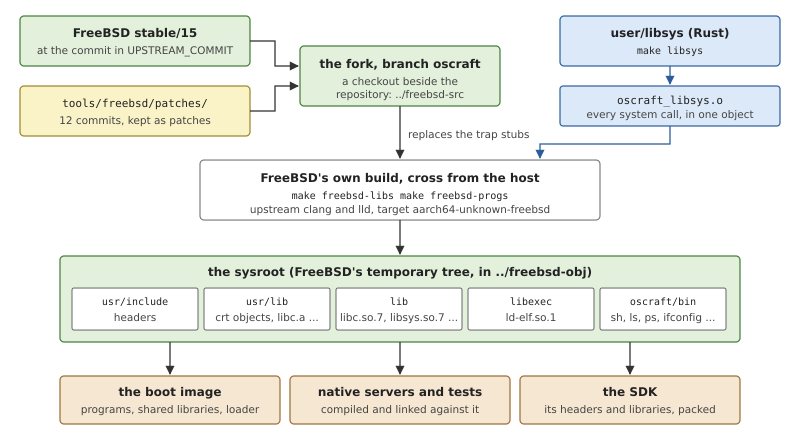
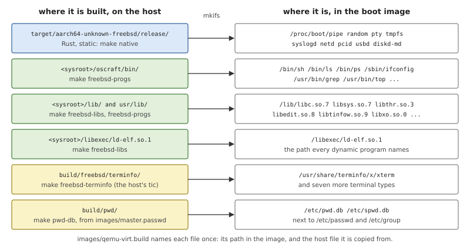
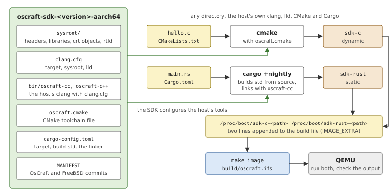

# The Userland and the SDK

A kernel and its servers are not yet a system anyone can use. There
must be a shell, the commands people type, and the libraries that
programs are linked with. OsCraft writes none of these: it takes
FreeBSD's, builds them from FreeBSD's source, and replaces only the
layer where FreeBSD's C library would trap into FreeBSD's kernel. This
chapter explains what a userland consists of and how one is built for a
machine other than the one doing the building, then how OsCraft gets
FreeBSD's, what goes into the boot image, and how you compile a program
of your own for OsCraft with the SDK.

## A userland and how one is built

### What the userland is

The *userland* is everything in an operating system that runs outside
the kernel and is not an application: the C library, the other system
libraries, the dynamic loader, the shell and the standard utilities,
and the configuration files they read.



*Figure 26.1: A userland. Programs call libraries; the libraries call
the kernel through one narrow interface, and expect certain files to
exist.*

The **C library** is the centre. It holds the functions the C language
defines (`printf()`, `malloc()`), the ones the operating system's
standard adds (`open()`, `fork()`, `getpwnam()`), and under them the
code that actually asks the kernel for something. Nearly every program
in any language ends up calling it.

The interface between the userland and the kernel has two descriptions,
and the difference between them matters for the rest of the chapter.

- The **API**, the application programming interface, is what a
  programmer sees: function names, argument types, header files. Two
  systems with the same API can compile the same source.
- The **ABI**, the application binary interface, is what a compiled
  program depends on: the numbers of the system calls, the size and
  field order of every structure passed to them, the values of error
  and signal numbers, the state of the stack when a program starts, the
  format of the program file. Two systems with the same ABI can run
  the same binary.

### What "programs for system X run here" takes

To claim that programs written for an existing system X run on a new
system, one of these two must be matched.

Matching the API is the lighter promise: provide X's headers and a
library with X's functions, and programs can be *ported* by compiling
them again. Every difference in behaviour then shows up as a bug in
somebody's port.

Matching the ABI is the stronger one. The cheapest way to do it is not
to imitate X's libraries but to *use* them: take X's own C library,
unchanged, and supply what it stands on. Everything above the lowest
layer is then X's code, with X's behaviour, and the question "is this
compatible?" shrinks to that one layer.

### Building for another machine

The machine a system is developed on is rarely the machine it runs on.
Producing programs for a different processor or operating system is
*cross-compilation*, and it needs two things.



*Figure 26.2: Cross-compiling. The compiler and linker run on the host
but take every header, start-up object and library from the sysroot.*

A **cross toolchain** is a compiler and a linker that run on the *host*
and produce code for the *target*. The target is named by a *target
triple*: the processor architecture, a vendor, and the operating
system, as in `aarch64-unknown-freebsd`. The triple tells the compiler
which instructions to emit, how arguments are passed, how large a
`long` is, and which file format and conventions the operating system
uses. Some compilers are built for one target only; others, clang among
them, contain every target and select one with an option.

A **sysroot** is a directory on the host laid out like the root of the
target's file system, holding the target's headers and libraries. The
compiler is told to look there and nowhere else, so that a program is
compiled against the target's `stdio.h` and linked with the target's C
library, never the host's.

### Static and dynamic linking

A program can be joined to its libraries at two moments.



*Figure 26.3: A statically linked program carries its libraries inside
it. A dynamically linked one names them, and an interpreter loads them
at every start.*

With **static linking** the linker copies the library functions the
program uses into the program file. The result needs nothing else at
run time, starts quickly, and keeps the library it was built with until
it is linked again.

With **dynamic linking** the program file only records the names of
the *shared libraries* it needs, and the path of an *interpreter*, the
dynamic loader. When the program starts, the loader runs first, maps
each library into the process, connects the program's calls to the
libraries' functions, and then jumps to the program. Libraries are
shared between all the programs that use them, on disk and in memory,
and replacing a library updates every program at once. The price is
that the loader and the libraries must be present, at the paths the
program names.

Two small pieces complete the picture. The *start-up objects*
(`crt1.o` and its relatives) are linked into every program; they
contain the real entry point, which prepares the C library and calls
`main()`. And the loader is itself a program that cannot rely on a
loader: it must be self-contained, down to the system calls it makes.

## The userland in OsCraft

OsCraft takes the stronger of the two promises, in the cheap way. Its
userland is FreeBSD's: FreeBSD's C library, thread library, dynamic
loader, shell and utilities, compiled from FreeBSD's source. The ABI a
program sees is FreeBSD's for AArch64, structures and numbers included
(Chapter 23). The one layer that is OsCraft's is *libsys*, which
FreeBSD's C library calls for every system call and which OsCraft
re-implements with kernel calls and messages to servers (Chapter 24).

### FreeBSD's source, as a fork

FreeBSD's source is not in OsCraft's repository. It is a separate
checkout beside it, a fork of FreeBSD's `stable/15` branch.



*Figure 26.4: Where the userland comes from. FreeBSD's own build system
compiles the fork, with libsys's object in place of FreeBSD's system
call stubs, into a sysroot that everything else is built from.*

Three things in `tools/freebsd/` define the fork exactly.

- `tools/freebsd/UPSTREAM_COMMIT` holds one commit of FreeBSD's
  `stable/15`: the base.
- `tools/freebsd/patches/` holds the fork's own commits as patch
  files, twelve of them. The fork's branch, `oscraft`, is the base plus
  these.
- `tools/freebsd/bootstrap.sh`, run by `make freebsd-bootstrap`, sets
  everything up once per machine. It clones the fork, or clones
  FreeBSD itself, checks out the base and applies the patches. It then
  builds `bmake`, FreeBSD's make, and runs the first stages of
  FreeBSD's cross-build: the build tools for the host and the headers
  for the target. FreeBSD's source tree can be built on a Linux host
  with its own driver script, `make.py`, and that is what OsCraft uses.

The patches are few because the design asks little of FreeBSD.

*Table 26.1: The patches of the fork, by number.*

| Patches | Touch | Purpose |
|---|---|---|
| 1 | the build of libsys and libc | when `OSCRAFT_LIBSYS_OBJ` is set, take that one prebuilt object in place of the generated system-call stubs |
| 3, 4 | the build of the dynamic loader | the same for the loader's private copy of the C library, with the file that reads the auxiliary vector, which libsys needs |
| 2 | `mtree`, a host tool | an include order, so that the tool compiles on a Linux host |
| 5 | `libgcc_eh` | silence one warning that a newer host clang raises |
| 6, 8, 9, 11, 12 | a kernel configuration file | the configuration from which the network stack is built as a library for `netd` |
| 7, 10 | three kernel source files | let FreeBSD kernel code run in a process: the current thread and CPU found per thread, no priority lending in epochs |

Only the first group concerns the userland, and it changes no source
code, only makefiles. The last two groups serve the servers that run
FreeBSD's kernel code (Chapter 27). The configuration files those
servers are built from today are kept in OsCraft's repository, in
`tools/freebsd/conf/`.

### What is built

Three `make` targets build the userland, in this order.

`make libsys` compiles `user/libsys` into a single object file. It is
Rust built without the standard library, for the target
`aarch64-unknown-freebsd`.

`make freebsd-libs` enters FreeBSD's build environment and runs
`tools/freebsd/build-libs.sh` on a list of FreeBSD source directories,
the Makefile's `FREEBSD_LIBS`. For each directory the script does what
FreeBSD's own build would do, `make obj`, `make all` and
`make install`, with the libsys object passed in. The list is in
dependency order:

- the start-up objects (`lib/csu`) and the compiler's support library;
- libsys and the C library, libc;
- the dynamic loader (`libexec/rtld-elf`);
- the unwinding libraries, then libthr (threads), librt (POSIX
  real-time functions) and libutil;
- libelf, libexecinfo, libkvm, libmemstat, libdevstat and libprocstat,
  which Rust's standard library links on FreeBSD.

Because of patch 1, the same object ends up in three places: in
`libsys.so.7`, which dynamic programs load; in the static libraries,
for static programs; and, through patches 3 and 4, inside the dynamic
loader, which must make system calls before any library is loaded.

`make freebsd-progs` builds the programs the same way, from the list
`FREEBSD_PROGS`: first the libraries they need beyond the base ones
(libedit and terminfo for the shell's line editing, libxo, libm, the
network configuration libraries), then `sh`, the file and text
utilities (`ls`, `cp`, `grep`, `sort`, and so on), `ps` and `top`, and
the administration tools the servers are driven with: `ifconfig`,
`route`, `ping`, `netstat`, `ipfw`, `sysctl`, `kldload`, `pciconf`,
`mount`, `dmesg`, `logger`. A few FreeBSD features that would pull in
subsystems OsCraft does not have are switched off with FreeBSD's own
build options.

All of it is installed into one directory, which FreeBSD's build calls
its temporary tree. It is laid out like a FreeBSD root file system,
with `usr/include`, `usr/lib`, `lib` and `libexec`, so it is at the
same time the sysroot against which everything else is compiled. The
programs go into a directory of their own inside it, because the
tree's `bin` is on the build environment's path and holds tools for
the host.

### The unchanged target

Nothing in this needs a special compiler. The target triple is
FreeBSD's own, `aarch64-unknown-freebsd`, so the host's stock clang and
lld produce OsCraft programs when pointed at the sysroot, and the
program files are ordinary FreeBSD executables. The kernel's program
loader recognises them by the operating-system field of the ELF header,
which says FreeBSD, and starts them as native processes with the
initial stack FreeBSD's start-up code expects (Chapter 19).

Rust needs slightly more. `aarch64-unknown-freebsd` is a target the
Rust project does not ship a compiled standard library for, so the
standard library is built from source along with the program, which
requires a nightly toolchain and its `rust-src` component. The Makefile
pins the nightly it uses. OsCraft's native servers are built this way
and linked through a two-line wrapper that calls clang with the triple
and the sysroot.

### What is static and what is dynamic

Both kinds of linking are used, each where it fits.

The native servers of Chapter 25 are static. A server started early in
boot then depends on nothing but its own file, and cannot be broken by
a missing library. `netd` and `pcid` are the exceptions: they load
modules at run time, which resolve their symbols against the server,
so they are dynamic.

FreeBSD's shell and utilities are dynamic, as on FreeBSD. Each names
`/libexec/ld-elf.so.1` as its interpreter, so the loader is in the
image at exactly that path, and the shared libraries are at `/lib` and
`/usr/lib` where the loader looks for them. When the kernel loads such
a program it maps the interpreter as well and starts there; from then
on FreeBSD's loader does what it does on FreeBSD, with libsys's `open()`
and `mmap()` under it.

### The files the libraries expect

A library brought from another system brings its expectations of the
file system with it. Three matter for a shell prompt to work.

**Terminal descriptions.** FreeBSD's `sh` edits its command line with
libedit, which asks the terminfo library how to move the cursor on the
terminal named by the `TERM` environment variable. The boot image sets
`TERM=xterm`, and `make freebsd-terminfo` compiles eight terminal
descriptions from the source file in FreeBSD's tree with the host's
`tic` (`xterm`, `xterm-256color`, `vt100`, `vt102`, `ansi`, `dumb`,
`screen` and `linux`). They are installed under `/usr/share/terminfo`,
one file per terminal in a directory named by its first letter.

**The password database.** FreeBSD's `getpwnam()` and `getpwuid()` do
not read `/etc/passwd`. They read `/etc/pwd.db`, a hashed database
generated from the text file `master.passwd`, and for privileged
callers `/etc/spwd.db`, which also holds the password hashes. OsCraft
keeps the text in `images/master.passwd`, two lines for `root` and for
the unprivileged user of `sshd`, and the target `pwd-db` runs FreeBSD's
own `pwd_mkdb` on it. The tool is one of those FreeBSD's build compiles
for the host. Without the database no user ID could be turned into a
name.

**Network files.** `/etc/protocols` is FreeBSD's, copied from its
source, and `/etc/resolv.conf` names the name server of QEMU's
user-mode network.

### Into the image

The boot image is assembled from a build file that lists every file
once, as its path in the image and the host file to copy (Chapter 3).



*Figure 26.5: The sources of the userland's files in the boot image.
`<sysroot>` is FreeBSD's temporary tree.*

Adding a FreeBSD utility to the system is therefore two edits: its
source directory in `FREEBSD_PROGS`, and a line in
`images/qemu-virt.build`, with a line for any shared library it needs
that is not there yet.

Not every FreeBSD system call exists in libsys. Those it does not
implement are generated stubs: the first time a program calls one, it
prints `libsys: not implemented:` and the call's name on standard
error, and the call fails with `ENOSYS`. A program that does not work
says what it was missing.

## The SDK

Everything above happens inside OsCraft's build. The SDK is the part
of it that somebody who only wants to write a program needs: the
sysroot, and a few files that point the host's own tools at it. It
contains no compiler.

`make sdk` copies the sysroot's headers, libraries, start-up objects
and loader into a directory, adds the files of `tools/sdk/`, writes a
`MANIFEST` with the OsCraft version and the FreeBSD base commit, and
packs the result as `build/sdk/oscraft-sdk-<version>-aarch64.tar.zst`.



*Figure 26.6: The SDK's contents, and the two builds `make sdk-check`
performs with it: a C program through CMake and a Rust program through
Cargo, both then run on OsCraft in QEMU.*

The whole of what makes the host's clang an OsCraft compiler is three
options.

*Listing 26.1: The clang configuration (`tools/sdk/clang.cfg`).*

```text
{{#include ../../../tools/sdk/clang.cfg}}
```

The triple selects FreeBSD on AArch64; the number after `freebsd` is a
FreeBSD release, which clang uses to choose that release's defaults.
The sysroot is found relative to the file itself, so the SDK can be
unpacked anywhere. The linker is lld, which links for any target.
`oscraft-cc` and `oscraft-c++` are shell scripts of one command that
run clang with this file, so that

```sh
oscraft-cc -o prog prog.c
```

builds a dynamic FreeBSD program, and adding `-static` a static one.
`oscraft.cmake` is a CMake toolchain file that names the same wrappers
and sysroot. `cargo-config.toml` is the Cargo configuration for Rust:
the target, the instruction to build the standard library from source,
`oscraft-cc` as the linker, and static linking by default, so that a
Rust program needs nothing in the image but itself.

`make sdk-check` proves that the package is complete by using it from
outside the source tree.

*Listing 26.2: Building a C and a Rust program against the SDK, out of
tree (`tools/sdk/check.sh`).*

```sh
{{#include ../../../tools/sdk/check.sh:out_of_tree}}
```

- Both builds happen in a temporary directory, with the host's `cmake`
  and `cargo`. The only things taken from the SDK are the toolchain
  file, the Cargo configuration, and the wrappers on `PATH`.
- The C program calls `uname()` and `getpid()` and prints the result.
  The Rust program starts a thread, uses a collection and formats a
  string, which exercises the standard library's use of threads,
  memory allocation and standard output.

A program still has to get onto the target. OsCraft has no package
format; a program runs when it is in a file system the target can see,
and the simplest such place is the boot image. The check script writes
a two-line build file that places the two programs under `/proc/boot`,
and passes it to `make image` as `IMAGE_EXTRA`, which appends it to
the system's own build file. It then boots the image in QEMU, runs both
programs from the shell and compares their output with the lines it
expects. The same variable serves for any program of your own; for a
dynamic one, check that the image has every shared library it needs.

## Summary

- A userland is the C library, the other libraries, the dynamic
  loader, the shell and utilities, and the files they expect. Its
  contract with the kernel is the ABI.
- OsCraft's userland is FreeBSD's, built from a fork of FreeBSD's
  `stable/15` that differs from a pinned upstream commit by twelve
  small patches. Only libsys, the system-call layer, is OsCraft's.
- FreeBSD's own build system cross-compiles it on the host, with
  libsys's object in place of FreeBSD's system-call stubs in libsys,
  the static libraries and the dynamic loader. The tree it installs
  into is the sysroot.
- The target triple is FreeBSD's, unchanged, so stock clang, lld and
  Rust produce OsCraft programs, and the kernel recognises them as
  native by their ELF header.
- The servers are linked statically; FreeBSD's shell and utilities
  dynamically, with FreeBSD's loader at `/libexec/ld-elf.so.1` and the
  shared libraries at `/lib` and `/usr/lib` in the image.
- The image also carries what FreeBSD's libraries read: terminfo
  entries for the shell's line editing and the password database made
  by `pwd_mkdb` from `images/master.passwd`.
- The SDK is the sysroot plus configuration for the host's clang,
  CMake and Cargo. `make sdk-check` builds a C and a Rust program with
  it out of tree and runs them on OsCraft.
