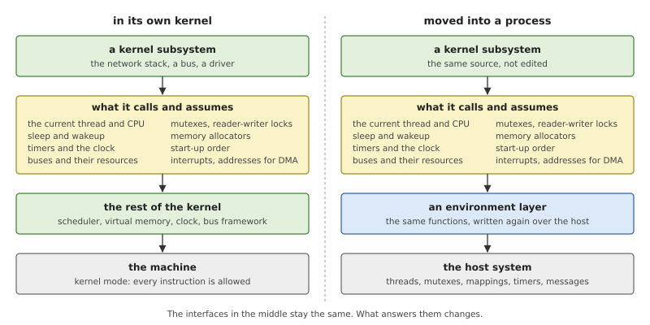
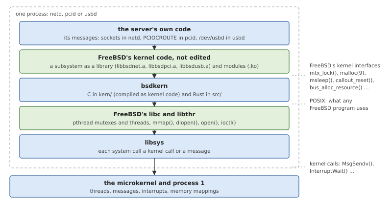
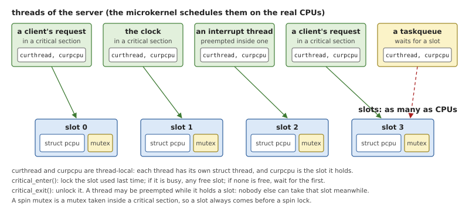
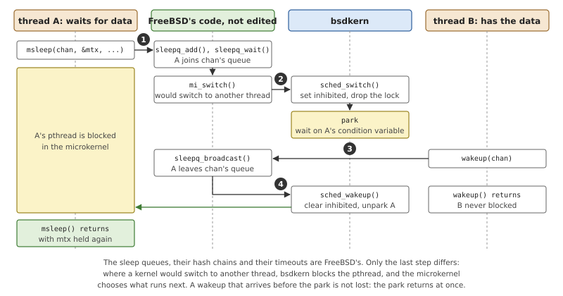
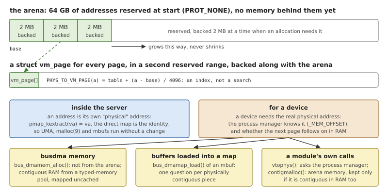
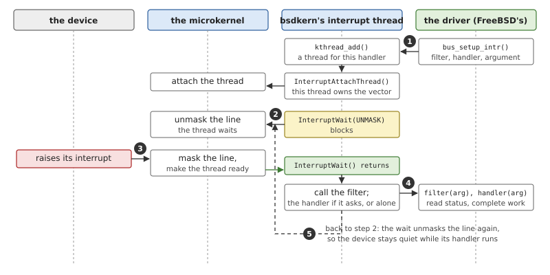
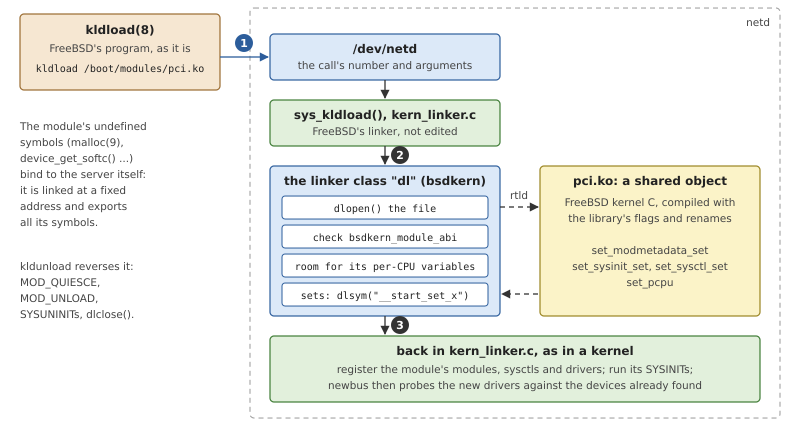
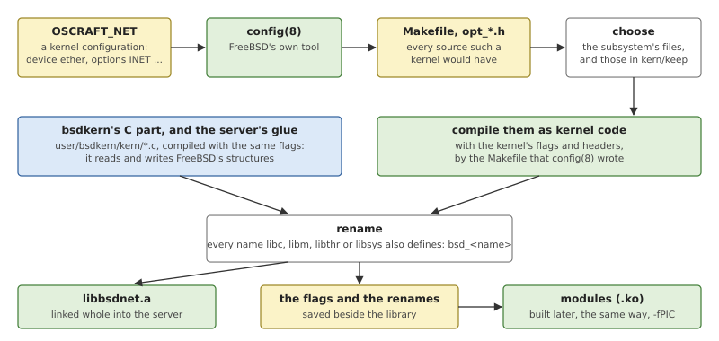

# bsdkern: a Kernel Inside a Process

OsCraft's network stack, its PCI bus and its USB stack are FreeBSD's.
They are not rewritten and not edited: the same source files that are
compiled into a FreeBSD kernel are compiled into three OsCraft servers,
`netd`, `pcid` and `usbd`. Kernel code does not run in a process by
itself, though. It expects a kernel around it, and *bsdkern* is the layer
that plays that part. This chapter explains what kernel code expects,
the known ways of supplying it outside a kernel, and how bsdkern does
it. The next three chapters describe the servers built on it.

## Kernel code outside its kernel

A monolithic kernel is one large program. Its network stack, its file
systems and its drivers call each other and a common core directly, and
decades of work have gone into them. A system with a different
structure, such as a microkernel, faces a choice for each of those
subsystems: write it again, or find a way to run the existing one.
Writing a TCP/IP stack or a USB stack again is years of work, and the
result behaves a little differently from the one every program was
tested against. Running the existing code keeps its behaviour and its
maintenance, at the price of giving it the world it was written for.

### What kernel code assumes

A subsystem of a kernel is not a library. It was never given a list of
what it may depend on, so it depends on whatever the kernel around it
offers. Reading through any driver or protocol turns up the same
families of assumptions.

- **A current thread and a current CPU.** Kernel code asks "who am I?"
  constantly: for the credentials of the caller, for a place to record
  that it is sleeping, for per-CPU counters and caches. In a kernel both
  answers are a register away, and the per-CPU data is safe to touch
  because the code can forbid preemption for a moment (a *critical
  section*).
- **Locks.** Mutexes, reader-writer locks and spin locks, with the
  kernel's own rules: which may be held while sleeping, which may be
  taken in an interrupt handler, who owns a lock right now.
- **Sleeping and waking.** A thread waits for an event by sleeping on an
  address, and whoever causes the event wakes every sleeper on that
  address. Underneath is the scheduler: to sleep is to switch to another
  thread.
- **Memory allocators.** A general allocator, and a faster one for
  objects of one size with per-CPU caches. Both stand on the kernel's
  own management of pages, and code freely converts between a virtual
  address, a physical address and the kernel's record of a page.
- **Time.** A clock to read, and timers that call a function later.
- **An order of initialisation.** Each subsystem registers functions to
  run at boot, at a named stage, and assumes the earlier stages are
  done.
- **A tree of devices.** A driver does not know where its device is. A
  framework of buses tells it, and gives it the device's *resources*:
  ranges of registers to map and interrupts to attach.
- **Interrupts and device addresses.** A driver's handler runs when the
  device interrupts, and a device that reads and writes memory on its
  own (*DMA*) must be told addresses that are valid on its bus.

None of this is in a C library. Moving a subsystem out of its kernel
means that something else has to answer every one of these calls.



*Figure 27.1: A subsystem and what it stands on. Moving it keeps the
subsystem and the interfaces it calls; the layer that answers them is
replaced by one written over the services of a host system.*

### Ways to supply it

There are a few well-known answers, and they differ in where they draw
the line between what is kept and what is replaced.

*Table 27.1: Ways of using a kernel's subsystem outside that kernel.*

| Approach | What is kept | What is written |
|---|---|---|
| A driver framework of the new system | nothing: drivers are written for the framework | every driver and stack, again |
| A driver environment | the drivers' source | a layer that imitates the old kernel's driver interfaces |
| A rump kernel | whole subsystems, unedited | a small set of calls to the host: threads, memory, locks, time |
| A library operating system | most of a kernel, linked into the application | the lowest layer, over a host or a hypervisor |

A **user-mode driver framework** defines a new, small interface for
drivers in processes. It is the cleanest design and gives the least
reuse: each driver is new code.

A **driver environment** goes the other way: it offers the interfaces of
an existing kernel (its locks, its allocator, its bus framework) inside
a process, so that the drivers of that kernel compile unchanged. The
environment is the only new code, and it is written once for all
drivers.

A **rump kernel** applies the same idea to whole subsystems. The kernel
is organised so that its file systems, its network stack and its drivers
can each be linked without the rest, on top of a thin layer of calls to
a host. The observation behind it is that most of a kernel is not
privileged at all: it is ordinary code that manipulates data structures
and only now and then needs a thread, a lock, some memory or the time.

A **library operating system** links kernel functionality into the
application itself, one copy per program, with the same technique
underneath.

Whatever the approach, three points decide how well it works.

**Concurrency.** Kernel code protects per-CPU data by disabling
preemption and protects other data with locks that assume a thread
cannot vanish while it holds one. A process can do neither: its threads
are preempted whenever the host decides. The environment has to give
the same guarantees by other means.

**Addresses.** Inside a kernel, virtual and physical addresses are
related by tables the code can read. In a process, memory is just
memory, until a device needs to be told where it is.

**Privilege.** Mapping registers and receiving interrupts are privileged
operations. The host must offer them to a process, and the environment
turns the kernel's own calls for them into the host's.

## bsdkern in OsCraft

bsdkern is a driver environment in the sense above, made for FreeBSD's
kernel code and sized for whole subsystems. A server that uses it is one
process with five layers.



*Figure 27.2: A bsdkern server. The FreeBSD code in the second layer is
compiled from the same files as a FreeBSD kernel; everything it calls is
answered by bsdkern, which is an ordinary user of the C library.*

bsdkern has two halves, both in `user/bsdkern`. The part in `src` is
Rust: slots, locks, parking, memory, privileges and the device nodes.
The part in `kern` is C, compiled with the kernel's own flags and
headers, because it must read and write FreeBSD's structures (`struct
thread`, `struct mtx`, `struct resource`) exactly as the FreeBSD code
beside it does. Neither half talks to the microkernel in a special way:
underneath is FreeBSD's C library and libsys (Chapter 24), as under any
program.

A rule runs through the whole design: **keep FreeBSD's code, replace as
little as possible, and replace it at an interface FreeBSD already
has.** The sleep queues, the callout wheel, the zone allocator, the bus
framework, the module linker and busdma are FreeBSD's own files. bsdkern
supplies what lies under them.

*Table 27.2: What FreeBSD's code expects, and what answers it.*

| FreeBSD's kernel | In a bsdkern server |
|---|---|
| `curthread`, per-CPU data, critical sections | thread-local pointers; *slots*, one per CPU |
| `mtx`, `rw`, `sx`, `rm` locks | FreeBSD's structures, with a pthread mutex or bsdkern's reader-writer lock behind them |
| sleep queues, `wakeup()` | FreeBSD's, over a scheduler that parks threads |
| `malloc(9)`, UMA zones | FreeBSD's, over an arena of pages |
| callouts, timecounters | FreeBSD's, driven by a clock thread |
| `SYSINIT`s | sorted and run at start |
| newbus, resources | FreeBSD's, under a nexus that maps registers and starts interrupt threads |
| busdma | FreeBSD's front, with memory and addresses from the process manager |
| the module linker | FreeBSD's, with a class that uses `dlopen()` |
| devfs | each `struct cdev` a path under `/dev` |
| `priv(9)` | the client's abilities |

### CPUs are slots

FreeBSD keeps much of its hot state per CPU: allocator caches, counters,
the callout wheel each CPU runs. Code reaches it through `curthread` and
the per-CPU structure `struct pcpu`, both found through a reserved
register, and may use it only inside a critical section, where the
thread cannot be moved to another CPU.

In a server, `curthread` and the pointer to the current `struct pcpu`
are thread-local variables: FreeBSD's header reads them that way when
the code is built for bsdkern. Every thread has a real `struct thread`
of its own, and all of them belong to one process, `proc0`.

A process cannot stop preemption, and on a real-time system it should
not. So a "CPU" in bsdkern is not a processor but a *slot*: a `struct
pcpu` with a mutex. `critical_enter()` locks a slot, and
`critical_exit()` unlocks it (`user/bsdkern/src/slot.rs`).



*Figure 27.3: Slots. A thread in a critical section holds one slot's
mutex and is alone with that slot's per-CPU data, even if the
microkernel preempts it. With every slot taken, a fifth thread waits.*

This keeps the property the FreeBSD code relies on: while a thread is
in a critical section, nobody else touches the per-CPU data it sees. It
gives up the other one, that a critical section is short: a thread can
be preempted while it holds a slot. The slots' mutexes inherit priority,
so a high-priority thread waiting for a slot lends its priority to the
holder.

A thread prefers the slot it used last, so that per-CPU caches stay
warm. A thread that FreeBSD's code has pinned or bound to a CPU
(`sched_pin()`, `sched_bind()`) always takes the same slot, as the code
expects. There are as many slots as the machine has CPUs, four on QEMU's
`virt`, so at most four threads of a server are in critical sections at
once.

### Locks

FreeBSD's locks are small structures: a `lock_object` with a name and
flags, followed by one word that holds the owner. Much code looks at
that word directly (`mtx_owned()`, the lock assertions). bsdkern keeps
the structures and the word's meaning, and builds FreeBSD with the
options that turn every lock operation into a function call instead of
an inlined compare-and-swap. Those functions are bsdkern's
(`user/bsdkern/src/lock.rs`).

- A **mutex** (`mtx`) has a pthread mutex behind it, with priority
  inheritance. The pointer to it is stored in a field of the
  `lock_object` that only FreeBSD's lock-order checker uses, and that
  checker is not built. After locking, the owner word is set to
  `curthread`, as FreeBSD would set it.
- A **spin mutex** is the same mutex, taken inside a critical section.
  In a kernel a spin lock disables interrupts; here the nearest
  equivalent is to hold a slot. The order is fixed: slot first, then the
  lock.
- **Reader-writer locks** (`rw` and `sx`) need two operations pthreads
  does not have: upgrading a read lock to a write lock, and downgrading
  without a gap. bsdkern has a small reader-writer lock of its own for
  them. Its waiters are not ordered and do not lend priority.
- **Read-mostly locks** (`rm`) are `sx` locks
  (`user/bsdkern/kern/rmlock.c`): FreeBSD's implementation tracks
  readers per CPU in a way that needs real critical sections.

### Threads, sleeping and the scheduler

`kthread_add()` and `kproc_create()` make a `struct thread` and start a
pthread that runs the function (`user/bsdkern/kern/thread.c`). A thread
that FreeBSD's code did not start, such as a server thread that has just
received a client's message, gets its `struct thread` the first time it
calls in.

FreeBSD's kernel has a narrow interface to its scheduler: a set of
`sched_*()` functions that the rest of the kernel calls. bsdkern
implements that interface (`user/bsdkern/kern/sched.c`) in place of
FreeBSD's scheduler, and almost every function in it is empty, because
the microkernel does the scheduling. Two functions matter, and they are
what makes FreeBSD's sleep queues work unchanged.



*Figure 27.4: `msleep()` and `wakeup()` in a server. FreeBSD's code
queues the thread and decides whom to wake; bsdkern's scheduler turns
"switch away" into blocking the pthread and "make runnable" into
releasing it.*

When a thread sleeps, FreeBSD's code puts it on a sleep queue, marks it
as not runnable and calls the scheduler to switch to another thread.
bsdkern's `sched_switch()` instead blocks the calling pthread on a
condition variable of its own. When another thread calls `wakeup()`,
FreeBSD's code finds the sleeper and calls `sched_wakeup()`, which
releases it. Timed sleeps, condition variables, `tsleep()` and
`pause()` all end in these two calls, so they all work.

A thread that FreeBSD creates stopped, to be started later (the threads
that run expired callouts are made this way), has no pthread until the
scheduler is first asked to run it.

Software interrupts, which FreeBSD uses to defer work, are a thread
each, woken when work is scheduled.

### Memory

FreeBSD's allocators, `malloc(9)` and the zone allocator UMA, are used
as they are. Under them FreeBSD expects pages from the kernel's virtual
memory system, and three conversions that are cheap in a kernel: from a
kernel address to a physical address, from a physical address back to a
kernel address through the *direct map*, and from a physical address to
the kernel's record of that page, a `struct vm_page`.

bsdkern supplies pages from an *arena* (`user/bsdkern/src/mem.rs`,
`user/bsdkern/kern/mem.c`), and makes all three conversions trivial with
one decision: **inside the server, an address is its own "physical"
address.**



*Figure 27.5: A server's kernel memory. The arena is a large reserved
range, backed as it grows, with a table of page records beside it.
Inside the server no address is ever translated; only a device needs
real physical addresses, and there are three ways to get them.*

At start, bsdkern reserves 64 GB of address space with no memory behind
it, and a second range for the page records. When an allocation finds
no free pages, 2 MB more of both are backed with memory. A page's record
is found by index, the "physical address" of a page is its address, and
the direct map is the identity. UMA runs without a change.

A driver is the one place where this is not enough. A device needs the
address of a buffer in RAM, not in the server. The process manager knows
it: for any address of a process it can say the physical address and how
many bytes from there are contiguous in RAM (the `_MEM_OFFSET` message,
Chapter 20). The lower half of Figure 27.5 shows who asks.

- **busdma**, FreeBSD's interface for DMA memory, asks on the driver's
  behalf (below). This is the normal path.
- A driver that calls `vtophys()` or `contigmalloc()` directly gets
  bsdkern's versions when it is built as a module: two headers in
  `user/bsdkern/mods/include` come first on a module's include path.
  `vtophys()` asks the process manager. `contigmalloc()` allocates from
  the arena and keeps the memory only if it is contiguous in RAM as
  well; otherwise it sets it aside and tries again, a limited number of
  times (`bsdkern_contigmalloc()` in `user/bsdkern/kern/mem.c`).

Copying to and from "user space" (`copyin()`, `copyout()`) is a plain
copy: a client's data arrives in a message, so by the time FreeBSD's
code sees it, it is already in the server's memory.

### Time, and the order of start-up

FreeBSD's `SYSINIT` macro places a record in a linker set. At start,
bsdkern collects the records of everything linked into the server,
sorts them by subsystem and order as a booting kernel does, and calls
them (`user/bsdkern/kern/start.c`). The allocator, the bus framework,
the network protocols and every driver initialise themselves this way,
unaware that no machine was booted. Before that, the server may fill
FreeBSD's *kernel environment*, the strings a boot loader would pass,
which is how tunables and device hints reach the code (`-e
name=value` on a server's command line).

Time is FreeBSD's own timekeeping over a *timecounter* that reads the
processor's virtual counter (`user/bsdkern/kern/clock.c`). A clock
thread does the work of the timer interrupt: once per tick it advances
`ticks`, updates the timekeeping, and visits each slot in turn to run
the callouts that have expired on that slot's wheel.

### The device tree: newbus and the nexus

FreeBSD organises devices in a tree called *newbus*. Each device hangs
from a bus, and asks its bus for resources; a bus that does not own a
resource passes the request to its own parent. At the root is the
*nexus*, which owns everything: all memory addresses and all interrupt
numbers.

bsdkern's nexus (`user/bsdkern/kern/nexus.c`) keeps FreeBSD's resource
manager and generic bus code and replaces only the two operations that
touch hardware.

**Mapping registers.** When a driver activates a memory resource, arm64's
own bus-space code asks for a mapping of the physical range. bsdkern
answers with a mapping of device memory from the process manager,
uncached. The driver's `bus_read_4()` and `bus_write_4()` are then plain
loads and stores in the server's address space.

**Interrupts.** When a driver sets up an interrupt handler, the nexus
starts a thread for it.



*Figure 27.6: A driver's interrupt in a server. The microkernel masks
the line when the interrupt fires and wakes the thread; the next wait
unmasks it.*

The thread attaches itself to the interrupt vector and then loops,
waiting for the interrupt and calling the driver (Chapter 15 explains
the kernel's side). FreeBSD drivers register a *filter*, a *handler*,
or both: the filter is meant to run at once and decide whether the
handler is needed. Here both run in the thread, in that order.

*Listing 27.1: The thread behind a driver's interrupt handler,
`nexus_ithread()` (`user/bsdkern/kern/nexus.c`).*

```c
{{#include ../../../user/bsdkern/kern/nexus.c:nexus_ithread}}
```

Because the wait itself unmasks the line, the device cannot interrupt
again while its handler runs. The thread has a priority like any other,
so a driver's interrupt work is scheduled against everything else in
the system.

Where do the nexus's children come from? In two ways. A server can name
a device itself, with a driver name, a register range and an interrupt
(`bsdkern_nexus_add()`); `usbd` and the PCI client bus of Chapter 29 use
this. Or the server is built with FreeBSD's device-tree support, and
then bsdkern hands FreeBSD the machine's own device tree, which the
startup left in memory and recorded in the system page
(`user/bsdkern/kern/fdt.c`). FreeBSD's code walks the tree and attaches
drivers to its nodes as it does on any arm64 board. `pcid` works this
way.

### Memory for DMA

FreeBSD drivers do not compute device addresses. They describe the
device's limits in a *tag* (the highest address it can reach, alignment,
how many pieces a buffer may be in), ask busdma for memory or hand it a
buffer to *load*, and receive a list of segments with bus addresses.
bsdkern keeps FreeBSD's front half of busdma and supplies the back
(`user/bsdkern/kern/busdma.c`).

- **Memory that busdma allocates** does not come from the arena. It is
  physically contiguous RAM mapped uncached, taken from a *typed-memory
  pool*: a named range of RAM that the startup describes in the system
  page, such as `below4G`. The tag decides which pool.
- **A buffer that is loaded** (a network packet in an mbuf) stays where
  it is. bsdkern asks the process manager for its physical address,
  piece by piece, and builds the segment list.
- **A sync**, which in a kernel flushes or discards cache lines around a
  transfer, is a memory barrier.

*Listing 27.2: Choosing a pool for a tag, `pool_for()`
(`user/bsdkern/src/dma.rs`).*

```rust
{{#include ../../../user/bsdkern/src/dma.rs:dma_pool_for}}
```

The rule in the listing is conservative: a pool is used only if all of
it lies below the address the device can reach. A server can also be
told which pool to use, through the kernel-environment variable
`hw.bsdkern.dma_pool`. If no pool fits, bsdkern asks for anonymous
contiguous memory and checks afterwards that the device can reach it.

### Modules

FreeBSD loads drivers at run time as *kernel modules*, with
`kldload(8)`. Its linker (`kern_linker.c`) is written in terms of
*classes* that know a file format. bsdkern runs that linker unchanged
and adds one class, whose files are shared objects loaded with
`dlopen()` (`user/bsdkern/kern/link_dl.c`).



*Figure 27.7: `kldload` of a driver into netd. FreeBSD's program and
FreeBSD's linker are at both ends; bsdkern's class does the loading
with the C library's dynamic loader.*

A module is FreeBSD kernel C compiled exactly as the server's library
was, plus one small file of bsdkern's (`user/bsdkern/mods/module.c`).
That file carries a version number, which the class checks before
anything else, and references that make the static linker emit the
start and end symbols of the module's linker sets. FreeBSD's linker
finds a module's `SYSINIT`s, its drivers and its sysctls in those sets;
the class looks the symbols up with `dlsym()`.

A server that takes modules is linked dynamically, at a fixed address,
with all its symbols exported, so that a module's calls into the kernel
(`malloc()`, `device_get_softc()`) bind to the server. One detail needs
help: a module's per-CPU variables. FreeBSD's loader relocates them into
each CPU's block, which `dlopen()` cannot do. Each slot's block
therefore has spare room; the class copies the module's initial values
there and tells the module the distance, and a third header in
`user/bsdkern/mods/include` adds that distance when the module's code
takes such a variable's address.

Unloading runs FreeBSD's whole sequence (the module is asked to quiesce
and unload, its `SYSUNINIT`s run, its sysctls go) and ends in
`dlclose()`.

### Device nodes and privileges

A FreeBSD driver offers itself to programs with `make_dev()`, which
creates a `struct cdev` with a name and a table of functions (open,
close, ioctl). FreeBSD's devfs shows it under `/dev`. bsdkern has no
devfs: it keeps the cdevs in a list (`user/bsdkern/kern/cdev.c`) and
serves each one as a path `/dev/<name>` with the resource-manager
framework of Chapter 25 (`user/bsdkern/src/devfs.rs`). An `open()`
calls the driver's open function. An `ioctl()` arrives as a message
whose command is FreeBSD's request number and whose data is the
request's structure; the driver's function runs on it, and the
structure, changed or not, is the reply. `/dev/pci` in `pcid` is
FreeBSD's own device node, reached this way.

FreeBSD's code checks privileges by name: before a restricted
operation it calls `priv_check()` with a constant that says what it is
about to do. bsdkern keeps every check and changes who answers
(`user/bsdkern/kern/priv.c`, `user/bsdkern/src/privilege.rs`). A server
registers a table that maps FreeBSD's privilege names to OsCraft
*abilities* (Chapter 17), and tells bsdkern which client the current
thread is working for. The answer to a check is then whether that
client holds the ability. FreeBSD's own threads, which work for no
client, may do anything.

### When something goes wrong

Whatever the linked FreeBSD code refers to and bsdkern does not
implement is in a generated file, `user/bsdkern/kern/stubs.c`: a
variable there is zeroed room, and a function stops the server with its
own name. An unexercised path therefore fails loudly and says where.

`panic()` prints its message and then the callers
(`user/bsdkern/kern/misc.c`). FreeBSD's kernel code is compiled with
frame pointers, so the callers are a chain on the stack, and the
dynamic loader can name each return address, in the server or in a
module. Then the server aborts. A panic in the network stack ends
`netd`, not the system.

### Building a subsystem as a library

A FreeBSD kernel is described by a configuration file that lists
devices and options. FreeBSD's `config(8)` turns it into a Makefile
with every source file such a kernel needs, and the `opt_*.h` headers
that the sources include. OsCraft keeps one configuration per server
(`tools/freebsd/conf/OSCRAFT_NET`, `tools/freebsd/conf/OSCRAFT_PCI`,
`tools/freebsd/conf/OSCRAFT_USB`) and lets FreeBSD's tools do their
work, then takes only part of the result
(`tools/freebsd/build-bsdlib.sh`).



*Figure 27.8: Building `libbsdnet.a`. The flags and the list of renamed
symbols are saved, and modules are built from them later.*

Two steps of the figure deserve a word. The files compiled are the
subsystem's own, chosen by a pattern, and a fixed list of generic kernel
files that bsdkern builds on: the sleep queues, the callout code, UMA,
the bus framework, the linker (`user/bsdkern/kern/keep`). And because
the server links both kernel code and a C library, every symbol that
both define (`malloc`, `printf`, `qsort` and many more) is renamed in
the kernel objects with a `bsd_` prefix. The library is then linked
whole into the server, since `SYSINIT`s and drivers are found through
linker sets and nothing refers to them by name. Modules are built with
the saved flags and renames (`tools/freebsd/build-bsdmod.sh`).

### Limits

*Table 27.3: Where a bsdkern server differs from a kernel today.*

| Limit | Effect |
|---|---|
| a critical section does not stop preemption | a preempted holder keeps its slot; at most as many threads as CPUs are in critical sections |
| a spin mutex is a mutex | it can block; code that assumes otherwise needs review |
| `rw` and `sx` have no priority inheritance and no writer preference | a low-priority holder can delay a high-priority thread; readers can starve a writer |
| `sx` sleeps cannot be interrupted by a signal | the interruptible variants behave like the plain ones |
| a module's `vtophys()` is a message; its `contigmalloc()` works by trying | slower than in a kernel, and a large contiguous request can fail when RAM is fragmented |
| a loaded buffer's cache is not maintained | a sync is only a barrier; correct for uncached busdma memory |
| modules load by absolute path; 64 KB of per-CPU room for all modules | no module search path |
| missing functions stop the server by name | an untested path of FreeBSD's code may end the server |

## Summary

- Kernel code assumes a current thread and CPU, the kernel's locks,
  sleep and wakeup, page-based allocators, timers, an order of start-up,
  a tree of devices, interrupts and device addresses. Running it
  elsewhere means answering all of these.
- bsdkern answers them for FreeBSD's code inside an ordinary process,
  over FreeBSD's C library. FreeBSD's own sleep queues, allocators,
  callouts, bus framework, busdma and linker are kept; bsdkern replaces
  what lies under them.
- A CPU is a slot, a `struct pcpu` with a mutex. A critical section
  holds a slot, which gives exclusive use of per-CPU data without
  stopping preemption.
- Sleeping parks a pthread and waking releases it, through FreeBSD's
  scheduler interface. The microkernel schedules every thread.
- Inside the server an address is its own physical address. Real
  physical addresses, which only devices need, come from the process
  manager, mostly through busdma.
- The nexus maps device registers into the server and runs each
  interrupt handler in a thread that waits for the interrupt.
- A subsystem is built by FreeBSD's own configuration tools into a
  library, with clashing names renamed; drivers can be added at run
  time as modules through FreeBSD's linker and `dlopen()`.
