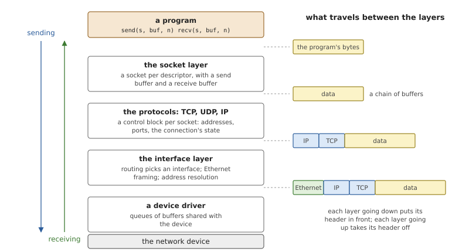
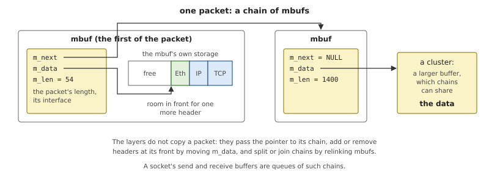
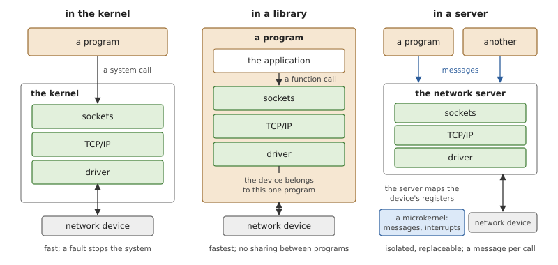
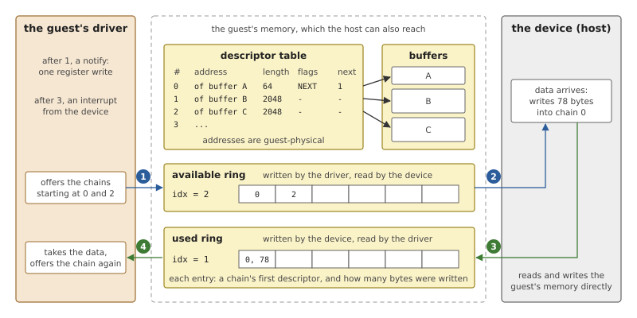
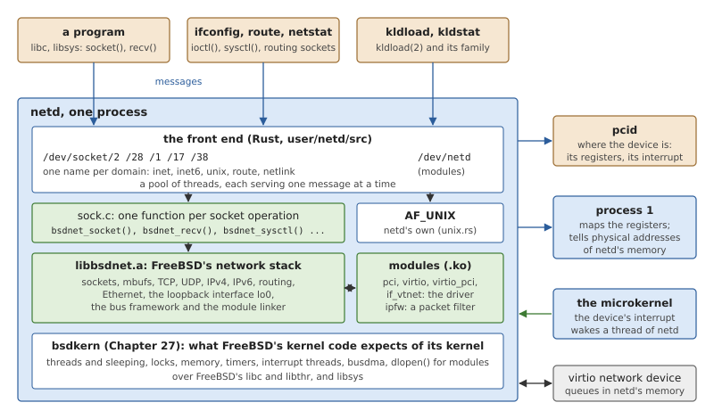
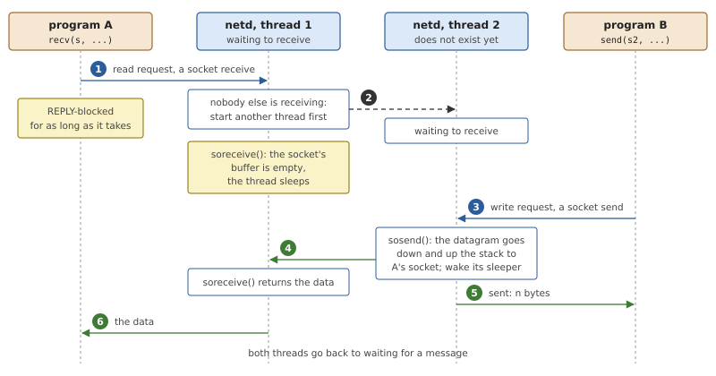
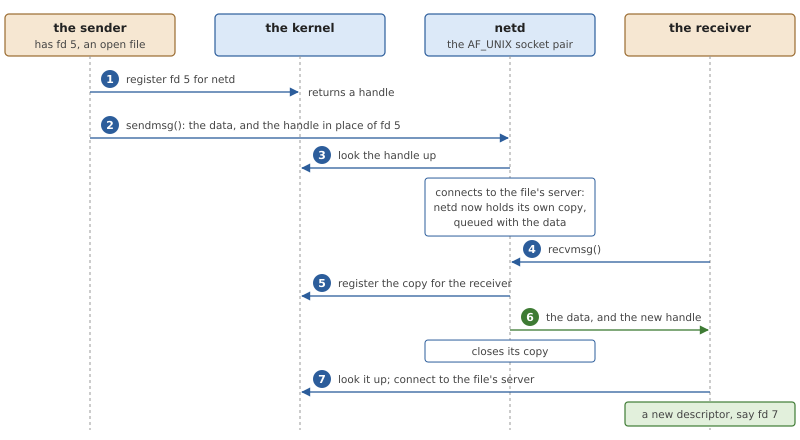
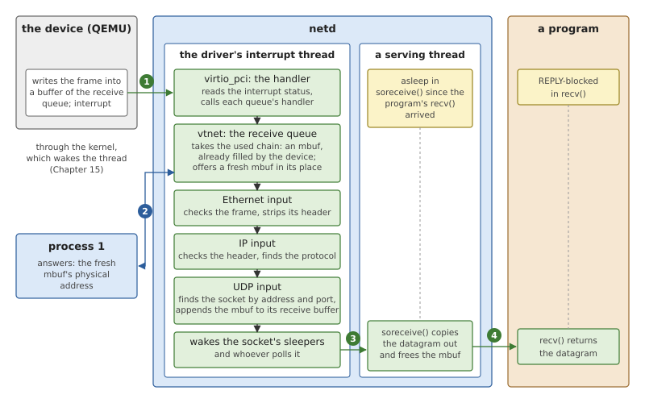

# The Network Stack

A program that calls `socket()`, `connect()` and `recv()` relies on a
large body of code: the protocols, the bookkeeping for every open
connection, and a driver for a network device. In OsCraft none of it is
in the kernel. It runs in one server, `netd`, and it is FreeBSD's own
network stack and FreeBSD's own driver, compiled from FreeBSD's source.
This chapter first describes what a network stack is made of and where
one can live, then how `netd` puts FreeBSD's stack behind messages, and
finally follows a packet from the virtio network device of QEMU's `virt`
to a program blocked in `recv()`.

## What a network stack does

### Layers

A network stack turns "send these bytes to that program on that machine"
into frames on a wire, and back. It is built in layers, each of which
talks to the one above and the one below through a narrow interface.



*Figure 28.1: The layers of a stack, and what a TCP segment looks like
as it passes between them.*

**Sockets** are the programming interface. A socket is an endpoint of
communication that a program holds as a file descriptor. The program
says what kind it wants (a *domain* such as IPv4, a *type* such as
stream or datagram), gives it an address with `bind()` or a peer with
`connect()`, and then reads and writes. The socket layer is the same
for every protocol. Each socket has a *send buffer* and a *receive
buffer*, and most of what makes socket calls block is there: `recv()`
waits while the receive buffer is empty, `send()` waits while the send
buffer is full.

**The protocols** do the real work. For each socket a protocol keeps a
*protocol control block*: the local and remote addresses and ports, and
for TCP the whole state of the connection (sequence numbers, windows,
timers). When a packet arrives, the protocol looks up the control block
that matches the packet's addresses and ports, and that leads to the
socket. Going down, a protocol puts its header in front of the data;
going up, it checks its header and removes it.

**The interface layer** connects the protocols to the devices. A
*network interface* is the stack's view of one device, with a name, a
set of addresses and flags such as "up". The routing table decides
which interface a packet leaves through and which neighbour gets it;
for Ethernet, the layer then finds the neighbour's hardware address and
adds the Ethernet header.

**A driver** moves frames between an interface and its device. It gives
the device buffers to fill with received frames, hands it frames to
send, and is told by an interrupt when either has been done.

### Packets in memory

Headers are added and removed at every layer, packets are queued in
socket buffers, split into fragments and joined again. If each step
copied the packet, the stack would do little else. BSD's answer, which
FreeBSD still uses, is the *mbuf*.



*Figure 28.2: A packet as a chain of two mbufs. The headers are in the
first mbuf's own storage, with room in front of them; the data is in a
cluster.*

An mbuf is a small fixed-size buffer with a short header: a pointer to
the next mbuf of the same packet, a pointer to where its data starts,
and the data's length. A packet is a chain of mbufs. Larger amounts of
data sit in a separate buffer, a *cluster*, which an mbuf points to. A
layer that needs to add a header moves the data pointer back, if there
is room, or links a new mbuf in front. A layer that removes one moves
the pointer forward. What passes from layer to layer, and what waits in
a socket's buffers, is a pointer to a chain.

### Where the stack lives

The layers say nothing about which program contains them. There are
three places.



*Figure 28.3: The same three layers in a kernel, in a library and in a
server.*

**In the kernel.** This is the classic arrangement, and FreeBSD's. A
socket call is a system call, the driver's interrupt handler runs in
the kernel, and everything shares one address space. It is fast, and a
fault anywhere in a very large body of code is a fault in the kernel.

**In a library.** The stack is linked into the application, which owns
the device outright. Nothing stands between the program and its
packets; in exchange, the device and its addresses belong to one
program.

**In a server.** The stack is an ordinary process. Programs reach it by
message, as they reach a file system. A fault in the stack ends one
process, which can be started again; the stack can be replaced or
extended without touching the kernel; and it runs at priorities the
scheduler controls like any other program's. The price is a message for
every socket call. This is the microkernel arrangement, and OsCraft's.

### Paravirtual devices: virtio

A driver needs a device. In a virtual machine the device is software in
the host, and it could imitate a real network card register by register.
That is slow: every register access stops the guest and runs the
host's emulation. A *paravirtual* device is designed for the situation
instead, with an interface that needs as few such stops as possible. *Virtio*
is the standard family of these devices: network, block, console and
others, all built on one mechanism, the *virtqueue*.



*Figure 28.4: A virtqueue, with example values. Three arrays in the
guest's memory are shared with the device: the descriptors of the
buffers, the chains the driver offers, and the chains the device has
finished with.*

A virtqueue is three arrays in the guest's memory.

- The **descriptor table** describes buffers: an address, a length, and
  a link to another descriptor, so that several buffers can form one
  *chain*.
- The **available ring** is written by the driver. It lists the chains
  the driver offers to the device.
- The **used ring** is written by the device. It lists the chains the
  device has finished with, and how many bytes it wrote into each.

A network device has at least two queues. On the *receive queue* the
driver offers empty buffers; the device fills one with each frame that
arrives and returns it as used. On the *transmit queue* the driver
offers buffers that hold frames; the device sends them and returns them.
After adding to the available ring the driver *notifies* the device by
writing one register, and after adding to the used ring the device
raises an interrupt. Each side can ask the other to skip these while it is busy.

Two properties of this design matter for the rest of the chapter. The
device reads and writes the guest's memory directly, so the addresses in
the descriptors, and the addresses of the rings themselves, are
*physical* addresses of the guest. And the device must be found and
configured before any of this starts: a virtio device usually appears on
the machine's PCI bus, with its registers behind a PCI base address
register.

## The network stack in OsCraft

OsCraft's stack is FreeBSD's, in a server. `netd` is a native program,
linked with FreeBSD's C library like any other, that contains FreeBSD's
network code built as a library and serves it by message
(`user/netd/src/main.rs`). 


*Figure 28.5: `netd`. FreeBSD's code is green. The front end and the
layer underneath are OsCraft's; the driver is loaded at run time.*

Reading Figure 28.5 from the bottom:

**bsdkern** is the kernel environment of Chapter 27: FreeBSD's kernel
threads, locks, sleeping, memory allocators, timers and device framework
on top of an ordinary process. Everything FreeBSD's network code asks of
"its kernel", bsdkern answers.

**`libbsdnet.a`** is the stack. It is built from FreeBSD's source tree
with FreeBSD's own tools: a kernel configuration file,
`tools/freebsd/conf/OSCRAFT_NET`, names what a network-only kernel would
contain (IPv4, IPv6, the loopback and Ethernet), and the `bsdnet` rule
of the `Makefile` compiles the files under FreeBSD's `net`, `netinet`,
`netinet6` and `netlink` directories and the socket and mbuf code, as
kernel code, into an archive. Chapter 27 describes this build. No
FreeBSD source is copied into OsCraft's tree, and none of the stack's
files is modified for `netd`.

**`sock.c`** (`user/netd/kern/sock.c`) is a thin layer of C with one
function per socket operation: `bsdnet_socket()` calls FreeBSD's
`socreate()`, `bsdnet_recv()` calls `soreceive()`, and so on. In
FreeBSD's kernel these functions are reached through the system-call
layer and a file-descriptor table. `netd` has neither: it holds each
`struct socket` directly.

**The front end** (`user/netd/src/server.rs`) is a resource manager
(Chapter 25), written in Rust. It registers path names, receives the
messages programs send to them, and calls `sock.c`.

When `netd` starts, it starts bsdkern with one slot per CPU, which runs
FreeBSD's initialisation routines, brings up the loopback interface
`lo0` with the address 127.0.0.1, and begins to serve. At that point the
system has a network with no way out of the machine. The driver comes
later, as modules.

### A socket call is a message

A socket is a file descriptor, and in OsCraft a file descriptor is a
connection to a server (Chapter 10). `netd` registers one path per
socket domain, named by FreeBSD's number for the domain:
`/dev/socket/2` for IPv4, `/dev/socket/28` for IPv6, `/dev/socket/1` for
local sockets, and two more for routing sockets and netlink. libsys, the
system-call layer under the C library (Chapter 24), turns each of
FreeBSD's socket calls into a message on such a connection
(`user/libsys/src/socket/`).

*Table 28.1: Socket calls as messages.*

| Call | Message to `netd` |
|---|---|
| `socket()` | an open of `/dev/socket/<domain>`, with the type and the protocol as extra data; the new connection is the descriptor |
| `read()`, `recv()`, `recvfrom()`, `recvmsg()` | a read request, extended with the flags and room for the sender's address |
| `write()`, `send()`, `sendto()`, `sendmsg()` | a write request, extended with the flags and the destination address |
| `bind()`, `connect()`, `listen()`, `shutdown()`, `getsockname()`, `getpeername()` | a device command with the address or the number |
| `accept()` | an open on a new connection made from the listening one; the new connection is the accepted socket |
| `getsockopt()`, `setsockopt()` | a message with the level, the option and its value |
| `ioctl()` on an interface (`SIOCGIFFLAGS` ...) | a device command with FreeBSD's request number and structure |
| `poll()`, `select()`, `kevent()` | a notify request per descriptor (Chapter 11) |

What travels inside these messages is FreeBSD's: `struct sockaddr`, the
option numbers, the interface request structures. The front end takes
the message apart, calls the function in `sock.c`, and replies with
FreeBSD's result, which is already the `errno` the program expects.

Each message is served for a particular client. Before it calls the
stack, the front end gives the serving thread the client's user and
group IDs, which FreeBSD records as the socket's owner, and tells
bsdkern which client the thread works for, so that FreeBSD's privilege
checks (binding a low port, opening a raw socket) are answered by that
client's abilities (Chapter 27).

### A thread per waiting call

Most servers in OsCraft answer a request quickly and return to receive
the next. A network server cannot. `recv()` on an empty socket,
`accept()` with no connection pending and `connect()` to a distant host
all wait, possibly for ever, and FreeBSD's code waits by putting the
calling thread to sleep. `netd` lets it: the thread that received the
message sleeps inside `soreceive()` until there is data, and replies
then. The client stays REPLY-blocked in the meantime, which is exactly
what a blocked `recv()` should look like.

A sleeping thread serves nobody else, so the pool of threads has to
grow.



*Figure 28.6: Program A's `recv()` occupies a thread of `netd` until
program B's datagram arrives. Before it starts on a message, a thread
makes sure another one is left to receive.*

*Listing 28.1: A serving thread, `serve()` (`user/netd/src/server.rs`).*

```rust
{{#include ../../../user/netd/src/server.rs:serve}}
```

`IDLE` counts the threads blocked in `dispatch_block()`, waiting for a
message. A thread that takes a message and sees that it was the last
idle one starts another before it calls the handler. So there is always
a thread receiving, and a client's message is taken, with its priority
(Chapter 10), the moment it is sent. Threads are never ended. The pool
stops growing at 128; with that many calls waiting at once, the next
client waits to be received.

The resource-manager framework's lock around each request on an open
file is turned off in `netd`: a request that sleeps would hold it, and
FreeBSD's sockets have their own locks.

**Leaving a wait early.** A program blocked in `recv()` may get a signal
or reach a timeout. `netd`'s channel asks for unblock pulses (Chapter
10): the kernel leaves the client REPLY-blocked and tells `netd`, which
finds the thread serving that message and interrupts its sleep as a
signal would in FreeBSD's kernel. FreeBSD's code unwinds, the call
returns `EINTR`, and that is the reply.

**Readiness.** `poll()`, `select()` and `kevent()` do not occupy a
thread. libsys sends a notify request, and the front end asks the stack
whether the socket is readable or writable now. If not, it records the
client's event against the socket. When FreeBSD's code later wakes a
socket's waiters, the wake-up reaches a hook in the front end, which
delivers the recorded events. Chapter 11 follows this from the program's
side.

### Local sockets and passing descriptors

One domain is not FreeBSD's. FreeBSD implements local sockets
(`AF_UNIX`) on top of its file-system layer and its file-descriptor
table, and `netd` has neither. So `netd` implements the domain itself
(`user/netd/src/unix.rs`): a socket is one end of a pair, each end has a
queue of what was sent to it, limited to 64 KB, and a condition variable
for the threads that wait on it. Stream sockets, datagram pairs,
`socketpair()`, and `bind()`, `listen()`, `connect()` and `accept()` by
name are there.

A local socket's name is a path, and paths belong to file systems. The
client's libsys creates the socket's node in whichever file system owns
the path (on `bind()`), or opens it (on `connect()`), and sends `netd` a
reference to the open node instead of the path. `netd` identifies the
socket by the node's device and inode numbers. Permissions, `rename()`
and `unlink()` therefore work as for any file, without `netd` knowing
anything about paths. Names that start with a zero byte have no node and
are kept in `netd` as they are.

Local sockets can also carry file descriptors from one process to
another (`SCM_RIGHTS`). A descriptor is a connection number in one
process's table and means nothing elsewhere, so what is passed is a
*handle* that the kernel issues for a connection and a destination
process.



*Figure 28.7: A descriptor sent over a local socket. `netd` holds a
connection of its own to the file's server while the message is queued,
so the sender may close its descriptor at once.*

The sender's libsys registers the descriptor for `netd` and puts the
handle in the message in place of the number. `netd` redeems the handle
(`user/netd/src/rights.rs`): it connects to the server behind the
descriptor and so holds its own copy of the open file, queued with the
data. When the receiver reads the message, `netd` registers its copy for
the receiver and replies with that handle; the receiver's libsys redeems
it and gets a descriptor of its own. `netd` then closes its copy. If the
message is never read, the copy is closed with the socket.

### FreeBSD's tools

Because the stack is FreeBSD's and the messages carry FreeBSD's
structures, FreeBSD's administration tools run unchanged. The image
contains `ifconfig`, `route`, `ping`, `netstat`, `sysctl` and `ipfw`,
built from FreeBSD's source. They use three interfaces, and each reaches
the stack by a path already described.

- **Interface requests.** `ifconfig` opens a socket and issues `ioctl()`
  requests on it. Each is a device command; `sock.c` passes it to
  FreeBSD's `ifioctl()`.
- **Routing sockets and netlink.** `route` and parts of `ifconfig` and
  `netstat` open sockets in the routing or the netlink domain and
  exchange messages with the stack. These are ordinary sockets of
  FreeBSD's, on `/dev/socket/17` and `/dev/socket/38`.
- **sysctl.** `netstat` reads the stack's tables and statistics, and
  `sysctl` reads and sets its variables, through FreeBSD's `sysctl()`
  call. libsys answers a few names itself and asks the kernel for
  others; a name neither knows goes to `netd`, as a message on a socket
  opened for the purpose, and FreeBSD's own sysctl tree inside `netd`
  answers it. `sysctl net.inet.ip.ttl` reads the variable the stack
  uses.

### Modules: drivers and filters

`netd` is extended at run time with FreeBSD's kernel modules, loaded
with FreeBSD's `kldload`. Chapter 27 explains the mechanism, which
belongs to bsdkern: FreeBSD's kernel linker runs unchanged, and a module
is a shared object that the linker loads with `dlopen()`. What `netd`
adds is the door.

`kldload()` and its relatives (`kldunload()`, `kldstat()`, `kldfind()`,
`modfind()` and the rest) are system calls on FreeBSD. In libsys each of
them opens `/dev/netd` and sends one device command that contains
FreeBSD's number for the call, its integer arguments and a buffer for
the path or the result. `netd` hands these to FreeBSD's own
implementations of the calls, on a thread that carries the client's
credentials, so that FreeBSD's privilege check for loading a module
applies to the program that asked. `kldstat` then lists `netd`'s
modules, because that is whom it asks.

Three kinds of module exist today.

- **Drivers.** The network driver for QEMU's `virt` is four modules,
  described below. The image also carries FreeBSD's USB Ethernet drivers
  as modules, over a USB bus that `usbd` provides (Chapter 30).
- **FreeBSD's packet filter, `ipfw`**, built from the same source files
  as FreeBSD's own `ipfw.ko`. FreeBSD's `ipfw` program configures it
  through socket options, which are messages like any others. Loading it
  blocks all traffic, as its default rule says, until rules are added.
- **A test filter**, `user/netd/mods/pfil_test.c`: about a hundred
  lines of ordinary FreeBSD kernel C that hook into FreeBSD's packet-filter
  framework, drop incoming ICMP echo requests, and count them in a
  sysctl variable of their own. The test suite loads it, checks that
  `ping 127.0.0.1` stops being answered and that the counter reads 1,
  unloads it, and checks that `ping` works again.

### The driver: vtnet0

The network device of QEMU's `virt` is a virtio network device on the
PCI Express bus. Its driver is FreeBSD's `vtnet`, unchanged, split into
modules as FreeBSD splits it.

*Table 28.2: The modules that make up the network driver.*

| Module | Source | What it is |
|---|---|---|
| `pci.ko` | `user/bsdkern/kern/pciclient.c` | a PCI bus for drivers in this server, which forwards to `pcid` (Chapter 29) |
| `virtio.ko` | FreeBSD's `virtio.c`, `virtqueue.c` | the virtqueues |
| `virtio_pci.ko` | FreeBSD's `virtio_pci*.c` | virtio's PCI transport: finds the device's registers and its interrupt |
| `if_vtnet.ko` | FreeBSD's `if_vtnet.c` | the network driver: creates the interface `vtnet0` |

The boot script (`images/qemu-virt.build`, shown in Chapter 3) starts
`netd`, starts `pcid`, loads the four modules in this order by their
paths under `/boot/modules`, and configures the interface with
FreeBSD's own commands:

```sh
ifconfig vtnet0 inet 10.0.2.15/24 up
route -q add default 10.0.2.2
```

The addresses are those of QEMU's user-mode network, in which QEMU
itself is the gateway at 10.0.2.2. Afterwards the system answers as a
FreeBSD system would. These lines are what the test `netd-vtnet` in
`tests/target.tests` checks:

```text
# ifconfig vtnet0 | grep -E "ether|inet "
	ether 52:54:00:12:34:56
	inet 10.0.2.15 netmask 0xffffff00 broadcast 10.0.2.255
# route -n get 192.0.2.1 | grep -E "gateway|interface"
    gateway: 10.0.2.2
  interface: vtnet0
# ping -c 1 10.0.2.2
...
1 packets transmitted, 1 packets received, 0.0% packet loss
```

**Finding the device.** `netd` contains no knowledge of the machine's
PCI bus. When `pci.ko` is loaded it attaches a bus named `pci` inside
`netd`, which asks `pcid` for the list of PCI functions and offers each
to the drivers present. `virtio_pci.ko` recognises the virtio device,
reads its capabilities from configuration space (each read a message to
`pcid`), and asks for the block of registers they point to and for its
interrupt. The bus gets the registers' physical address and the
interrupt's vector from `pcid`; `netd` then maps the registers itself
and starts a thread that waits for the interrupt. Chapter 29 covers this
conversation, and Chapter 15 the interrupt thread. `pcid` offers no
MSI-X, so the driver uses the device's single legacy interrupt for all
its queues.

**Physical addresses.** Here the driver meets the one thing bsdkern
cannot pretend. Inside `netd`, FreeBSD's code treats an address as its
own physical address, which the stack never notices (Chapter 27). The
virtio device does notice: it reads the rings and the packets from the
machine's memory, by physical address. Two cases arise.

The rings are allocated once, with FreeBSD's `contigmalloc()`, and their
address is taken with `vtophys()`. A module is compiled with two of
bsdkern's headers ahead of FreeBSD's on its include path
(`user/bsdkern/mods/include`), which replace exactly these two
functions: the memory is checked to be contiguous in RAM, and the
address is the real one, asked of the process manager.

Packets are different, because there are many and they are mbufs that
the stack allocated wherever it liked. FreeBSD's `vtnet` passes each
mbuf through busdma, FreeBSD's interface for memory that a device will
access, and bsdkern's busdma does the translation.

*Listing 28.2: Finding where a buffer is in RAM, `load_buffer()`
(`user/bsdkern/kern/busdma.c`).*

```c
{{#include ../../../user/bsdkern/kern/busdma.c:load_buffer}}
```

`bsdkern_phys()` sends the process manager a message: for this address
of mine, what is the physical address, and how many bytes from there are
contiguous? The loop collects the answers into the list of segments that
the driver writes into the queue's descriptors. The memory cannot move
afterwards: OsCraft backs a mapping fully when it is made and never
pages it out (Chapter 20), so an address given to a device stays valid.

### A packet from the device to `recv()`

Everything is now in place to follow one received datagram. A program
has a UDP socket and is blocked in `recv()`; as in Figure 28.6, a thread
of `netd` is asleep in `soreceive()` on its behalf. Chapter 4 follows
the same event through the kernel's layers. This is the view from inside
`netd`.



*Figure 28.8: One received datagram. FreeBSD's code runs in two threads
of `netd`: the driver's interrupt thread carries the packet up to the
socket, and the thread serving the `recv()` carries it out.*

1. **The device delivers.** The driver had offered mbufs on the receive
   queue. A frame arrives; the device (QEMU) writes it into the first
   offered buffer, adds the chain to the used ring and raises its
   interrupt. The kernel makes the driver's interrupt thread ready and
   does nothing else (Chapter 15).
2. **The driver collects.** The thread calls the transport's handler,
   which reads the device's interrupt status and calls the handler of
   each queue. `vtnet`'s receive handler takes the used chain, which is
   an mbuf with the frame already in it: nothing is copied. It offers a
   fresh mbuf in its place, and loading that mbuf for the device is the
   message to the process manager of Listing 28.2. Then it passes the
   received mbuf to the interface's input routine.
3. **The stack carries it up**, still in the interrupt thread. Ethernet
   input checks the frame and removes its header by moving the mbuf's
   data pointer. IP input checks its header and finds the protocol. UDP
   input looks up the control block for the destination address and
   port, appends the mbuf to that socket's receive buffer, and wakes the
   socket's sleepers. If a program was polling the socket instead, this
   is where its event is delivered.
4. **The serving thread finishes.** The thread asleep in `soreceive()`
   wakes, copies the datagram from the mbuf into the reply buffer and
   frees the mbuf. The front end replies, and the kernel copies the
   bytes into the program's buffer. `recv()` returns.

Sending is the same path in the other direction, in the serving thread:
`sosend()` copies the program's bytes into an mbuf, the layers put
their headers in front, and the driver loads the mbuf through busdma,
places it on the transmit queue and notifies the device with one write
to a mapped register.

The data of a received packet is copied twice: from the mbuf to the
reply buffer in `netd`, and from there to the program by the kernel. In
FreeBSD's kernel it is copied once. The second copy and the two
messages per packet (the program's, and the one for the physical
address) are what the server arrangement costs today.

### Limits

*Table 28.3: What the network support does not do yet.*

| Limit | Effect |
|---|---|
| the address is fixed in the boot script | there is no DHCP client; the image fits QEMU's user-mode network only |
| one legacy interrupt (INTx) for the device | `pcid` offers no MSI-X, so all queues share an interrupt and its thread |
| modern virtio only | QEMU is started with the legacy interface disabled |
| a message to the process manager for every packet loaded | bsdkern does not yet remember the physical addresses of its own memory |
| local sockets are `netd`'s own | no `SOCK_SEQPACKET`, no peer credentials, no `sendto()` to a name; `getsockname()` returns only the family |
| no control data on TCP and UDP sockets | sending it fails with `EOPNOTSUPP` |
| no `SIGPIPE`, no `SIGIO` | `netd` does not signal its clients; a write to a closed connection fails with `EPIPE` only |
| interface requests whose structure points to more memory | not served (`SIOCGIFMEDIA`, `SIOCGIFCONF`) |
| at most 128 serving threads | the 129th waiting call delays every later one |
| modules load by absolute path | no module search path; the boot script loads dependencies in order |
| a missing function stops the server | bsdkern's stubs panic by name; an untested path of the stack can end `netd` |

## Summary

- A network stack is layers: sockets, protocols with a control block per
  socket, interfaces and drivers. Packets move between them as chains of
  mbufs, by pointer.
- OsCraft's stack is FreeBSD's, built as a library from FreeBSD's source
  and run in one server, `netd`, on bsdkern.
- A socket is a connection to `/dev/socket/<domain>`, and each socket
  call is one message carrying FreeBSD's structures. A call that waits
  keeps a thread of `netd` asleep in FreeBSD's code, and the pool grows
  so that one thread is always receiving.
- Local sockets are `netd`'s own code. Their names are nodes in a file
  system, and descriptors cross them as kernel handles, with `netd`
  holding a copy in between.
- FreeBSD's `ifconfig`, `route`, `netstat`, `ping`, `sysctl`, `ipfw` and
  `kldload` work unchanged, because what they ask reaches FreeBSD's own
  code in `netd`.
- The driver is FreeBSD's `vtnet`, loaded as four modules. It finds its
  device through `pcid`, takes its interrupt in a thread, and gets the
  physical addresses the device needs from the process manager.
- A received packet is carried from the device's queue to the socket by
  the driver's interrupt thread, and from the socket to the program by
  the thread that serves its `recv()`.
