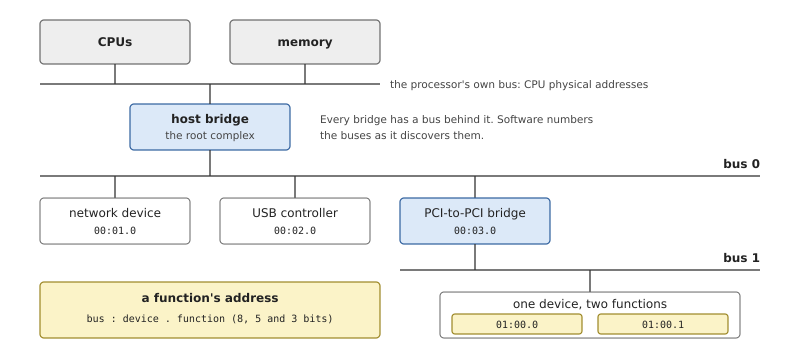
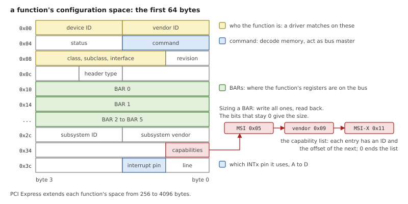
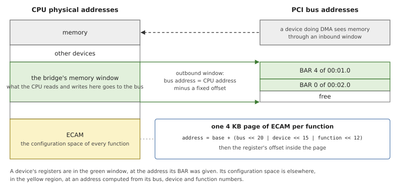
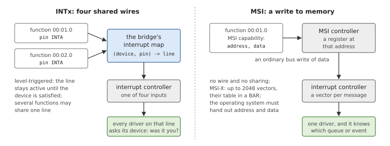
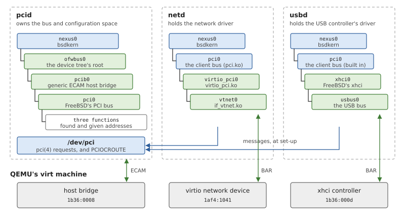
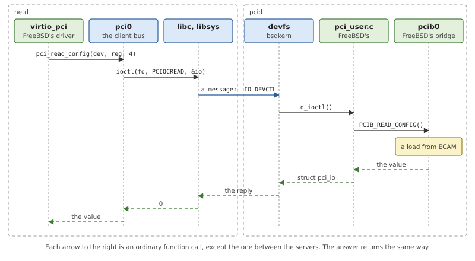
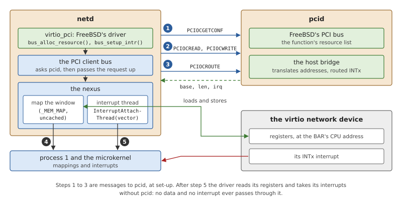

# PCI

The machine OsCraft runs on has a PCI Express bus, and its network
device and its USB controller are on it. Before a driver can use such a
device, somebody has to find the device, decide where its registers
appear in memory, and work out which interrupt it raises. In OsCraft
that somebody is a server, `pcid`, which runs FreeBSD's PCI bus code on
bsdkern (Chapter 27). The drivers themselves are in other servers. This
chapter explains what a PCI bus asks of an operating system, and then
how `pcid` and its clients share the work.

## What PCI Express is

PCI is a way of attaching devices to a computer so that software can
discover them. A device on an older bus had to be described to the
system by hand: where its registers were, which interrupt it used.
A PCI device describes itself, and it lets software choose where its
registers go. PCI Express replaced PCI's shared parallel wires with
serial links between pairs of components, and kept the software model
almost unchanged. Everything in this section applies to both.

### A tree of buses

The processor reaches PCI through a *host bridge* (in PCI Express, the
*root complex*). Behind the host bridge is bus 0. A *PCI-to-PCI bridge*
on a bus leads to another bus, and so the whole forms a tree.



*Figure 29.1: A small PCI tree. Each end point is a function, addressed
by the number of its bus, its device number on that bus, and its
function number within the device.*

What sits on a bus is a *device*, numbered 0 to 31, and a device has one
to eight *functions*. The function is the unit software deals with: a
network port, a USB controller. Its address is written
`bus:device.function`, and those three numbers are all that is needed to
talk to it before anything else is known.

### Configuration space

Every function has a small block of registers with a fixed layout, its
*configuration space*. This is where the function describes itself and
where the system configures it.



*Figure 29.2: The start of a function's configuration space. The
identity fields are read-only; the command register, the BARs and the
capability structures are how the system configures the function.*

Four groups of fields matter in what follows.

- **Identity.** The *vendor ID* and *device ID* say exactly what the
  function is, and the *class code* says what kind of thing it is (a
  network controller, a USB controller of the xhci kind). Drivers claim
  functions by these.
- **The command register.** Two of its bits are switches that a driver
  must turn on: one lets the function respond to accesses to its memory
  registers, the other lets it start transfers of its own (*bus
  mastering*, which DMA needs).
- **Base Address Registers** (BARs). Each BAR stands for one block of
  the function's own registers. The function fixes the block's size; the
  system writes the address at which the block will appear.
- **Capabilities.** Optional features are described by structures
  chained in a list: power management, MSI, or structures a vendor
  defines for its own use. Software walks the list to find the ones it
  knows.

A bridge has a different header, with the numbers of the buses behind it
and the address ranges it forwards to them.

### Enumeration

Finding out what is on the bus is called *enumeration*. Software reads
the vendor ID at every device number of bus 0. Where a function answers,
it reads the rest of the header. If the function is a bridge, software
gives the bus behind it a number and continues there.

For each function, software then sizes the BARs. Writing all ones to a
BAR and reading it back shows which address bits the function
implements, and from that the size of the block. Software picks an
address of that size and alignment, from a range that the bridges above
the function forward, and writes it to the BAR. Firmware often does
this before the operating system starts; an operating system must be
able to do it by itself, because not every machine has such firmware.

### Windows through the host bridge

A BAR holds a *PCI bus address*. The processor uses *CPU physical
addresses*. The host bridge connects the two with *windows*.



*Figure 29.3: The host bridge's windows. A range of CPU addresses is
forwarded to the bus; a function's registers appear in it at the place
its BAR says. Configuration space is reached separately, through ECAM.*

An *outbound window* is a range of CPU physical addresses that the
bridge forwards to the bus, possibly shifted by a constant. A driver
that wants to map a function's registers therefore needs two facts: the
bus address in the BAR, and the window's translation. In the other
direction, a device that does DMA reaches memory through an *inbound
window*, which decides what bus address stands for which RAM.

Configuration space is not in these windows. On PCI Express it has a
region of CPU addresses of its own, the *Enhanced Configuration Access
Mechanism* (ECAM): 4 KB for every possible function, laid out so that
the function's address is the index. Reading a configuration register is
then an ordinary load from an address computed from the bus, device,
function and register numbers.

### Interrupts

A PCI function can ask for attention in two ways.



*Figure 29.4: The two kinds of PCI interrupt. INTx is a routed, shared
line. MSI is a write that the function makes, to an address and with a
value the system chose.*

**INTx** is the original scheme: four interrupt lines, INTA to INTD,
shared by everything on the bus. A function's header says which pin it
uses. Which input of the machine's interrupt controller that pin ends up
on depends on the board's wiring and on every bridge in between, so the
machine's description must include a map from (device, pin) to
interrupt. Because lines are shared, a driver whose handler is called
must first ask its device whether it was the one.

**MSI** (*message-signalled interrupts*) and its extension MSI-X do
without lines. The system writes an address and a value into the
function's MSI capability; to interrupt, the function writes that value
to that address, and a component of the interrupt controller turns the
write into an interrupt. Each function, and with MSI-X each queue of a
function, can have an interrupt of its own. MSI needs more from the
system: something must hand out those addresses and values and deliver
the result to the right driver.

### What the operating system has to provide

Putting the pieces together, a PCI subsystem has four jobs: a driver
for the host bridge (where ECAM is, what the windows are, how INTx is
routed), enumeration and address assignment, a way for drivers to find
their function and its resources, and a way for administrators to look
(a tool that lists the bus).

In a monolithic kernel all of that and the drivers share one address
space. When drivers are separate processes, a question appears that the
kernel never had to answer: who touches configuration space? It is one
shared region, a write to the wrong function's BAR breaks another
driver, and access to it must be serialised.

## PCI in OsCraft

OsCraft answers with one server that owns the bus and any number of
servers that own drivers.

- **pcid** (`user/pcid`) holds FreeBSD's PCI code: the host bridge
  driver, enumeration, address assignment and interrupt routing. It is
  the only process that reads or writes configuration space.
- **A server with a PCI driver** (`netd` for the network device, `usbd`
  for the USB controller) asks pcid about its function, by messages.
  Then it maps the function's registers into its own address space and
  receives the function's interrupt in its own thread.



*Figure 29.5: Three servers, each with a FreeBSD device tree of its own.
pcid's tree ends at the functions it found; the drivers are in netd and
usbd, under a bus called `pci` that forwards to pcid. Each server
touches only its own piece of hardware.*

### pcid: FreeBSD's PCI bus in a server

pcid is small. Its Rust `main()` (`user/pcid/src/main.rs`) starts
bsdkern, loads any modules named on its command line, and serves the
device nodes FreeBSD's code created. Everything else is FreeBSD's,
built into `libbsdpci.a` from the configuration
`tools/freebsd/conf/OSCRAFT_PCI`: the PCI bus driver, the driver for
PCI-to-PCI bridges, the `/dev/pci` device, FreeBSD's device-tree layer,
and a host bridge driver for bridges that follow the generic ECAM
model.

That last driver is the one QEMU's `virt` needs. Its host bridge has
no registers of its own to program: its device-tree node gives the ECAM
region, the windows and the interrupt map, and that is all there is to
know. A board whose bridge needs set-up code would supply its driver as
a module, which pcid loads with `-m`; the generic one is built in.

How does pcid learn about the bridge? QEMU hands the startup a device
tree, and the startup records where it is in the system page (Chapter
5). bsdkern maps it and installs it for FreeBSD's device-tree code
(`user/bsdkern/kern/fdt.c`) before any driver is probed. From there the
sequence is FreeBSD's own, as on any arm64 board.

1. The bus for the tree's root attaches under the nexus, and looks for a
   driver for each node.
2. The generic host bridge driver matches the node whose `compatible`
   property is `pci-host-ecam-generic`. It maps the ECAM region named by
   the node's `reg` property and reads the windows from `ranges`.
3. The PCI bus attaches to the bridge and enumerates. For every function
   it reads the header through ECAM and records the BARs and the
   interrupt pin.
4. For a function with an interrupt pin, the bus asks the bridge to
   route it. The bridge looks the pin up in the node's `interrupt-map`,
   which yields an interrupt specifier in the terms of the machine's
   interrupt controller.

The last step ends in bsdkern. FreeBSD would pass the specifier to its
driver for the interrupt controller. In OsCraft the controller belongs
to the microkernel, and a process names an interrupt by its vector
number in the system page. bsdkern's nexus does the conversion, which
for the GIC is arithmetic.

*Listing 29.1: A device tree's interrupt specifier as a vector number,
`intr_fdt_map_irq()` (`user/bsdkern/kern/fdt.c`).*

```c
{{#include ../../../user/bsdkern/kern/fdt.c:fdt_map_irq}}
```

When pcid has started, its newbus tree holds the bridge, the bus and
one child per function, each with a list of its resources. No driver is
attached to those children, and none ever will be in this process.

### /dev/pci and pciconf

FreeBSD's PCI code creates a device node, `/dev/pci`, with a set of
`ioctl()` requests: list the functions that match a pattern
(`PCIOCGETCONF`), read and write a configuration register (`PCIOCREAD`,
`PCIOCWRITE`), and a few more. bsdkern serves that node as a path
(Chapter 27), so FreeBSD's `pciconf` works as it is. On QEMU's `virt`,
`pciconf -l` lists three functions.

*Table 29.1: The PCI functions of the QEMU machine OsCraft runs on.*

| Vendor and device | Class | What it is | Driver |
|---|---|---|---|
| `1b36:0008` | `0x060000` | the host bridge itself | none needed |
| `1af4:1041` | `0x020000` | the virtio network device | FreeBSD's `vtnet`, in netd |
| `1b36:000d` | `0x0c0330` | QEMU's xhci USB controller | FreeBSD's `xhci`, in usbd |

One request needs care on the way. An `ioctl()` normally carries one
structure, which travels in the message and comes back in the reply.
`PCIOCGETCONF`'s structure contains pointers to the caller's buffers,
and a server cannot follow pointers into another process. So libsys
sends the structure and the buffers together in one message
(Chapter 24), and pcid points the structure at its own copy of them
before it calls FreeBSD's code (`user/pcid/kern/glue.c`).

### The PCI client bus

A FreeBSD PCI driver is written against the PCI bus: it declares itself
a child of a bus named `pci`, reads its configuration registers with
`pci_read_config()`, and asks that bus for its BARs and its interrupt.
In a server that holds such a driver, bsdkern provides a bus with that
name and those methods, the *client bus*
(`user/bsdkern/kern/pciclient.c`). It is not a PCI bus. It is a
forwarding agent for pcid's.

When the client bus attaches, it opens `/dev/pci` and asks for the list
of functions. For each one that is not a bridge it creates a child
device and keeps the function's description (vendor, device, class,
address). FreeBSD then offers each child to the drivers in the server,
and the one that recognises the IDs attaches. The driver cannot tell
the difference.

Every configuration access the driver makes becomes a request to pcid.



*Figure 29.6: `pci_read_config()` in netd. The driver calls its parent
bus; the client bus calls `ioctl()`; libsys sends a message; in pcid,
FreeBSD's own `/dev/pci` code calls the host bridge, which reads ECAM.*

Only the second column of the figure and the fourth are OsCraft's code.
The driver, the handling of the request in pcid and the bridge are
FreeBSD's, and the request between them is one FreeBSD already defined
for `pciconf`. Functions built on configuration access, such as
enabling bus mastering or walking the capability list, are done in the
client bus as sequences of such reads and writes.

A message per register would be too slow in a data path. Configuration
space is not one: drivers use it while they attach, and afterwards work
through the registers behind their BARs. In exchange for the messages,
one process owns the bridge and its lock, and a server with drivers
contains no code about the board's bridge at all.

### A BAR and an interrupt: PCIOCROUTE

Two things a driver needs are not in FreeBSD's `/dev/pci` interface,
because in a kernel the driver would never ask for them this way. The
BAR holds a bus address, and the driver must map a CPU address: the
window's translation is known to the bridge driver, in pcid. And the
INTx interrupt is whatever the bridge routed the pin to, again known
only in pcid. OsCraft adds one request for both.

*Listing 29.2: OsCraft's request on `/dev/pci`, `struct
bsdkern_pci_route` (`user/bsdkern/kern/bsdkern_pci.h`).*

```c
{{#include ../../../user/bsdkern/kern/bsdkern_pci.h:pci_route_request}}
```

The client names a function and a BAR. pcid answers with the CPU
physical address and length of that BAR's block, and the vector of the
function's INTx interrupt.

*Listing 29.3: Answering it in pcid, `route()`
(`user/pcid/kern/glue.c`).*

```c
{{#include ../../../user/pcid/kern/glue.c:pci_route}}
```

Three things in the listing are worth noticing.

- pcid computes nothing itself. The interrupt comes from the resource
  list FreeBSD's bus filled when it routed the pin, and the address
  from FreeBSD's `bus_translate_resource()`, which asks the bridge.
- A BAR may not have an address yet. QEMU's `virt` starts OsCraft
  without firmware that assigns BARs, and FreeBSD's bus assigns one
  only when a driver allocates it. The driver is in another server, so
  pcid allocates the BAR on its behalf, which makes FreeBSD pick an
  address in the bridge's window and write it to the function.
- The allocation is kept. pcid's resource manager then knows the range
  is in use, and will not give it to another function.

With the answer, the client bus does the rest in its own server.

*Listing 29.4: A driver's request for a BAR or an interrupt, in the
client bus, `pcicl_alloc_resource()`
(`user/bsdkern/kern/pciclient.c`).*

```c
{{#include ../../../user/bsdkern/kern/pciclient.c:pcicl_alloc_resource}}
```

The client bus rewrites the driver's request with the numbers from
pcid and passes it to its own parent, the server's nexus. From there on
the resource is like any other in a bsdkern server (Chapter 27): the
nexus maps the registers into this process, and when the driver sets up
its handler, the nexus starts an interrupt thread for the vector.



*Figure 29.7: A driver attaching in netd. pcid is asked three kinds of
question; the mapping and the interrupt are then set up directly with
process 1 and the microkernel.*

The figure shows the division that the whole design aims at. pcid gives
out addresses and vector numbers. It never maps a function's registers,
never sees one of its interrupts, and is not involved when a packet is
sent or received.

### The two clients

**The network device, in netd.** netd takes all its drivers as modules
(Chapter 28), so the client bus is a module there too: `pci.ko`, built
from the same source file, which adds the bus to netd's nexus when it is
loaded. On top of it runs FreeBSD's virtio code, split into modules as
FreeBSD splits it: `virtio.ko` (the queues), `virtio_pci.ko` (the PCI
transport) and `if_vtnet.ko` (the network driver). The boot script
starts pcid, waits for `/dev/pci`, loads the four modules in that order
and configures the interface `vtnet0` they create.

The virtio transport exercises the client bus more than most drivers. A
modern virtio device describes its register blocks with vendor
capabilities in configuration space. The driver walks the capability
list, each step a message to pcid, and then maps pieces of one BAR. It
asks for MSI-X, is refused, and falls back to the INTx interrupt, which
it shares among its queues.

**The USB controller, in usbd.** usbd is built with the client bus
inside it, and attaches it when started with the `pci` argument.
FreeBSD's xhci driver then finds the controller as a child of that bus
and attaches (Chapter 30). The path is the same one netd uses.

### Limits

*Table 29.2: What the PCI support does not do yet.*

| Limit | Effect |
|---|---|
| no MSI and no MSI-X | a driver's request fails, and it uses INTx; a device with several queues has one interrupt for all of them |
| memory BARs only | I/O-port BARs are not handed out, so the legacy virtio interface cannot be used; QEMU is started with it disabled |
| no extended capabilities for clients | the client bus reports none |
| the function list is read once | the client bus sees the functions present when it attached |
| xhci's interrupt on QEMU's `virt` | the controller attaches in usbd, but its interrupt does not arrive yet; the network device's INTx, routed the same way, works |
| no board bridges in this tree | only the generic ECAM bridge is built in; another bridge is a module for pcid |

## Summary

- A PCI function is found by its bus, device and function numbers, and
  describes itself in configuration space: who it is, how big its
  register blocks are, which interrupt pin it uses, what optional
  features it has.
- The system assigns each BAR a bus address. The host bridge's windows
  relate bus addresses to CPU addresses, and ECAM makes configuration
  space readable as memory.
- In OsCraft, pcid runs FreeBSD's PCI bus code on bsdkern. It finds the
  host bridge in the device tree the startup left in the system page,
  enumerates, assigns addresses and routes INTx, and serves FreeBSD's
  `/dev/pci`, so `pciconf` works unchanged.
- Drivers live in other servers, under a client bus that looks like
  FreeBSD's `pci` bus and turns configuration accesses into requests to
  pcid. Only pcid touches configuration space.
- One request of OsCraft's own, `PCIOCROUTE`, gives a driver's server
  the CPU address of a BAR and the vector of the INTx interrupt. The
  server then maps the registers and attaches the interrupt itself, so
  neither data nor interrupts pass through pcid.
- Today's clients are the virtio network driver in netd, loaded as
  modules, and xhci in usbd. Interrupts are INTx only.
