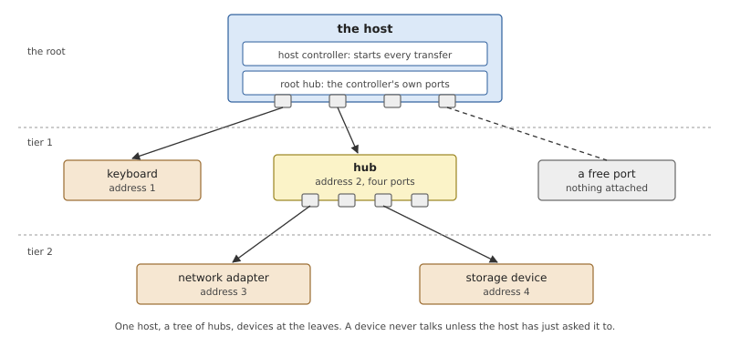
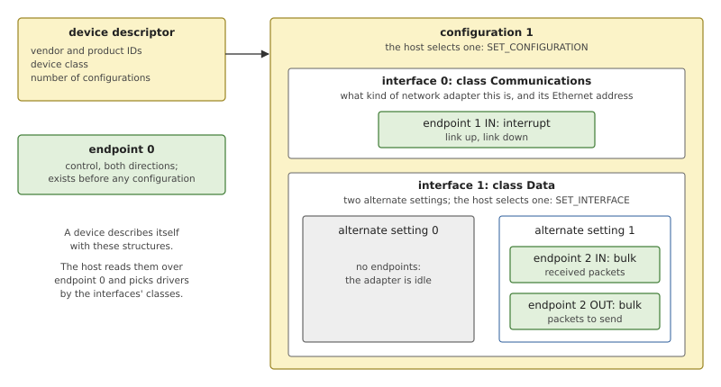
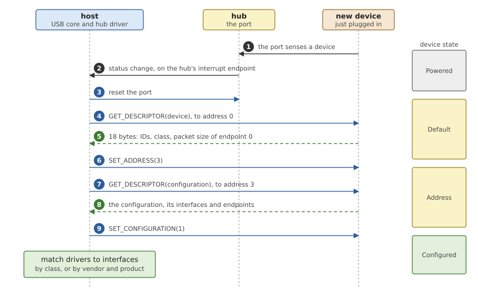
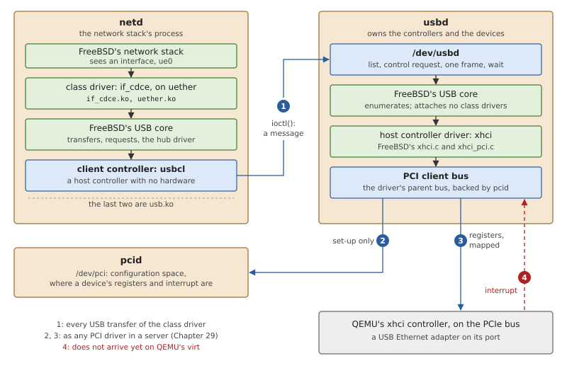
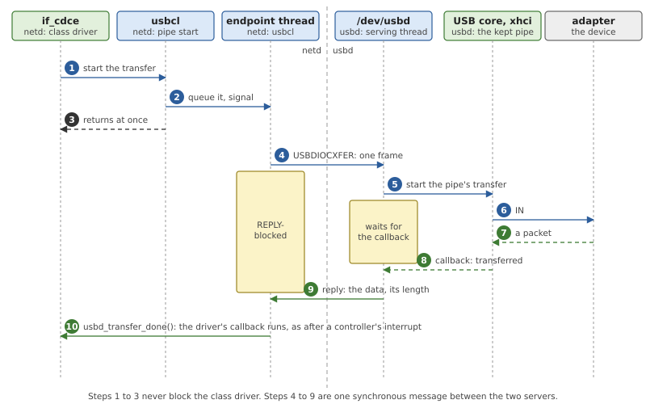
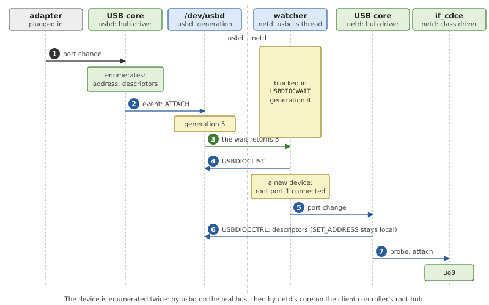

# USB

USB is the bus of everything that is plugged in after the machine was
built: keyboards, disks, network adapters. Supporting it takes three
kinds of code: a driver for the controller on the host's side, a core
that finds devices and learns what they are, and a driver for each kind
of device. In OsCraft all three are FreeBSD's, unchanged, and they are
divided between two servers. `usbd` owns the controller and the devices.
The driver of a device lives in the server that uses the device: the
driver of a USB Ethernet adapter is in `netd`, the network stack. This
chapter explains how USB works, and then how a transfer started by a
driver in one process is carried out by a controller in another.

## How USB works

### One host and a tree

A USB bus has exactly one *host*, and everything else on it is a
*device*. The host's side of the wire is the *host controller*, the
piece of hardware that puts packets on the bus. The rule that shapes
everything else is that only the host starts a transfer. A device never
speaks first: it answers when the host has just addressed it. A keyboard
with a key pressed has to wait until the host asks it for news.



*Figure 30.1: The bus is a tree. The host controller's own ports form
the root hub; hubs add ports; devices are the leaves, each with an
address the host gave it.*

The bus is a tree (Figure 30.1). A *hub* is a device whose job is to
provide more ports. The host controller's own ports behave like one more
hub, the *root hub*, which does not exist as a device on the wire: the
controller's driver plays its part in software, so that the rest of the
host's code can treat every port alike. Each device has an *address*, a
small number the host assigns when the device appears, and every packet
names the address it is for.

### Endpoints and the four kinds of transfer

Inside a device, data goes to and comes from *endpoints*. An endpoint is
a numbered, one-directional channel: *IN* endpoints carry data to the
host, *OUT* endpoints from it. (Directions are always named from the
host's side.) Every device has endpoint 0, which works in both
directions and exists from the moment the device is powered. The others
depend on what the device is.

Each endpoint has one of four *transfer types*, which say what the host
promises about timing and delivery.

*Table 30.1: The four transfer types.*

| Type | Promise | Used for |
|---|---|---|
| control | a request, optional data, and a status, delivered reliably | configuring the device, on endpoint 0 |
| bulk | reliable delivery, whenever the bus has room | disks, network packets |
| interrupt | reliable delivery, polled by the host at a fixed interval | keys, status notifications |
| isochronous | reserved bandwidth on time, no retry | audio and video streams |

The name *interrupt* is historical. No device can interrupt the host;
the host polls the endpoint often enough that it feels like one.

A transfer is cut into packets no larger than the endpoint's *maximum
packet size*. The end of a transfer is not announced: a packet shorter
than the maximum ends it. So a receiver that asked for up to 4096 bytes
learns that only 200 are coming when a short packet arrives.

### Descriptors

The host knows nothing about a device when it appears. The device
describes itself, in a set of structures called *descriptors* that the
host reads through endpoint 0.



*Figure 30.2: What a USB Ethernet adapter of the standard kind (CDC ECM)
says about itself. Endpoints belong to interfaces, interfaces to a
configuration.*

The *device descriptor* names the maker and the product and says how
many *configurations* the device has. A configuration is one complete
way of using the device; nearly all devices have one. A configuration
holds *interfaces*, and an interface is one function of the device with
the endpoints that serve it. This is the level at which drivers attach:
a device that is both a keyboard and an audio output has two interfaces
and gets two drivers.

An interface may have *alternate settings*, different sets of endpoints
for the same function, of which one is in use at a time. The adapter in
Figure 30.2 uses them as an on/off switch: its data interface has no
endpoints in setting 0 and its two bulk endpoints in setting 1. The host
moves between settings with a control request, and after it the
interface's endpoints are different ones.

### Enumeration

*Enumeration* is what the host does between a device being plugged in
and a driver using it.



*Figure 30.3: Enumeration. All requests go to the device's endpoint 0.
Until step 6 the device answers at address 0, which is why the host
enumerates one device at a time.*

The hub notices the device and reports a change on its own interrupt
endpoint. The host resets the port, which leaves the device listening at
address 0. It reads the device descriptor, assigns an address, reads the
configuration with all its interfaces and endpoints, and selects it.
Every step is a *control request*: eight bytes of *setup* (a type, a
request number, three parameters, of which the last is the length of the
data that follows), then the data in one direction or the other.
Requests such as `GET_DESCRIPTOR`, `SET_ADDRESS`, `SET_CONFIGURATION`
and `SET_INTERFACE` are *standard*: every device implements them.

### The layers of a host

Host software is built in three layers, in every operating system.

- A **host controller driver** knows one kind of controller hardware,
  for example xhci, the controller of USB 3. It turns "send these bytes
  to endpoint 2 of device 3" into whatever that hardware needs, takes
  the controller's interrupt when a transfer finishes, and emulates the
  root hub.
- The **core** is independent of the hardware. It keeps the list of
  devices, runs enumeration, contains the driver for hubs, queues
  transfers per endpoint, and matches drivers to interfaces.
- A **class driver** knows one kind of device. Most devices follow a
  *class* specification (hubs, storage, human-interface devices,
  communications), named in the interface descriptor, so one driver
  serves every product of the class. A class driver never touches the
  controller. It asks the core to run transfers on its interface's
  endpoints, and is called back when each one completes.

The class driver is also where USB meets the rest of the system. A
storage driver appears as a disk, a network driver as an interface in
the network stack. That decides where a microkernel system has to cut
the stack, which is the subject of the rest of the chapter.

## USB in OsCraft

### Two servers

OsCraft runs FreeBSD's USB stack, from `sys/dev/usb` in FreeBSD's
source, inside processes. The layer that makes kernel code run in a
process, *bsdkern*, is the subject of Chapter 27; this chapter takes it
as given.

The controller must have one owner, so the host controller driver and a
core to enumerate with are in one server, `usbd`. The class drivers
could have gone there too, but then every network packet would cross
from the network stack to `usbd` and back as data, and `usbd` would
need a piece of every subsystem that has USB devices. OsCraft puts each
class driver in the server that needs the device instead: the USB
Ethernet drivers are modules of `netd` and hand their packets straight
to the stack in the same address space.

A class driver, however, is written against FreeBSD's core, and calls
it as ordinary functions. To leave the driver unchanged, `netd` runs a
second copy of the core, on top of a host controller that has no
hardware: the *client controller*, which hands every transfer to
`usbd` in a message.



*Figure 30.4: FreeBSD's code (green) and OsCraft's (blue) in the two
servers. The class driver's transfers cross between the servers at 1.
Arrow 4, the controller's interrupt, is the part that does not work yet
on QEMU's virt.*

The design is that of USB/IP, where the host's software is on one
machine and the devices on another, with messages in place of a network.

### usbd

`usbd` (`user/usbd`) is a small Rust program linked with a library of
FreeBSD's code, `libbsdusb.a`. The library is selected the way a FreeBSD
kernel is: a kernel configuration file,
`tools/freebsd/conf/OSCRAFT_USB`, lists `device usb` and the host
controller drivers, and FreeBSD's own `config(8)` works out the source
files. Packet capture (`usb_pf.c`) is left out, because it needs a
network stack; `user/usbd/kern/glue.c` supplies empty functions in its
place.

A host controller driver needs its hardware. QEMU's xhci controller is
a PCI device, and the PCI bus belongs to another server, `pcid`. Started
as `usbd pci`, `usbd` adds bsdkern's *PCI client bus* to its device
tree. FreeBSD's `xhci_pci.c` attaches to it as it would to the kernel's
PCI bus. Its reads of configuration space become requests to `pcid`,
which also says where the controller's registers and its interrupt are;
`usbd` then maps the registers into its own address space and waits for
the interrupt in a thread of its own (Chapter 29). A controller that is
not on PCI can be named on the command line, with the address of its
registers and its interrupt number.

`usbd` attaches no class drivers. FreeBSD's core in it enumerates each
device, including hubs, and stops there. What `usbd` offers to other
servers is one device node, `/dev/usbd`, with four requests.

*Listing 30.1: The requests on `/dev/usbd`
(`user/bsdkern/kern/bsdkern_usb.h`).*

```c
{{#include ../../../user/bsdkern/kern/bsdkern_usb.h:usb_protocol}}
```

- `USBDIOCLIST` returns the devices: for each, an identifier (the bus's
  number and the device's address on it), its speed, whether it is a
  hub, and its 18-byte device descriptor.
- `USBDIOCCTRL` runs one control request on a device: the eight setup
  bytes in `req`, the data in `data`.
- `USBDIOCXFER` runs one frame of a bulk or interrupt transfer on an
  endpoint.
- `USBDIOCWAIT` blocks until the set of devices changes. It is the
  hot-plug notification, described below.

The requests are FreeBSD `ioctl()`s. `ioctl()` on OsCraft is a message
to the server behind the descriptor (Chapter 24), and bsdkern serves the
device nodes that FreeBSD's code creates, calling the driver's `ioctl`
function for each message (Chapter 27). So the driver's side of
`/dev/usbd` in `user/usbd/kern/serve.c` is written exactly as a FreeBSD
character device, and the client's side calls plain `ioctl()`. The data
travels inside the request, which limits a frame to 4096 bytes: the
`ioctl()` encoding has room for 8 KB.

Each request is synchronous. The serving thread in `usbd` runs it
through FreeBSD's core and replies when it is done; meanwhile the
calling thread in the client is REPLY-blocked. `usbd` serves its nodes
with sixteen threads, so that many transfers can wait at once.

### The client controller

On `netd`'s side everything USB arrives as modules, loaded with
FreeBSD's `kldload` (Chapter 28 describes modules in `netd`).

*Table 30.2: `netd`'s USB modules, all in `/boot/modules` of the image.*

| Module | Contents |
|---|---|
| `usb.ko` | FreeBSD's USB core and the client controller, `user/bsdkern/usb/usbclient.c` |
| `uether.ko` | FreeBSD's `usb_ethernet.c`, the part all USB Ethernet drivers share |
| `miibus.ko` | FreeBSD's MII layer, for adapters with a separate PHY chip |
| `if_cdce.ko` | the driver for standard adapters (CDC ECM) |
| `if_urndis.ko`, `if_axe.ko`, `if_axge.ko`, `if_ure.ko`, `if_smsc.ko`, `if_muge.ko` | drivers for RNDIS, ASIX, Realtek, SMSC and Microchip adapters |

The drivers are FreeBSD's files, compiled as they are; the Makefile
builds each `if_*.ko` from the one source file of that name.

The client controller, `usbcl`, is a host controller driver in every
respect FreeBSD's core cares about. It implements the two tables of
functions the core requires of one: the bus methods (emulate the root
hub, prepare an endpoint, set a device's address) and the pipe methods
(open, close, start a transfer). What it lacks is hardware. When it
attaches, it opens `/dev/usbd` and asks for the list of devices. Its
root hub has four ports, and each device `usbd` lends is shown as
connected to a free one. Hubs are not lent: they stay `usbd`'s, and a
device behind a hub appears in `netd` directly on a root port.

From there FreeBSD's core in `netd` does what it always does. Its hub
driver sees a connected port, resets it, and enumerates the device:
reads the descriptors, sets an address, selects the configuration, and
offers the interfaces to the loaded drivers. Every one of those control
requests goes through the client controller to `usbd` as a
`USBDIOCCTRL`. The device is thus enumerated a second time, and three
requests cannot simply be repeated on the real device.

- **`SET_ADDRESS`** never leaves `netd`. The device already has its
  address, given by `usbd`. The client controller's `set_address`
  method does nothing, and the address `netd`'s core chose is only that
  core's own name for the device. The port reset is likewise answered
  locally.
- **`SET_CONFIGURATION`** to the configuration `usbd` already selected
  is answered without touching the device.
- **`SET_INTERFACE`** changes which endpoints exist, and `usbd`'s core
  must know. `usbd` does not forward the raw request; it calls its own
  core's function for changing the alternate setting, which sends the
  request and rebuilds the endpoints.

*Listing 30.2: The two control requests `usbd` treats specially, in
`ctrl()` (`user/usbd/kern/serve.c`).*

```c
{{#include ../../../user/usbd/kern/serve.c:usbd_ctrl_rules}}
```

Any other request goes to the device as it is, with a timeout of five
seconds unless the client gave one.

### A transfer across the servers

Take the Ethernet driver waiting for a packet. It has set up a bulk
transfer on its IN endpoint and starts it. In a FreeBSD kernel the core
would call the controller driver's `start` function, which would program
the hardware and return; later the controller's interrupt would complete
the transfer and the core would call the driver back.

The client controller keeps that contract. Its `start` must not block,
because the core calls it with the bus's lock held, so it cannot send
the message itself.

*Listing 30.3: Starting a transfer in the client controller,
`usbcl_pipe_start()` (`user/bsdkern/usb/usbclient.c`).*

```c
{{#include ../../../user/bsdkern/usb/usbclient.c:usbcl_pipe_start}}
```

The transfer is queued for a *worker*: a thread that the client
controller creates for each endpoint of each device the first time the
endpoint is used (all control transfers of a device share one). The
worker is what plays the hardware's part.



*Figure 30.5: A bulk IN transfer of the Ethernet driver. The endpoint's
thread in `netd` is blocked in a message while `usbd` runs the transfer
on the real controller.*

The worker takes the transfer off its queue and sends it to `usbd`. A
FreeBSD transfer may have several *frames*, each a buffer of its own
that goes on the wire as a separate USB transfer; the worker sends them
one `USBDIOCXFER` at a time, and a frame that comes back shorter than
asked ends the whole transfer, as a short packet would. For an OUT
endpoint the frame's bytes go in the request; for an IN endpoint they
come back in the reply. When the last frame is done the worker calls
`usbd_transfer_done()`, the same function a hardware driver's interrupt
handler calls, and the core runs the class driver's callback.

In `usbd`, the first frame for an endpoint sets up a FreeBSD transfer on
that endpoint and keeps it; `serve.c` calls this kept transfer a *pipe*.
Each later frame reuses it: the serving thread points the transfer at
the request's buffer, starts it, and sleeps until FreeBSD's core calls
back with the result. A pipe is dropped when its device is unplugged or
when `SET_INTERFACE` changes the interface's endpoints.

Stopping is the delicate part. A class driver may stop a transfer, or
the transfer's own timeout may fire, while the worker is blocked in
`usbd`. The client controller then completes the transfer at once, as
cancelled or timed out, and marks the worker as no longer owning it.
When the reply eventually arrives, the worker sees that the transfer is
not its own any more and drops the answer.

Two kinds of transfer are not carried. Isochronous endpoints get no
pipe methods, so drivers for audio and video devices cannot work in a
client. And a frame larger than 4096 bytes fails with FreeBSD's
`USB_ERR_INVAL`; the client controller tells its core that this is the
largest frame the "hardware" takes, so the core does not ask for more.

### Hot-plug

Devices come and go, and a client must follow. FreeBSD's core announces
every attach and detach as an event, which bsdkern passes to a function
of the server. `usbd` keeps a counter, the *generation*, and adds one
for each event. On a detach it also drops the device's pipes, before the
core frees the device.



*Figure 30.6: Hot-plug. A thread of the client controller waits in
`usbd` for the generation to change, then compares `usbd`'s list of
devices with its ports.*

The client controller has one more thread, the watcher, blocked in
`USBDIOCWAIT` with the generation it last saw. When the request returns,
it lists the devices again and compares the list with its ports. A
device that is on no port takes a free one, marked "connected, changed";
a port whose device is gone is marked "disconnected, changed". Then it
tells its core's hub driver that the root hub has news. The hub driver
explores the ports as on any controller: a new device is enumerated and
a driver attaches, a missing one is detached and its driver with it. For
an Ethernet adapter that means an interface `ue0` appears in, or
disappears from, the network stack.

The first wait returns immediately, because the watcher starts with a
generation `usbd` never has. Devices that were present before `netd`
loaded `usb.ko` are found the same way as devices plugged in later.

### The state on QEMU's virt

The machine `tools/qemu/run.sh` starts has an xhci controller on its
PCIe bus and a USB Ethernet adapter (CDC ECM) plugged into it. What
works and what does not is this.

- `usbd` and all the modules of Table 30.2 are in the boot image. The
  boot script does not start `usbd` and loads none of the USB modules.
- `pcid` lists the controller: the test `pcid-virt` expects it, with
  class 0x0c0330, in the output of FreeBSD's `pciconf -l`.
- Started by hand as `usbd pci`, `usbd` finds the controller through
  `pcid` and FreeBSD's xhci driver attaches to it.
- The controller's interrupt does not reach `usbd`. Without it no
  transfer completes, the adapter is not enumerated, and `netd` never
  gets `ue0`. The same path, a legacy PCI interrupt routed by `pcid` to
  a thread in the driver's server, works for the virtio network device,
  so the fault is specific to this device's interrupt and is still to be
  found.
- No test in `tests/target.tests` exercises `/dev/usbd` on virt. A test
  program for the protocol exists (`tests/native/usbd.c`) and is in the
  test image, but nothing runs it.

The network on virt therefore comes from the virtio driver (Chapter 28).
The USB path described in this chapter is the design and the code as
they stand; on this machine it runs as far as the attached controller.

## Summary

- USB has one host that starts every transfer. Devices sit in a tree of
  hubs, describe themselves with descriptors, and exchange data through
  endpoints of four transfer types.
- Host software has three layers: a driver for the controller, a core
  that enumerates, and class drivers for kinds of device. OsCraft uses
  FreeBSD's code for all three.
- `usbd` holds the controller's driver and a core, enumerates the
  devices, and attaches no class drivers. It finds its xhci controller
  on PCI by asking `pcid`.
- A class driver lives in the server that uses its device, on a second
  copy of the core and a client controller that has no hardware and
  forwards each control request and each frame to `/dev/usbd`.
- The client controller never blocks the core: a thread per endpoint
  sends the frames and completes the transfer, as an interrupt handler
  would.
- `usbd` answers `SET_CONFIGURATION` and `SET_INTERFACE` through its own
  core so that both cores agree on the endpoints; `SET_ADDRESS` stays in
  the client.
- Hot-plug is a generation counter in `usbd` and a thread in the client
  that waits for it to change.
- On QEMU's virt the xhci controller attaches but its interrupt does not
  arrive yet, so no USB device is usable there and the network comes
  from virtio.
