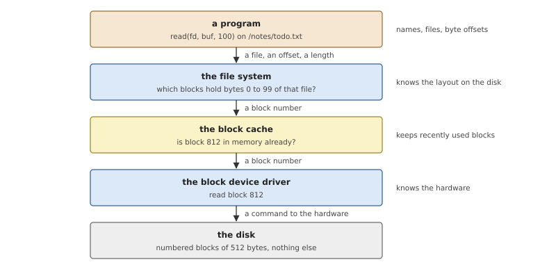
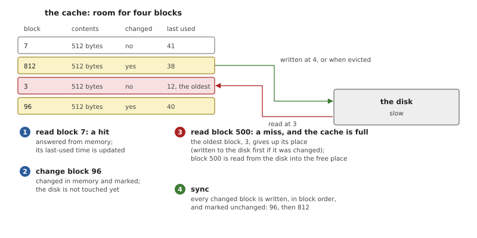
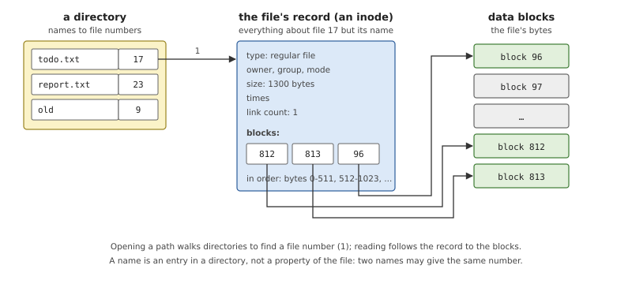
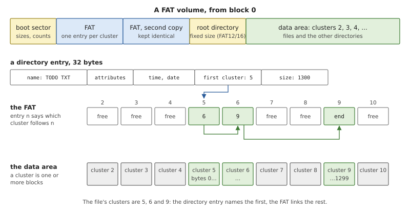
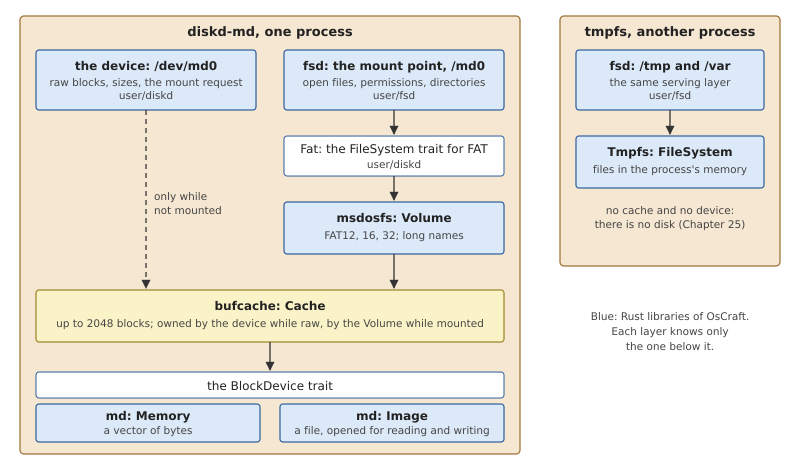
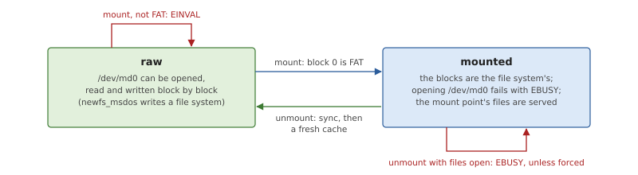
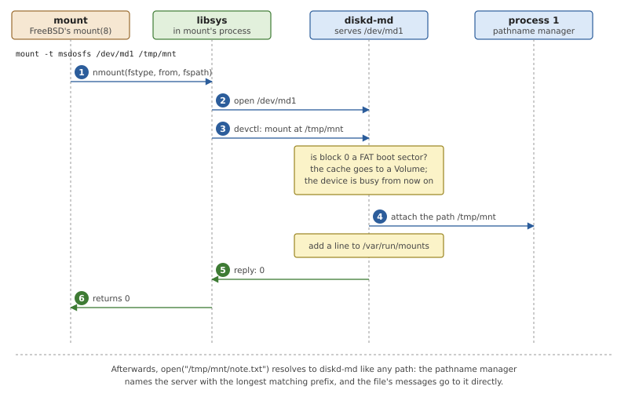

# Disks and File Systems

A disk stores numbered blocks. A program wants named files. Everything
between the two is the subject of this chapter: the block device, the
cache in front of it, and the file system that turns blocks into
directories and files. In OsCraft all of it is one ordinary process per
disk, written in Rust, which serves the disk as a device under `/dev`
and its file system at a mount point. The chapter first explains what
each layer does in any operating system, with FAT as the worked example,
and then how OsCraft builds them, how FreeBSD's `mount` and
`newfs_msdos` drive them, and what exists today: a memory disk and FAT,
with no real disk yet.

## From blocks to files

### The layers



*Figure 31.1: The layers between a program and a disk. Each one asks the
layer below a simpler question.*

A **block device** is the simplest useful view of a disk: an array of
*blocks* of a fixed size, traditionally 512 bytes, each read or written
whole by its number. The driver of a block device knows how to make one
kind of hardware do that, and nothing about what the blocks mean.

A **file system** gives the blocks meaning. It decides, and records on
the disk itself, which blocks belong to which file, what the files are
called, and which blocks are free.

Between the two sits a **block cache**. Disks are slow compared with
memory, and a file system returns to the same few blocks constantly: the
tables that say where things are get read on almost every operation. The
cache keeps recently used blocks in memory so that most of those reads
never reach the disk.

### The block cache



*Figure 31.2: A cache of four blocks. Reads of cached blocks cost
nothing; changes stay in memory until a sync, or until the block must
make room for another.*

A cache has a fixed capacity, and four behaviours define it.

- A **hit**: the block is in the cache, and the request is answered from
  memory.
- A **miss**: the block is read from the disk into the cache. If the
  cache is full, another block must leave first, an *eviction*. The
  usual choice is the block that has gone unused the longest (*least
  recently used*), on the guess that it is the least likely to be needed
  next.
- A **change**: the file system modifies the copy in memory, and the
  block is marked *dirty*. Nothing is written yet. This *write-behind*
  is what makes many small changes to one block cost a single disk
  write.
- A **sync**: every dirty block is written to the disk.

Write-behind has a price. Between a change and the next sync, the disk
holds an older state than the one programs have seen. If the machine
stops in that window, the changes are lost, and if only some of a group
of related blocks were written, the file system on the disk is
inconsistent. How often and in what order a file system syncs is
therefore a design decision about safety, not only about speed.

### Names, records and blocks

A file system answers two questions: given a name, which file is it; and
given a file and an offset, which block is that.



*Figure 31.3: The classic design. A directory maps names to file
numbers; the numbered record describes the file and lists its blocks.*

In the design UNIX made standard (Figure 31.3), each file has a record
on the disk, the *inode*, identified by a number. The inode holds
everything about the file except its name: its type, owner, permission
bits, size, times, and the list of blocks that hold its contents. A
*directory* is itself a file, whose contents are a table of names and
inode numbers.

*Path resolution* walks this structure. To open `/notes/todo.txt` the
file system reads the root directory, finds `notes` and its inode
number, reads that directory, finds `todo.txt`, and arrives at the
file's inode. Because names live in directories and not in files, one
file may appear under several names (*hard links*), and the inode counts
them.

The file system also has to know which blocks are free, and keeps a
structure for that too, often a bitmap with one bit per block.

### FAT, the simple case

FAT, the file system of MS-DOS, is still the common format of memory
cards and USB sticks, because it is simple enough for anything to
implement. It has no inodes. It makes do with two structures.



*Figure 31.4: A FAT volume. The table that gives the format its name
links each cluster of a file to the next.*

The volume starts with a *boot sector*, which gives the sizes of
everything else. The data area is divided into *clusters*, each one or
more blocks, numbered from 2. The *file allocation table*, the FAT, has
one entry per cluster, and that entry does two jobs at once. For a
cluster in use, it holds the number of the next cluster of the same
file, or an end mark. For a free cluster, it holds zero. So a file's
contents are a linked list threaded through the table, and the table is
also the map of free space. The table is important enough to be stored
twice.

The entries are 12, 16 or 32 bits wide, giving the three variants
FAT12, FAT16 and FAT32. Which one a volume uses is not written in a
field: it follows from the number of clusters.

A directory is a sequence of 32-byte entries. Each holds a name of
eight characters plus three, attribute bits, a time, the file's size and
its *first cluster*. That is all a file is: there is nowhere to store an
owner, a group or permission bits beyond a read-only attribute, and
since the entry is the file, a file cannot have two names. Longer names
are stored in extra entries placed before the short one. Names keep
their case but are compared without it.

Reading byte 1000 of a file with 512-byte clusters means: find the
directory entry, take the first cluster, follow the table one step to
the second cluster of the chain, and read from there. Every step of
that is a block read, which is why a FAT implementation leans so
heavily on its cache.

### File systems without a disk, and as servers

A file system is defined by what it answers, not by where it keeps its
data. A *memory file system* keeps directories and file contents in
ordinary memory and has no layout, no cache and no sync. It is fast and
forgets everything at power-off, which suits `/tmp`.

In a monolithic kernel, file systems are kernel modules behind a common
internal interface, and a kernel table of *mounts* says which file
system serves which directory. In a microkernel system a file system is
a server like any other. It registers the directory it serves, the
*mount point*, in the path name space, and from then on the messages for
every path below it arrive at that server. Mounting is then not a kernel
operation at all: it is a server starting to answer for a path.

## Disks and file systems in OsCraft

### One process per disk

OsCraft follows the server model exactly. A disk is served by one
process that contains the device's driver, the cache and the file
system, as libraries stacked in one address space.



*Figure 31.5: The libraries inside the disk server, and the memory file
system, which shares the top one.*

*Table 31.1: The crates.*

| Crate | What it is |
|---|---|
| `user/bufcache` | the `BlockDevice` trait and the block cache over it |
| `user/md` | two block devices: `Memory` and `Image` |
| `user/msdosfs` | FAT12, FAT16 and FAT32 over a cache |
| `user/fsd` | the serving layer: everything a file system server does that does not depend on the file system |
| `user/diskd` | the server: the device node, mounting, and the adapter between `fsd` and `msdosfs`; its program `diskd-md` |
| `user/tmpfs` | the memory file system, another user of `fsd` (Chapter 25) |

The lower crates have no OsCraft in them: `bufcache`, `md` and
`msdosfs` are plain Rust libraries that also build and run on the
development host. The FAT code is tested there against images made and
checked by the host's own tools (`user/msdosfs/tests/tools.rs`).

### Block devices and the cache

A block device is anything that implements five functions.

*Listing 31.1: What a disk must provide, the `BlockDevice` trait
(`user/bufcache/src/lib.rs`).*

```rust
{{#include ../../../user/bufcache/src/lib.rs:block_device}}
```

`md`, named after FreeBSD's memory disk, has the two implementations
that exist today, both with 512-byte blocks. `Memory` is a vector of
bytes of a given size. `Image` is a file, read and written in place at
the block's offset, so a disk image made on another machine can be
served.

`Cache` wraps a device and behaves as Figure 31.2 shows. Its buffers
are in a hash map keyed by block number, each with a dirty flag and the
value of a counter at its last use. `read()` returns the block's bytes;
`change()` runs a closure on them and marks the buffer dirty. When a
miss finds the cache full, the buffer with the oldest counter is
written out if dirty and dropped. `sync()` writes the dirty buffers in
ascending block order and then flushes the device. The disk server
gives its cache 2048 blocks, one megabyte.

### FAT

`msdosfs` implements the structures of Figure 31.4, and is written to
behave as FreeBSD's file system of the same name does. `Volume::mount()`
reads the boot sector, checks it, computes where the tables, the root
directory and the data area start, and picks FAT12, FAT16 or FAT32 from
the cluster count. From then on the `Volume` owns the cache. A change
to a table entry is made in every copy of the table. Long names are
read and written, and names are matched without regard to case.

The library works by path. `resolve()` walks from the root directory,
reading each directory and comparing names, and returns the file's
directory entry; reads and writes then follow the cluster chain from
that entry's first cluster. There is no table of open files and no
in-memory copy of the directory tree: everything is read through the
cache each time, and the cache is what makes that affordable.

### The serving layer

`fsd` is the part every file system server needs, whatever it stores.
It is a resource manager (Chapter 25): it attaches a path, and handles
the messages that `open()`, `read()`, `write()`, `stat()`,
`getdirentries()`, `rename()`, `unlink()`, `mkdir()`, `chmod()` and the
rest become in libsys. It keeps the state of each open file, checks
permissions as FreeBSD does, builds FreeBSD's `struct dirent` records
for directory listings, and answers `statfs()`. A file system plugs in
underneath by implementing one trait.

*Listing 31.2: What a file system must provide, the `FileSystem` trait
(`user/fsd/src/lib.rs`).*

```rust
{{#include ../../../user/fsd/src/lib.rs:file_system}}
```

Two things about this interface shape everything above it.

- **Every operation takes a path.** There is no "open" in the trait and
  no handle. What `fsd` remembers for an open file is its path, its
  position and the mount it belongs to, and each `read()` message
  becomes `read(path, offset, buffer)`. A file system therefore needs no
  notion of an open file. The cost is a path resolution on every
  operation, which FAT pays through its cache and `tmpfs` in memory.
- **Policy is in the trait's caller where it can be.** `fsd` decides
  whether the caller may read, write or search, from the `Node` a
  `lookup()` returns and the caller's credentials in `Who`, so the two
  file systems agree on the rules. Only what depends on the format is
  left to the file system: `set_owner()` on FAT, which has no owners,
  accepts a request that changes nothing and refuses the others.

One `fsd` serves any number of mounts in a process: `tmpfs` serves
`/tmp` and `/var` from the same loop. Each mount's file system sits
behind a lock, and the serving loop runs on one thread, so operations
on a disk are handled one at a time.

`fsd` syncs the file system when a file is closed, and on `fsync()`.
The FAT adapter also syncs after creating, removing or renaming a file,
so the directory structure on the disk is never far behind.

### The disk server

`diskd` joins the pieces. Its one program today, `diskd-md`, creates a
memory disk (`-s` megabytes) or opens an image file (`-f`), wraps it in
a cache, and serves it as `/dev/md<unit>`.

The device node gives the disk's raw blocks. Reads and writes at any
offset go through the cache block by block, and each write is followed
by a sync. A few FreeBSD disk `ioctl()`s are answered: the sector size
and the media size, which is what a tool needs to lay out a file system.
FreeBSD's `newfs_msdos` formats `/dev/md1` this way, with no knowledge
that the disk is a server.

One more request on the device node is OsCraft's own: *mount at this
path*.

*Listing 31.3: Mounting, `mount()` (`user/diskd/src/server.rs`).*

```rust
{{#include ../../../user/diskd/src/server.rs:diskd_mount}}
```

The cache is taken out of the server's global slot and given to the
`Volume`. While mounted, the slot is empty, and that emptiness is the
whole exclusion mechanism: an attempt to open or read the raw device
finds no cache and fails with `EBUSY`, so nobody can write blocks
underneath the file system.



*Figure 31.6: A disk in `diskd` is either raw or mounted. The cache
belongs to exactly one side at a time.*

Unmounting reverses it. `fsd` gives up the path, refusing with `EBUSY`
if files are still open unless the request is forced. The volume is
synced and hands back the device, which gets a fresh cache, and the
disk is raw again.

### mount, umount and df

FreeBSD's `mount(8)`, `mount_msdosfs`, `umount`, `df` and
`newfs_msdos` are in the image, built from FreeBSD's source without
changes. They work because libsys implements the system calls under
them in terms of the servers (`user/libsys/src/mount.rs`).



*Figure 31.7: `mount -t msdosfs /dev/md1 /tmp/mnt`. The system call
becomes a request to the disk's own server, which attaches the mount
point itself.*

- **`nmount()`** takes the file system type, the device and the mount
  point from its arguments, opens the device, and sends it the mount
  request. Only `msdosfs` is accepted; any other type fails with
  `ENODEV`.
- **`unmount()`** opens the mount point, which reaches the `fsd` that
  serves it, and sends the unmount request there.
- **`getfsstat()`**, which `mount` with no arguments and `df` use to
  list what is mounted, has no kernel table to read. The servers keep
  one themselves: `fsd` adds a line to the file `/var/run/mounts` for
  each mount and removes it at unmount. libsys reads the file, puts the
  boot image's root file system in front, and asks each mount point for
  its numbers with `statfs()`, which is a message to the server like any
  other.

Because a mount is only a server attaching a path, it can also happen
with no `mount` command: `diskd-md -f image -m /md0` mounts at start.

Two tests in `tests/target.tests` show both ways. `native-fat` runs
`tests/native/fs.c`, which copies a FAT image, made on the build host
with `mkfs.fat` and `mcopy`, into `/tmp`, starts `diskd-md` on it
mounted at `/md0`, and then checks FreeBSD's behaviour through the C
library: reading what the host's tools wrote, long names, names in the
wrong case, creation with `O_EXCL`, appending, `rename()`, `truncate()`,
`rmdir()` of a directory that is not empty, the `chmod()` and `chown()`
rules of a file system without owners, `pread()` and `pwrite()`,
`mmap()`, and finally running a program copied onto the disk.
`native-mount` uses FreeBSD's tools only: it starts a memory disk,
formats it with `newfs_msdos`, mounts it, writes a file, checks `mount`
and `df`, unmounts, and mounts again to find the file still there.

### What exists and what does not

The disk code is complete as a path from `open()` to blocks, but on
QEMU's virt there is nothing permanent underneath it.

- **There is no driver for a real disk.** The only block devices are
  the two in `md`. A memory disk lasts as long as its server; an image
  file lives wherever the file does, which today means in `tmpfs`, also
  in memory. A virtio block device, or a USB storage device through
  `usbd` (Chapter 30), is planned.
- **The boot script does not start a disk server.** `diskd-md` is in the
  image and is started by hand or by the tests.
- **The root is not on a disk.** `/` is the read-only file system of the
  boot image, served by process 1 (Chapter 22), with `tmpfs` over `/tmp`
  and `/var` for everything that must be written.
- **FAT is the only disk file system.** It cannot hold owners, links or
  device nodes, so it cannot be a FreeBSD root file system.
- **A read-only mount is not enforced**, and `mmap()` of a file on a
  disk or on `tmpfs` is done by copying the file's bytes; a shared
  writable mapping is refused with `ENODEV`.

## Summary

- A block device stores numbered blocks; a file system records on those
  blocks which belong to which file and what the files are called; a
  cache between them keeps recent blocks in memory and delays writes
  until a sync.
- FAT has no inodes: a directory entry is the file, and one table both
  chains a file's clusters and marks the free ones.
- In OsCraft a disk is one process: a `BlockDevice`, a `Cache` over it,
  a file system over that, and `fsd` on top answering the messages.
- `fsd` is generic over the `FileSystem` trait, whose operations all
  take paths. `diskd` serves FAT through it, and `tmpfs` serves memory.
- A disk is either raw, readable and writable as `/dev/md<unit>`, or
  mounted, when its cache belongs to the file system and the raw device
  is busy.
- Mounting is a request to the disk's server, which attaches the mount
  point itself. FreeBSD's `mount`, `umount`, `df` and `newfs_msdos` run
  unchanged over libsys, and the list of mounts is a file the servers
  maintain.
- Today the only disks are a memory disk and an image file, and the
  root is the boot image plus `tmpfs`. A real disk on QEMU's virt is
  still to come.
