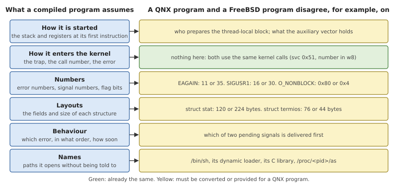
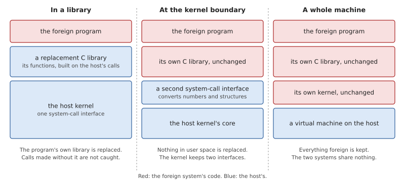
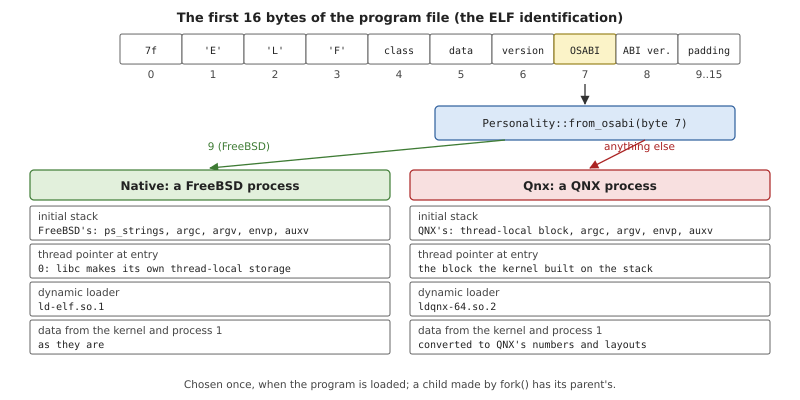
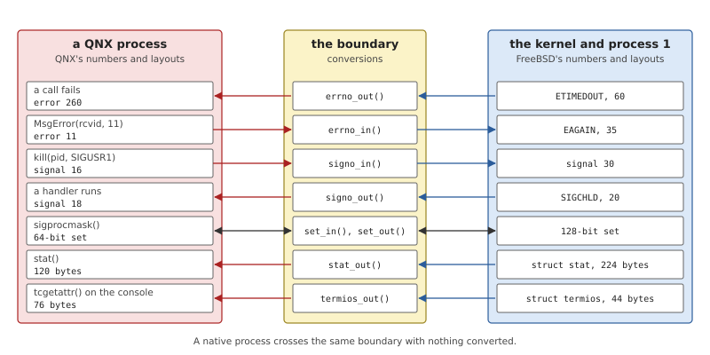
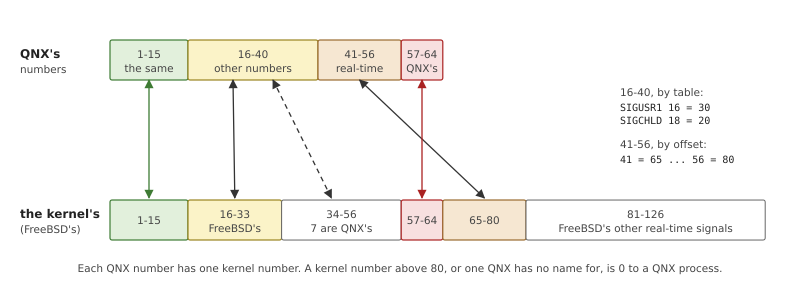
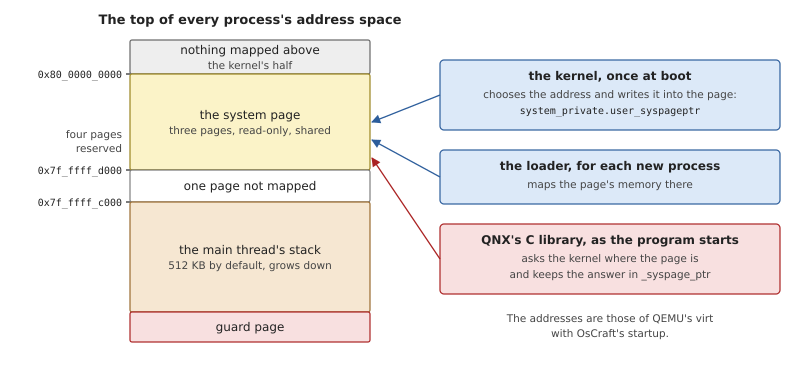

# The QNX Personality

Everything in this book so far describes a FreeBSD system on a real-time
microkernel. This part describes an option on top of it: running
programs that were compiled for QNX OS 8.0, unmodified, next to the
native ones. Nothing in the native system depends on the option. QNX's
programs and libraries are not part of OsCraft; they come from a
licensed QNX Software Development Platform (SDP) that a user already
has, and are added to the image only when it is built with `QNX=1`.
Without them the system contains no QNX code at all.

This chapter covers the kernel's side: how a process comes to be a QNX
process, and what the kernel and process 1 do differently for it.
Chapter 33 covers the user-space side, the translation service `qnxd`
and the directory QNX's files live in. Chapter 34 explains how the
behaviour a QNX program sees is measured against QNX's own kernel.

## Running another system's programs

A compiled program is full of assumptions about the system it was built
for. None of them are visible in its source code, and all of them must
hold when it runs.



*Figure 32.1: The layers of an application binary interface. A program
built for one system runs on another only if every layer is the same or
is made to look the same.*

Together these assumptions are the system's *application binary
interface*, or ABI. Reading Figure 32.1 from the top:

- **The start.** The first instruction of a program expects its
  arguments, its environment and a table of facts about the machine
  (the *auxiliary vector*) at known places on the stack, and certain
  registers set.
- **The way into the kernel.** The C library was compiled with one trap
  instruction, one register for the call number, one set of numbers,
  and one way of telling success from failure.
- **Numbers.** "Try again" is error 11 on one system and 35 on another.
  The same is true of signal numbers and of the bits in a flags word.
- **Layouts.** `struct stat` has the same name everywhere and a
  different size and field order on each system.
- **Behaviour.** Where the standards leave a choice (which of two
  pending signals comes first, which error wins when two apply),
  programs come to rely on what their system does.
- **Names.** A program opens `/bin/sh` for `system()`, and its dynamic
  loader opens the C library, at paths fixed when it was built.

A system that wants to run another system's binaries has to supply all
of these. There are three places to do it.



*Figure 32.2: Three ways to run a foreign program. They differ in how
much of the foreign system is kept, and in how much the two kinds of
program can share.*

**In a library.** The foreign program is given a replacement for its C
library, with the same functions built on the host's system calls. This
needs no change to the kernel. It does need a complete second C
library, kept faithful to the original, and it fails for any program
that reaches the kernel without going through the library.

**At the kernel boundary.** The foreign program keeps its own C library
and dynamic loader, and the kernel accepts that library's system calls.
The kernel recognises a foreign binary when it loads it, marks the
process, and from then on converts numbers and structures as they cross
into and out of the kernel for that process. The marked variant is
often called a *personality*, a *brand* or an *ABI*. Everything inside
the kernel is shared: both kinds of process are scheduled together, can
signal each other and use the same files.

**A whole machine.** The foreign kernel runs too, in a virtual machine.
Compatibility is perfect, and the two systems share nothing but what a
network or a virtual disk can carry.

FreeBSD's Linux emulation is the well-known example of the second way.
FreeBSD recognises a Linux binary by the mark in its ELF header, gives
its process a second system-call table whose entries convert Linux's
arguments and call the same kernel functions the native table does, and
looks up every path a Linux process names under `/compat/linux` first,
where Linux's own libraries are installed. The Linux C library runs
unchanged and never learns that the kernel is not Linux.

The second way has one rule that keeps it manageable: *the kernel has
one internal form, and only the foreign process is converted.* If each
kind of process could leave its own numbers in shared kernel state,
every piece of code that touched that state would have to ask who wrote
it. With one internal form, conversion happens at the edge and nowhere
else.

## The QNX personality in OsCraft

OsCraft uses the second way, with a difference that makes the job much
smaller than FreeBSD's. A Linux system call and a FreeBSD system call
are different calls. In OsCraft the kernel calls (`MsgSendv()`,
`TimerCreate()`, `SyncMutexLock()` and the rest) were designed after
QNX's from the start, and the native system reaches them through libsys
(Chapter 24). A QNX program's C library makes the very same calls. So
the second row of Figure 32.1 needs no work at all, and the rest comes
down to four things:

1. recognising a QNX program and starting it the way its library
   expects;
2. converting numbers and a few structures at the kernel-call boundary;
3. having process 1 answer a QNX process in QNX's layouts, and offer
   the few services only QNX programs ask for;
4. translating between a QNX program and the native *servers*, which
   speak FreeBSD's layouts. That is done outside the kernel and is the
   subject of Chapter 33.

The internal form is FreeBSD's. The kernel's error numbers, signal
numbers and structures are the native ones described in Chapter 23, and
the code for QNX's variants carries a `Qnx` or `qnx_` prefix
(`QnxStat`, `QnxTermios`, `qnx_errno`). The kernel's part is in
`kernel/src/personality/qnx.rs`. The tables themselves, which number is
which, are in a small crate of pure functions, `user/qnxabi`, compiled
into the kernel, into `qnxd` and into libsys, so that all three convert
the same way.

### Becoming a QNX process

The personality is decided when a program is loaded, from one byte of
its file.



*Figure 32.3: The loader reads byte 7 of the ELF header. FreeBSD's
toolchain writes 9 there; anything else is taken to be a QNX program.*

FreeBSD's toolchain marks every binary it produces with the value 9 in
the OS/ABI byte of the ELF header. QNX's toolchain leaves the byte 0
for a dynamically linked program and writes 3 for a statically linked
one. `from_osabi()` (Listing 19.2) therefore tests for FreeBSD's mark
and treats everything else as QNX. The loader stores the result in the
process (`Process::personality`) before it builds the stack, each
`execve()` decides again, and a child made by `fork()` inherits its
parent's. A program can read its own from `/proc/self/personality`,
which holds the line `freebsd` or `qnx`.

Chapter 19 describes the native start. A QNX program differs in three
ways.

**The dynamic loader is QNX's.** A dynamically linked QNX program names
`/usr/lib/ldqnx-64.so.2` as its interpreter. The kernel's loader maps
whichever interpreter the program names; the image provides QNX's under
that name (Chapter 33). From there QNX's loader finds QNX's C library
and the program's other libraries by itself, with ordinary `open()` and
`mmap()` calls.

**The initial stack is QNX's.** `initial_stack_qnx()` in
`kernel/src/proc/loader.rs` lays out, from the top of the stack down:
the main thread's *thread-local block*, a 16-byte control block that
points at it, the argument and environment strings, the auxiliary
vector, the environment pointers, the argument pointers and the
argument count. The auxiliary vector holds what QNX's loader and
library read: the program's headers and entry point, the page size, the
interpreter's base address and its file's device and inode numbers, the
path of the executable, sixteen random bytes, and the room left on the
stack. It carries no user or group IDs; QNX's library asks process 1
for those.

**The kernel builds the main thread's thread-local block.** On FreeBSD
the C library allocates thread-local storage itself and sets the thread
pointer register. QNX's library expects to find the block already
there, with the thread pointer aimed at it, at its first instruction.

*Listing 32.1: The thread-local block of a QNX program's main thread,
from `initial_stack_qnx()` (`kernel/src/proc/loader.rs`).*

```rust
{{#include ../../../kernel/src/proc/loader.rs:qnx_thread_block}}
```

The block tells the library its stack's size and base, where its
`errno` variable is, and its process and thread IDs. The `__owner`
field is the value the library writes into a mutex when this thread
locks it: the process ID in the upper half and the thread ID in the
lower. The same block is built for every later thread of a QNX process
by `ThreadCreate()`, and it is the reason the two personalities create
threads through different calls: FreeBSD's thread library calls
`thr_new()`, which takes a stack and a thread pointer prepared by the
caller, and the kernel refuses that call, with `ENOSYS`, from a QNX
process.

`fork()` shows the same difference once more. The child of a QNX
process finds its new process ID in its thread-local block, so the
kernel rewrites the block in the child's copy and makes the child's
call return 0. A native child has no such block; its call returns its
ID with a marker bit, and libsys does the rest.

### The kernel-call interface

A kernel call is the instruction `svc #0x51` with the call's number in
register `w8` and its arguments in `x0` to `x7`. On success the result
is in `x0` and the program continues at the next instruction. On
failure `x0` holds the error number and the program continues one
instruction further on, so the library's stub has a branch at each of
the two places (Chapter 7). The call numbers in
`kernel/src/ker/number.rs` are those of QNX OS 8.0, and Appendix A
lists them.

This is the interface of both personalities. libsys was written to it;
QNX's C library was compiled to it. A QNX program therefore enters the
kernel through the same dispatcher, reaches the same handlers and
blocks in the same queues as a native one. Four numbers that QNX does
not use are OsCraft's own: three serve FreeBSD's thread library and are
refused to a QNX process, and one, `MsgForwardv()`, serves `qnxd`.

One structure filled by the kernel is worth a remark. When a server
receives a message it can ask who sent it, and gets a small record with
the sender's process, thread and priority and a word of flags. OsCraft
uses one bit of that word, a bit QNX leaves unused, to say "this client
is a native process". For a QNX client the word is exactly what QNX's
kernel would write. A server compiled for QNX sees nothing it does not
know, and a native server can tell its two kinds of client apart.

### Conversion at the boundary

What the two personalities disagree on is data, and Figure 32.4 shows
where each kind is converted.



*Figure 32.4: A QNX process's numbers and structures are converted as
they cross into and out of the kernel. The values on the right are the
kernel's own, which a native process receives unchanged.*

**Error numbers.** Every kernel call that fails passes its error
through `Personality::errno_out()` just before returning, and the one
call that takes an error number from a program, `MsgError()`, with
which a server fails a client's request, passes it through
`errno_in()`.

*Listing 32.2: Error numbers for a QNX process, `errno_out()` and
`errno_in()` (`kernel/src/personality/qnx.rs`).*

```rust
{{#include ../../../kernel/src/personality/qnx.rs:errno}}
```

Most errors exist on both systems under different numbers, and
`user/qnxabi/src/errno.rs` pairs them. Two cases need care.

- QNX has a few errors FreeBSD has no number for. One is `ESRVRFAULT`,
  with which a client is told that its *server* passed a bad buffer;
  the kernel itself raises it (Chapter 10). Inside the kernel such an
  error is QNX's number with a mark bit set above it (`QNX_ONLY`). On
  the way out to a QNX process the mark is removed and the number is
  exact. A native process gets `EIO` instead.
- A FreeBSD error that QNX has no name for reaches a QNX process as
  `EIO`.

Because the conversion sits in the dispatcher's return path, it also
covers errors that came from somewhere else. When a native server fails
a QNX client's request with FreeBSD's `ETIMEDOUT`, the number travels
through the kernel as 60 and becomes 260 only as the client's
`MsgSendv()` returns.

**Signals.** The kernel's signals are FreeBSD's: its numbers, 128-bit
sets and 62 real-time signals (Chapter 14). QNX has 64 signals in a
64-bit set, and only the first fifteen have the same numbers.



*Figure 32.5: Every QNX signal number has a kernel number. The classic
signals from 16 on are renumbered by a table, QNX's sixteen real-time
signals become the first sixteen of FreeBSD's, and the top eight keep
their numbers.*

*Listing 32.3: Signal numbers for a QNX process
(`kernel/src/personality/qnx.rs`).*

```rust
{{#include ../../../kernel/src/personality/qnx.rs:signals}}
```

Seven of QNX's signals have no FreeBSD counterpart (its power-failure
signal is one). They are given kernel numbers in the range FreeBSD
leaves unused, 34 to 56, so they exist only between QNX processes and
take nothing away from native ones. QNX's top eight, 57 to 64, are the
always-blocked notification signals of Chapter 14, which are numbered
the same in both.

Numbers are only part of it. For a QNX process the kernel also converts
signal sets in both directions (`set_in()`, `set_out()`), the flag bits
of `sigaction()`, and the `si_code` values that say who sent a signal.
`view()` rewrites a whole `siginfo` for delivery, including the signal
number inside a child's exit status. Three rules of behaviour follow
the personality as well:

- **Order.** When several signals are ready, a native process takes
  the one with the lowest kernel number and a QNX process the one with
  the lowest *QNX* number (`next()`), which is not the same signal.
- **Queuing.** A native process has real-time signals queued and
  classic ones merged, as on FreeBSD. For a QNX process a signal is
  queued if its handler was installed with `SA_SIGINFO`, whatever its
  number.
- **The handler's frame.** A QNX handler receives QNX's `ucontext_t`
  and `siginfo_t` on its stack, laid out by `enter_handler_qnx()`, and
  returns through QNX's library stub.

**Structures.** The kernel proper passes few structures to programs;
most belong to process 1 and to servers. Where the kernel does (the
flags of a kernel pipe or of a message queue, for instance) it asks the
caller's personality and converts in place.

### What process 1 answers differently

Process 1 is a server like any other, but it runs inside the kernel
file and can see each client's personality directly. So its managers
compute one answer, in FreeBSD's form, and encode it for the client as
the last step.

- **`stat()` and directories.** The built-in resource managers build
  FreeBSD's `struct stat` (Chapter 22). For a QNX client `stat_out()`
  produces QNX's 120-byte structure, with the two things it has that
  FreeBSD's lacks filled in from an extra value the manager supplies.
  Directory entries are written as QNX's `struct dirent`, whose name
  starts four bytes earlier than FreeBSD's.
- **Terminal settings.** The kernel's console keeps FreeBSD's `struct
  termios`. A QNX program's `tcgetattr()` and `tcsetattr()` on it go
  through `termios_out()` and `termios_in()`, which remap every flag
  word and the control characters. QNX has one control character
  FreeBSD has no slot for, and it keeps its value across the round
  trip.
- **Open flags.** The bits of `open()`'s flags differ
  (`user/qnxabi/src/fcntl.rs`), and the path manager converts them
  when a connect request comes from a QNX process.
- **Waiting for a child.** The status a parent collects is a `siginfo`,
  written in the waiter's numbers and layout.

Process 1 also keeps some services that only QNX programs use. Native
programs never send these messages, because libsys reaches the same
ends another way.

*Table 32.1: Services of process 1 and the kernel that only QNX
programs use.*

| Service | What a QNX program uses it for |
|---|---|
| creating a child from a spawn request | QNX's `posix_spawn()` and `spawn()` send process 1 the file actions and attributes and receive a finished child; FreeBSD's library forks and executes instead (Chapter 19) |
| `/proc/<pid>/as` and `ctl` with device-control requests | QNX's `pidin`, `top` and `slay` list processes, threads, mappings, timers and channels through them; native tools use `sysctl()` (Chapter 18) |
| `/proc/mount` | the path space listed by server, as QNX's tools expect to browse it |
| names under `/dev/name/local` | QNX's `name_attach()` and `name_open()`, a registry of servers by name |
| configuration strings | `confstr()` and `sysconf()` as QNX's library asks for them, see below |
| the kernel's message queues | QNX's `mqueue` server and `mq_*` functions (Chapter 12) |

The configuration strings show how thin the difference can be. QNX's
C library asks process 1 for the default search paths
(`kernel/src/proc/sysmgr.rs`). OsCraft answers with paths that list
QNX's directories under `/compat/qnx` before the system's own, so a QNX
shell started with no `PATH` finds QNX's tools first. The operating
system's name is reported as `OsCraft`, and the release as 8.0.0, the
QNX release whose interface this is.

One difference from QNX is deliberate and visible. On QNX the first
process is called `procnto`. On OsCraft it is called `kernel`, after
the file it is loaded from, and QNX's tools show it under that name:
`pidin` lists process 1 as `kernel`, and `/proc/1/cmdline` holds
`kernel` followed by its boot options.

### The system page

QNX's C library reads the system page (Chapter 5) directly: the number
of processors, the clock's rate, the layout of memory. It does not open
a file to find it. A program learns the page's address from the kernel,
with a kernel call, and QNX's library keeps it in a variable,
`_syspage_ptr`, that programs and QNX's tools then use freely. A program may also pass
bytes of the page to a server, for example by writing a string from it
to a file. So the page must be mapped in every process, at a user
address, readable and never writable.



*Figure 32.6: The system page is mapped read-only in the last pages of
every process's address space, above the main thread's stack.*

`adopt_user_syspage()` in `kernel/src/proc/loader.rs` chooses the
address once, at boot. If the startup program has written a usable user
address in the page, the kernel takes it. OsCraft's startup does not,
and then the kernel places the page so that it ends exactly at the end
of user space. On QEMU's `virt` the page with its per-processor parts
is three pages long, which puts it at `0x7f_ffff_d000`. The kernel
writes the chosen address back into the page itself, because QNX's
tools read it from there, and the loader maps the page's memory at that
address in every new process, of either personality. The main thread's
stack ends four pages below the end of user space, whatever the page's
length.

Why this exact address matters, and how it was found, is one of the
worked examples of Chapter 34.

## Summary

- Running another system's binaries means matching its whole binary
  interface: the start of a program, the way into the kernel, numbers,
  layouts, behaviour and file names. OsCraft does it at the kernel
  boundary, as FreeBSD does for Linux programs.
- The kernel calls are the same for both personalities, with QNX 8.0's
  trap instruction and call numbers, so a QNX program's C library runs
  on the kernel unchanged.
- A process's personality comes from one byte of its program's ELF
  header. A QNX process gets QNX's initial stack and a thread-local
  block built by the kernel, and starts in QNX's dynamic loader.
- The kernel's internal numbers are FreeBSD's. Error numbers, signal
  numbers, signal sets and a few flags are converted for a QNX process
  as they cross the boundary, by tables shared with user space in
  `user/qnxabi`.
- Process 1 computes each answer once and encodes it for the client's
  personality. It also keeps a few services only QNX programs ask for:
  spawning a child directly, the control files under `/proc`, server
  names and message queues.
- The system page is mapped read-only at the top of every address
  space, where QNX's library and tools expect to find it.
- All of this is optional. A system built without `QNX=1` has the same
  kernel and no QNX program to use these paths.
