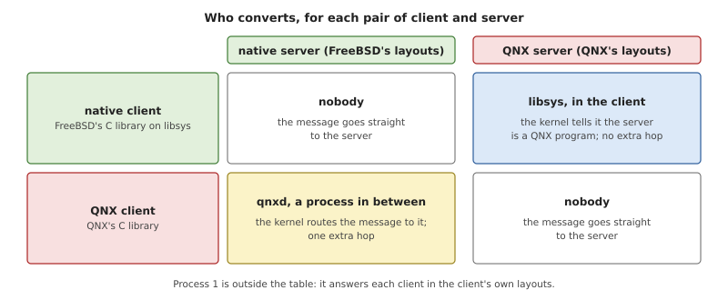
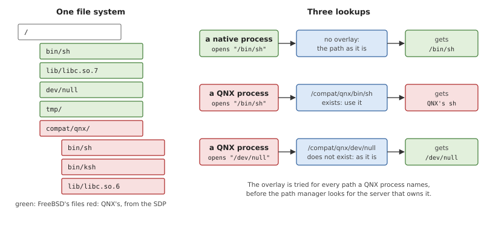
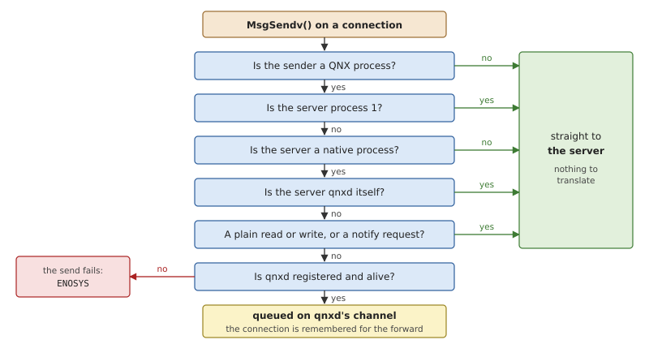
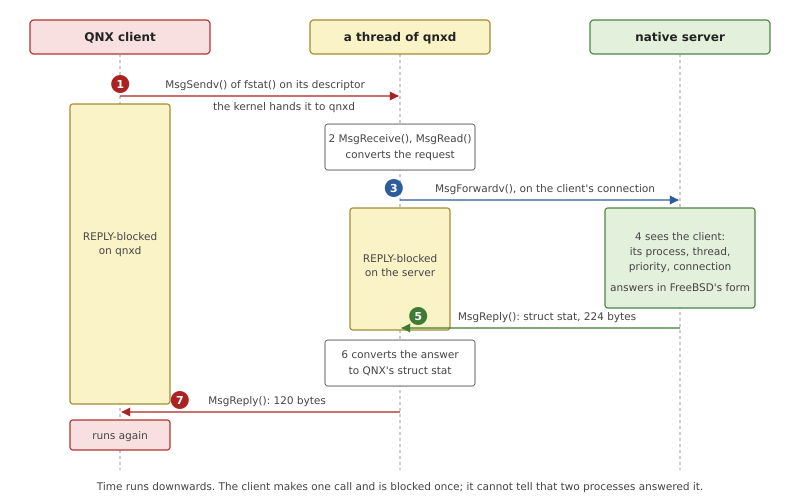
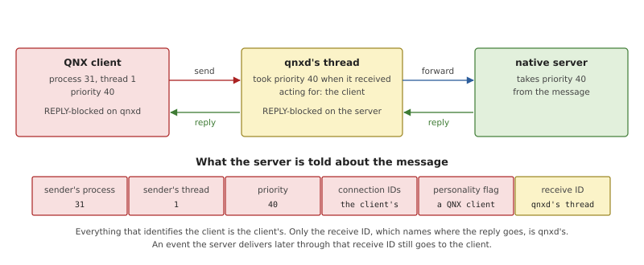
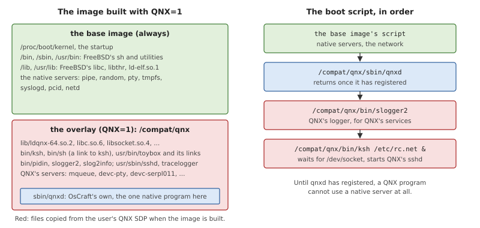

# qnxd and the Overlay

Chapter 32 showed how the kernel and process 1 serve a QNX program in
QNX's own numbers and layouts. That leaves the rest of the system. A
QNX program also opens files, reads directories, sets up a terminal and
talks to the network, and on OsCraft the servers behind those calls are
native: they answer in FreeBSD's layouts. This chapter describes the
two pieces that close the gap: a translation service called `qnxd`,
which sits between a QNX program and a native server, and a directory,
`/compat/qnx`, that holds QNX's files and is searched first whenever a
QNX program names a path.

Both exist only in an image built with `QNX=1`. The native system does
not contain them and does not need them.

## Two families of programs in one system

A system that runs two kinds of program has two questions to answer
once the kernel's own interface is settled: how the two kinds talk to
each other's servers, and where each kind finds its files.

### Translating a protocol

In a microkernel system, a client and a server agree on a *protocol*:
the layout of each request and each reply. When there are two families
of clients and two families of servers, each family with its own
layouts, some pairs do not understand each other, and something must
translate. There are four places to put the translation.

- **In every server.** Each server learns both dialects and answers
  each client in the client's. This is the fastest, and it puts the
  foreign system's layouts into every server ever written for the host.
- **In the client's library.** The library converts before it sends
  and after it receives. This costs nothing extra at run time. It is
  only possible when the library is yours to change.
- **In the kernel.** The kernel converts messages as it copies them.
  The kernel would then have to parse the protocols of user-space
  servers, which is exactly what a microkernel is built to avoid.
- **In a process in between.** A translator receives the client's
  request, converts it, sends it on, and converts the answer on the way
  back. Nothing else in the system changes. The cost is an extra hop
  for each request.

A translator in between has a well-known weakness: it is a *proxy*, and
a server normally sees its proxy, not the real client. Three things a
server learns from the kernel about a request then become wrong.

- **Identity.** Servers check permissions against the sender's user and
  group, and keep state per client process. Through a proxy, every
  client looks like the proxy.
- **Priority.** With priority inheritance (Chapter 10) a server works
  at its client's priority. Through a proxy it works at the proxy's.
- **Later delivery.** A server that is asked to notify a client later
  ("tell me when data arrives") keeps a reference to the request it
  received. Through a proxy, that reference leads to the proxy.

A proxy that is to be invisible must solve all three.

### A compatibility root

A foreign program expects its own files at fixed paths: its dynamic
loader, its C library, its shell at `/bin/sh`. The host has other files
at the same paths. Three arrangements are possible.

- **Rename.** Install the foreign files elsewhere and patch each
  program to look there. It breaks on the first path compiled into a
  binary.
- **A separate root.** Give foreign processes their own root directory
  (`chroot`). Every path now resolves to the foreign file, but the
  process has also lost the host's `/dev`, `/tmp` and everything else
  the two kinds of program are supposed to share.
- **An overlay.** Keep one file system, install the foreign files under
  one directory, and for a foreign process look each path up under that
  directory first and in the real root second.

FreeBSD's Linux emulation uses the third: Linux's files live under
`/compat/linux`, and a path named by a Linux process is tried there
before it is taken as it stands. The process sees its own libraries and
shell, and the host's devices and temporary files, in what looks like
one ordinary tree.

## Translation and the overlay in OsCraft

OsCraft takes the overlay from FreeBSD as it is, with `/compat/qnx` for
the directory. For the protocol it uses different places for different
pairs.



*Figure 33.1: Where conversion happens for each pair. Only a QNX client
of a native server needs a process in between.*

Two of the four pairs need nothing. A native client and a native server
both speak FreeBSD's layouts. A QNX client and a QNX server, for
example QNX's `pidin` writing to QNX's serial driver, both speak QNX's,
and their messages pass through the kernel untouched.

A native client of a QNX server is handled in the client's library,
because that library is OsCraft's own. When libsys connects to a
server, the kernel's answer says whether the server is a QNX program,
and libsys then sends QNX's flag values to it.

A QNX client of a native server cannot be handled that way: the client
library is QNX's and must not be changed, and the native servers are
kept free of QNX's layouts on purpose. So this one pair goes through a
translator, `qnxd`, and the kernel makes it invisible to both sides.

### The overlay

The overlay is one function in the pathname manager.

*Listing 33.1: The path a QNX program means, `overlay()`
(`kernel/src/proc/pathmgr.rs`).*

```rust
{{#include ../../../kernel/src/proc/pathmgr.rs:overlay}}
```

Chapter 21 describes how process 1 makes a path absolute against the
caller's working directory and root before it looks for the server that
owns it. `overlay()` runs at the end of that step. For a native process
it returns the path unchanged. For a QNX process it asks whether the
same path exists under `/compat/qnx` and, if so, returns that path
instead.



*Figure 33.2: One tree, two views. A QNX process finds its own shell
at `/bin/sh` and the system's device at `/dev/null`.*

The effect is what Figure 33.2 shows.

- QNX's dynamic loader opens `/lib/libc.so.6` and gets QNX's C
  library. `system()` in a QNX program runs `/bin/sh` and gets QNX's
  shell. Neither knows the files are somewhere else.
- `/dev/null`, `/tmp`, `/dev/socket` and every other path that has no
  counterpart under `/compat/qnx` are the system's, shared with native
  programs. A file a QNX program creates in `/tmp` is in the real
  `/tmp`.
- A path that already starts with `/compat/qnx` is left alone, so the
  directory can also be named outright.
- A native process sees `/compat/qnx` as an ordinary directory and
  nothing of the overlay. FreeBSD's `ls /bin/ksh` fails, because there
  is no such file in `/bin`.

Because the overlay follows the process and not the shell it was typed
into, it has one consequence worth knowing. In a QNX shell, typing
`/bin/sh` starts QNX's shell again, not FreeBSD's: the shell is a QNX
process, so the path it passes to the kernel is looked up through the
overlay. The personality of the new process is then decided by the file
that was found. To start FreeBSD's `sh` from a QNX shell, the tests run
a small native program that executes its arguments; once that program
is running it is a native process, and *its* `/bin/sh` is FreeBSD's.

The overlay consults the image file system, where QNX's files are
installed. It is a lookup rule, not a mount: the path manager's table
of servers (Chapter 21) is the same for everyone.

The search paths are the same for both personalities as well. The boot
environment's `PATH` lists `/proc/boot`, `/bin`, `/sbin`, `/usr/bin` and
`/usr/sbin`, and nothing under `/compat/qnx`; a QNX shell finds QNX's tools there
through the overlay.

### qnxd: a translator the kernel routes to

`qnxd` is a small native server, written in Rust (`user/qnxd`). It owns
one channel, and it registers that channel with the pathname manager
under a file type reserved for it. The pathname manager recognises the
type and tells the kernel's message-passing code which channel is
`qnxd`'s. Only a process running as root can register.

From then on the kernel checks every `MsgSendv()`.

*Listing 33.2: Deciding whether a message goes to its server or to
`qnxd` first, `qnxd_for()` (`kernel/src/ker/msg.rs`).*

```rust
{{#include ../../../kernel/src/ker/msg.rs:qnxd_for}}
```



*Figure 33.3: The questions `qnxd_for()` asks, in order. A native
program's send leaves at the first one.*

The decision reads only two facts the kernel already has, the
personalities of the sender and of the channel's owner, and the first
nine bytes of the message. Those bytes are enough to recognise three
kinds of message that go straight to the server:

- **Plain reads and writes.** The request is a small header in a
  layout both personalities share, and the data is bytes. Nothing in it
  needs converting, and it is by far the most frequent kind.
- **Notify requests**, with which a client asks to be told when a
  descriptor becomes ready (`poll()` and `select()` are built on them).
  The server keeps the request and delivers an event later, so it must
  have received it from the real client.

Messages to process 1 never go to `qnxd`, since process 1 answers each
client in its own layouts (Chapter 32).

The last question of Figure 33.3 is a safety rule. If a QNX program
sends to a native server and there is no `qnxd`, the send fails with
`ENOSYS`. It is never delivered directly, because the client would
read a FreeBSD reply as if it were QNX's and act on garbage. A QNX
program's `open()` of a native server's path then fails with `ENOENT`:
QNX's library takes the `ENOSYS` to mean "not this server" and finds no
other. `qnxd` can be started again, and descriptors opened before it
ended work again once it has registered.

### One message through qnxd

When the answer is `qnxd`, the kernel queues the client's send on
`qnxd`'s channel instead of the server's. For the client nothing is
different: it is blocked in `MsgSendv()` and will get a reply.



*Figure 33.4: A QNX program's `fstat()` on a file served by a native
server. The request and the reply each pass through `qnxd`, which
converts what differs.*

A thread of `qnxd` receives the message like any server (step 2). It
reads the whole request into its own buffer, converts what the two
systems number differently, and then makes the one kernel call that
exists for it, `MsgForwardv()`. Its arguments are the receive ID, the
parts of the message to send, the parts of a buffer for the reply, and
a place for the reply's length.

`MsgForwardv()` is `MsgSendv()` with a receive ID where the connection
would be. The kernel finds the client that is waiting on `qnxd` under
that receive ID, takes the connection *the client* originally sent on,
and sends `qnxd`'s converted message on it. `qnxd`'s thread blocks for
the reply exactly as a client would (step 3). When the server replies,
the thread wakes with the server's status and the reply's length,
converts the reply, and answers the client with an ordinary
`MsgReply()` (steps 6 and 7). An error from the server is passed back
with `MsgError()`, and its number is converted for the client by the
kernel on the way out, as for any failed call.

`qnxd` never opens anything itself and holds no state between requests.
It does not need to know which server a message is for: the kernel
remembered the connection when it diverted the send.

*Table 33.1: What `qnxd` converts. Everything else is forwarded as it
came.*

| Message | On the way to the server | On the way back |
|---|---|---|
| open (`_IO_CONNECT`, `_IO_OPENFD`) | the open flags, QNX's bits to FreeBSD's | |
| `stat()`, alone or combined with an open | | FreeBSD's `struct stat`, 224 bytes, to QNX's, 120 bytes |
| reading a directory | | each FreeBSD `struct dirent` to QNX's |
| `tcsetattr()` | QNX's `struct termios` to FreeBSD's; the request shrinks | |
| `tcgetattr()` | the request is rewritten to ask for FreeBSD's size | FreeBSD's `struct termios` to QNX's |
| getting and setting a descriptor's status flags | the flags, when setting | the flags, when getting |
| `fsync()` and its relatives | the flags | |

The conversions themselves are the functions of `user/qnxabi`, the same
ones the kernel uses. For `stat()`, `qnxd` does not guess: a server
states in the reply's status which form its structure has, and `qnxd`
converts only a reply marked as FreeBSD's.

### Staying invisible

The three weaknesses of a proxy are answered in the kernel, by one
field. While a thread is inside `MsgForwardv()`, the kernel records
which client it is *acting for*.



*Figure 33.5: The server's view of a forwarded message. The record the
kernel fills in for the server describes the client, not `qnxd`.*

**Identity.** When the server asks who sent the message, the kernel
fills the record from the client the sending thread is acting for: the
client's process and thread, and the IDs of the client's connection. A
server that checks credentials or keeps per-client state does so for
the QNX program. The personality flag in the record says "QNX client",
which is how the native pipe server knows to give such a client QNX's
atomic write size of 5120 bytes rather than FreeBSD's 512 (Chapter 12).

**Priority.** `qnxd`'s threads inherit priority like any server's: the
thread that receives a message takes the sender's priority, up or
down. It then sends at that priority, and the native server inherits it
in turn. A QNX client at priority 40 has its request served at 40 by
both processes, and one at 5 does not get `qnxd`'s own priority as a
gift. The test for this sends from priorities 40, 15, 60 and 5 to a
native server that replies with the priority it is running at.

**Later delivery.** When a server delivers an event through the receive
ID of a forwarded message, the kernel follows the same field back to
the client. Notify requests avoid the question entirely by going
direct.

Two more details keep a slow server from harming anyone else.

- `qnxd` runs a pool of threads. Whenever a thread takes a message and
  no other thread is left waiting, it starts another. A request that
  blocks for a long time in its server, waiting for a connection on a
  socket for example, holds one thread of the pool, and the next
  request finds another.
- `qnxd`'s channel asks to be told before a client leaves a request
  early (the unblock flag of Chapter 10). When a signal arrives for a
  client that is waiting on `qnxd`, the kernel looks for the thread
  acting for that client and passes the request to leave on to the real
  server, through that thread. The server decides, as it would for a
  direct client, and the client leaves when the answer has come back
  through `qnxd`.

> [!WARNING]
> `qnxd_for()` runs on every `MsgSendv()` in the system. Its first test,
> the sender's personality, is what keeps it free for native programs:
> keep that test first when changing the function.

### The network

There is one network stack, `netd` (Chapter 28), for both
personalities. The QNX overlay brings no network stack of its own.

A socket is a connection to a path under `/dev/socket`, and each socket
call is a message on that connection. QNX's socket library,
`libsocket`, sends such messages, and `netd` was written to answer the
messages both libsys and `libsocket` send. A QNX program's `socket()`,
`bind()`, `connect()` and option calls therefore travel through `qnxd`
like any other request to a native server, and `qnxd` forwards them
with the conversions of Table 33.1 and no others. `send()` and `recv()`
on a connected socket are plain writes and reads and go direct, and so
do the notify requests behind `poll()` and `select()`. Failures come
back as FreeBSD's error numbers and are converted by the kernel.

With this, QNX's `sshd` from the SDP accepts connections on `netd`, and
QNX's `scp` and `sftp` copy files through it. The tests cover TCP, UDP,
name lookup, socket options, `poll()`, `select()` and the error cases
from a QNX program.

### What `QNX=1` puts in the image

`images/qnx.build` is appended to the base image's build file when the
image is built with `QNX=1` (Chapter 3). Everything it adds is under
`/compat/qnx`, and everything except `qnxd` is copied from the user's
SDP, found through `$QNX_TARGET`. The repository holds no QNX file.



*Figure 33.6: The image built with `QNX=1`, and the lines the overlay
adds to the end of the boot script.*

*Table 33.2: What the overlay installs under `/compat/qnx`.*

| Group | Files |
|---|---|
| loader and libraries | `ldqnx-64.so.2`, QNX's `libc.so.6`, `libm`, `libgcc_s`, `libsocket`, and the libraries the tools below need |
| shell and commands | `ksh`, with `sh` as a link to it; `toybox` with links for `ls`, `cat`, `grep` and the other usual commands |
| QNX's tools | `pidin`, `top`, `slay`, `kill`, `stty`, `on`, `waitfor`, `getconf`, `slog2info`, `tracelogger` |
| QNX's servers | the logger `slogger2`, the message-queue manager `mqueue`, the serial and pseudo-terminal drivers, block-device and file-system drivers |
| network programs | `sshd` and its helpers, `ssh`, `scp`, `ifconfig`, `ping`, `netstat` |
| the translator | `qnxd`, OsCraft's own |

One file is installed outside the directory: a link at
`/usr/lib/ldqnx-64.so.2`, the path every dynamically linked QNX program
names as its interpreter. The kernel's program loader resolves that
name itself, before the new process exists, and so does not go through
the overlay.

The overlay also extends the boot script (the right half of Figure
33.6). `qnxd` comes first. It forks, the child registers the channel,
and the parent exits only when the child has done so; the script, which
runs its commands in order, therefore continues with every native
server already reachable from QNX programs. Then come QNX's logger,
which QNX's services write to, and a QNX shell script that waits for
the network and starts `sshd`.

QNX's own pipe manager and random-number server are in the image but
are not started: the native ones serve QNX programs through `qnxd`. The
message-queue manager is the opposite case. No native server manages
POSIX message queues, so a QNX program that wants them starts QNX's
`mqueue`, which runs on the kernel's message-queue calls (Chapter 12).

The console of this image is still FreeBSD's `sh`. The test image for
the QNX personality goes one step further and starts QNX's serial
driver and QNX's `ksh` as the console, because its tests are typed into
a QNX shell (Chapter 34).

## Summary

- Two families of programs need a rule for each pair of client and
  server. In OsCraft only one pair needs a process in between: a QNX
  client of a native server.
- `/compat/qnx` holds QNX's files. For a QNX process the pathname
  manager tries every path under it first, so the process finds its own
  loader, library and shell at their usual paths and shares the
  system's devices and `/tmp`.
- The kernel diverts a QNX program's message for a native server to
  `qnxd`, by looking at two personalities and nine bytes. Plain reads,
  plain writes and notify requests go direct; without `qnxd` the send
  fails rather than deliver a reply the client would misread.
- `qnxd` converts the request, forwards it with `MsgForwardv()` on the
  client's own connection, converts the reply and answers the client.
  It converts open flags, `stat`, directory entries and terminal
  settings.
- The server sees the real client: its identity, its connection and its
  priority. Priority inheritance holds across both hops.
- QNX's `libsocket` reaches the native network stack the same way, so
  QNX's `sshd` runs on `netd`.
- The image gets QNX's loader, libraries, shell and tools from the
  user's SDP at build time, under `/compat/qnx`, and `qnxd` is started
  before any QNX program.
