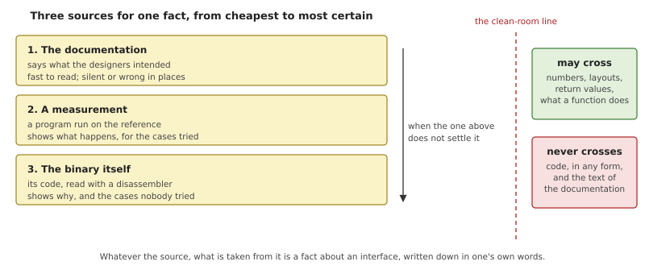
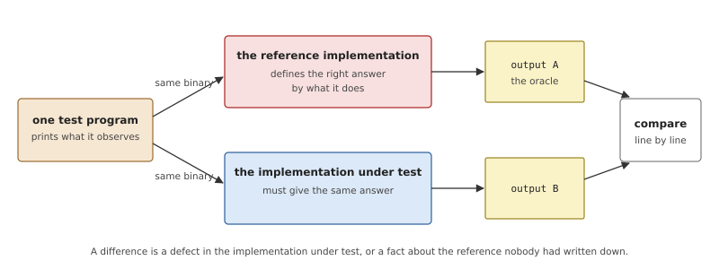
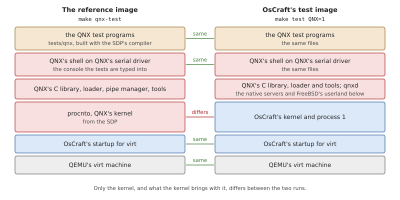
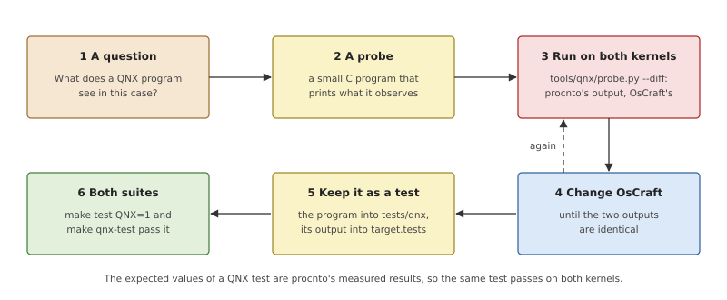
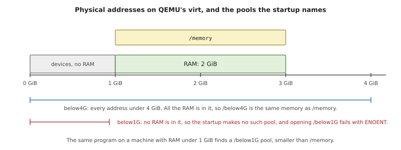
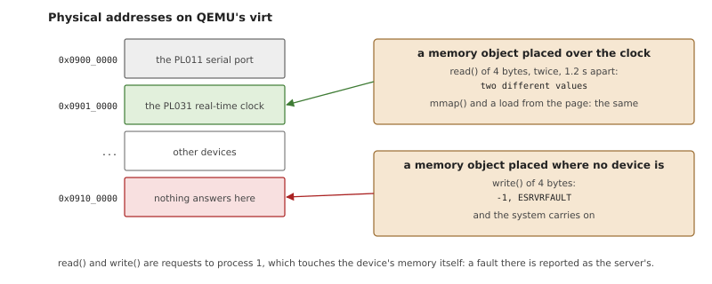

# Measuring Against procnto

The QNX personality makes one promise: a program built for QNX OS 8.0
sees on OsCraft what it would see on QNX. "What it would see" has to
come from somewhere. This chapter is about where it comes from: QNX's
own kernel, `procnto`, run on the same machine, with the same test
programs, and compared line by line. It describes the method first and
then the tools that carry it out, and ends with three cases in which
the measurement decided what the code does.

Everything here needs a licensed QNX SDP, and applies only to the QNX
personality. The native system is tested against FreeBSD's semantics,
with FreeBSD programs, and none of this is involved (Chapter 3).

## A reference implementation as the specification

To build something compatible with an existing system you need a
statement of what that system does. There are three kinds, and they are
not equally good.



*Figure 34.1: Where a fact about the reference system can come from,
and what may be taken from each source.*

**The documentation** says what a function is meant to do. It is the
place to start, and for most questions it is enough. But documentation
is written for people who use the system, not for people who rebuild
it. It leaves out what its authors considered detail: which of two
errors is reported when both apply, the order of two events, the exact
contents of a structure in an unusual case. Sometimes it describes an
older version, and sometimes it is simply mistaken.

**The system itself** has an answer for every question, including the
ones nobody thought to document, and programs in the field depend on
those answers whether they are documented or not. So when the system
and its documentation disagree, the system wins. This is what it means
to treat a *reference implementation* as the specification: the
documentation states the intent, and observed behaviour is the fact.

**The implementation's code** explains a behaviour that measurements
alone leave unclear: what rule produces the values seen, and what would
happen in the cases no test tried.

### Differential testing

The practical form of "the system is the specification" is
*differential testing*: give the same input to two implementations and
compare what comes out.



*Figure 34.2: One program is run on the reference and on the
implementation under test. The reference's output is the expected
result.*

The reference's output is called the *oracle*: the thing that says
what the right answer is. Differential testing has two properties that
ordinary testing lacks. Nobody has to work out the expected value by
reasoning, which is where test suites usually go wrong; it is read off
the reference. And a test written this way can be checked: run it on
the reference, and if it fails there, the test is wrong.

It also has two requirements, and both shape the tools in this chapter.

- **Everything except the thing under test must be the same.** If the
  two runs differ in the machine, the compiler or the libraries, a
  difference in the output proves nothing about the kernel.
- **The output must be deterministic.** A program that prints an
  address that changes with each run, or a time that depends on the
  load of the host, produces differences that mean nothing. Tests
  print what should be equal, and check ranges where exact values
  cannot be.

### Clean-room rules

Studying a system in order to be compatible with it, and copying it,
are different things, and the difference has to be kept deliberately.
The usual discipline is called *clean-room* work. Facts about an
interface may be learned from the original and used: a call's number,
a structure's layout, the value returned in a given case, what a
function does. The original's code, and the text of its documentation,
are never copied, in any form. A fact is written down in one's own
words, with a note of where it was observed, and the new code is
written from that description.

## Measuring in OsCraft

For OsCraft's QNX personality the reference is `procnto`, the kernel
and process manager of QNX OS 8.0, in the instrumented multiprocessor
variant that the SDP ships. The project's rule is short: the QNX 8.0
documentation states the intent, and where it is silent or differs,
procnto's observed behaviour is the specification. That covers return
values, error numbers, the order in which signals arrive, timings at
the granularity of the clock tick, and the contents of `/proc`.

An example of the documentation and the system disagreeing sits in the
kernel's signal code. When a signal that is not queued is sent twice
before it is delivered, the documentation says the second replaces the
first. Measured on procnto, the first stays pending and the later ones
are dropped. A QNX program on OsCraft sees what was measured.

One difference from procnto is deliberate: process 1 is named `kernel`
(Chapter 32). Everything else a QNX program can observe is meant to
match.

### The oracle: QNX test programs

The directory `tests/qnx` holds about 130 small C programs. Each
exercises one area (message passing, signals, timers, shared memory,
process creation, the path manager) and prints one line per check and
a final verdict. They are compiled with the SDP's compiler against
QNX's own C library, reached through `$QNX_HOST` and `$QNX_TARGET`, so
they are QNX programs in every respect. They are not ported to OsCraft
and contain nothing specific to it.

`tests/target.tests` lists the tests that run in a booted system
(Chapter 3 describes the file and the program that runs it). A test of
the QNX personality carries the line `needs: qnx`; about 150 of the
file's 190 tests do.

*Listing 34.1: A test of the QNX personality (`tests/target.tests`).*

```text
{{#include ../../../tests/target.tests:test_device_shm}}
```

The test runs one program at the shell and matches its output. What
makes it a differential test is where the program's own expectations
came from: every value a program in `tests/qnx` checks was first
printed by that program running on procnto.

### Two images, one machine

To honour the first requirement of differential testing, the project
builds two images that are as alike as they can be.



*Figure 34.3: The reference image and OsCraft's test image. The same
test binaries run on the same emulated machine, booted by the same
startup program.*

**The reference image** (`tests/qnx/reference.build`) boots QNX's own
kernel on QEMU's `virt`. The kernel, QNX's serial driver, pipe manager,
shell and tools come from the SDP. The startup program is OsCraft's
(Chapter 5), which builds a system page procnto accepts and starts it
as QNX's own startup would. This matters: the system page describes the
machine to the kernel, so with the same startup both kernels are told
the same things about memory, processors and interrupts. The image
then holds the test programs, under the same names as in OsCraft's.

**OsCraft's test image** for the QNX personality is the base image,
the overlay of Chapter 33, and `tests/qnx/image.build`, which adds the
same test programs and ends the boot script by starting QNX's serial
driver on the PL011 and QNX's `ksh` on it. The tests are typed into a
QNX shell on both systems, so even the shell's part in a test's output
is the same.

Two commands run the suite, one on each image.

*Table 34.1: The commands of the QNX suite. Both need the SDP's
environment.*

| Command | Boots | Runs |
|---|---|---|
| `make test QNX=1` | OsCraft's kernel, with the overlay | the native tests and the tests marked `needs: qnx` |
| `make qnx-test` | procnto, from the reference image | the tests marked `needs: qnx` |
| `make qnx-run` | procnto, from the reference image | nothing: an interactive QNX shell |

Because the expected values are procnto's, a QNX test is expected to
pass on both. Running the suite on procnto is the check on the tests
themselves: a test that fails there has a wrong expectation, or
depends on something that is not the kernel.

A few programs in `tests/qnx` are not measurements. They test parts of
OsCraft's own design that have no counterpart on QNX: that a QNX
program finds its files through the overlay, what it sees when `qnxd`
is gone, and that its priority reaches a native server. These are
installed in OsCraft's image only, and their comments say that the
expected values are OsCraft's.

A change to the QNX personality must pass `make test QNX=1`, and where
it changes what a QNX program sees, `make qnx-test` on the same tests.
Only one QEMU may run at a time on a machine: tests run beside another
QEMU fail in bulk, which looks like a broken kernel.

### The probe

A test in the suite is the end of a measurement. The beginning is a
question ("what does `posix_typed_mem_open()` return for a pool that
does not exist?") and a scratch program that prints the answer.
`tools/qnx/probe.py` runs such a program on both kernels in one
command.



*Figure 34.4: The measuring cycle. A behaviour enters the suite with
the output procnto gave for it.*

The probe does the following.

1. It compiles the program with the SDP's compiler, as the tests are.
2. It makes a copy of the reference image's build file and of the build
   file `make test QNX=1` uses, and adds the program to each as
   `/proc/boot/probe`. The copies and their images go to a directory of
   their own; the normal images are not touched.
3. It boots each image in QEMU, waits for the shell, types `probe` with
   any arguments given, and collects the output until the prompt
   returns or a time limit passes.
4. It prints both outputs, and with `--diff` a unified diff of them.

It boots the systems with the test runner's own code, so a probe runs
in exactly the environment a test will. Options skip one of the two
runs while iterating, pass kernel options to both kernels (to boot
with one processor, for instance), and choose the debug or the release
build of OsCraft's kernel.

Writing a good probe is mostly a matter of the second requirement
above. The program prints values that should be equal on both systems
and nothing else. For an address or a process ID it prints a property
("is in the last four pages", "is the same as the other one") rather
than the number. Where time is involved it uses absolute deadlines and
checks windows wide enough to hold on a loaded host. When the two
outputs are identical, the program moves to `tests/qnx`, its final
line becomes the `expect:` of a new entry in `tests/target.tests`, and
both build files get a line for it.

### Reading the binary

Sometimes a measurement shows *what* and the code is needed for *why*.
The reference image uses procnto's instrumented variant, which carries
its symbol names, so a disassembler or decompiler shows named
functions. The project reads it for interface facts only, under the
clean-room rules above:

- a finding is recorded as a description of what a named function
  does, in the project's own words, in a source comment or in this
  book, next to the code it explains;
- no code is copied, in any form;
- the SDP's licence checks are never patched or bypassed, and the
  SDP's location is never written into the tree: build files and tools
  reach it only through the environment variables its own setup script
  defines.

A typical finding is small. Reading procnto showed that its
shared-memory manager registers handlers for opening, unlinking and
mounting only, so on QNX a `mkdir()` under `/dev/shmem` can only fail. The comments in OsCraft's kernel that say "as
procnto" and name a function, or say "measured", are the record of
this work, one fact at a time.

## Three worked examples

The three cases below are tests in the suite. Each started as a
difference between the two outputs of a probe.

### Where the system page is mapped

QNX's C library keeps the address of the system page in a variable,
and programs read the page through it (Chapter 32). An early version
of OsCraft gave programs the kernel's own address for the page. A
program could read the page there, so nothing seemed wrong. The
difference appeared when a program handed part of the page to a
server, by calling `write()` with a pointer into it: the server reads
its client's buffer through the client's address space, and a kernel
address is not in it.

*Listing 34.2: Checking where the page is, from `main()`
(`tests/qnx/syspagetest.c`).*

```c
{{#include ../../../tests/qnx/syspagetest.c:syspage_where}}
```

The program does not print the address as its result; it checks two
properties of it. It is a user address, and it is the address recorded
in the page's own `user_syspageptr` field, inside the last four pages
of the address space. It then writes a string straight from the page
to the console and the whole page to `/dev/null`, and has a child try
to write to the page, which must kill the child.

Three sources came together here, as in Figure 34.1.

- *Read from the binary:* when procnto creates an address space, it
  takes the address in `user_syspageptr`, if it is a user address, and
  maps the page there.
- *Measured:* OsCraft's startup leaves no user address in that field,
  and procnto then places the page at `0x7f_ffff_d000` on QEMU's
  `virt`, three pages below the end of user space.
- *Inferred:* that the distance from the end is the length of the page
  with its per-processor parts. This fits the measurement and the
  length procnto maps, but it was not read from procnto's code, and
  the comment on `adopt_user_syspage()` says so.

OsCraft now places the page by the same rule, and the test passes on
both kernels with the same line of output. The honest label on the
third point is part of the method: an inference is recorded as one, so
that whoever meets a machine where it fails knows which step to
question.

### A memory pool that does not exist

*Typed memory* lets a program allocate from a named pool of physical
memory, such as memory below a certain address that a device needs.
The pools are named by the startup program in the system page, and a
program opens one with `posix_typed_mem_open()`.



*Figure 34.5: QEMU's `virt` has its memory from 1 GiB upwards, so one
of the customary pools has nothing in it and is not created.*

The test program opens pools and asks how much each can supply.
Measured on procnto, and now matched by OsCraft:

- a pool opened to allocate scattered memory reports its free memory,
  which for `/memory` is nearly all the free memory in the system;
- opened to allocate contiguous memory, it reports the largest free
  run, never more than the scattered figure;
- opened for neither, it reports 0;
- a pool can be named by itself, `/below4G`, or by its place in the
  system page's tree, `/memory/below4G`;
- a name that is not there fails with `ENOENT`.

Before the measurement OsCraft reported the largest contiguous run in
every case and refused names with a path in them.

The interesting result is the last kind. A pool for memory below 1 GiB
is customary, and a version of this test expected one. On `virt` there
is no memory below 1 GiB at all, the startup creates no such pool, and
opening `/below1G` fails with `ENOENT`, on procnto as on OsCraft. The
test was changed to expect exactly that on this machine, and the
changed test was compared on procnto with the probe before it was
accepted.

The lesson is about what a measurement measures. The result "the
`below1G` pool has less memory than `/memory`" was a fact about a
machine, not about the kernel. With the same startup under both
kernels, the fact changes for both at once, and the test stays a fair
comparison. A test must say which of its expectations belong to the
machine, and this one does, in the comment at its head.

### A device's registers through shared memory

On QNX a shared memory object can be placed over a range of physical
addresses, and a driver uses that to reach its device's registers.
The object can then be mapped, and it can also be read and written
with `read()` and `write()`, which are requests to the memory manager
in process 1 (Chapter 20). The question was what those calls do when
the addresses belong to a device, or to nothing.



*Figure 34.6: The two cases of the test on QEMU's `virt`: a device
that answers, and an address where none does.*

The test (Listing 34.1 is its entry in the suite) uses two addresses
of QEMU's `virt`.

- Over the real-time clock, `read()` returns the registers themselves:
  two reads of the clock's data register, a little over a second
  apart, differ. Mapping the object and reading the page gives the
  same.
- Over an address where the machine has no device, a `write()` fails
  with `ESRVRFAULT`, the error that says the *server's* access
  faulted, and the system carries on.

The second result is the one that mattered for OsCraft. The access is
made by process 1 on the caller's behalf, and process 1 runs in kernel
mode. A fault there must come back to the caller as an error and not
bring the system down, and the measurement fixed which error.

This test also states its limit. Both results depend on how the
machine answers an access to a missing device, and the test's comment
says it holds for QEMU: another board's bus may answer differently,
or later. A measurement is a fact about the system that was measured,
and writing down its conditions is as much a part of it as the number.

## Summary

- For the QNX personality, QNX's kernel is the specification. Its
  documentation states the intent; where the two differ, what the
  kernel does is what OsCraft does.
- The method is differential testing: the same QNX program runs on
  procnto and on OsCraft, and procnto's output is the expected result.
- The test programs in `tests/qnx` are built with the SDP's compiler
  against QNX's C library. A test marked `needs: qnx` passes on both
  kernels, and running the suite on procnto checks the tests
  themselves.
- The reference image boots procnto on QEMU's `virt` with OsCraft's
  startup, so that the two runs differ in the kernel and in nothing
  the kernel does not bring.
- `tools/qnx/probe.py` turns a question into a comparison: one C
  program, both kernels, both outputs. A probe whose outputs agree
  becomes a test.
- procnto's binary is read when a measurement needs explaining, for
  interface facts only. Findings are written in the project's own
  words, and an inference is labelled as one.
- A measurement belongs to the machine it was made on. The tests say
  which of their expectations are the machine's.
