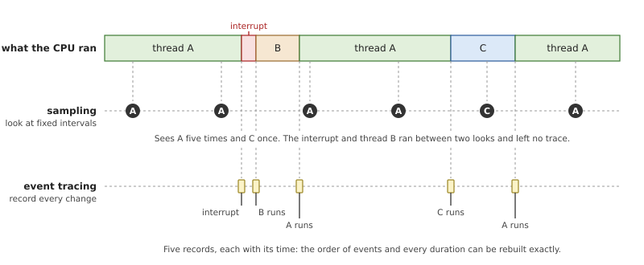
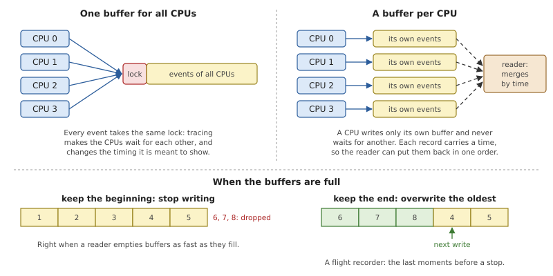
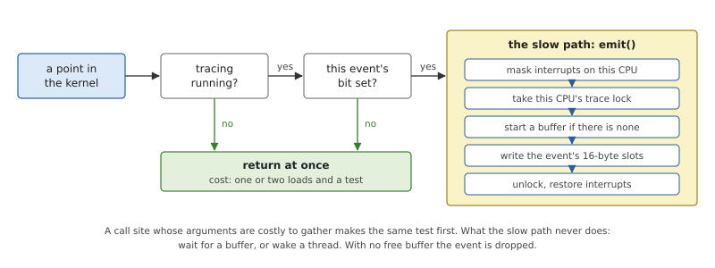
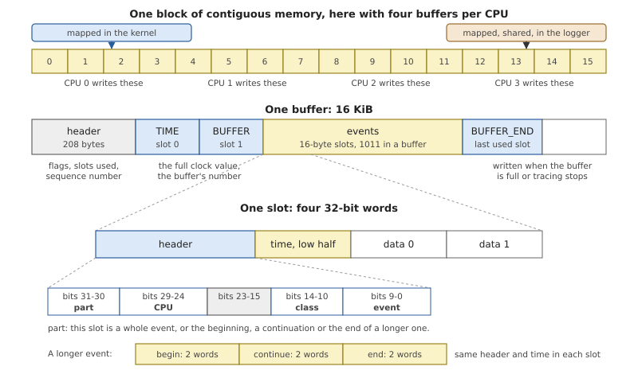
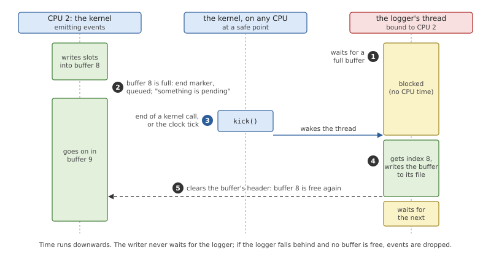
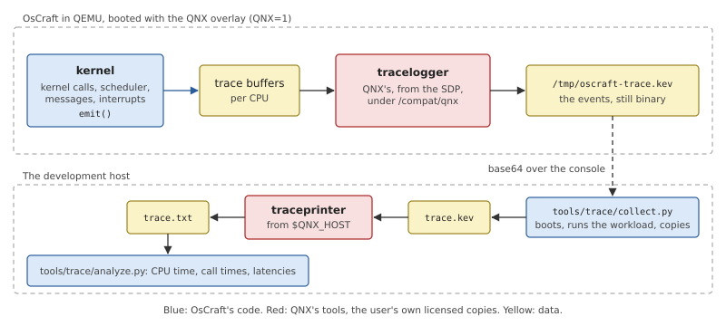

# Tracing

A real-time system is judged by when things happen: how long after an
interrupt its thread ran, which thread held the processor in between,
in what order two messages arrived. None of that can be read from a
program's output. *Tracing* records what the kernel does, as it does it,
so that the questions can be answered afterwards from the record.

One thing must be said first. OsCraft's kernel records events with its
own code, described in this chapter. But the only program that collects
those events today is QNX's `tracelogger`, and the only one that turns
them into text is QNX's `traceprinter`. Both come from the user's own
licensed QNX SDP and are not part of OsCraft; the first runs only on a
system built with the optional QNX overlay (`make QNX=1`). A system
built without the SDP has the kernel's tracing code and nothing to
drive it. What such a system offers for observation instead (the
kernel's messages, the system log, `ps` and `top`, a debugger on the
emulated machine) is the subject of
[Chapter 36](36-debugging.md#observing-without-the-sdp).

## Why and how systems are traced

### The questions

A program that prints what it does is the oldest debugging tool, and it
answers the question "what did this program do?". An operating system
raises questions that no single program can answer:

- **Latency.** An interrupt arrived; how long until the thread that
  handles it was running? A high-priority thread became ready; how long
  until it had a processor?
- **Order.** Did the server receive the request before or after the
  timer fired? Which of two threads took the lock first?
- **Who ran when.** Something kept a thread waiting for three
  milliseconds. What was on that processor during those three
  milliseconds, and why?

The answers lie in the kernel, because the kernel is where threads are
switched, interrupts are taken and messages are passed. Printing them
from there does not work. Formatting a line of text costs far more than
most kernel operations, so the printing changes the timing it is meant
to show; and a serial console is slow, far slower than a busy kernel
makes decisions worth recording.

### Sampling and event tracing

There are two ways to observe a running system cheaply.

**Sampling** looks at the system at regular intervals and notes what it
finds: which thread is running, at which instruction. After many looks,
the counts say where the time goes. Sampling is cheap, its cost does
not depend on how busy the system is, and it is the right tool for
"which function uses the processor?". It is a statistic, though. It
cannot say in what order things happened, and anything shorter than the
interval between two looks is seen only by luck.

**Event tracing** records every occurrence of chosen kinds of events,
each with the time at which it happened. The result is a history, not a
statistic: the exact sequence of thread switches, kernel calls and
interrupts, from which any duration can be computed by subtracting two
times. Its cost grows with the number of events, so it has to be made
very cheap per event.



*Figure 35.1: The same stretch of time seen by a sampler and by an event
trace. The sampler gets the proportions roughly right and misses the
short events; the trace has all of them, in order.*

Latency and order are questions about single events, so a real-time
system needs event tracing. The rest of this chapter is about that.

### Records and buffers

To be cheap, a trace does not describe events; it only notes them. An
*event record* is a few machine words: which kind of event, on which
processor, the time, and one or two values (a thread's ID, a kernel
call's first arguments). Writing it takes a few dozen instructions.
Turning records into readable text is done later, by another program,
usually on another machine.

The time in a record comes from a counter that the processor
increments at a fixed rate, read with one instruction. It must be the
same counter on every processor, because the records of several
processors are later merged by time.

Records go into memory. Where exactly matters on a machine with several
processors.



*Figure 35.2: Top: a buffer shared by all processors needs a lock that
every event takes; a buffer per processor does not. Bottom: the two
answers to a full buffer.*

A single buffer needs a lock, and every event on every processor would
take it. The processors would then wait for each other because of the
tracing, which changes the behaviour under observation; the cache line
holding the lock would also travel between processors on every event.
So tracers give each processor its own buffer. A processor writes only
there, never waits for another, and the reader restores a single order
by sorting on the time.

Memory is finite, so there must be a rule for a full buffer. There are
two, for two uses. If a program is emptying buffers into a file while
the trace runs, a writer that finds no free buffer *drops* events: the
trace keeps its beginning and has a gap. If nobody is emptying them,
the writer *overwrites* the oldest records: the buffers always hold the
most recent stretch of history, to be read once something interesting
has happened. The second is called a *ring*, or a flight recorder. What
a tracer in a real-time kernel must never do is the third possibility,
making the kernel wait for room.

### Keeping the cost down

A kernel that can be traced has trace points on its busiest paths: the
kernel-call entry, the scheduler, message passing. Most of the time
nobody is tracing, and those paths must not pay for the possibility.
The rule is that a disabled trace point costs a test of a flag and
nothing else: no arguments gathered, no function called. This path is
called the *fast path*; everything that happens only when the event is
really recorded is the slow path.

*Filters* apply the same idea when tracing is on. Recording everything
fills buffers quickly and costs the most. A filter says which events
are wanted, by kind (only thread state changes, only one kernel call),
sometimes by process or thread. The cheapest filters are those that can
be tested like the main flag: one bit per kind of event, looked up
before anything else is done.

Tracing is never free, and a trace must be read with that in mind: the
traced system is slightly slower than the untraced one, and the program
collecting the trace is itself a set of threads that run, make kernel
calls and appear in the record.

## Tracing in OsCraft

OsCraft's kernel has event tracing with a buffer set per processor, a
bitmap filter with one bit per kind of event, and both rules for a full
buffer. The code is in `kernel/src/ker/trace.rs`, with trace points in
the kernel-call dispatcher, the scheduler, message passing and
interrupt delivery.

Its interface to a collecting program, and the layout of the records,
are those that QNX's trace tools expect, because those tools are today
the only collector and decoder. That is a property of the format, not a
dependency of the kernel: with no collector attached, the trace points
cost their fast path and nothing else happens.

### What is recorded

Events are grouped in *classes*, and each event has a number within its
class.

*Table 35.1: The classes of events and where the kernel emits them.*

| Class | Events | Emitted from |
|---|---|---|
| kernel calls | entry and exit of every kernel call | `dispatch()` in `kernel/src/ker/mod.rs` (Chapter 7) |
| processes and threads | every thread state change; threads and processes created, named and ended | `kernel/src/sched.rs`, `kernel/src/ker/process.rs`, `kernel/src/proc/loader.rs` |
| communication | messages and pulses sent and received, replies | `kernel/src/ker/msg.rs` (Chapter 10) |
| interrupts | an interrupt delivered to the processes attached to it | `kernel/src/ker/interrupt.rs` (Chapter 15) |
| control | the full clock value, the start and end of each buffer | `kernel/src/ker/trace.rs` itself |
| user | events a program inserts with `TraceEvent()` | `trace_event()` |

A kernel call's entry event carries two values, for most calls its
first two arguments; for a few the kernel picks more telling ones, such
as the connection and the first word of the message for `MsgSendv()`.
Its exit event carries the result, or -1 and the error number. A thread
state event carries the process and thread IDs, and the new state is
the event's number, so "thread 3 of process 12 became READY" and "is
now RUNNING" are two events whose times, subtracted, give a scheduling
latency.

Each event can be recorded in one of two sizes. *Fast* mode, the
default, is what was just described. *Wide* mode records more: all six
arguments of a kernel call instead of two.

### The fast path

Two bitmaps hold one bit per event of each class: one says whether the
event is recorded, the other whether it is recorded wide. A global flag
says whether tracing is running at all.

*Listing 35.1: Is this event recorded, and in which size: `on()` and
`wide()` (`kernel/src/ker/trace.rs`).*

```rust
{{#include ../../../kernel/src/ker/trace.rs:trace_on}}
```

`on()` is the fast path. With tracing stopped it is one load and one
test. The trace points that have work to do before they can emit, such
as the kernel-call entry, which must choose the two values to record
and may read the first word of a message from user memory, call `on()`
first and return at once when it says no.



*Figure 35.3: A trace point. With tracing off, or the event filtered
out, it costs the test on the left.*

All events are enabled until a filter says otherwise, so a collector
that sets no filter gets everything. Filters are set through
`TraceEvent()`: all classes, one class, or one event of a class, on or
off, and the same for wide mode. Filters by process and by thread are
accepted and ignored: OsCraft always records the events of all
processes.

When the event is wanted, `emit()` records it.

*Listing 35.2: Recording an event, `emit()` (`kernel/src/ker/trace.rs`).*

```rust
{{#include ../../../kernel/src/ker/trace.rs:emit}}
```

Two things protect the buffer, for two different dangers. Interrupts
are masked first, so that an interrupt arriving on this processor in
the middle of a record cannot start a second record inside the first.
Then the processor takes its own trace lock. Other processors never
write here, so the lock is almost never contended; it is there for the
few moments when another processor does need this one's state, to hand
a full buffer to the collector or to take the buffers away when tracing
ends.

### Buffers and records

The buffers are one block of physically contiguous memory, allocated
when the collector asks for them: a number of 16 KiB buffers for each
processor, the first processor's first. The block is mapped twice, in
the kernel and, shared, in the collector's address space, so the
collector reads the records where the kernel wrote them and nothing is
copied on the way out of the kernel.



*Figure 35.4: The buffers, one buffer, and one record slot. A buffer has
a 208-byte header and room for 1011 slots of 16 bytes.*

A record is one 16-byte *slot*: a header word, the low half of the
clock, and two data words. The header packs the processor, the class
and the event number. An event with more than two words of data, such
as a process's name or a wide kernel call, takes several slots in a
row, marked as the beginning, the continuations and the end of one
event and all carrying the same time.

The clock is the generic timer's counter (Chapter 13), which is 64 bits
wide; a slot keeps only its low 32 bits, to stay small. The high half
is written separately: every buffer starts with a control event holding
the full value, and whenever the high half changes while a buffer is
being filled, a new such event is written before the next record. A
decoder can therefore always rebuild full times, from any buffer on its
own.

A buffer's second slot holds its sequence number among those the
processor has filled. When the next event would not fit, the kernel
writes an end marker, stores the number of slots used in the header,
and marks the buffer full. The next event starts a new buffer, if there
is one.

### Handing buffers to the collector

A buffer's memory is shared with the collector, but the collector must
learn when a buffer is ready. Each mode has its own way.

In **linear** mode the collector empties buffers while the trace runs.
It has one thread per processor, each bound to its processor, and each
calls `TraceEvent()` to wait for a full buffer. The thread blocks in a
state of its own, and costs nothing until there is work.



*Figure 35.5: A full buffer goes from the kernel to the collector's
thread in linear mode. The wake-up is not done where the buffer fills,
but at the next safe point.*

Step 3 of the figure is the delicate one. A buffer becomes full inside
`emit()`, and `emit()` is called from everywhere: from the scheduler
while it holds its locks, from interrupt handling. Waking a thread
there would take scheduler locks the caller may already hold, and would
itself emit events. So the trace point only queues the buffer and sets
a flag, and the wake-up is done by `kick()`, which runs at two places
where waking is always safe: the end of every kernel call and the clock
tick. The collector's thread then returns with the buffer's index,
writes the buffer to its file, and frees the buffer by clearing its
header. A buffer whose header is not clear is never reused, so when the
collector falls behind and every buffer of a processor is full, that
processor's events are dropped until one is freed.

In **ring** mode the kernel reuses each processor's buffers in turn,
whatever their state, and hands nothing over. The collector reads all
of them once tracing has stopped, and sorts them by the clock value at
the start of each.

Stopping a linear trace needs care for the last buffers. Each processor
ends the buffer it was writing and queues it. A processor is then in a
*stopped* state until its collector thread has taken every queued
buffer and been told that there are no more. The buffers cannot be
freed before every processor has got there: a request to free them
fails with `EBUSY`. This keeps the collector from losing the end of the
trace, and the kernel from writing into memory that has been given
back.

### Starting, and who may

Everything is driven through one kernel call, `TraceEvent()`, whose
first argument selects the operation, and three messages to process 1
for the operations that need memory management.

*Table 35.2: The operations of tracing.*

| Operation | How | What it does |
|---|---|---|
| attach as the collector | `TraceEvent()` | names the calling process as the one collector; a second is refused with `EBUSY` while the first lives |
| allocate buffers | message to process 1 | maps the block into the kernel and the collector; only the collector may, and only once (`EEXIST`) |
| set filters, fast or wide | `TraceEvent()` | sets and clears bits in the two bitmaps |
| linear or ring | `TraceEvent()` | chooses the rule for a full buffer |
| start, stop, flush | `TraceEvent()` | start fails with `EINVAL` when there are no buffers |
| wait for a buffer | `TraceEvent()` | blocks a collector thread until its processor has a full buffer |
| insert a user event | `TraceEvent()` | records an event of the user class with the caller's data |
| free buffers, detach | message to process 1 | unmaps the block everywhere and frees its memory |

Tracing shows what every process does, so controlling it is a
privilege: all operations except inserting one's own user events
require the process's trace ability (Chapter 17). The user events are
open to any program on purpose. A program can mark the beginning and
the end of the code it wants to measure, and find its marks in the
trace among the kernel's events.

A trace that began with the first event after the start would be hard
to read: it would mention threads by number that were created long
before. So starting first records the present state: for every process
its name, for every thread a creation event, its name if it has one,
and its current state. From then on the record is complete.

The buffers belong to the collector. If it detaches, or simply ends,
tracing is stopped at once and the block is unmapped from every address
space and freed. The collector's mapping is not inherited by a child it
forks, so no other process keeps a view of that memory.

Some of the interface is not implemented: event handlers (code run by
the kernel on an event) are refused with `ENOTSUP`, and when tracing
starts, the threads running on the other processors at that moment are
not reported separately.

### Collecting and reading a trace today

The collector is QNX's `tracelogger`. On a system built with the QNX
overlay it is installed under `/compat/qnx`, with the other programs of
the QNX personality (Chapter 33), and runs as a QNX program. The file
it writes is binary; QNX's `traceprinter`, a host tool of the SDP,
decodes it into one line of text per event.



*Figure 35.6: The way of a trace today. The two red boxes are QNX's
programs; everything else is OsCraft's.*

Two scripts in `tools/trace/` do the work around those two programs.

`tools/trace/collect.py` boots an image in QEMU, starts `tracelogger`,
runs the commands given as the workload, and waits for the logger to
finish. The trace file is inside the emulated machine, so the script
copies it out over the console, encoded in base64, checks its size, and
runs `traceprinter` on it. It finds `traceprinter` through the
environment variable `QNX_HOST`, which the SDP's own setup script sets,
and stops with a message when the variable is missing. The result is a
directory with the binary trace, its text and the console's log.

`tools/trace/analyze.py` reads the text and prints what one usually
wants first:

- the events per class and per processor, and the time the trace spans;
- processor time per thread, from each "running" event to the thread's
  next state change;
- per kernel call: how many, how many failed, and the time from entry
  to exit, which for a blocking call includes the wait;
- scheduling latency: for every wake-up, the time from "ready" to
  "running", with the worst cases named;
- interrupts per number, and message traffic per process.

Given a second trace, it prints the two side by side as rates per
second. The usual second trace is the same workload traced on QNX's own
kernel, which is how the QNX personality's timing is compared with its
reference (Chapter 34).

The test suite checks the whole path once: a test named `tracing`, in
`tests/target.tests`, runs `tracelogger` for two seconds and expects a
trace file of some size. It is one of the tests marked as needing the
QNX overlay, and is skipped without it.

> [!NOTE]
> A collector does not have to be QNX's. Everything `tracelogger` does
> goes through `TraceEvent()` and three messages, described above, and
> the buffers' layout is in Figure 35.4. A native collector and decoder
> would make tracing available on a system built without the SDP; none
> exists yet.

## Summary

- Event tracing records every occurrence of chosen events with its
  time. It answers the questions of a real-time system (latency, order,
  who ran when) that sampling and printed output cannot.
- OsCraft's kernel has trace points in the kernel-call dispatcher, the
  scheduler, message passing and interrupt delivery. A trace point that
  is off costs one test.
- Each processor writes 16-byte records into its own buffers, with
  interrupts masked, and never waits: with no free buffer, events are
  dropped.
- The buffers are shared with one collecting process. In linear mode
  its threads wait for full buffers, which the kernel hands over only
  at safe points; in ring mode the newest records overwrite the oldest
  and are read after a stop.
- Controlling tracing needs the trace ability; any program may insert
  its own events.
- The kernel side is OsCraft's. Collecting and decoding are done today
  with QNX's `tracelogger` and `traceprinter`, from the user's licensed
  SDP, on a system built with the QNX overlay; `tools/trace/` wraps
  them and analyses the result.
