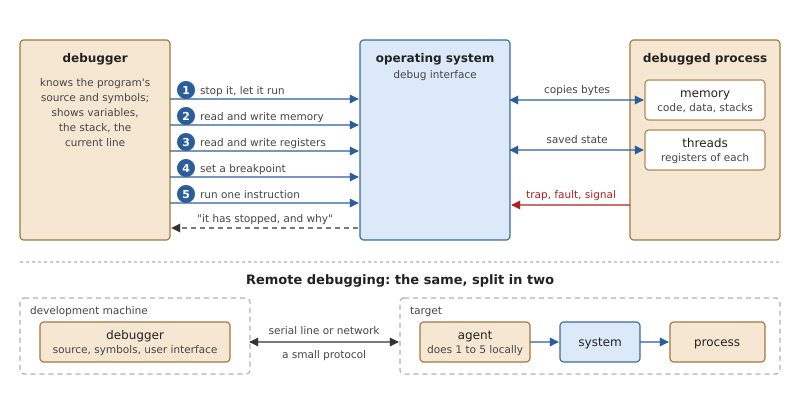
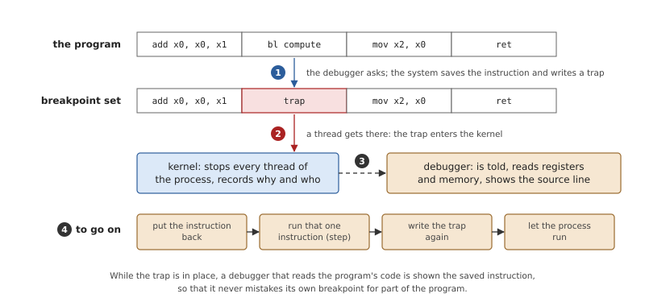
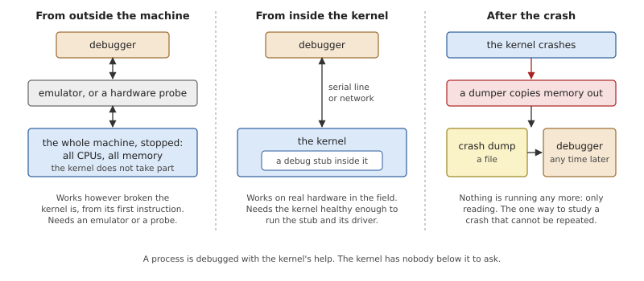
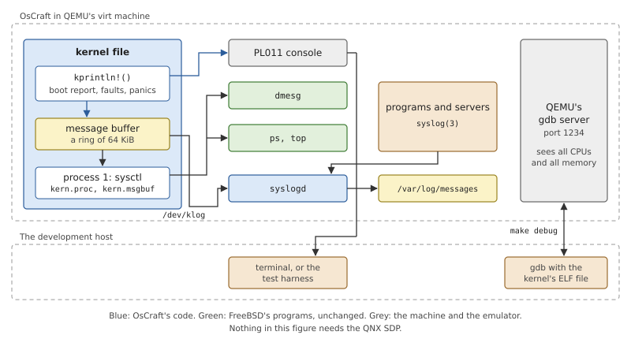
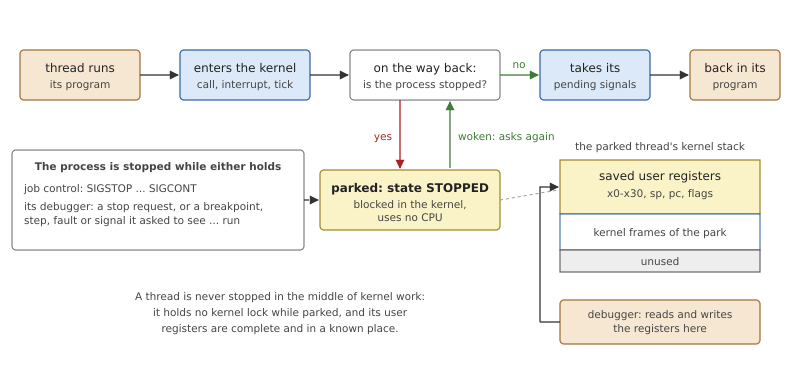
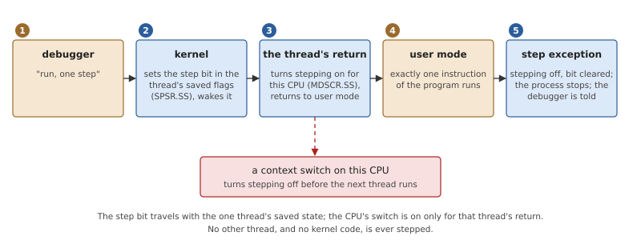
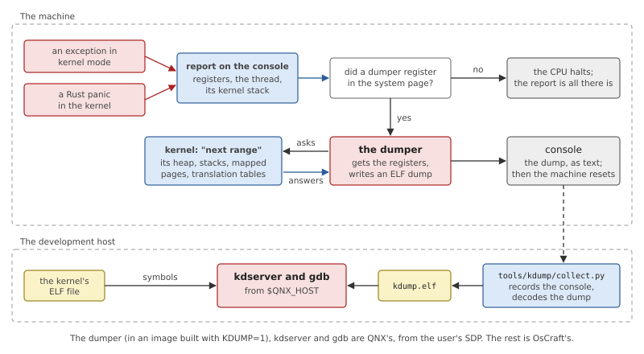

# Debugging and Crash Dumps

When a program misbehaves you want to stop it and look inside. When
the kernel misbehaves you want the same, and it is harder, because the
kernel is the thing that normally does the stopping and the looking.
This chapter covers both: what the kernel does so that a process can be
debugged, and what can be done about the kernel itself, while it runs
and after it has crashed.

As in the previous chapter, the dependencies must be stated first.
OsCraft's kernel has its own mechanisms for stopping, inspecting and
stepping a process, and for handing a crash to a dumper. But the
interface to the first is today the one a QNX debug agent uses, and the
only dumper is QNX's `kdumper`, read back with QNX's `kdserver` and
`gdb`. Those programs belong to the user's licensed QNX SDP, not to
OsCraft. Without the SDP you still have a good deal: the kernel's
messages, the system log, FreeBSD's `ps` and `top`, the kernel's
self-tests, and a debugger attached to the emulated machine. The
chapter says exactly which is which, and what works on QEMU's `virt`
today.

## How debugging works

### What a debugger needs

A debugger is a program that controls another one. It knows the
program's source and symbols, and that knowledge is all its own; from
the operating system it needs only five small things.



*Figure 36.1: The five operations a debugger asks of the system, and
the one thing the system tells it. Below: the same when the debugger
and the program are on different machines.*

1. **Stop and run.** Suspend the process, or one thread, and let it
   continue.
2. **Memory.** Read the process's memory, to show variables, and write
   it, to change them.
3. **Registers.** Read each thread's registers, to know where it is and
   to walk its stack; write them, to change a value or the program
   counter.
4. **Breakpoints.** Stop the process when it reaches a chosen
   instruction.
5. **Single step.** Run exactly one instruction and stop again.

In the other direction the system must tell the debugger when the
process has stopped, and why: a breakpoint, a fault, a signal.

Everything else a debugger shows is built from these. "Step over this
line" is a temporary breakpoint and a run. A backtrace is registers and
memory read with the help of the symbols.

When the program runs on another machine, the debugger is split. A
small *agent* runs beside the program and performs the five operations
locally; the debugger proper stays on the development machine and
talks to the agent over a serial line or the network. This is *remote
debugging*, and it is the normal arrangement for an embedded system,
which has neither the screen nor the storage for the debugger itself.

### Breakpoints and single steps

A *software breakpoint* is a change to the program. The instruction at
the chosen address is saved and replaced by one that traps into the
kernel; on AArch64 that is `brk`. When a thread executes it, the kernel
gets control, stops the process and tells the debugger.



*Figure 36.2: Setting a breakpoint, hitting it, and going on. Going on
needs a single step, because the saved instruction must run once with
the trap out of the way.*

Two details make this harder than it looks. The page that holds the
instruction is usually read-only and shared with every other process
running the same program, so the system must write through the
protection, and to a private copy. And the processor may hold the old
instruction in its instruction cache, which must be told of the change.

A *hardware breakpoint* leaves the program alone: the processor has a
few registers that hold addresses and raises an exception when
execution, or a data access (a *watchpoint*), reaches one of them.
There are only a handful, so debuggers use software breakpoints by
default.

A *single step* needs the processor's help in any case, since the
system cannot know where one instruction will lead. Processors have a
mode in which they execute one instruction and then raise an exception.

### Debugging a kernel

A process is debugged with the kernel's help. The kernel has nobody
below it to ask, so the five operations must come from somewhere else.



*Figure 36.3: Where the debugger's five operations come from when the
program under study is the kernel.*

**From outside.** Something that controls the whole machine implements
the operations: an emulator, which is a program and can stop its
emulated processors at will, or a hardware probe attached to the
processor's debug port. The kernel does not take part and need not be
working at all, which makes this the method of choice for the earliest
boot code and the worst bugs.

**From inside.** The kernel contains a small debug agent of its own, a
*stub*, which takes over on a breakpoint or a fault and talks to a
debugger over a serial line. This works on real hardware with no probe,
but only as long as enough of the kernel still works to run the stub.

**Afterwards.** Nothing is debugged live. When the kernel crashes, the
state of the machine is copied to a file, a *crash dump*, and a
debugger later reads the file as if it were a stopped program. This is
*post-mortem* debugging. It is the only method for a crash that happens
once a month on a machine nobody is watching.

### What a crash dump must contain

A dump is useful to the degree that a debugger can answer its usual
questions from it. That takes four things.

- **The registers** of the processor that crashed, at the moment of the
  crash: without the program counter and the stack pointer there is no
  starting point.
- **Memory.** At least the kernel's own: its data, its heap, the stacks
  of its threads. All of physical memory is simplest and largest; a
  filtered dump keeps what the kernel uses and leaves out user pages and
  file contents.
- **The translation tables.** The dump is a copy of *physical* memory,
  but every pointer in it is a *virtual* address. The reader must walk
  the kernel's page tables, found in the dump itself, to follow one.
- **The identity of the kernel.** Symbols and types come from the
  kernel's file on the host, and they describe the dump only if that
  file is the very kernel that crashed.

The code that writes the dump runs in the worst conditions there are: a
kernel that has just proved itself wrong. It must not rely on the
kernel's locks, its heap, or its drivers. The usual answer is a
separate small program with its own way of writing to a device, which
the kernel merely calls.

## Debugging in OsCraft

### Observing without the SDP

Most questions about a running system need no debugger. A native
OsCraft system answers them with FreeBSD's tools.



*Figure 36.4: What a system built without the SDP offers: the kernel's
messages three ways, the process table, and a debugger on the emulated
machine.*

**The kernel's messages.** Everything the kernel prints goes to two
places at once: the console, through the startup's callout for the
PL011 (Chapter 5), and a *message buffer*, a ring of 64 KiB in the
kernel that holds the messages from the very first, long before any
program runs (`kernel/src/msgbuf.rs`). The ring has two readers.
FreeBSD's `dmesg` takes a snapshot of all of it through `sysctl`. The
system logger, `syslogd`, opens `/dev/klog`, which gives each message
once, and files the kernel's lines in `/var/log/messages` with every
other program's. What programs write to the console is not the kernel's
to keep, and does not enter the ring.

**The process table.** FreeBSD's `ps` and `top` ask the kernel for a
record per process or per thread through `sysctl`, and process 1 fills
in FreeBSD's own structure for each (`kernel/src/proc/kinfo.rs`). A
thread's kernel state appears as the word `ps` shows for a sleeping
thread: `msg` for a thread blocked in a send, `recv` for a server
waiting for a message, `mutex`, `sem`, and so on. `top` computes
processor usage from each processor's idle thread.

**Faults.** When a program takes a fault that none of its signal
handlers will catch, the kernel prints the exception, the fault address
and all registers before delivering the signal, so the console and the
log show where a program died even with no debugger near.

**A server's panic.** The servers that contain FreeBSD kernel code
(Chapter 27) can fail the way a kernel does, in a call to `panic()`.
Their `panic()` prints the message and then the chain of callers, found
by following the frame pointers up the stack and named by the dynamic
linker, and ends the process (`user/bsdkern/kern/misc.c`). The server
is a process, so the rest of the system goes on.

**Self-tests.** The kernel always checks its exception vectors and its
address translation while it boots. Built with `make run SELFTEST=1`,
it also runs a set of tests of its own before the boot script starts
(`kernel/src/selftest.rs`): the heap, a fresh user address space, clock
ticks counted on every processor, round-robin scheduling with more
threads than processors, kernel calls from a kernel thread including
one that must fail, sleeping, a message exchange between a server and
clients of higher and lower priority, and two user processes, one of
which dereferences a null pointer and must be ended without harm to the
kernel. They catch a badly broken change before any program runs. The
boot script waits for them for 30 seconds at most.

### Debugging the kernel on QEMU

OsCraft's kernel has no debug stub inside it. On QEMU it does not need
one, because QEMU is an emulator and offers the first of the three
methods: it contains a server for `gdb`'s remote protocol that
implements the five operations on the emulated machine.

`make debug` builds the image and starts QEMU with that server
listening on TCP port 1234 and the processors halted before their first
instruction. A `gdb` for AArch64, given the kernel's ELF file for the
symbols and told `target remote :1234`, then controls the whole
machine: it can set a breakpoint in the scheduler, step through an
exception handler, or read any kernel structure. The startup can be
debugged the same way, and so can a kernel that dies before it can
print.

What this debugger sees is the machine, not the system. It stops all
four processors together, and it knows nothing of processes: when the
machine is stopped in user code, it shows whichever program happened to
be running, with the kernel's symbols, which do not apply.

### Stopping a process

A process on OsCraft can be stopped for two independent reasons, and it
runs only when neither holds.

- **Job control.** `SIGSTOP`, or a terminal's stop signal left at its
  default action, stops it; `SIGCONT` continues it. Its parent can
  learn of both by waiting (Chapter 18).
- **Its debugger.** An explicit stop request, or a *point of interest*
  the debugger asked to see (a breakpoint, a completed step, a fault or
  a signal from the sets it chose), holds the process until the
  debugger lets it run.

The two are kept apart because they are undone by different parties: a
`SIGCONT` from the shell must not restart a process its debugger is
examining.

Stopping does not reach into a thread and freeze it. A flag is set on
the process, and each thread stops by itself at the one place where it
is safe: the last step of its return to user mode, where it holds no
kernel lock and its user registers have all been saved.



*Figure 36.5: A stopped process's threads park on their way back to
user mode. Their user registers are then at the top of their kernel
stacks.*

A thread that is running user code gets to that place at its next
kernel call or interrupt, the clock tick at the latest. A thread that
is blocked in the kernel stays blocked; it will park when whatever it
waits for lets it return.

*Listing 36.1: Parking on the way back to user mode,
`park_if_stopped()` (`kernel/src/ker/debug.rs`).*

```rust
{{#include ../../../kernel/src/ker/debug.rs:park_if_stopped}}
```

The loop is the usual shape of a wait: test, block, test again when
woken. Blocking is prepared while the process's debug lock is held,
which is the lock anyone who restarts the process takes first, so a
restart cannot slip between the test and the block. A thread can also
be held alone, without its process; the same function parks it.

`SIGKILL` reaches a process stopped by job control: its threads go on,
only to end. A process held by its debugger is different. It stays
parked, and the kill takes effect when the debugger lets go of it, so a
debugger is never surprised by a process vanishing from under it.

The same reasoning covers a debugged process that ends by itself. Its
last thread parks just before the process would become a zombie, and
the debugger sees a stop whose reason is "terminated", with the exit
status. The process is released when the debugger closes it.

### Memory, registers, breakpoints

Process 1 gives a debugger its five operations through two files per
process in `/proc` (`kernel/src/proc/procfs.rs`): `as`, the address
space, and `ctl`, for control.

**Memory** is read and written by reading and writing `as` at the
offset of the address. Writes go through the process's page tables to
the frames behind them, whatever the page's protection, which is what
lets a debugger write into code.

**Registers** are the parked thread's saved user state, in the place
Figure 36.5 shows. They can be read and written only while the thread
is not running; for a thread that is running on another processor the
request fails with `EBUSY`.

**Breakpoints** are software ones. Setting one writes `brk #0` over
the instruction, through the same path as any write to `as`, and keeps
the original in a list in the process's debug state. That path handles
the two difficulties named earlier. A page that maps the boot image's
file in place, shared by every process running that program, is first
replaced by a private copy in this process. And after a write to an
executable page the instruction cache is brought up to date. Reads of
`as` show the saved instructions in place of the traps. When the
debugger lets go of the process, all its breakpoints are removed.
Hardware breakpoints and watchpoints are not implemented.

**Single steps** use AArch64's software step. Two bits are involved: a
bit in the saved processor state of one thread (`SPSR_EL1.SS`), and a
per-processor enable (`MDSCR_EL1.SS`).



*Figure 36.6: One step of one thread. The enable is turned on only at
the stepping thread's own return to user mode, and off at every context
switch.*

The split matters because the enable is a property of the processor,
not of the thread. If it stayed on, the next thread to run on that
processor would take a step exception at once. So the kernel sets it at
the last moment before the stepping thread's return, and clears it
whenever the processor switches threads.

### Points of interest

A breakpoint, a completed step and an ordinary fault all arrive the
same way: as a synchronous exception from user mode (Chapter 6). Before
the exception is treated as a fault of the thread, the handler asks
`fault()` whether the process's debugger wants it.

*Listing 36.2: Does the debugger take this exception, `fault()`
(`kernel/src/ker/debug.rs`).*

```rust
{{#include ../../../kernel/src/ker/debug.rs:debug_fault}}
```

Read the `match` in the middle as the list of what stops a process:

- a step, always, with the step bit cleared so that it does not repeat;
- a `brk` at an address in the debugger's own list of breakpoints. A
  `brk` that the program contains itself is not one of those, and falls
  through to the next case;
- any other fault, if the debugger put it in its fault set. Such a
  fault stays pending: if the debugger runs the process on without
  clearing it, the fault takes its normal course and becomes a signal.

When `fault()` returns true, the thread goes on to its return to user
mode and parks there, like every other thread of the process. The stop
records why, which fault, and which thread, and `stop_at()` delivers
the event the debugger registered. The event is armed for one stop at a
time: the debugger re-arms it each time it runs the process, so it gets
one notification per stop.

Signals are the other kind of point of interest. When a signal the
debugger has put in its trace set is about to be delivered, the process
stops instead, before the signal has any effect. The debugger then
either discards the signal or passes it on when it runs the process.
This is also how a debugger interrupts a running program: it sends
the process a signal that it traces.

### What a process debugger can use today

The mechanism of the last three sections is complete and tested. Its
interface is not yet a native one, and this is the largest gap in the
chapter.

The control file `ctl` is driven with device-control commands, and
those commands, their structures and their numbering of signals and
faults are QNX's: the interface was built for QNX's debug agent. A
native program has no way in. FreeBSD debuggers are built on
`ptrace()`, and in OsCraft's system-call library (Chapter 24)
`ptrace()` is still a stub that reports the call as not implemented.
There is therefore no native process debugger on OsCraft today: no
`gdb` and no `lldb` for a FreeBSD program.

With the QNX overlay, a QNX program can use the interface, and one test
does. `debug-events` in `tests/target.tests` runs a QNX test program
that acts as a debugger on its own children: it checks the stop at a
traced fault and its event, that `SIGKILL` waits for the debugger, and
the parked end of a process that exits.

The full arrangement of Figure 36.1, the SDP's `gdb` on the host
talking to QNX's agent on the target, has tests too: the scripts in
`tests/gdb/` set a breakpoint in a second thread, list the threads,
take a backtrace, and catch a fault as its signal. On QEMU's `virt`
they are skipped. They need a second serial line for the agent, apart
from the console, and `virt` has one PL011. The harness prints a note
for each skipped test rather than passing it silently
(`tools/test/run-tests.py`).

*Table 36.1: What works on QEMU's `virt` today.*

| Tool | Needs | State |
|---|---|---|
| console messages, `dmesg`, `syslogd` | nothing | works; tested |
| `ps`, `top` | nothing | works; tested |
| kernel self-tests (`SELFTEST=1`) | nothing | works |
| `gdb` on the machine (`make debug`) | a host `gdb` for AArch64 | works; sees the machine, not processes |
| process debug mechanism in the kernel | QNX overlay, to reach its interface | works; tested by `debug-events` |
| a process debugger (`gdb` with an agent) | QNX overlay and SDP | tests skipped: no second serial line |
| a native process debugger | `ptrace()` | not implemented |
| kernel event trace (Chapter 35) | QNX overlay and SDP | works; tested by `tracing` |
| kernel crash dump | SDP, image built with `KDUMP=1` | supported, with the limits below; no test in the suite |

### When the kernel crashes

A kernel bug shows itself in one of two ways: an exception taken in
kernel mode that no handler expects, or a Rust panic. Both end in the
same place.



*Figure 36.7: From a kernel crash to a debugger session on the dump.
Without a dumper, the path ends at the report.*

**The report.** For an exception the kernel first prints what it knows:
the kind of exception and the fault status, the fault address, all
registers, the thread that was running and the bounds of its kernel
stack. Then it checks one thing that is otherwise hard to recognise. If
the fault address lies in the unmapped guard page just below that
stack, it says so: the kernel stack has overflowed. A panic prints its
message and source location. Since these lines go through the normal
print path, they are on the console; the machine will not live to log
them.

**The dumper.** OsCraft follows the usual design: the dump is written
by a separate program that the kernel calls. That program is not part
of the kernel file. It is a *bootstrap executable*, placed before the
kernel in the image, that runs first, leaves the address of a callback
in the system page, and returns so that the boot can go on (Chapter 5).
At a crash the kernel looks for that callback.

*Listing 36.3: Handing a crash to the dumper, `crash()`
(`kernel/src/kdebug.rs`).*

```rust
{{#include ../../../kernel/src/kdebug.rs:kdebug_crash}}
```

- It runs once. A second crash while the first is being handled, on
  this processor or another, returns at once.
- With no callback in the system page it returns, and the caller halts
  the processor. This is the normal case: the default image has no
  dumper.
- The registers passed are those of the exception's frame. For a panic
  there is no frame, and the function captures its caller's.
- Just before the call, the processor's number is put in the register
  where the kernel normally keeps its per-processor pointer, because
  that is where the dumper looks for it. Nothing in the kernel may use
  that pointer afterwards; the call is not expected to return.

**What goes into the dump.** The dumper does not know the kernel's
memory layout, so it asks. At boot the kernel publishes, also in the
system page, the address of a function the dumper can call; the dumper
calls it repeatedly, and each call returns the next physical range to
write. For a filtered dump the kernel walks its own address space and
names every frame mapped there that is ordinary memory (its heap, its
threads' stacks, its mapped windows), leaving out device registers,
which a read could disturb, and the boot image, which the dumper has
anyway. It ends with the frames of its translation tables. That last
part is what makes the dump readable: with the tables in the file, the
reader can follow kernel virtual addresses. For an unfiltered dump the
function names every range of system memory instead.

Three of the four requirements for a dump are met this way: registers,
the kernel's memory, the translation tables. The fourth, the kernel's
identity, is checked on the host.

**The current dumper** is QNX's `kdumper`, from the SDP. `make image
KDUMP=1` puts it before the kernel in the image and stops with a
message when the SDP's environment is not set. It writes the dump as
text on the console, compressed and encoded for a serial line, and
resets the machine.

Two scripts in `tools/kdump/` handle the host's side.
`tools/kdump/collect.py` boots the image in QEMU, optionally types a
command that crashes the kernel, records the console from the start to
the end of the dump, decodes the dump into an ELF file, and keeps a
copy of the kernel's ELF file beside it. `tools/kdump/analyze.py`
prints the crash from the dump's note (signal, fault, processor,
program counter and stack pointer), verifies that the kernel file's
code is really the code in the dump, shows the kernel's own report from
the console log, and runs QNX's `gdb` on the dump through `kdserver`,
which it finds through `QNX_HOST`, for a backtrace with local
variables.

To crash a kernel on purpose there is a private message to process 1,
honoured only from a process running as root, on which the kernel reads
from an address that is never mapped. The test image built with the QNX
overlay has a small program that sends it.

The dump has limits that follow from what the kernel publishes. It
describes memory, not the system: the kernel gives the dumper no table
of processes and threads, so the reader sees the crashed processor's
stack and the kernel's data, without process names. The other
processors are not stopped and their registers are not captured. User
memory is not in a filtered dump.

## Summary

- A debugger needs five things from the system: stop and run, memory,
  registers, breakpoints, single steps. A kernel must get them from
  outside (an emulator or a probe), from a stub inside itself, or
  after the fact from a crash dump.
- Without the SDP, an OsCraft system is observed with the kernel's
  message buffer (`dmesg`, `syslogd`), FreeBSD's `ps` and `top`, the
  fault reports on the console, the kernel's self-tests, and `gdb` on
  QEMU's own debug server with `make debug`.
- A process stops for job control or for its debugger, independently.
  Each thread parks at its return to user mode, with its user registers
  saved where a debugger can read and write them.
- Breakpoints are `brk` instructions written into a private copy of the
  page; single steps use AArch64's software step, enabled only for the
  stepping thread's return.
- The kernel's process-debugging mechanism is reached today only
  through an interface with QNX's layouts. There is no native debugger:
  `ptrace()` is not implemented. The `gdb` tests are skipped on `virt`
  for want of a second serial line.
- A kernel crash is always reported on the console. If a dumper was
  placed before the kernel in the image, the kernel hands it the
  registers and tells it which memory to write, translation tables
  included; today that dumper and the tools that read its dump are
  QNX's.
