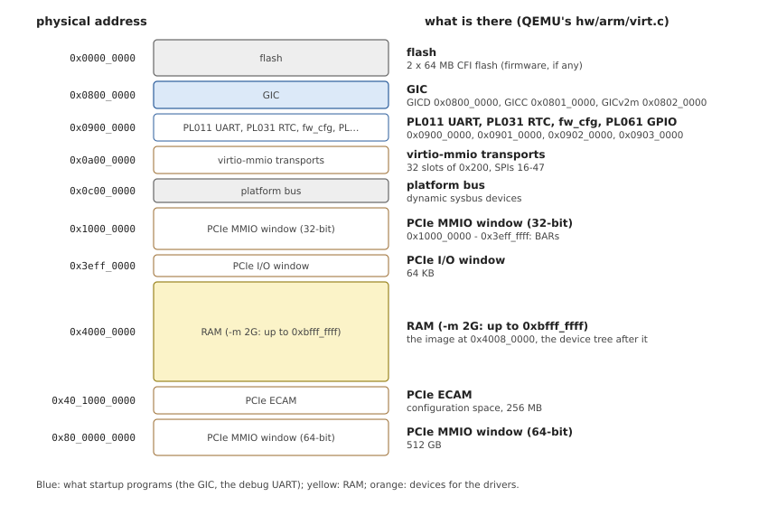
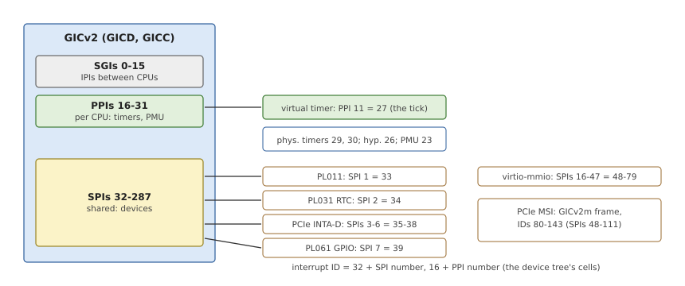
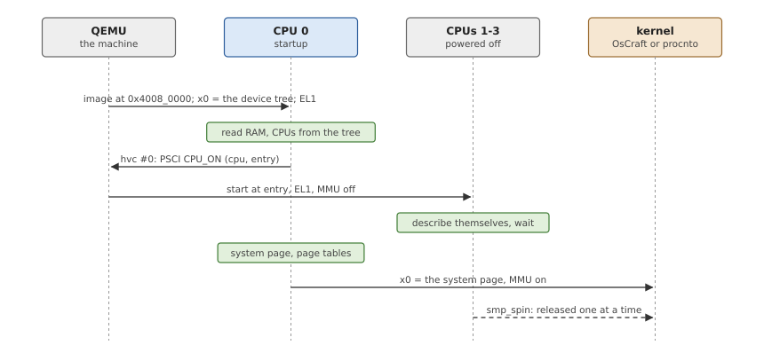
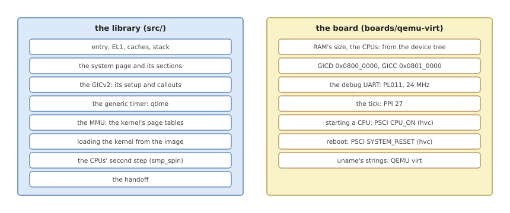

# The Reference Board: QEMU virt

> [!NOTE]
> A draft. The board's startup boots OsCraft's kernel on all four CPUs;
> the rest of its BSP (drivers for its devices) is being ported, and this
> chapter will grow with it.

Every example in this book comes from one board: QEMU's `virt` machine.
This chapter describes it, what its hardware is, where it is, and how it
starts, so that the later chapters can use its numbers without stopping
to explain them. Its board crate, `boards/qemu-virt`, is the library's
reference user; Chapter 15 walks through it.

## A board that exists only in an emulator

Most boards a startup library meets are real: a system-on-chip with its
peripherals at addresses the chip's designers chose, and a boot loader in
ROM or flash. `virt` is different. QEMU's developers designed it to run
operating systems, not to imitate a product, and they gave it what an
operating system wants from a modern Arm machine:

- **standard parts only**: an Arm GIC, Arm's generic timer, Arm's PL011
  UART and PL031 real-time clock, PSCI firmware calls, PCI Express with
  a generic ECAM host bridge, and virtio devices, each with drivers in
  every major operating system;
- **a device tree** that QEMU writes at boot and passes to the kernel, or
  to whatever it loads, describing exactly the machine the command line
  asked for;
- **choices on the command line**: the CPU model and how many, the RAM's
  size, GICv2 or GICv3, an SMMU, and any device QEMU can emulate.

For a startup library this is a good reference. Nothing about it is
quirky, so a board crate for it shows the library's interface without a
board's accidents in the way. Everything in it is also found on real
boards, so what works on `virt` carries over.

## The machine OsCraft runs

OsCraft's build starts `virt` with a fixed configuration (`tools/qemu/run.sh`
in OsCraft's tree), which this book assumes:

*Table 2.1: The `virt` machine as OsCraft starts it.*

| What | Setting | Notes |
|---|---|---|
| Machine | `-M virt,gic-version=2` | GICv2, the controller this library supports |
| CPUs | `-cpu cortex-a72 -smp 4` | the same cores as several real boards |
| RAM | `-m 2G` | at `0x4000_0000`, so up to `0xbfff_ffff` |
| Boot | `-kernel oscraft.ifs` | the image, loaded raw, no firmware |
| Console | `-serial ...` | the PL011 |
| Devices | `virtio-net-pci`, `qemu-xhci`, `usb-net` | on PCIe, for the drivers, not for startup |

## Its memory map

Figure 2.1 is the physical address space. Its layout is fixed by QEMU
(`hw/arm/virt.c`): the devices sit in the first 1 GB, RAM starts at 1 GB,
and the large PCIe windows live far above 4 GB. Only the RAM's size and
the devices on PCIe change with the command line.

*Figure 2.1: The physical memory map of QEMU's `virt`, as OsCraft runs it.*

Startup touches very little of it:

- **RAM**, which it describes to the kernel and in which it places the
  system page, the page tables and the kernel's segments (Chapter 6);
- **the GIC**, which it sets up and for which it installs the kernel's
  interrupt callouts (Chapter 9);
- **the PL011**, its own debug output and, through a callout, the
  kernel's (Chapter 8).

Everything else is the drivers' business, found later through the
device tree that startup keeps for them in the system page.

## Its interrupts

`virt`'s interrupt controller is an Arm GICv2: a *distributor* (GICD),
shared by all CPUs, and a *CPU interface* (GICC) for each. Interrupts have
numbers, *interrupt IDs*, in three ranges (Figure 2.2). The device tree
names each device's interrupt by its type and its number within the type,
so the ID is the number plus 16 for a PPI, or plus 32 for an SPI.

*Figure 2.2: The interrupts of `virt`: the timer's PPI and the devices'
SPIs, as interrupt IDs.*

The one that matters most to startup is the **virtual timer's PPI, ID 27**:
it becomes the kernel's tick (Chapter 10). The PL011's SPI 1 (ID 33) is
the console's, for the drivers. The GICv2m frame at `0x0802_0000` turns
PCIe devices' message-signalled interrupts into SPIs.

## How it boots

A real board runs firmware first; `virt`, booted with `-kernel`, does not.
QEMU loads the image into RAM at `0x4008_0000`, 512 KB above the RAM's
start, places the device tree after it, and starts CPU 0 at the image's
first byte, at EL1, with the device tree's address in `x0` (Figure 2.3).
That is the same handoff Linux's arm64 boot protocol defines, which is
why QEMU uses it.

*Figure 2.3: The boot of `virt`: QEMU enters startup on CPU 0; startup
starts the other CPUs through PSCI; the kernel takes over.*

The other CPUs are powered off. A CPU is started with **PSCI**, Arm's
Power State Coordination Interface, a set of firmware calls: `CPU_ON` with
the CPU's number and an address starts it there. On `virt`, QEMU itself
implements PSCI, behind the `hvc` instruction (the device tree's
`/psci/method`), as a hypervisor would. PSCI also resets the machine
(`SYSTEM_RESET`), which becomes the kernel's reboot callout.

## The board crate's share

With all of this, the board's part of startup is small (Figure 2.4). The
library does everything that is the same on every AArch64 board; the board
crate says where `virt`'s parts are and how to start its CPUs. Chapter 15
shows the crate's code.

*Figure 2.4: What the library does for `virt`, and what `boards/qemu-virt`
adds.*

Two facts come from the device tree rather than from constants, because
the command line can change them: **the RAM's size** (`/memory`'s `reg`)
and **the number of CPUs** (the `/cpus/cpu@n` nodes). The rest, the GIC's
and the UART's addresses, the timer's interrupt, the PSCI method, is fixed
by the machine, and the crate states it as constants.
