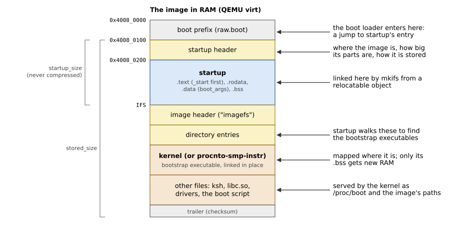
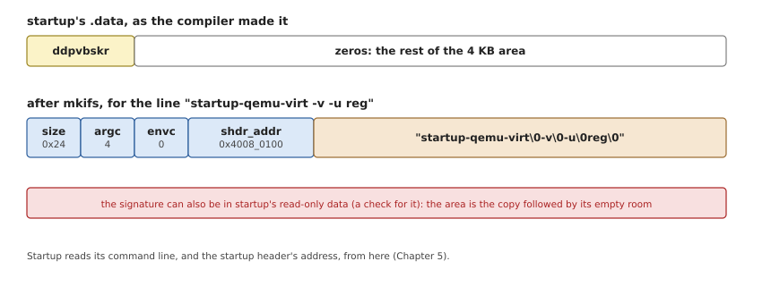
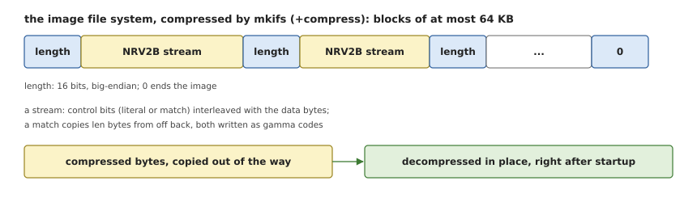

# The Image

Startup does not come alone: it is the first part of a QNX *boot image*,
one file that holds everything the system needs to start. This chapter
shows what the image looks like, how startup becomes part of it, and how
startup finds its way around it.

## Building an image

QNX's `mkifs` utility builds an image from a *build file*, a text file
that lists:

- the **bootstrap section**: first the startup program and its command
  line, then the *bootstrap executables* (normally just the kernel,
  `procnto-smp-instr`), each with its own command line and environment;
- the **boot script**, the commands the kernel runs once it is up;
- the **files**: programs, libraries and configuration, which the kernel
  serves from memory under `/proc/boot` and the other paths the build
  file gives.

A build file's bootstrap section looks like Listing 3.1, from OsCraft's
image for QEMU's `virt`.

*Listing 3.1: The bootstrap section of a build file.*

```text
[image=0x40080000]
[virtual=aarch64le,raw] .boot = {
    startup-qemu-virt -v -u reg
    PATH=/proc/boot:/bin:/sbin:/usr/bin:/usr/sbin
    kernel -v
}
```

`[image=0x40080000]` is the physical address the image is loaded at:
where QEMU puts a raw `-kernel`, 512 KB into `virt`'s RAM (Chapter 2).
`virtual=aarch64le` says that the system uses the MMU; `raw` that the
image is a plain block of bytes, which the boot loader copies to RAM and
jumps into. mkifs links each bootstrap executable at its final address
in the kernel's address space, so that startup only has to map it
(Chapter 12); `-u reg` tells startup that the device tree's address is in
`x0`, as QEMU passes it.

## The image's layout

Figure 3.1 shows the image as mkifs lays it out and as the boot loader
leaves it in RAM.



*Figure 3.1: The boot image in RAM.*

- The **boot prefix** comes from the SDP (`boot/sys/raw.boot` for a raw
  AArch64 image): code that jumps to startup's entry point, since boot
  loaders enter an image at its first byte.
- The **startup header** describes the image: where it is, where it runs,
  how big startup and the image file system are, and whether the file
  system is compressed.
- **Startup** follows: its code and data, and room for its `.bss`.
- The **image file system** (IFS) starts with its own header and a
  directory of variable-size entries, followed by the files' data. The
  bootstrap executables are among the files, marked as such in their
  directory entries.

## The startup header

Listing 3.2 is the startup header as the library sees it, the Rust mirror
of `struct startup_header` in `<sys/startup.h>`.

*Listing 3.2: The startup header, `StartupHeader` (`src/abi/startup.rs`).*

```rust
{{#include ../../../src/abi/startup.rs:startup_header}}
```

The fields startup needs are few:

- `image_paddr` and `startup_size` locate the image file system: it starts
  right after startup, at `image_paddr + startup_size`;
- `ram_paddr` and `ram_size` give the RAM the image itself occupies, which
  startup must keep out of the kernel's free memory;
- `flags1` says whether the image uses the MMU and whether the file system
  is compressed (this library supports uncompressed images only);
- `addr_off` is added to the 32-bit addresses for images above 4 GB.

Its fields are 32 bits wide because the format predates 64-bit systems.

## Startup as a relocatable object

Startup's address in the image is not known when startup is compiled:
the build file decides it (Table 3.1), and one startup program goes into
every image built for its board.

*Table 3.1: What decides startup's address.*

| Part | Decided by | In Figure 3.1 |
|---|---|---|
| Where the image is loaded | `[image=...]` | `0x4008_0000` |
| The boot prefix, if any | the image format (`raw`, `elf`, `binary`, ...) | `0x100` bytes |
| The startup header | fixed | `0x100` bytes |

QNX therefore ships startup not as an executable but as a *relocatable
object*: the output of a partial link (`ld -r`), with its relocations
still in it. mkifs, which knows the final address, does the last link
step itself.

So the build of a Rust startup ends the same way. The board crate is built
as a static library; a partial link with `-u _start` pulls in the entry
point and everything it reaches, and a small linker script merges the
compiler's per-function sections into the usual ones, with `_start` first.

*Listing 3.3: The partial-link script (`startup.ld`).*

```text
{{#include ../../../startup.ld}}
```

The script puts `_start` first in `.text`, and that is where the image's
entry point ends up.

> [!WARNING]
> mkifs links startup with its own linker, which handles the relocation
> types that compilers emit for AArch64's small code model (`ADR_PREL_PG_HI21`,
> `ADD_ABS_LO12_NC`, `CALL26`, `ABS64`, and the like). Do not build startup
> with a large or position-independent code model.

## The boot arguments

Startup's command line (`-v -u reg` above) is not passed in registers:
mkifs writes it into startup itself. Startup reserves 4 KB of its data
for it, starting with the signature `ddpvbskr`; mkifs finds the area and
overwrites it with a `struct bootargs_entry` (its size, the argument and
environment counts, the startup header's address) followed by the
strings (Figure 3.2).



*Figure 3.2: The boot-argument area before and after mkifs, with the
bytes of OsCraft's `virt` image.*

The entry also gives the address of the startup header, which is how
startup finds it. Chapter 5 shows how the library parses the entry.

> [!WARNING]
> The library compares the area with the signature, to tell an image
> mkifs never patched, so the eight bytes are in its read-only data too.
> A tool that patches startup must take the copy followed by the area's
> empty room, as QNX's mkifs and OsCraft's do, not the first one.

> [!NOTE]
> The C library shares the area with the bottom of startup's stack; this
> library keeps the two apart, so a long command line cannot collide with
> a deep call chain.

## Compressed images

With `+compress` in the build file, mkifs compresses the image file
system (never startup, which must run first). The startup header's
`flags1` then says how, and `imagefs_size` gives the size it decompresses
to. The default algorithm, and the only one QNX's startup programs
decompress, is UCL's NRV2B ("UCL8"); mkifs also knows LZO and zlib, but
neither boots.

NRV2B belongs to the LZ77 family, like most fast decompressors: the
compressed stream is a mix of *literals*, bytes copied as they are, and
*matches*, which say "copy `len` bytes from `off` bytes back in what was
already decompressed". Repeated data costs a few bits per match, and a
match may overlap the bytes it writes, which encodes a run of the same
byte. NRV2B's particularity is its control stream: single bits, taken
from bytes interleaved with the data, say whether a literal or a match
comes next, and the match's offset and length are written as *gamma
codes*, sequences of a data bit followed by a "more" bit, so that small
numbers take few bits.

mkifs cuts the image file system into blocks of at most 64 KB and
compresses each on its own (Figure 3.3). Every read and write of the
decoder (`src/decompress.rs`) is checked, so a corrupt image stops startup
with a message instead of overwriting memory.



*Figure 3.3: The compressed image file system, and how startup
decompresses it in place.*

The image file system must end up right after startup, where the
kernel will serve it, but the compressed bytes are there to begin with.
So `boot()` first copies them to free RAM out of the way, where
`Ram::find()` points (Chapter 6), and decompresses from there. The
startup header's `ram_size` includes the decompressed image file system,
so the image's RAM, already reserved, has room for it.

## The bootstrap executables

Each bootstrap executable is an ELF file in the image file system. mkifs
marks its directory entry with the `IFS_INO_BOOTSTRAP_EXE` bit in the inode
number, links it at its address in the kernel's address space, and records
in each segment's `p_paddr` where the segment's bytes are in the image.
Right before its entry point, the executable has a small header that
leads startup to a structure through which startup chains it to the next
executable. Chapter 12 follows the whole process.
