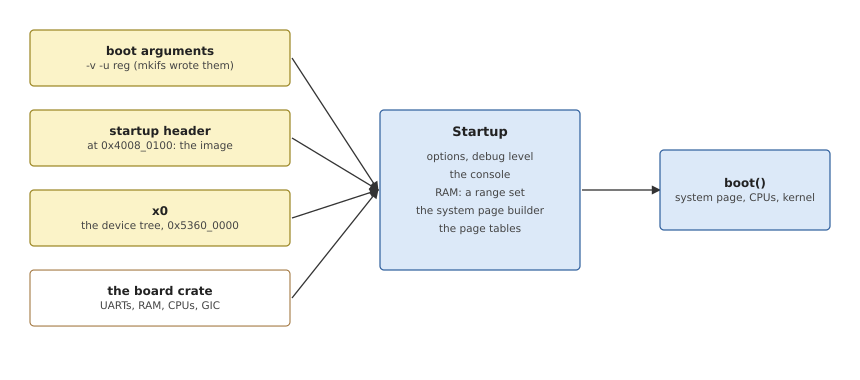

# The Startup Context

Once `_start` has a stack, control passes to Rust, and from the library
to the board. This chapter shows how the two meet: the `entry!` macro,
the `Startup` context the board works with, the command line, and the
debug console.

## From `_start` to the board's `main()`

A board crate names its `main()` with `entry!` (Listing 5.1). The macro
defines the symbol `_start` calls, `__oscraft_startup_main`, which builds
the context and passes it on.

*Listing 5.1: The `entry!` macro (`src/lib.rs`).*

```rust
{{#include ../../../src/lib.rs:entry_macro}}
```

The board's `main()` never returns: it ends by calling `Startup::boot()`,
which jumps into the kernel (Chapter 14).

## The `Startup` context

`Startup` (Listing 5.2) holds everything the library knows about the boot,
and its methods are the operations a board calls, in the order of
Table 1.1. It plays the part of QNX's startup library's global variables
(`shdr`, `debug_flag`, `lsp`, ...).



*Figure 5.1: What the `Startup` context gathers on `virt`, and what it hands to `boot()`.*

*Listing 5.2: The context, `Startup` (`src/startup.rs`).*

```rust
{{#include ../../../src/startup.rs:startup_struct}}
```

With the system page builder inside it, `Startup` takes about 13 KB, most
of startup's 16 KB stack. It is a static instead, initialized once by
`Startup::init()` and handed to `main()` as a `&'static mut`.

> [!NOTE]
> Startup has very little global state, and no locks. Until the secondary
> CPUs start, one CPU runs; when they do, the boot CPU waits for each in
> turn (Chapter 13). The few globals use a `Global<T>` wrapper
> (`src/global.rs`) whose every access is `unsafe` and says why it is safe.

## The command line

`Startup::init()` first parses the boot-arguments area that mkifs filled
in (Chapter 3). `CmdLine::parse()` (`src/cmdline.rs`) splits it into the argument and environment
strings, and finds the startup header's address in it.

The strings stay in the area; `CmdLine` only holds references to them, up
to 32 of each kind, which is plenty for a startup command line.

QNX's startup programs read their options with `getopt()`. The library
has the same parser: single-letter options, grouped
(`-vvv`), with an argument either attached (`-Dpl011`) or in the next
word (`-D pl011`).

A board parses its own options and the library's in one loop. The library's
letters are `COMMON_OPTIONS`, the same set as QNX's startup library, so an
existing build file's options are accepted; the board adds its own, such
as `-W` for a watchdog:

```rust
for opt in s.options("W:") {
    match opt {
        Opt::Flag('W', ms) => { /* the board's option */ }
        other => s.handle_common_option(&other),
    }
}
```

## The common options

The common options are those of QNX's startup library (Appendix A lists
them). Parsing only records what an option asks for, in `Options`,
and `Options::apply()` checks the syntax and
the values; its parsing is plain Rust, unit-tested on the host.

`Startup::handle_common_option()` records the option, and
acts at once on the few that the board's next steps depend on: the
verbosity and number of CPUs, the debug UART, the device tree, and the
RAM `-r` and `-j` name, which must stay out of startup's allocations
from the start. Everything else waits: the CPU options until the CPUs are
described (Chapter 10), meltdown until the page tables are built
(Chapter 11), and the rest until `boot()` (Chapter 14).

## The debug console

Startup prints on a UART: its messages with `-v`, and its crash reports.
The kernel needs a debug channel too, and on most boards it is the same
UART. QNX's startup library lets a board list the UARTs it can use, and
picks one with the `-D` option; the library does the same.

A board describes each UART as a `DebugDriver` (Listing 5.3): a name for
`-D`, a default *port* (the registers' address, and the baud rate and
input clock), startup's own driver as two functions, and the three
callouts the kernel uses for the same device (Chapter 8).

*Listing 5.3: A debug UART, `DebugDriver` (`src/console.rs`).*

```rust
{{#include ../../../src/console.rs:debug_driver}}
```

The board passes its list to `Startup::init_debug()` first thing in
`main()`, which makes the first entry the console, so that
everything after it can print. `-D` may then select another: `-D name` picks the driver by name, and `-D name.options` changes
its port too, with QNX's syntax, `base^shift.baud.clk` (any field may be
left empty, and the base is hexadecimal).

On top of the selected driver, `kprintln!` formats with Rust's
`core::fmt`, and `crash!` prints a message and stops the CPU. A panic does
the same, so a failed `assert!` in startup ends with a message on the
console rather than a silent hang.

The kernel cannot call startup's driver: startup is gone by then.
`boot()` gives it the console's device instead: it maps the device's
registers for the kernel and installs the driver's callouts in the
system page, patched with that address (Chapter 14).

## A generic UART: the PL011

Most UARTs are the board's business, but Arm's PL011 is found on many
SoCs, so the library has a driver for it (`src/pl011.rs`), which a board
lists with `pl011::driver(name, port)`. When the port has a baud rate and
a clock, startup programs the divisor; otherwise it uses the
UART as the firmware left it.

The divisor is the input clock over 16 times the baud rate, kept in 16.6
fixed point: an integer part (`IBRD`) and 6 bits of fraction (`FBRD`). For
115200 baud from 48 MHz it is 26 and 3/64.

The PL011's callouts (Listing 5.4) are those of QNX's library: wait for
room in the transmit FIFO and write, read a byte if the receive FIFO has
one, and no break detection.

*Listing 5.4: The PL011's callouts (`src/pl011.rs`).*

```rust
{{#include ../../../src/pl011.rs:pl011_callouts}}
```
