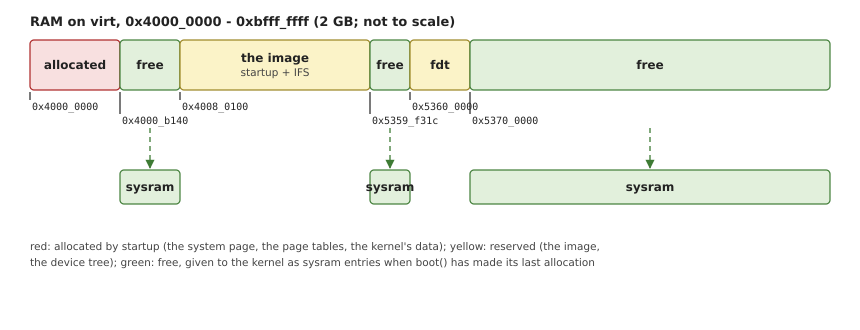

# Physical Memory

Startup needs memory of its own (for page tables, the system page, the
kernel's writable data), and it must tell the kernel which memory is free
for it to manage. This chapter shows how the library keeps track of both.

## What the kernel needs to know

QNX's kernel takes its free memory from the system page's `asinfo`
section (Chapter 7): every entry named `sysram` is RAM it may hand out.
Everything else is either not RAM, or RAM that something already uses:

- the **image**: startup itself, and the image file system, whose files
  the kernel serves straight from where they are;
- **startup's allocations**: the page tables, the system page, the
  writable parts of the kernel;
- RAM **owned by devices**: a GPU's share of RAM on some SoCs, buffers
  that firmware set up;
- RAM a board keeps for its own reasons, such as firmware code that the
  secondary CPUs still run.

The kernel never sees startup's bookkeeping: it sees the `sysram` entries
that are left at the end.

## Ranges

All of this is about sets of address ranges. `RangeSet`
keeps disjoint, half-open ranges `[start, end)` sorted, and merges ranges
that touch, so that the free RAM is always the fewest, largest ranges.

`partition_point` finds the first range that ends at or after the new
one's start; every range from there that starts at or before its end
merges into it. The array shifts to close the gap or make room. Removing
a range works the other way: it trims the ranges it overlaps, and splits
the one it falls inside.

The sets live in fixed arrays (32 ranges), since startup has no heap. A
board with more separate RAM ranges than that would stop with a message.

## Three kinds of bookkeeping

`Ram` keeps two sets, and offers three operations on them:

- `add(start, size)`: there is RAM here;
- `reserve(start, size)`: this RAM is in use for good. It leaves the free
  set, so neither startup nor the kernel gets it;
- `avoid(start, size)`: startup must not allocate from this RAM, but the
  kernel may have it. The ranges go to the second set, which only
  allocations look at.

*Avoiding* is for memory that startup needs to stay intact while it runs,
but that is free afterwards. A compressed image, for one, would be avoided
while it is unpacked. The device tree the boot loader passed is avoided
from the moment the `-u` option names it: the options are
parsed before the board reports its RAM, so it cannot be reserved yet.
`boot()` reserves it, and gives it an `fdt` asinfo entry for the drivers
that read it.

Where the device tree is depends on the boot loader. With `-u reg`, its
address is in `x0` at entry, where QEMU puts it on `virt` (Chapter 2).
With `-u arg`, the boot loader called startup like a C program,
`main(argc, argv)`, with the address as the first argument: U-Boot's `go`
command does this. `Startup::fdt_address()` reads both.

## Allocating

Startup allocates with `Ram::alloc()` (Listing 6.1): the lowest address
that fits the size and alignment, outside the avoided ranges.

*Listing 6.1: Allocating RAM, `Ram::alloc()` (`src/ram.rs`).*

```rust
{{#include ../../../src/ram.rs:ram_alloc}}
```

For each free range, the loop steps over the avoided ranges inside it and
tries each gap in turn. What it allocates is reserved: it leaves the free
set.

Allocating from the bottom keeps startup's allocations together, below
the image on most boards, and leaves the rest of RAM in one piece for the
kernel. QNX's startup library does the same.

Two variants serve other needs. `Ram::find()` only says where `alloc()`
would allocate: decompressing the image file system (Chapter 3) needs a
place for a moment, which is free again afterwards. `Ram::find_top()`
looks for the highest fit instead, for `-R`, which sets RAM aside under a
name for a driver or a debugger, at the top of RAM as QNX's startup does.

> [!WARNING]
> `alloc()` is the only way startup gets memory, and nothing frees it. Any
> allocation after `boot()` has turned the free set into `sysram` entries
> (Chapter 14) would hand the kernel memory that startup also uses.

## Adding RAM

A board reports its RAM with `Startup::add_ram()`. The
first call also builds the root of the `asinfo` tree, `memory`, which
spans the CPU's whole physical address range, and its child `below4G`.
Every call adds a `ram` entry, and reserves the image's RAM, which
the startup header gives (`ram_paddr`, `ram_size`).

The size of `memory` comes from the CPU: `ID_AA64MMFR0_EL1.PARange` gives
the number of physical address bits (44 on a Cortex-A72).

A board then reserves what its devices own and adds the names drivers
look for: a GPU's RAM, say, reserved and named, or `below1G` for DMA
engines that cannot reach further. Each is added under `ram` with
`as_add_containing()` (Chapter 7). `virt` needs neither: all its RAM is
free, and its devices reach all of it.

## From free RAM to `sysram`

When `boot()` has made its last allocation, it walks the free set and
adds each range as `sysram` under the most specific entry that contains
it. On `virt` with 2 GB the result looks like this (OsCraft's kernel
prints it at boot with `-v`; QNX's `pidin syspage=asinfo` shows the same):

```text
0x0000000000-0xfffffffffff memory
  0x0000000000-0x00ffffffff below4G
    0x0040000000-0x00bfffffff ram
      0x004000b140-0x00400800ff sysram
      0x005359f31c-0x00535fffff sysram
      0x0053700000-0x00bfffffff sysram
  0x0008000000-0x0008000fff gicd
  0x0008010000-0x0008011fff gicc
  0x0040080100-0x00400f05c3 startup
  0x00400f05c4-0x005359f31b imagefs, bootram
  0x0053600000-0x00536fffff fdt
```

The gaps in `ram` are startup's allocations, from `0x4000_0000` up to
`0x4000_b140` (the system page, the page tables), the image (startup and
the image file system, from `0x4008_0100`), and the device tree, which
QEMU put after the image, at `0x5360_0000`. Figure 7.2 draws the same
tree.



*Figure 6.1: `virt`'s RAM as startup leaves it: what it allocated, what it reserved, and the free ranges that become `sysram`.*
