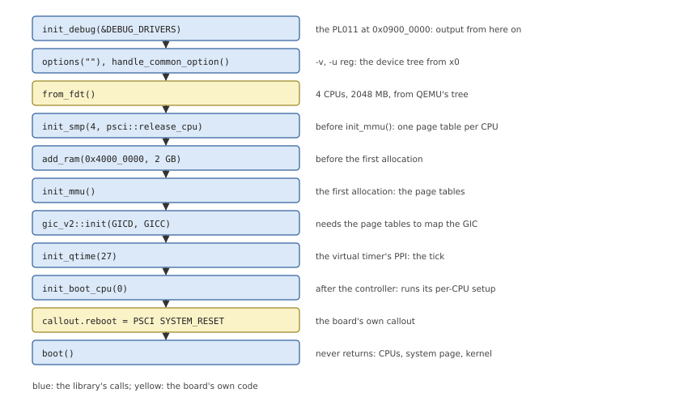

# Writing a Board Crate

The library does the generic work; a board crate supplies the facts and
the code that only the board knows. This chapter lists what a board must
provide, the order to call the library in, and how to build the result.

## What a board provides

A board crate answers the questions the library cannot: where the board's
parts are, and how to do the few things that differ between boards.
Table 15.1 lists them, with the reference board's answers.

*Table 15.1: What a board provides, and `virt`'s answers.*

| What | Library interface | QEMU `virt` (`boards/qemu-virt`) |
|---|---|---|
| Its debug UARTs, for startup and the kernel | `DebugDriver`s, `Startup::init_debug()` | The PL011 at `0x0900_0000`, 24 MHz |
| Its options | `Startup::options()` | None of its own: `-u reg` is common |
| The number of CPUs, and how to release one | `Startup::init_smp()` | From the device tree; PSCI `CPU_ON` through `hvc` |
| The RAM, and what is not free | `Startup::add_ram()`, `ram.reserve()`, `syspage.as_add_containing()` | `0x4000_0000`, its size from the device tree |
| The interrupt controller | `gic_v2::init()`, or the board's own setup with `Startup::set_cpu_intr_init()` | `gic_v2::init()` at `0x0800_0000` and `0x0801_0000` |
| The tick's interrupt | `Startup::init_qtime()` | PPI 27, the virtual timer |
| The CPUs' speed | `Startup::init_boot_cpu()` | Unknown: `virt`'s tree has no clock frequency |
| Reboot | a callout in `callout.reboot` | PSCI `SYSTEM_RESET` through `hvc` |
| Names | `syspage.add_typed_string()` | "QEMU virt", "QEMU" |
| Devices for drivers | `syspage.hwinfo` | None yet: drivers read the device tree, which startup keeps (Chapter 6) |

## The board's facts

`virt`'s fixed addresses are constants (Listing 15.1), as in QEMU's own
description of the machine. They are few because startup programs so
little of the hardware.

*Listing 15.1: `virt`'s memory map, as the board crate needs it
(`boards/qemu-virt/src/board.rs`).*

```rust
{{#include ../../../boards/qemu-virt/src/board.rs:memory_map}}
```

*Listing 15.2: The debug UART (`boards/qemu-virt/src/board.rs`).*

```rust
{{#include ../../../boards/qemu-virt/src/board.rs:debug_drivers}}
```

What the command line can change, it reads from the device tree QEMU
passes (Listing 15.3): the RAM's size, from `/memory`'s `reg` (two cells
of address, two of size: `0x4000_0000` and `0x8000_0000` for `-m 2G`),
and the number of CPUs, from the nodes whose `device_type` is `cpu`. The
library's reader (`src/fdt.rs`) walks the blob in place; nothing is
copied.

*Listing 15.3: RAM and CPUs from the device tree, `from_fdt()`
(`boards/qemu-virt/src/board.rs`).*

```rust
{{#include ../../../boards/qemu-virt/src/board.rs:from_fdt}}
```

## The order

The calls depend on each other: the page tables need the CPU count, every
allocation needs the RAM to be described, the interrupt controller needs
the page tables. Figure 15.1 is the order that works, with `virt`'s
arguments, and Listing 15.4 the board's `main()` that follows it.



*Figure 15.1: `virt`'s `main()`: the library's calls in their order, and
why each comes where it does.*

*Listing 15.4: `virt`'s `main()` (`boards/qemu-virt/src/board.rs`).*

```rust
{{#include ../../../boards/qemu-virt/src/board.rs:board_main}}
```

The constraints behind the order:

- `init_smp()` comes before `init_mmu()`, which gives each CPU a page
  table;
- every `add_ram()`, `ram.reserve()` and `ram.avoid()` comes before the
  first allocation, `init_mmu()`, or an allocation may land on memory that
  is not free;
- the interrupt controller's setup and `map_device()` need the page
  tables;
- `init_boot_cpu()` runs the controller's per-CPU setup, so it comes after
  the setup that registers it, or startup stops with "no interrupt
  controller set up";
- everything ends with `boot()`.

## Starting CPUs and rebooting: PSCI

How a board releases its CPUs is its `release()` function, which the
library calls with a CPU's number and the address to start it at
(Chapter 13). On `virt` it is one PSCI call: `CPU_ON` (function
`0xc400_0003`) with the CPU's MPIDR, the entry address and a context word,
in `x0`-`x3`, then `hvc #0`. QEMU answers it itself and starts the CPU at
EL1. The reboot callout is another call, `SYSTEM_RESET` (`0x8400_0009`),
written in assembly because the kernel runs it after startup is gone
(Listing 15.5).

*Listing 15.5: PSCI on `virt`: starting a CPU, and the reboot callout
(`boards/qemu-virt/src/psci.rs`).*

```rust
{{#include ../../../boards/qemu-virt/src/psci.rs:psci_calls}}
```

A board on real hardware calls the same functions with `smc` when its
firmware runs at EL3 (the device tree's `/psci/method` says which), or
uses another mechanism entirely, such as a spin table: the library does
not care.

## The callouts a board writes

A board writes callouts with `callout!` (Chapter 8) for its own devices:
its debug UART's `display_char`, `poll_key` and `break_detect` (unless
the UART is a PL011, for which the library has them), and usually a
reboot. They follow the rules of Chapter 8: patch the device's virtual
address in, use nothing but the arguments, the system page and the
patched values.

> [!TIP]
> Write the startup driver for the UART first, and check that startup's
> own messages appear with `-v`; then write the callouts, which do the
> same in assembly. A board that prints nothing after "Starting next
> program" usually has a broken `display_char` callout.

## Building

A board crate is a `no_std` static library (`crate-type = ["staticlib"]`)
for `aarch64-unknown-none-softfloat`. The startup program mkifs takes is a
partial link of it, with the library's linker script (Chapter 3); for
`virt`, OsCraft's build does:

```text
cargo build -p startup-qemu-virt --target aarch64-unknown-none-softfloat --release
ld.lld -r -u _start -T startup.ld -o startup-qemu-virt \
    target/aarch64-unknown-none-softfloat/release/libstartup_qemu_virt.a
```

mkifs then finds `startup-qemu-virt` through its search path, before
QNX's own startup of the same name in the SDP, and the build file names
it in its bootstrap section (Listing 3.1).

An interrupt controller is the board's when it is not a GICv2, the one
the library has: the board describes it with `intrinfo` entries and
callouts, sets `smp.send_ipi`, and registers each CPU's part of the setup
with `Startup::set_cpu_intr_init()` before `init_boot_cpu()` (Chapter 9).
A GICv3, which `virt` also offers (`gic-version=3`), is better added to
the library, next to `src/arch/aarch64/gic_v2.rs`.
